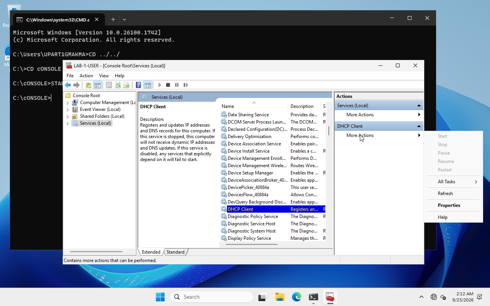

# Ход работы

## Цель работы

Собрать MMC-консоль для администрирования Windows Server, настроить локальные учётные записи и IPv4, а также подготовить и запустить сценарии CMD и PowerShell.

## Среда выполнения

Работа выполнена в Windows Server 2025 Standard Evaluation с Desktop Experience. Сервер запущен в виртуальной машине Proxmox VE/KVM. Для лабораторной сети использован отдельный адаптер `Lab-Isolated`.

## 1. MMC-консоль

В `mmc.exe` добавлены оснастки локального компьютера:

1. `Computer Management`;
2. `Event Viewer`;
3. `Shared Folders`;
4. `Services`.


Консоль сохранена по пути:

```text
C:\Console\lab-1.msc
```


В корне консоли создано представление задач `Tools`. В нём добавлены `Network Connections` и задачи запуска всех четырёх сценариев.


## 2. Локальный пользователь и группа

Созданы объекты с идентификатором команды `GMAKMA`:

| Объект | Имя |
|---|---|
| Локальный пользователь | `UPart1GMAKMA` |
| Локальная группа | `GPart1GMAKMA` |

Пользователь добавлен в группу `GPart1GMAKMA`.


## 3. Настройка IPv4

Статические параметры заданы только на изолированном адаптере `Lab-Isolated`. Основной адаптер виртуальной машины не изменялся.

| Параметр | Значение |
|---|---|
| IPv4-адрес | `192.168.1.10` |
| Маска подсети | `255.255.255.0` (`/24`) |
| Основной шлюз | `192.168.1.1` |
| DNS-сервер | `8.8.8.8` |


## 4. Сценарии CMD

### `script21.cmd`

Сценарий принимает строку из четырёх символов, создаёт пользователя `UPart2<строка>` и группу `GPart2<строка>`, добавляет пользователя в группу и активирует его.

```bat
@echo off
setlocal EnableExtensions
set /p "STR=Enter exactly 4 characters without spaces: "
if "%STR:~3,1%"=="" goto invalid
if not "%STR:~4,1%"=="" goto invalid
for /f "tokens=* delims= " %%A in ("%STR%") do if not "%%A"=="%STR%" goto invalid
net user "UPart2%STR%" /add /active:yes
net localgroup "GPart2%STR%" /add
net localgroup "GPart2%STR%" "UPart2%STR%" /add
echo User and group created.
goto end
:invalid
echo Input must contain exactly 4 non-space characters.
:end
endlocal
```


Исходный файл: [`scripts/script21.cmd`](scripts/script21.cmd).

### `script22.cmd`

Сценарий принимает `Auto` или `Manual`. В режиме `Auto` он включает DHCP для IPv4 и DNS. В режиме `Manual` задаёт параметры лабораторной сети через `netsh`.

```bat
@echo off
setlocal EnableExtensions
set /p "MODE=Enter Auto or Manual: "
if /I "%MODE%"=="Auto" (
  netsh interface ipv4 set address name="Lab-Isolated" source=dhcp
  netsh interface ipv4 set dnsservers name="Lab-Isolated" source=dhcp
  echo DHCP enabled for IPv4 and DNS.
) else if /I "%MODE%"=="Manual" (
  netsh interface ipv4 set address name="Lab-Isolated" static 192.168.1.10 255.255.255.0 192.168.1.1
  netsh interface ipv4 set dnsservers name="Lab-Isolated" static 8.8.8.8 primary validate=no
  echo Static IPv4 configuration applied.
) else (
  echo Allowed values: Auto or Manual.
)
endlocal
```


Исходный файл: [`scripts/script22.cmd`](scripts/script22.cmd).

## 5. Сценарии PowerShell

### `script31.ps1`

Сценарий принимает четыре символа, создаёт пользователя `UPart3<строка>` и группу `GPart3<строка>`, добавляет пользователя в группу и включает учётную запись.

```powershell
$str = Read-Host 'Enter exactly 4 characters without spaces'
if ($str -notmatch '^[^\s]{4}$') {
    Write-Error 'Input must contain exactly 4 non-space characters.'
    exit 1
}
$userName = "UPart3$str"
$groupName = "GPart3$str"
New-LocalUser -Name $userName -NoPassword -AccountNeverExpires -Description 'Lab 1 local user'
New-LocalGroup -Name $groupName -Description 'Lab 1 local group'
Add-LocalGroupMember -Group $groupName -Member $userName
Enable-LocalUser -Name $userName
Write-Host "Created $userName and $groupName; membership configured."
```


Исходный файл: [`scripts/script31.ps1`](scripts/script31.ps1).

### `script32.ps1`

Сценарий работает только с `Lab-Isolated`. В режиме `Auto` он включает DHCP, в режиме `Manual` задаёт статический IPv4-адрес, шлюз и DNS.

```powershell
$mode = Read-Host 'Enter Auto or Manual'
$adapter = Get-NetAdapter -Name 'Lab-Isolated' -ErrorAction Stop
if ($mode -ieq 'Auto') {
    Set-NetIPInterface -InterfaceIndex $adapter.ifIndex -Dhcp Enabled
    Set-DnsClientServerAddress -InterfaceIndex $adapter.ifIndex -ResetServerAddresses
    Write-Host 'DHCP enabled for IPv4 and DNS.'
} elseif ($mode -ieq 'Manual') {
    Get-NetRoute -InterfaceIndex $adapter.ifIndex -DestinationPrefix '0.0.0.0/0' -ErrorAction SilentlyContinue | Remove-NetRoute -Confirm:$false
    Get-NetIPAddress -InterfaceIndex $adapter.ifIndex -AddressFamily IPv4 -ErrorAction SilentlyContinue | Remove-NetIPAddress -Confirm:$false
    New-NetIPAddress -InterfaceIndex $adapter.ifIndex -IPAddress 192.168.1.10 -PrefixLength 24 -DefaultGateway 192.168.1.1
    Set-DnsClientServerAddress -InterfaceIndex $adapter.ifIndex -ServerAddresses 8.8.8.8
    Write-Host 'Static IPv4 configuration applied.'
} else {
    Write-Error 'Allowed values: Auto or Manual.'
}
```


Исходный файл: [`scripts/script32.ps1`](scripts/script32.ps1).

## 6. Проверка обычного пользователя

Создана ограниченная копия консоли:

```text
C:\Console\LAB-1-USER.msc
```

Она открыта под `UPart1GMAKMA`. В разделе служб для `DHCP Client` команды запуска, остановки, приостановки и продолжения недоступны. Обычный пользователь может открыть консоль, но не может менять её структуру или управлять системной службой.



## Контрольные вопросы

### В какие группы вошёл пользователь после части 1?

У пользователя есть индивидуальная локальная группа с тем же именем. В рамках работы пользователь добавлен в `GPart1GMAKMA`. Остальные группы определяются локальной политикой Windows.

### Чем различаются CMD и PowerShell-сценарии?

CMD использует текстовые команды `net` и `netsh`, ввод через `set /p` и ветвление `if`. PowerShell работает с cmdlet-ами и объектами, например `New-LocalUser`, `Get-NetAdapter` и `New-NetIPAddress`. Поэтому в PowerShell удобнее получать параметры конкретного адаптера и обрабатывать ошибки.

### Как добавить несколько IPv4-адресов адаптеру?

В GUI: свойства IPv4 -> **Advanced** -> **IP addresses** -> **Add**. В PowerShell для одного `InterfaceIndex` можно несколько раз вызвать `New-NetIPAddress`. В `netsh` используется команда `add address`.

### Как управлять удалённым компьютером через оснастку?

В подходящей оснастке MMC нужно выбрать **Connect to another computer**, указать имя или IP удалённого компьютера и войти с учётной записью с административными правами. Для подключения нужны сетевой доступ, работающие RPC/WMI, правила Windows Firewall и права на удалённой машине.

## Вывод

Собрана MMC-консоль с требуемыми оснастками и задачами. Созданы локальный пользователь и группа, настроен изолированный IPv4-адаптер, подготовлены и проверены CMD- и PowerShell-сценарии. Ограниченная копия MMC подтверждает, что обычный пользователь не может управлять системной службой.
