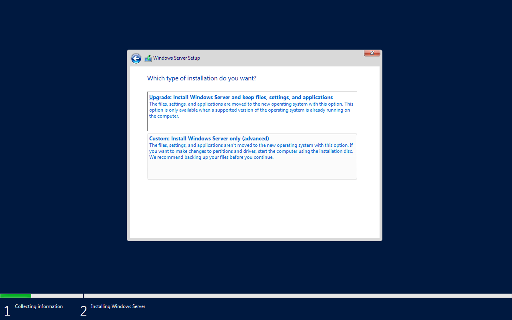
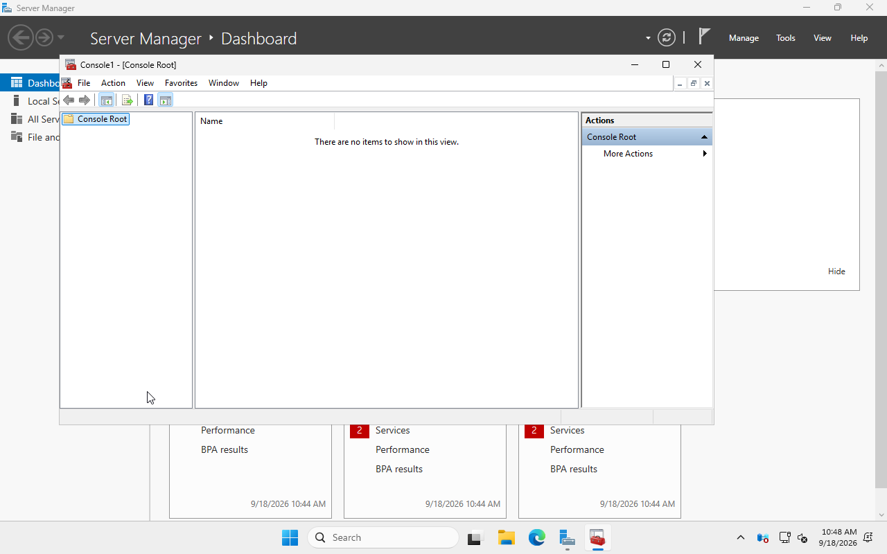
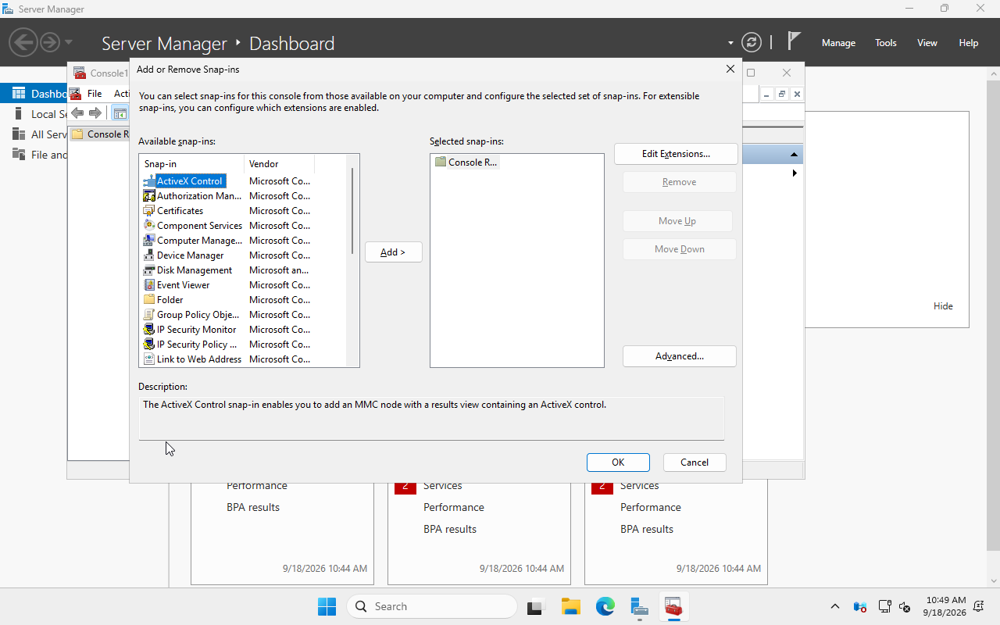
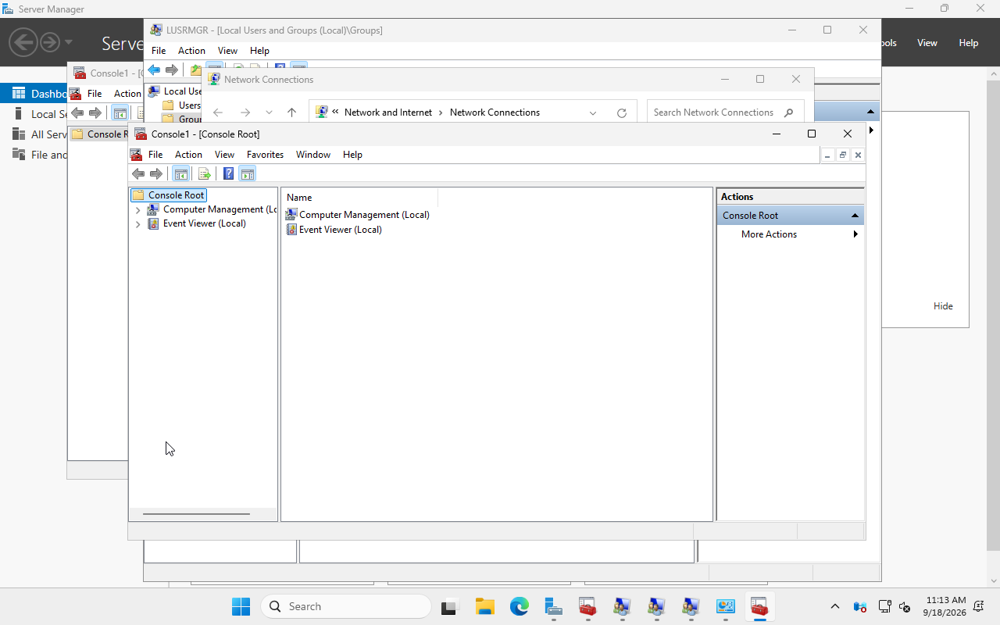
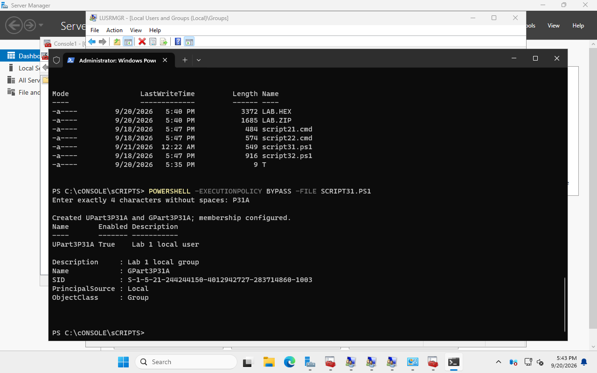
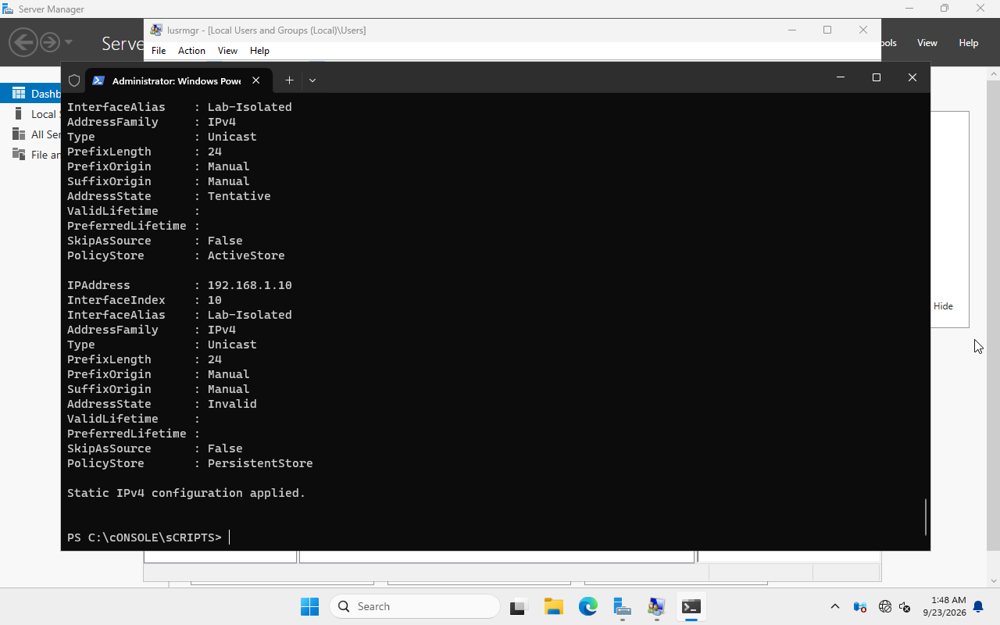

# Лабораторная работа №1
## Инструменты управления Windows Server

> Титульный лист добавляется перед экспортом в PDF.

## Цель работы

Научиться собирать MMC-консоль, управлять локальными учётными записями и IPv4-настройками Windows Server, а также автоматизировать эти действия в CMD и PowerShell.

## Участники

- Кургут Михаил Александрович;
- Гунин Михаил Александрович.

Идентификатор команды для объектов лабораторной работы: `GMAKMA`.

## Среда выполнения

| Параметр | Значение |
|---|---|
| Гипервизор | Proxmox VE / KVM |
| Виртуальная машина | `win-labs` (VM 104) |
| Операционная система | Windows Server 2025 Standard Evaluation, Desktop Experience |
| Системный диск | SATA, 64 GiB |
| Установочный образ | Windows Server 2025 Evaluation |
| Вспомогательный ISO | `virtio-win-0.1.302.iso` |
| Инициалы команды | `GMAKMA` |

## Исходное задание

Полный текст задания приведён в отдельном файле: [lab-1-task.md](lab-1-task.md).

Работа включает три части:

1. создание консоли MMC и управление локальными объектами;
2. подготовку двух CMD-сценариев;
3. подготовку двух PowerShell-сценариев.

---

# Ход работы

## 1. Установка и первичная подготовка Windows Server

Для работы использовалась отдельная VM `win-labs`. Сначала системный диск подключили через VirtIO SCSI, но установщик Windows не видел его без драйвера контроллера. Поэтому пустой диск перевели на SATA. После этого установщик увидел диск объёмом 64 GiB.

### 1.1. Запуск установщика

На первом экране оставлены английские региональные параметры: ISO Windows Server англоязычный, и названия оснасток в отчёте указаны так же.


### 1.2. Выбор редакции ОС

Выбрана **Windows Server 2025 Standard Evaluation (Desktop Experience)**. Server Core здесь не подходит: по заданию нужны MMC, оснастки и графические диалоги.


### 1.3. Лицензионные условия и тип установки

Приняты условия evaluation-версии Windows Server; выбран вариант чистой установки на пустой виртуальный диск.



### 1.4. Выбор диска

Установщик обнаружил неразмеченный SATA-диск на 64 GiB. После выбора диска Windows сама создала служебные EFI/MSR/Recovery-разделы.


### 1.5. Ход установки и первая загрузка

После копирования файлов и перезагрузки завершена начальная настройка Windows Server. Затем выполнен вход под локальной учётной записью `Administrator`.


---

## 2. Часть 1. Консоль MMC

### 2.1. Создание консоли

Запущена `mmc.exe`, затем открыт диалог **Add or Remove Snap-ins**.





### 2.2. Добавленные оснастки

В итоговую консоль добавлены оснастки локального компьютера:

1. **Computer Management (Local)** — комплексная оснастка управления компьютером, в том числе локальными пользователями и группами.
2. **Event Viewer (Local)** — просмотр системных журналов Windows.
3. **Shared Folders (Local)** — управление общими ресурсами, сеансами и открытыми файлами.
4. **Services (Local)** — просмотр состояния и запуск/остановка служб.

Во время настройки использовались следующие окна:




На снимке виден итоговый состав консоли. Лишние оснастки, добавленные при первых попытках настройки, удалены.


### 2.3. Папка задач `Tools`

В корне MMC создано представление задач `Tools`. В нём есть кнопка **Network Connections**, которая запускает `control.exe` с параметром `ncpa.cpl`.


После исправления параметра задача открыла окно **Network Connections**.


> В `Tools` добавлены отдельные задачи для всех четырёх сценариев. Их итоговый вид показан в разделе 6.

### 2.4. Сохранение MMC-консоли

Консоль сохранена по пути:

```text
C:\Console\lab-1.msc
```


---

## 3. Локальные учётные записи и группы

Для первой части созданы объекты с идентификатором команды:

| Тип объекта | Имя |
|---|---|
| Локальный пользователь | `UPart1GMAKMA` |
| Локальная группа | `GPart1GMAKMA` |

Пользователь создан как активная локальная учётная запись. Команда `net localgroup GPart1GMAKMA` показывает, что в группе есть `UPart1GMAKMA`.


---

## 4. Сетевая настройка

По заданию на интерфейсе Windows Server должны быть такие параметры:

| Параметр | Значение |
|---|---|
| IPv4-адрес | `192.168.1.10` |
| Маска | `255.255.255.0` (`/24`) |
| Основной шлюз | `192.168.1.1` |
| DNS-сервер | `8.8.8.8` |

Окно Network Connections используется для перехода к свойствам адаптера `Ethernet`.


Статическая настройка применена только к отдельному адаптеру `Lab-Isolated`, подключённому к изолированному bridge Proxmox `vmbr1_lab`. Основной `Ethernet` не менялся.

`Get-NetIPConfiguration` подтвердил следующие параметры:

| Параметр | Значение |
|---|---|
| IPv4-адрес | `192.168.1.10` |
| Префикс | `/24` |
| Основной шлюз | `192.168.1.1` |
| DNS-сервер | `8.8.8.8` |


---

## 5. Часть 2. Сценарии CMD

### 5.1. `script21.cmd`

Сценарий принимает строку из четырёх символов без пробелов. По ней он создаёт локального пользователя и группу с префиксами `UPart2` и `GPart2`, добавляет пользователя в группу и активирует его.

```bat
@echo off
setlocal EnableExtensions
set /p "STR=Enter exactly 4 characters without spaces: "
if "%STR:~3,1%"=="" goto invalid
if not "%STR:~4,1%"=="" goto invalid
for /f "tokens=* delims= " %%A in ("%STR%") do if not "%%A"=="%STR%" goto invalid
net user "UPart2%STR%" /add /active:yes
net localgroup "GPart2%STR%" /add
net localgroup "GPart2%STR%" "UPart2%STR%" /add
echo User and group created.
goto end
:invalid
echo Input must contain exactly 4 non-space characters.
:end
endlocal
```

Исходный файл: [`scripts/script21.cmd`](scripts/script21.cmd).

В Windows Server сценарий запущен с вводом `C21A`; на экране есть подтверждение создания пользователя и группы.


### 5.2. `script22.cmd`

Сценарий принимает `Auto` или `Manual`. В режиме `Auto` он включает DHCP для IPv4 и DNS. В режиме `Manual` задаёт параметры лабораторной через `netsh`.

```bat
@echo off
setlocal EnableExtensions
set /p "MODE=Enter Auto or Manual: "
if /I "%MODE%"=="Auto" (
  netsh interface ipv4 set address name="Lab-Isolated" source=dhcp
  netsh interface ipv4 set dnsservers name="Lab-Isolated" source=dhcp
  echo DHCP enabled for IPv4 and DNS.
) else if /I "%MODE%"=="Manual" (
  netsh interface ipv4 set address name="Lab-Isolated" static 192.168.1.10 255.255.255.0 192.168.1.1
  netsh interface ipv4 set dnsservers name="Lab-Isolated" static 8.8.8.8 primary validate=no
  echo Static IPv4 configuration applied.
) else (
  echo Allowed values: Auto or Manual.
)
endlocal
```

После добавления `validate=no` в команду `netsh` сценарий снова запущен в режиме `Manual`. Ошибка настройки DNS больше не появилась.


Исходный файл: [`scripts/script22.cmd`](scripts/script22.cmd).

---

## 6. Часть 3. Сценарии PowerShell

### 6.1. `script31.ps1`

Сценарий принимает четыре символа, создаёт `UPart3STR` и `GPart3STR`, добавляет пользователя в группу и активирует его. Для учебной учётной записи используется `-NoPassword`, поэтому пароль в исходнике не хранится.

```powershell
$str = Read-Host 'Enter exactly 4 characters without spaces'
if ($str -notmatch '^[^\s]{4}$') {
    Write-Error 'Input must contain exactly 4 non-space characters.'
    exit 1
}
$userName = "UPart3$str"
$groupName = "GPart3$str"
New-LocalUser -Name $userName -NoPassword -AccountNeverExpires -Description 'Lab 1 local user'
New-LocalGroup -Name $groupName -Description 'Lab 1 local group'
Add-LocalGroupMember -Group $groupName -Member $userName
Enable-LocalUser -Name $userName
Write-Host "Created $userName and $groupName; membership configured."
```

Сценарий запущен в Windows Server с вводом `P31A`. Созданы `UPart3P31A` и `GPart3P31A`.



Исходный файл: [`scripts/script31.ps1`](scripts/script31.ps1).

### 6.2. `script32.ps1`

Сценарий работает только с изолированным адаптером `Lab-Isolated`. Он принимает `Auto` или `Manual`, включает DHCP либо задаёт IPv4-адрес, шлюз и DNS. Основной `Ethernet` не затрагивается.

```powershell
$mode = Read-Host 'Enter Auto or Manual'
$adapter = Get-NetAdapter -Name 'Lab-Isolated' -ErrorAction Stop
if ($mode -ieq 'Auto') {
    Set-NetIPInterface -InterfaceIndex $adapter.ifIndex -Dhcp Enabled
    Set-DnsClientServerAddress -InterfaceIndex $adapter.ifIndex -ResetServerAddresses
} elseif ($mode -ieq 'Manual') {
    Get-NetRoute -InterfaceIndex $adapter.ifIndex -DestinationPrefix '0.0.0.0/0' -ErrorAction SilentlyContinue | Remove-NetRoute -Confirm:$false
    Get-NetIPAddress -InterfaceIndex $adapter.ifIndex -AddressFamily IPv4 -ErrorAction SilentlyContinue | Remove-NetIPAddress -Confirm:$false
    New-NetIPAddress -InterfaceIndex $adapter.ifIndex -IPAddress 192.168.1.10 -PrefixLength 24 -DefaultGateway 192.168.1.1
    Set-DnsClientServerAddress -InterfaceIndex $adapter.ifIndex -ServerAddresses 8.8.8.8
} else {
    Write-Error 'Allowed values: Auto or Manual.'
}
```

Исходный файл: [`scripts/script32.ps1`](scripts/script32.ps1).

Перед повторным добавлением IPv4-адреса сценарий удаляет прежний default route на `Lab-Isolated`. Повторный запуск в `Manual` завершился сообщением `Static IPv4 configuration applied.`



> Изолированный bridge не подключён к внешнему маршрутизатору. Поэтому Windows может показывать адрес как `Tentative` или `Invalid`. Параметры на `Lab-Isolated` при этом применены, а основной адаптер не изменён.

> Все четыре сценария переданы в Windows и выполнены через консоль. Для каждого сценария есть отдельная задача в `Tools`; итоговая консоль сохранена.


---

# Проверка артефактов

| Критерий | Статус | Подтверждение |
|---|---|---|
| Windows Server с Desktop Experience | подтверждён | `01-setup-language.png`, `15-server-desktop.png` |
| Локальный пользователь `UPart1GMAKMA` | подтверждён | `22-local-user-created.png` |
| Локальная группа `GPart1GMAKMA` и членство пользователя | подтверждено | `23-local-group-created.png`, `37-group-membership.png` |
| Состав MMC: Computer Management, Event Viewer, Shared Folders, Services | подтверждён | `30-mmc-final-snapins.png` |
| Сохранение MMC в `C:\Console\lab-1.msc` | подтверждён | `31-mmc-saved.png` |
| `Tools`, Network Connections и четыре сценария | подтверждено | `34-mmc-tools-overview.png`, `35-tools-network-connections.png`, `66-mmc-tools-all-tasks.png` |
| Четыре исходных сценария переданы в гостевую ОС | подтверждено | `33-guest-script-directory.png` |
| Запуск `script21.cmd` в Windows | подтверждён | `41-script21-cmd-success.png` |
| Запуск `script31.ps1` в Windows | подтверждён | `44-script31-powershell-success.png` |
| Статический IPv4 на `Lab-Isolated` | подтверждён | `40-ipconfig-static.png`: `192.168.1.10/24`, gateway `192.168.1.1`, DNS `8.8.8.8` |
| Задачи для `script21.cmd`, `script22.cmd`, `script31.ps1`, `script32.ps1` в `Tools` | подтверждены | `66-mmc-tools-all-tasks.png`: в Taskpad отображены все четыре задачи и Network Connections; консоль сохранена |
| Запуск `script22.cmd` | подтверждён | `53-script22-cmd-success.png`: финальный `Manual`-запуск без DNS-ошибки |
| Запуск `script32.ps1` | подтверждён | `57-script32-powershell-success.png`: `Static IPv4 configuration applied.` |
| Вход обычным пользователем, перезапуск службы, защищённая копия MMC | подтверждён с ограничением прав | `62-upart1-second-login.png`, `63-upart1-protected-console.png`, `64-upart1-dhcp-actions-disabled.png`: открыта `C:\Console\LAB-1-USER.msc`; для DHCP Client команды Start/Stop/Pause/Resume отключены для обычного пользователя |

---

# Контрольные вопросы

## 1. В какие группы вошёл пользователь после части 1?

После создания у пользователя есть индивидуальная локальная группа с тем же именем. Пользователь также включён в рабочую группу `GPart1GMAKMA`. Стандартные группы зависят от локальной политики VM; их можно посмотреть в свойствах пользователя.

## 2. Чем различаются CMD и PowerShell-сценарии?

CMD использует текстовые команды `net` и `netsh`, ввод `set /p` и ветвление `if`. PowerShell работает с объектами и cmdlet-ами, например `New-LocalUser`, `Get-NetAdapter` и `New-NetIPAddress`. Поэтому в PowerShell проще проверять ввод, обрабатывать ошибки и выбирать нужный адаптер.

## 3. Как добавить несколько IPv4-адресов адаптеру?

В GUI: свойства IPv4 -> **Advanced** -> **IP addresses** -> **Add**. В PowerShell можно вызвать `New-NetIPAddress` несколько раз для одного `InterfaceIndex`. В `netsh` используется `add address` для соответствующего интерфейса.

## 4. Как управлять удалённым компьютером через оснастку?

В подходящей оснастке MMC нужно выбрать **Connect to another computer**, указать имя или IP удалённого компьютера и войти с учётной записью, у которой есть административные права. Нужны сетевой доступ, работающие RPC/WMI, разрешающие правила Windows Firewall и права на удалённой машине.

---

# Приложения

- [Текст задания](lab-1-task.md)
- [`script21.cmd`](scripts/script21.cmd)
- [`script22.cmd`](scripts/script22.cmd)
- [`script31.ps1`](scripts/script31.ps1)
- [`script32.ps1`](scripts/script32.ps1)
