# Практическая работа №1: основные инструментальные средства управления Windows Server

## Цель работы

Собрать пользовательскую консоль Microsoft Management Console (MMC), создать локальные учётные объекты, настроить учебный IPv4-адаптер и подготовить эквивалентные сценарии CMD и PowerShell. Отдельно проверить, что обычный пользователь может открыть ограниченную консоль, но не получает административных прав на управление системной службой.

## Среда и границы работы

| Параметр | Значение |
|---|---|
| ОС | Windows Server 2025 Standard Evaluation, Desktop Experience |
| Гипервизор | Proxmox VE / KVM |
| Виртуальная машина повторной демонстрации | VM 107 |
| Администраторская учётная запись | локальная `Administrator` |
| Учебный пользователь | `UPart1GMAKMA` |
| Учебная группа | `GPart1GMAKMA` |
| Учебный интерфейс | `Lab-Isolated` |

Виртуальная машина имеет два адаптера. Для задания используется только `Lab-Isolated`, подключённый к изолированному bridge Proxmox. Рабочий адаптер `Ethernet` не переопределялся учебными статическими параметрами: это не позволяет потерять доступ к VM.

Ниже объединены два вида доказательств:

1. результаты выполнения лабораторной и запуска сценариев;
2. повторный пошаговый показ интерфейса на VM 107. Новые снимки `67`--`85` показывают именно экраны, из которых выполняются действия. Они нужны, чтобы по отчёту можно было повторить работу с нуля, а не только увидеть финальные состояния.

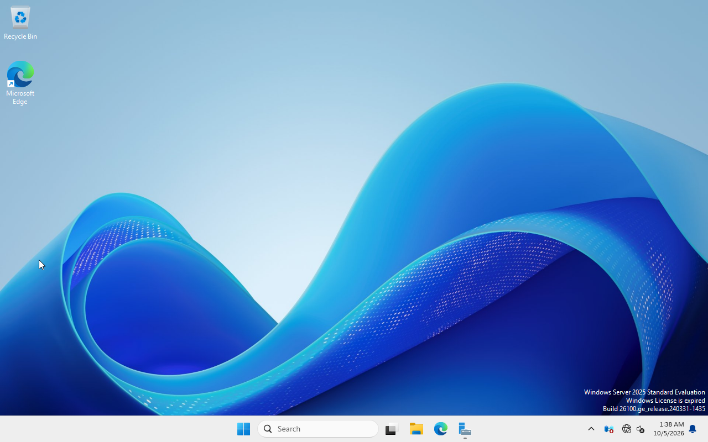

## Карта соответствия заданию

| Требование обновлённого задания | Где показано в отчёте |
|---|---|
| Запустить MMC и добавить четыре оснастки | раздел 1, снимки 69--76 и 79 |
| Проверить доступ к оснасткам и службе DNS Client | раздел 1.4; оснастки доступны из итоговой консоли |
| Создать `Tools` и пять задач | раздел 2, снимки 34--35 и 66 |
| Создать `UPart1GMAKMA` и `GPart1GMAKMA`, задать членство | раздел 3, снимки 80--82 и 22--23, 37 |
| Настроить IPv4 на отдельном адаптере | раздел 4, снимки 84, 40 и 24 |
| Подготовить два CMD-сценария | раздел 5, снимки 85, 41 и 53 |
| Подготовить два PowerShell-сценария | раздел 6, снимки 85, 44 и 57 |
| Добавить сценарии в `Tools` | раздел 7, снимок 66 |
| Ограничить MMC для обычного пользователя и проверить права | раздел 8, снимки 61, 63 и 64 |

---

## 1. Создание основной MMC-консоли

### 1.1. Запуск пустой консоли

**Что делаем.** Открываем `Win + R`, вводим `mmc` и подтверждаем запуск. Появляется пустая консоль с единственным узлом `Console Root`.

**Зачем.** MMC является контейнером. Сама по себе она не администрирует Windows: нужные возможности появляются после добавления оснасток.

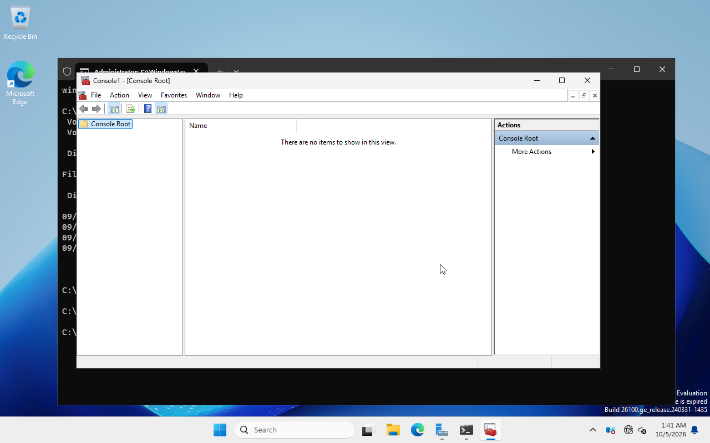

### 1.2. Открытие окна добавления оснасток

**Что делаем.** В окне MMC выбираем **File -> Add/Remove Snap-in...**. Альтернативный способ -- `Ctrl + M`.

**Зачем.** В этом окне выбираются компоненты, которые войдут именно в созданную консоль. Это отличается от запуска отдельных системных оснасток через `Win + R`.


### 1.3. Добавление четырёх оснасток

В левом списке `Available snap-ins` по очереди выбираем оснастку, нажимаем **Add >**, в окне выбора компьютера оставляем **Local computer**, затем нажимаем **Finish**. В правой части `Selected snap-ins` должна сформироваться следующая структура:

1. `Computer Management`;
2. `Event Viewer`;
3. `Shared Folders`;
4. `Services`.

#### Computer Management

**Путь.** `Add/Remove Snap-ins -> Computer Management -> Add -> Local computer -> Finish`.

**Назначение.** Комплексная оснастка для локального компьютера: локальные пользователи и группы, диспетчер устройств, журналы, диски и другие разделы.


#### Event Viewer

**Путь.** `Add/Remove Snap-ins -> Event Viewer -> Add -> Local computer -> OK`.

**Назначение.** Просмотр системных журналов и ошибок служб.

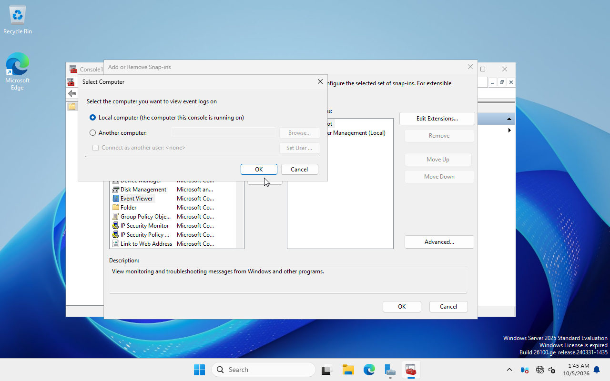

#### Shared Folders

**Путь.** `Add/Remove Snap-ins -> Shared Folders -> Add -> Local computer -> All -> Finish`.

**Назначение.** Просмотр общих папок, открытых файлов и сессий.


#### Services

**Путь.** `Add/Remove Snap-ins -> Services -> Add -> Local computer -> Finish`.

**Назначение.** Просмотр состояния и управление локальными службами Windows.


### 1.4. Проверка состава и работы оснасток

Перед нажатием **OK** проверяем правую область `Selected snap-ins`: в ней должны быть только четыре оснастки, перечисленные выше. Лишние оснастки не добавляем.

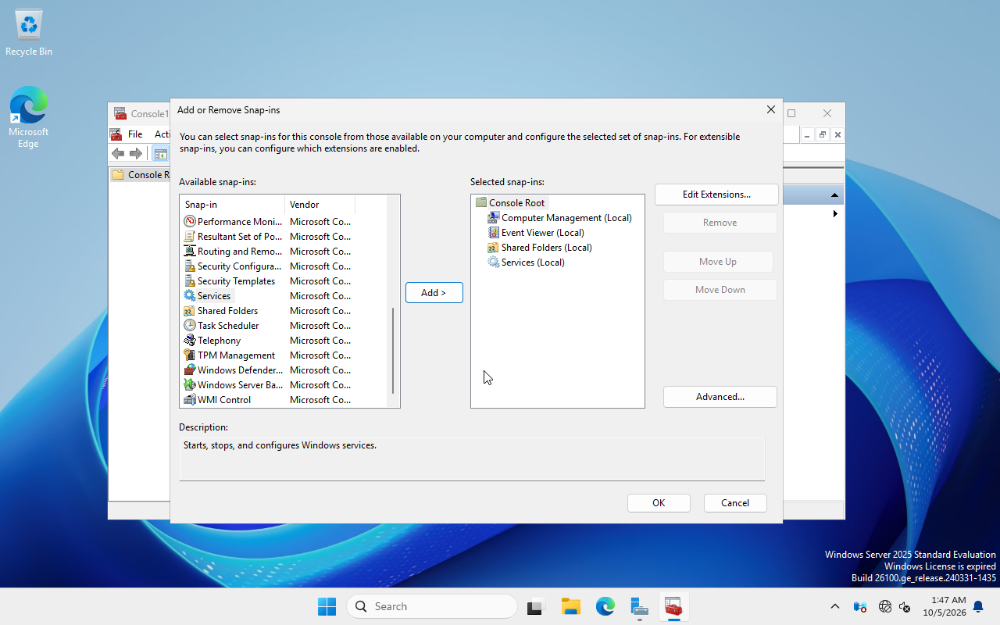

После закрытия окна раскрываем каждый узел. Это проверяет, что оснастка добавлена не только формально, а действительно открывает данные локального компьютера. В `Services` находим `DNS Client` и проверяем его состояние. Если службы DNS Client нет в конкретной сборке или её состояние нельзя надёжно показать, для демонстрации ограничений используется `DHCP Client` -- системная служба, присутствующая в VM.

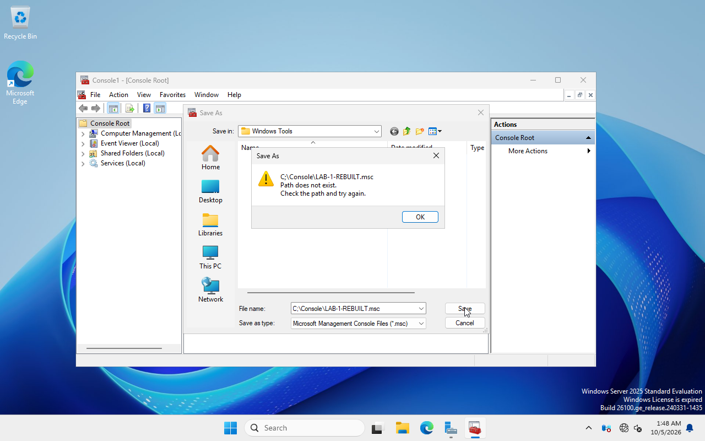

### 1.5. Сохранение основной консоли

**Что делаем.** Выбираем **File -> Save As...**, указываем каталог `C:\Console` и имя файла основной консоли. В штатном результате лабораторной используется:

```text
C:\Console\lab-1.msc
```

**Зачем.** После сохранения пользователь открывает именно подготовленную структуру, а не заново собранную временную `Console1`.


На VM 107 в ходе повторного показа создана дополнительная демонстрационная копия `C:\Console\LAB-1-REBUILT.msc`; она содержит те же четыре требуемые оснастки и не заменяет зафиксированный результат задания.

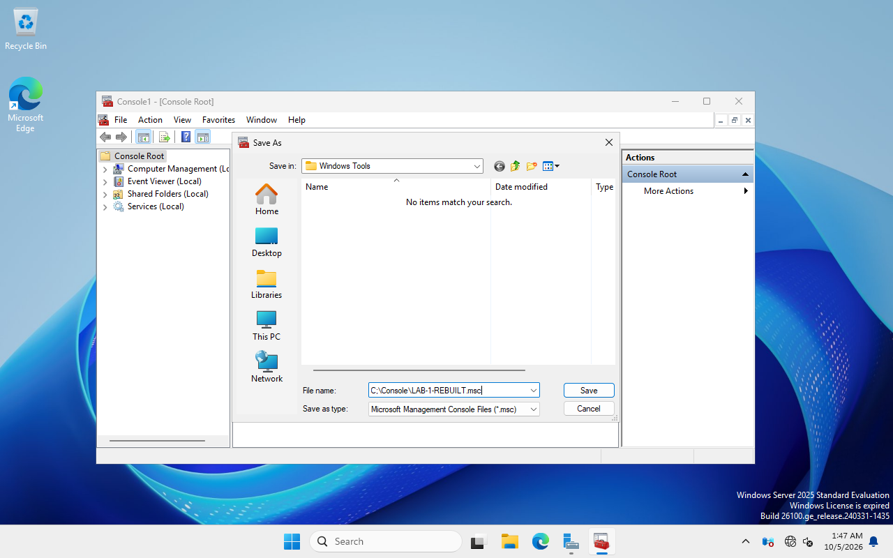

Первоначально сохранённая основная консоль также зафиксирована в результатах выполнения:


---

## 2. Создание раздела Tools и задач MMC

### 2.1. Создание папки Tools

**Что делаем.** В корне основной консоли щёлкаем правой кнопкой мыши и выбираем **New Window from Here** или создаём taskpad/папку задач способом, предусмотренным версией MMC. Имя узла -- `Tools`.

**Зачем.** `Tools` собирает часто используемые действия в одном месте, поэтому для показа на защите не требуется искать каждый сценарий по файловой системе.

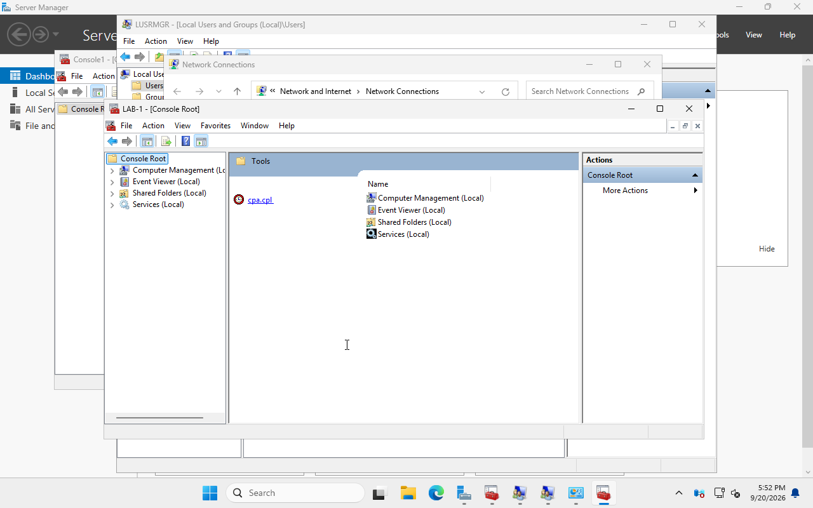

### 2.2. Задача Network Connections

**Что делаем.** В `Tools` создаём задачу запуска окна сетевых адаптеров. Целевой путь: `ncpa.cpl`.

**Проверка.** Нажатие задачи открывает `Network Connections`.


### 2.3. Четыре задачи запуска сценариев

В `Tools` добавляем ещё четыре задачи. Каждая задача запускает конкретный файл из `C:\Console\Scripts`:

| Задача в MMC | Целевой файл | Что проверяется |
|---|---|---|
| `SCRIPT21.CMD` | `C:\Console\Scripts\script21.cmd` | создание локального пользователя и группы средствами CMD |
| `SCRIPT22.CMD` | `C:\Console\Scripts\script22.cmd` | DHCP или статический IPv4 средствами `netsh` |
| `SCRIPT31.PS1` | `C:\Console\Scripts\script31.ps1` | создание локального пользователя и группы средствами PowerShell |
| `SCRIPT32.PS1` | `C:\Console\Scripts\script32.ps1` | DHCP или статический IPv4 средствами PowerShell |

При создании задачи указываем понятное имя, путь к файлу и рабочую папку `C:\Console\Scripts`. Для `.ps1` при необходимости используем запуск через `powershell.exe` с параметром `-ExecutionPolicy Bypass -File`, чтобы выполнение не зависело от политики для интерактивной сессии.

**Итог.** В `Tools` доступны Network Connections и четыре сценария.


---

## 3. Локальный пользователь и группа

### 3.1. Где создаются объекты

**Что делаем.** Открываем `Win + R -> lusrmgr.msc` либо идём в `Computer Management -> Local Users and Groups`. В левой части есть папки `Users` и `Groups`.

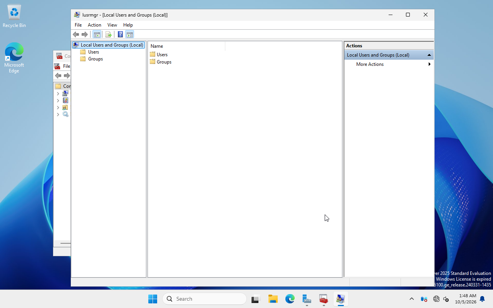

### 3.2. Создание пользователя

**Путь.** `Local Users and Groups -> Users -> Action -> New User...`.

**Действие.** Создаём пользователя:

```text
UPart1GMAKMA
```

Пароль задаётся в защищённом диалоге Windows и не записывается в отчёт, исходники или Git. Учётная запись включена.

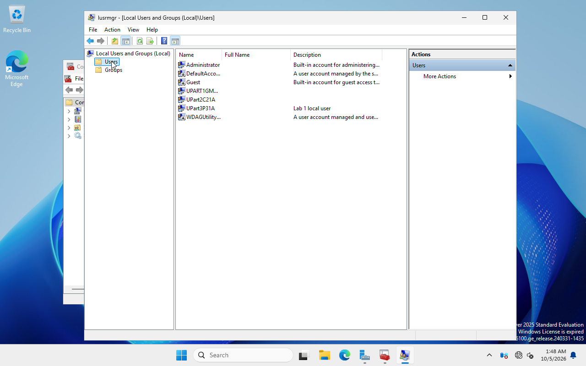

Первичное создание объекта также подтверждено отдельным снимком.


### 3.3. Создание группы

**Путь.** `Local Users and Groups -> Groups -> Action -> New Group...`.

**Действие.** Создаём группу:

```text
GPart1GMAKMA
```

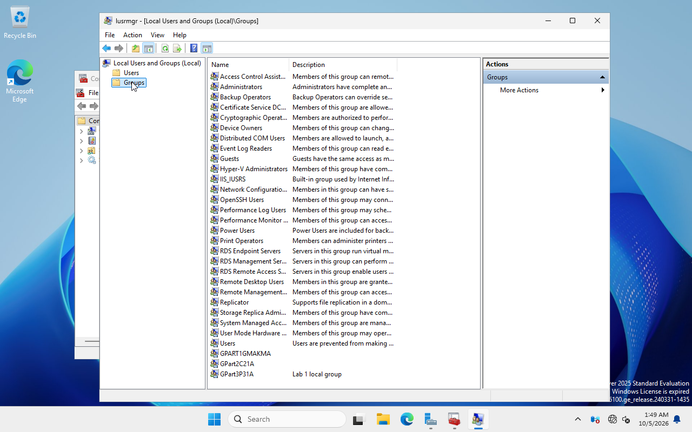


### 3.4. Добавление пользователя в группу

**Путь.** Открываем свойства `GPart1GMAKMA` двойным щелчком -> **Members** -> **Add...** -> вводим `UPart1GMAKMA` -> **Check Names** -> **OK**.

**Проверка.** В списке `Members` группы отображается `UPart1GMAKMA`.

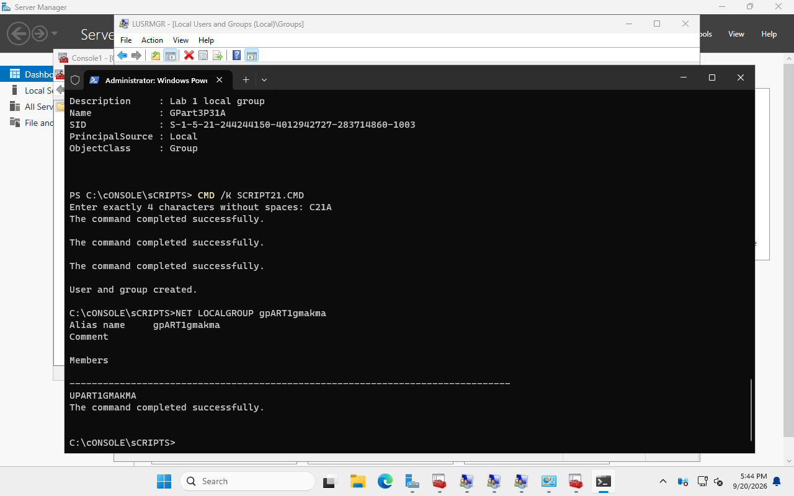

---

## 4. Настройка IPv4

### 4.1. Открытие адаптеров

**Что делаем.** Нажимаем `Win + R`, вводим `ncpa.cpl`. Открывается окно `Network Connections`.

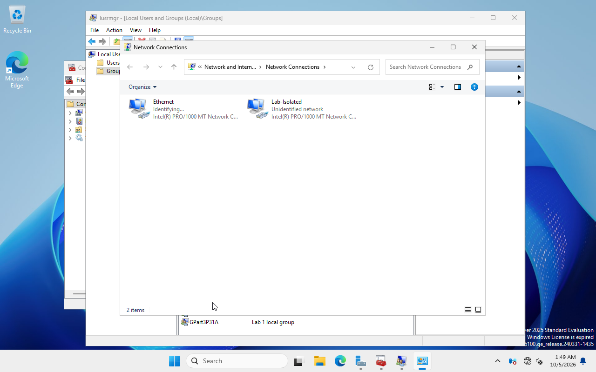

В окне видны два адаптера: обычный `Ethernet` и выделенный для лабораторной `Lab-Isolated`. Меняется только второй.

### 4.2. Ручной ввод статических параметров

**Путь.** `Lab-Isolated -> Properties -> Internet Protocol Version 4 (TCP/IPv4) -> Properties`.

Выбираем **Use the following IP address** и вводим:

| Поле | Значение |
|---|---|
| IP address | `192.168.1.10` |
| Subnet mask | `255.255.255.0` |
| Default gateway | `192.168.1.1` |
| Preferred DNS server | `8.8.8.8` |

После подтверждения проверяем параметры командой `ipconfig /all` или в свойствах IPv4. Статическая конфигурация применяется только к `Lab-Isolated`.


---

## 5. CMD-сценарии

### 5.1. Расположение файлов

Перед настройкой задач MMC создаём папку `C:\Console\Scripts` и помещаем туда все четыре файла. Через проводник можно проверить, что файлы находятся в одной предсказуемой папке.

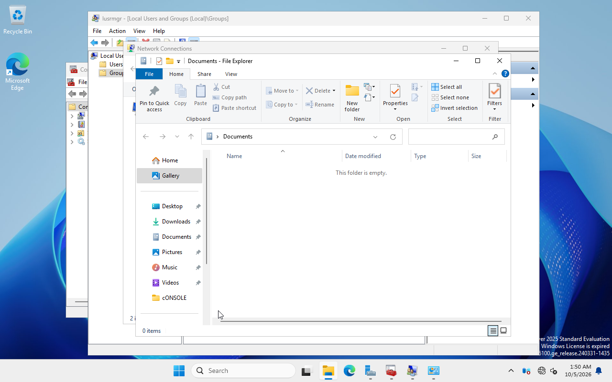

### 5.2. `script21.cmd`: пользователь и группа по четырём символам

**Назначение.** Сценарий запрашивает строку ровно из четырёх символов без пробелов. Для строки `ABCD` он создаёт `UPart2ABCD` и `GPart2ABCD`, добавляет пользователя в группу и включает учётную запись.

**Запуск.** Открываем CMD от имени администратора, переходим в `C:\Console\Scripts` и запускаем `script21.cmd`. Вводим четыре символа. Неиспользуемый или уже существующий идентификатор выбирать не следует, чтобы не смешивать результаты повторного запуска.

Исходник: [scripts/script21.cmd](scripts/script21.cmd)


### 5.3. `script22.cmd`: DHCP или статический IPv4

**Назначение.** Сценарий принимает строго `Auto` или `Manual`.

- `Auto` включает DHCP для IPv4 и DNS на `Lab-Isolated`.
- `Manual` задаёт IP `192.168.1.10`, маску `255.255.255.0`, шлюз `192.168.1.1` и DNS `8.8.8.8` через `netsh`.

**Запуск.** Открываем CMD с повышенными правами, запускаем `script22.cmd` и вводим `Manual` для воспроизведения требуемой статической конфигурации. Параметр `validate=no` в команде DNS нужен для учебной изолированной сети: шлюз `192.168.1.1` может не иметь маршрута в Интернет.

Исходник: [scripts/script22.cmd](scripts/script22.cmd)


---

## 6. PowerShell-сценарии

### 6.1. `script31.ps1`: пользователь и группа средствами PowerShell

**Назначение.** Сценарий получает строку из четырёх непробельных символов, создаёт `UPart3<строка>` и `GPart3<строка>`, добавляет пользователя в группу и активирует учётную запись.

**Запуск.** Открываем Windows PowerShell от имени администратора и выполняем:

```powershell
Set-ExecutionPolicy -Scope Process Bypass
C:\Console\Scripts\script31.ps1
```

Политика изменяется только для текущего процесса PowerShell. Пароль не хранится внутри файла: сценарий использует `-NoPassword` для демонстрационного учебного объекта.

Исходник: [scripts/script31.ps1](scripts/script31.ps1)


### 6.2. `script32.ps1`: настройка IPv4 средствами PowerShell

**Назначение.** Сценарий запрашивает `Auto` или `Manual` и работает строго с адаптером `Lab-Isolated`.

- при `Auto` включает DHCP и сбрасывает вручную заданные DNS;
- при `Manual` удаляет прежний IPv4-адрес и default route только у этого адаптера, после чего добавляет параметры лабораторной сети.

**Почему удаляется старый маршрут.** Повторный запуск должен приводить к одному и тому же результату. Без удаления старого default route Windows может сохранить конфликтующий маршрут от предыдущего запуска.

**Запуск.** Открываем PowerShell от имени администратора, запускаем `script32.ps1` и вводим `Manual`.

Исходник: [scripts/script32.ps1](scripts/script32.ps1)


---

## 7. Проверка запуска задач из Tools

Возвращаемся в основную MMC, открываем `Tools` и по очереди запускаем Network Connections, `SCRIPT21.CMD`, `SCRIPT22.CMD`, `SCRIPT31.PS1` и `SCRIPT32.PS1`.

**Что проверяется.**

1. в консоли сохранены правильные пути к файлам;
2. сценарии открываются без ручного поиска в проводнике;
3. задания, которые изменяют пользователей или сетевые параметры, запускаются в административном контексте;
4. в итоговой ветке `Manual` оба сетевых сценария возвращают требуемую статическую конфигурацию.


---

## 8. Ограниченная MMC для обычного пользователя

### 8.1. Создание копии с ограниченным режимом

**Что делаем.** В основной MMC выбираем **File -> Options...** и переключаем режим на **User mode - limited access, single window**. Запрещаем пользователю сохранять изменения, затем сохраняем отдельный файл:

```text
C:\Console\LAB-1-USER.msc
```

**Зачем.** Обычный пользователь может пользоваться согласованным набором инструментов, но не изменяет структуру MMC и не получает права администратора через неё.


### 8.2. Проверка под `UPart1GMAKMA`

Сеанс администратора завершается, после чего пользователь вручную входит как `UPart1GMAKMA` и открывает `C:\Console\LAB-1-USER.msc`.


В `Services` выбираем `DHCP Client` и проверяем панель действий. Команды **Start**, **Stop**, **Pause** и **Resume** недоступны. Это ожидаемое доказательство того, что доступ к оснастке не равен административным полномочиям над службой.


---

## Контрольные вопросы

### 1. В какие группы вошёл пользователь после части 1?

В Windows локальный пользователь имеет индивидуальную группу с тем же именем, а в рамках данной работы `UPart1GMAKMA` явно добавлен в `GPart1GMAKMA`. Остальные эффективные группы могут определяться локальной политикой и встроенными группами Windows, поэтому на защите корректно показывать именно свойства созданной группы и её список `Members`, а не делать предположение о полном наборе токенов безопасности.

### 2. Чем различаются CMD- и PowerShell-сценарии?

CMD использует текстовые утилиты `net`, `netsh`, ввод через `set /p` и условные ветви `if`. PowerShell работает с объектами и cmdlet-ами: `New-LocalUser`, `New-LocalGroup`, `Get-NetAdapter`, `New-NetIPAddress`. Поэтому PowerShell удобнее, когда нужно выбрать конкретный интерфейс по имени, получить его `InterfaceIndex` и обработать ошибки объектным способом. CMD легче запускать на минимальных системах, но его синтаксис менее выразителен для сложного администрирования.

### 3. Как добавить несколько IPv4-адресов одному адаптеру?

В графическом интерфейсе открывают свойства `Internet Protocol Version 4 (TCP/IPv4)`, затем **Advanced...**, в блоке **IP addresses** нажимают **Add...**. В PowerShell для одного `InterfaceIndex` несколько раз вызывают `New-NetIPAddress` с разными значениями `IPAddress`. В `netsh` используется `netsh interface ipv4 add address`. Перед добавлением дополнительного адреса важно проверить маршруты и отсутствие пересечения подсетей.

### 4. Как управлять удалённым компьютером через оснастку MMC?

В подходящей оснастке выбирают **Connect to another computer**, вводят имя или IP-адрес удалённого компьютера и используют учётную запись, имеющую нужные права. Нужны маршрутизация до узла, разрешённые правила Windows Firewall, работающие RPC/WMI и соответствующие локальные либо доменные разрешения. Для Services и Computer Management права на удалённое подключение сами по себе не дают права запускать или останавливать защищённые службы.

---

## Вывод

Собрана и сохранена MMC-консоль с `Computer Management`, `Event Viewer`, `Shared Folders` и `Services`. Для неё подготовлен раздел `Tools`, объединяющий сетевые настройки и запуск четырёх сценариев. Созданы локальные объекты `UPart1GMAKMA` и `GPart1GMAKMA`; членство пользователя в группе подтверждено. Статический IPv4 назначен только изолированному интерфейсу `Lab-Isolated`. CMD- и PowerShell-сценарии проверены в ветке `Manual`. Отдельная ограниченная консоль демонстрирует разделение между доступом к интерфейсу MMC и административными правами на управление службой.
