# Ход выполнения практической работы №1

## Цель работы

Получить практические навыки использования основных средств управления Windows Server: MMC, командного интерпретатора CMD и PowerShell, на примере создания локальных пользователей и групп, настройки сетевого интерфейса и ограничения прав обычного пользователя.

## Среда выполнения

Работа выполнена в Windows Server 2025 Standard Evaluation с графической оболочкой Desktop Experience, развёрнутой в виртуальной машине Proxmox VE/KVM. Для учебной статической конфигурации использован отдельный сетевой адаптер `Lab-Isolated`. Рабочий адаптер `Ethernet` не изменялся.

Локальные объекты части 1 созданы с идентификатором команды `GMAKMA`:

| Объект | Имя |
|---|---|
| Локальный пользователь | `UPart1GMAKMA` |
| Локальная группа | `GPart1GMAKMA` |

## 1. Консоль MMC

### 1.1. Создание консоли и добавление оснасток

Консоль создана запуском `mmc.exe` от имени локального администратора. В исходном состоянии она содержит только корневой узел `Console Root`.


Через меню **File** открыто окно **Add/Remove Snap-in...**.

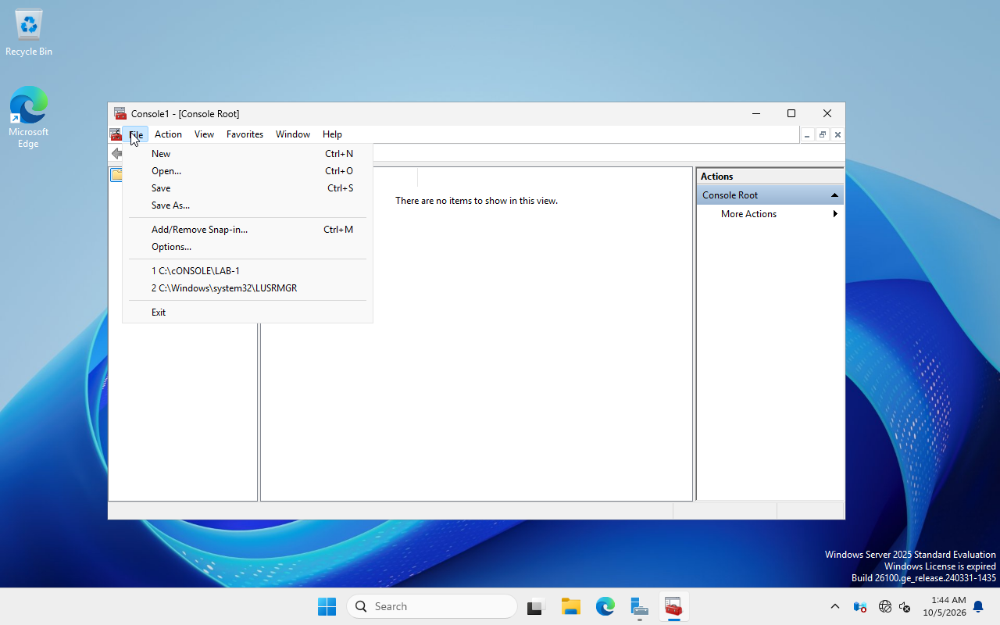

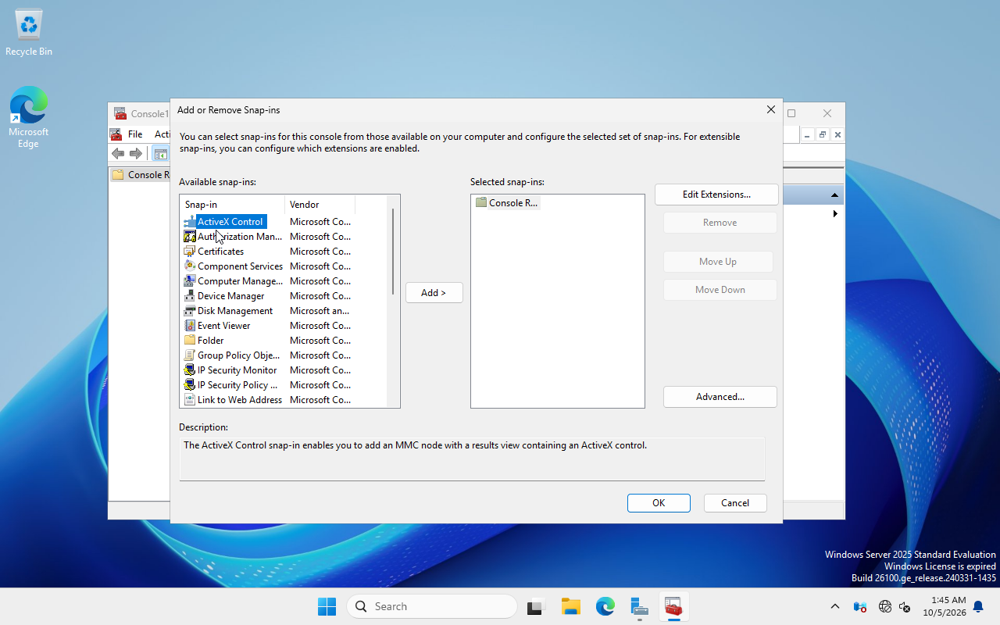

В консоль добавлены оснастки локального компьютера:

1. `Computer Management`;
2. `Services`;
3. `Event Viewer`;
4. `Shared Folders`.

Для `Computer Management` в окне настройки выбран локальный компьютер.

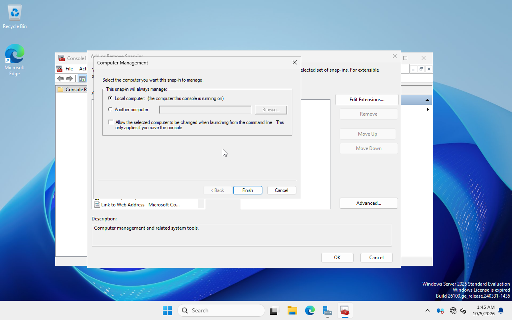

Для `Event Viewer` также выбран локальный компьютер.


Для `Shared Folders` выбран локальный компьютер и режим просмотра всех объектов: общих ресурсов, сессий и открытых файлов.

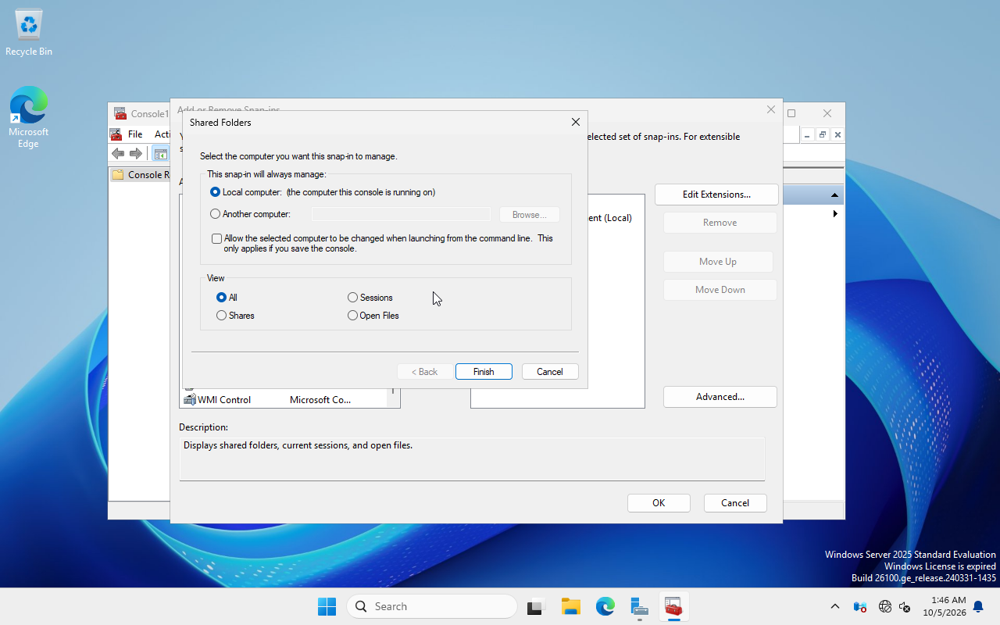

Для `Services` выбран локальный компьютер.


Перед сохранением проверен состав консоли. В области `Selected snap-ins` присутствуют только четыре требуемые оснастки.


Итоговая консоль содержит `Computer Management`, `Event Viewer`, `Shared Folders` и `Services`.


Консоль сохранена в каталоге:

```text
C:\Console\lab-1.msc
```

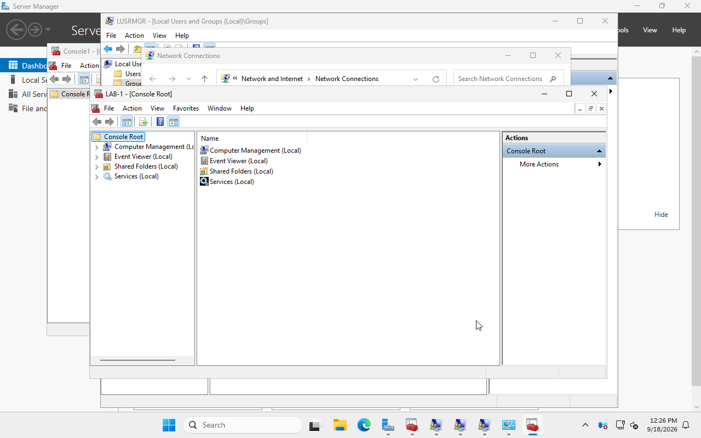

### 1.2. Папка Tools и задачи MMC

В корне консоли создана папка `Tools`. Она предназначена для запуска сетевых настроек и подготовленных сценариев из одной консоли.


В `Tools` добавлена задача запуска окна сетевых подключений.

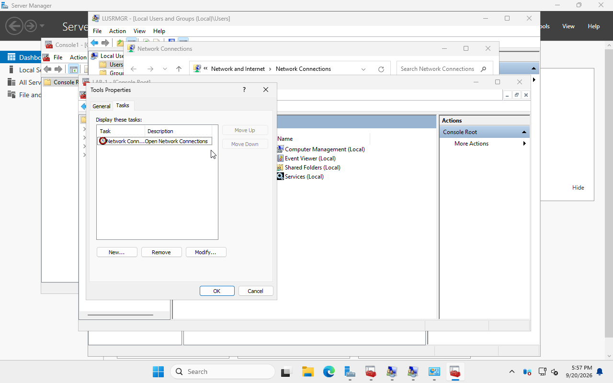

В папку добавлены задачи запуска четырёх сценариев:

| Задача | Запускаемый файл |
|---|---|
| `SCRIPT21.CMD` | `C:\Console\Scripts\script21.cmd` |
| `SCRIPT22.CMD` | `C:\Console\Scripts\script22.cmd` |
| `SCRIPT31.PS1` | `C:\Console\Scripts\script31.ps1` |
| `SCRIPT32.PS1` | `C:\Console\Scripts\script32.ps1` |

Итоговый раздел `Tools` содержит Network Connections и все четыре сценария.

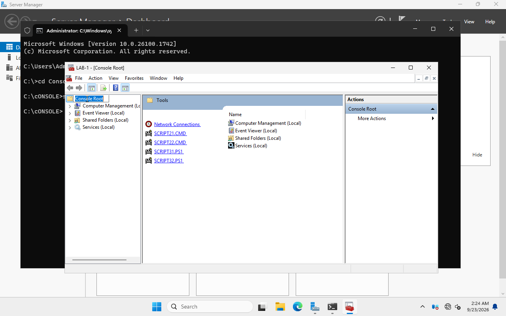

### 1.3. Локальный пользователь и группа

Через оснастку `Computer Management -> Local Users and Groups` создан пользователь `UPart1GMAKMA`.

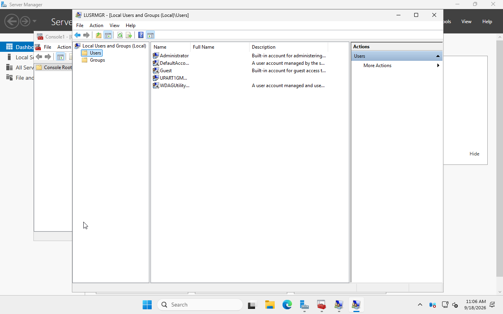

В той же оснастке создана группа `GPart1GMAKMA`.

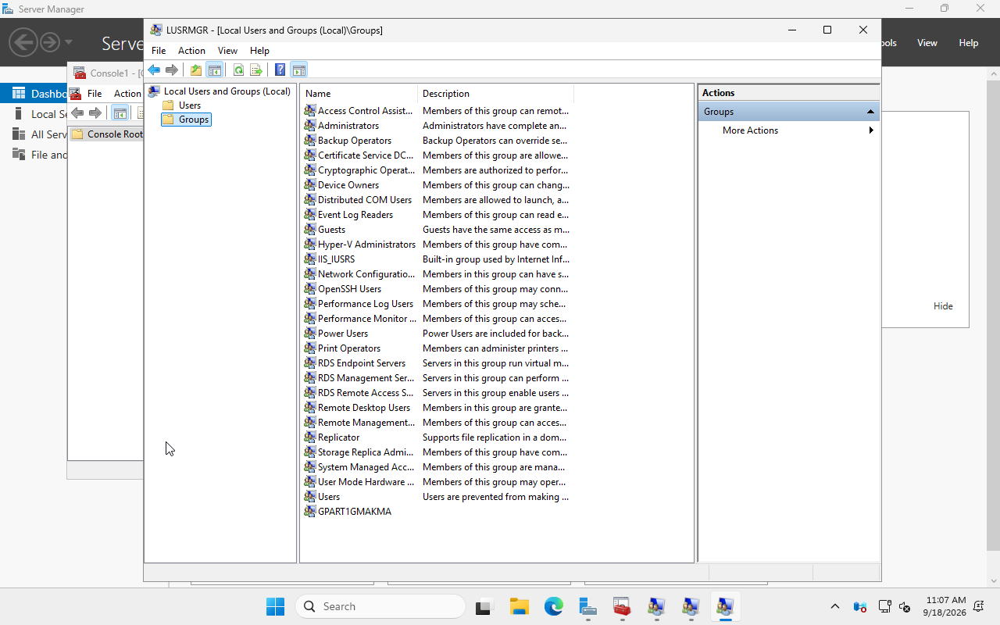

Пользователь `UPart1GMAKMA` добавлен в `GPart1GMAKMA`. Членство подтверждено в свойствах группы.


### 1.4. Проверка ограничений обычного пользователя и администратора

Сохранённая консоль запускалась под `UPart1GMAKMA`. Для проверки использована служба `DHCP Client`, так как управление службой `DNS Client` в используемой версии Windows ограничено политикой.

Для обычного пользователя создана отдельная копия консоли:

```text
C:\Console\LAB-1-USER.msc
```

Копия сохранена в режиме `User mode - limited access, single window` с запретом сохранения изменений.

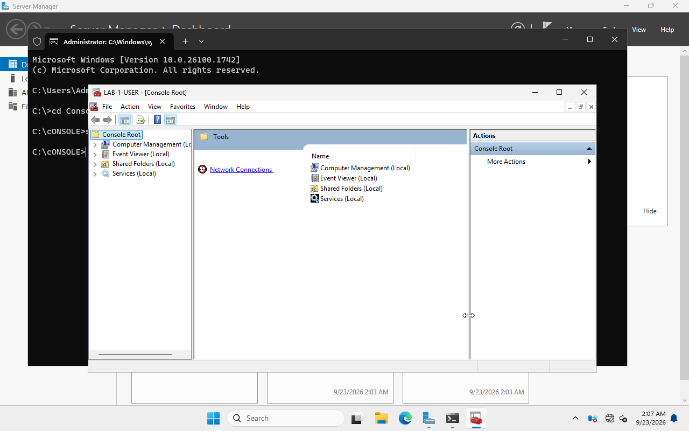

Обычный пользователь открыл ограниченную консоль.

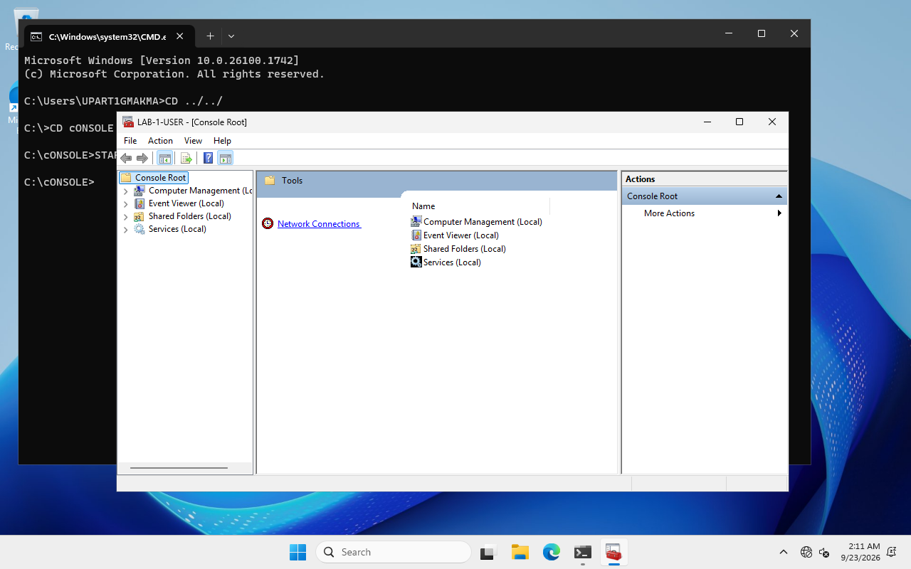

В оснастке `Services` для `DHCP Client` действия запуска, остановки, приостановки и продолжения недоступны. Следовательно, доступ к консоли не предоставляет обычному пользователю административные права на управление системной службой.


Административная сессия выполнена от имени `Administrator`.

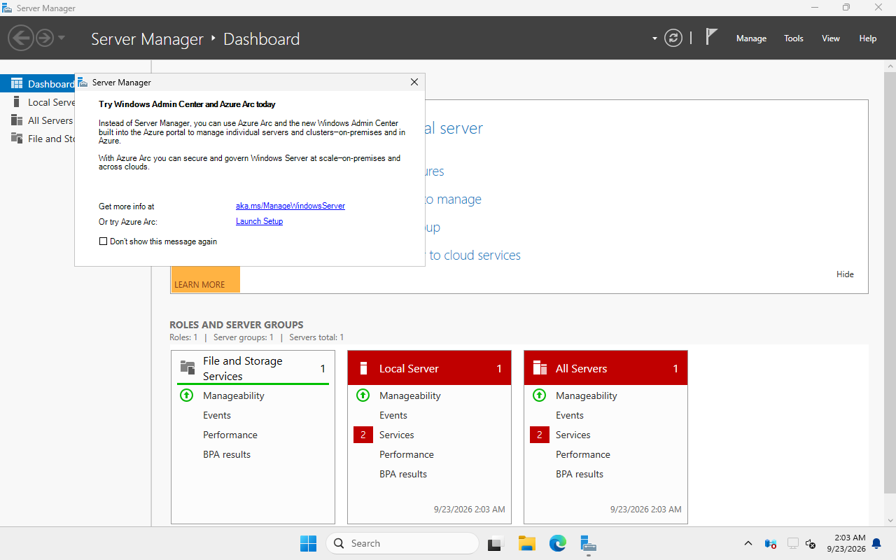

### 1.5. Настройка IPv4

В виртуальной машине присутствуют два адаптера. Для лабораторной работы выбран `Lab-Isolated`; основной адаптер `Ethernet` не изменялся.

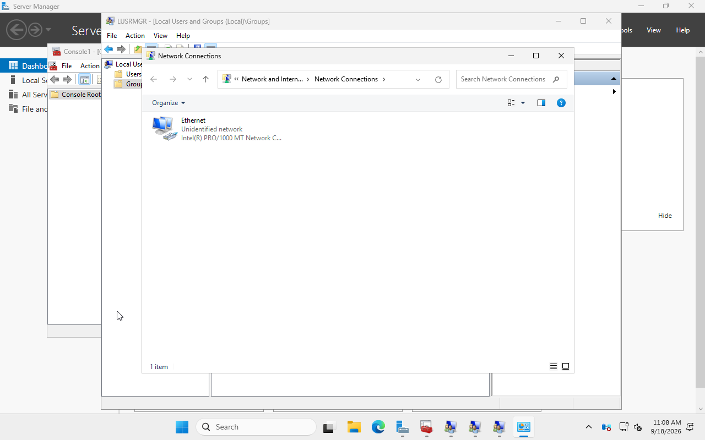

На `Lab-Isolated` вручную заданы параметры:

| Параметр | Значение |
|---|---|
| IPv4-адрес | `192.168.1.10` |
| Маска подсети | `255.255.255.0` |
| Основной шлюз | `192.168.1.1` |
| DNS-сервер | `8.8.8.8` |

Конфигурация проверена после применения параметров.

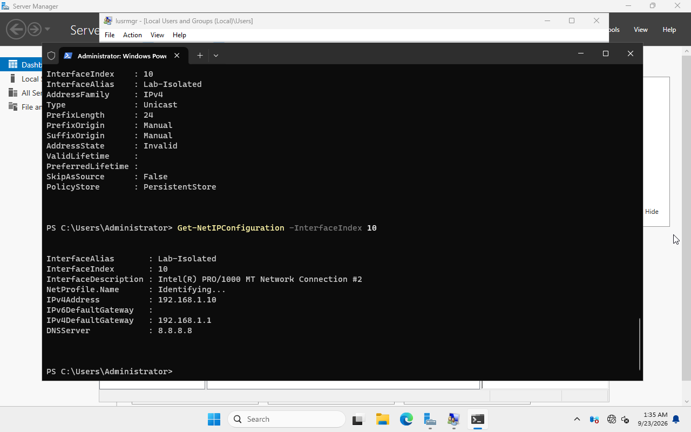

## 2. Утилиты командной строки CMD

### 2.1. Сценарий `script21.cmd`

Сценарий запрашивает строку из четырёх символов без пробелов. Из введённой строки формируются имя пользователя `UPart2STR` и имя группы `GPart2STR`. Затем создаются пользователь и группа, пользователь включается в группу и активируется.

```bat
@echo off
setlocal EnableExtensions
set /p "STR=Enter exactly 4 characters without spaces: "
if "%STR:~3,1%"=="" goto invalid
if not "%STR:~4,1%"=="" goto invalid
for /f "tokens=* delims= " %%A in ("%STR%") do if not "%%A"=="%STR%" goto invalid
net user "UPart2%STR%" /add /active:yes
net localgroup "GPart2%STR%" /add
net localgroup "GPart2%STR%" "UPart2%STR%" /add
echo User and group created.
goto end
:invalid
echo Input must contain exactly 4 non-space characters.
:end
endlocal
```

При тестовом запуске сценарий принял корректную строку, создал учётные объекты и подтвердил выполнение сообщением `User and group created.`

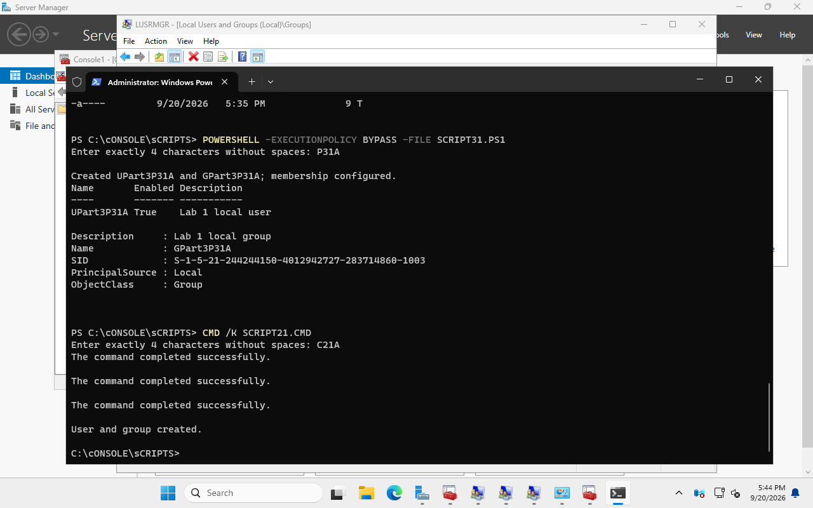

Исходный файл: [scripts/script21.cmd](scripts/script21.cmd).

### 2.2. Сценарий `script22.cmd`

Сценарий запрашивает режим `Auto` или `Manual`. В режиме `Auto` включается получение адреса и DNS через DHCP. В режиме `Manual` на адаптере `Lab-Isolated` устанавливаются параметры из части 1.

```bat
@echo off
setlocal EnableExtensions
set /p "MODE=Enter Auto or Manual: "
if /I "%MODE%"=="Auto" (
  netsh interface ipv4 set address name="Lab-Isolated" source=dhcp
  netsh interface ipv4 set dnsservers name="Lab-Isolated" source=dhcp
  echo DHCP enabled for IPv4 and DNS.
) else if /I "%MODE%"=="Manual" (
  netsh interface ipv4 set address name="Lab-Isolated" static 192.168.1.10 255.255.255.0 192.168.1.1
  netsh interface ipv4 set dnsservers name="Lab-Isolated" static 8.8.8.8 primary validate=no
  echo Static IPv4 configuration applied.
) else (
  echo Allowed values: Auto or Manual.
)
endlocal
```

В режиме `Manual` сценарий успешно применил статическую конфигурацию. Параметр `validate=no` разрешает задать DNS в изолированной учебной сети, в которой шлюз не обязан обеспечивать доступ к внешней сети.

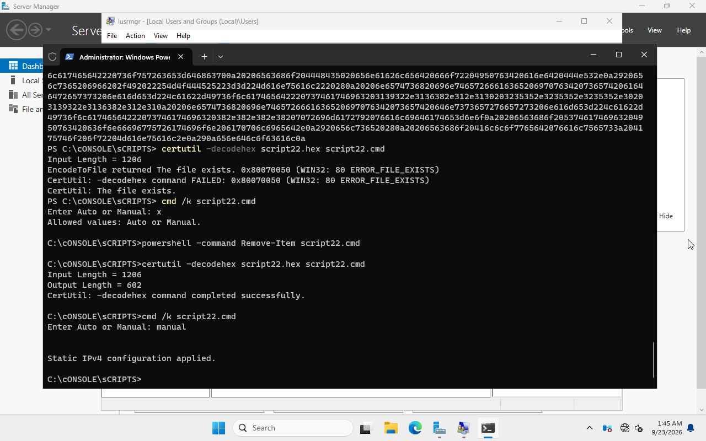

Исходный файл: [scripts/script22.cmd](scripts/script22.cmd).

## 3. PowerShell

### 3.1. Сценарий `script31.ps1`

Сценарий получает строку из четырёх непробельных символов, формирует имена `UPart3STR` и `GPart3STR`, создаёт пользователя и группу, добавляет пользователя в группу и включает учётную запись.

```powershell
$str = Read-Host 'Enter exactly 4 characters without spaces'
if ($str -notmatch '^[^\s]{4}$') {
    Write-Error 'Input must contain exactly 4 non-space characters.'
    exit 1
}
$userName = "UPart3$str"
$groupName = "GPart3$str"
New-LocalUser -Name $userName -NoPassword -AccountNeverExpires -Description 'Lab 1 local user'
New-LocalGroup -Name $groupName -Description 'Lab 1 local group'
Add-LocalGroupMember -Group $groupName -Member $userName
Enable-LocalUser -Name $userName
Write-Host "Created $userName and $groupName; membership configured."
```

Сценарий выполнен с корректным четырёхсимвольным значением. В консоли выведено сообщение о создании пользователя, группы и настройке членства.


Исходный файл: [scripts/script31.ps1](scripts/script31.ps1).

### 3.2. Сценарий `script32.ps1`

Сценарий получает режим `Auto` или `Manual` и работает только с адаптером `Lab-Isolated`. В режиме `Auto` включается DHCP и сбрасываются вручную заданные DNS-серверы. В режиме `Manual` удаляются прежний IPv4-адрес и маршрут по умолчанию этого адаптера, после чего назначаются параметры из части 1.

```powershell
$mode = Read-Host 'Enter Auto or Manual'
$adapter = Get-NetAdapter -Name 'Lab-Isolated' -ErrorAction Stop
if ($mode -ieq 'Auto') {
    Set-NetIPInterface -InterfaceIndex $adapter.ifIndex -Dhcp Enabled
    Set-DnsClientServerAddress -InterfaceIndex $adapter.ifIndex -ResetServerAddresses
    Write-Host 'DHCP enabled for IPv4 and DNS.'
} elseif ($mode -ieq 'Manual') {
    Get-NetRoute -InterfaceIndex $adapter.ifIndex -DestinationPrefix '0.0.0.0/0' -ErrorAction SilentlyContinue | Remove-NetRoute -Confirm:$false
    Get-NetIPAddress -InterfaceIndex $adapter.ifIndex -AddressFamily IPv4 -ErrorAction SilentlyContinue | Remove-NetIPAddress -Confirm:$false
    New-NetIPAddress -InterfaceIndex $adapter.ifIndex -IPAddress 192.168.1.10 -PrefixLength 24 -DefaultGateway 192.168.1.1
    Set-DnsClientServerAddress -InterfaceIndex $adapter.ifIndex -ServerAddresses 8.8.8.8
    Write-Host 'Static IPv4 configuration applied.'
} else {
    Write-Error 'Allowed values: Auto or Manual.'
}
```

Режим `Manual` завершился сообщением `Static IPv4 configuration applied.` и установил требуемые параметры на `Lab-Isolated`.


Исходный файл: [scripts/script32.ps1](scripts/script32.ps1).

## Ответы на контрольные вопросы

### 1. В каких группах оказался пользователь после п. 6 части 1?

В рамках работы пользователь `UPart1GMAKMA` включён в созданную группу `GPart1GMAKMA`. Windows не создаёт отдельную локальную группу с именем пользователя автоматически. Другие эффективные группы определяются локальной политикой и назначенными правами.

### 2. Сравните организацию диалога в скриптах CMD и PowerShell.

В CMD ввод организован командой `set /p`, а выполнение строится на текстовых утилитах `net` и `netsh` с ветвлением `if`. Результат каждой команды обрабатывается как текстовый вывод.

В PowerShell ввод организован cmdlet-ом `Read-Host`. Сценарии используют cmdlet-ы `New-LocalUser`, `New-LocalGroup`, `Add-LocalGroupMember`, `Get-NetAdapter`, `New-NetIPAddress` и `Set-DnsClientServerAddress`. Команды PowerShell работают с объектами, поэтому параметры конкретного адаптера выбираются по его имени и `InterfaceIndex`.

### 3. Как добавить несколько IPv4-адресов на сетевой адаптер?

В графическом интерфейсе Windows в свойствах `Internet Protocol Version 4 (TCP/IPv4)` используется кнопка **Advanced...**, затем в области `IP addresses` выбирается **Add...**. В PowerShell для одного `InterfaceIndex` несколько раз выполняется `New-NetIPAddress` с разными значениями IP-адреса. В `netsh` применяется команда `netsh interface ipv4 add address`.

### 4. Как, используя созданную оснастку, управлять службами и пользователями на удалённом компьютере Windows?

В оснастках `Services` и `Computer Management` выбирается подключение к другому компьютеру, после чего указывается имя или IP-адрес удалённого узла. Учётная запись должна иметь соответствующие права на удалённой машине. Для работы необходимы сетевой доступ, разрешённые правила Windows Firewall и доступность RPC/WMI. Управление пользователями выполняется через `Local Users and Groups` в составе `Computer Management`, если этот раздел доступен на удалённом компьютере и у учётной записи есть административные права.

## Вывод

В работе создана MMC-консоль с четырьмя требуемыми оснастками и папкой `Tools`. Созданы локальные пользователь `UPart1GMAKMA` и группа `GPart1GMAKMA`, пользователь включён в группу. На выделенном интерфейсе `Lab-Isolated` установлена статическая IPv4-конфигурация. Подготовлены и проверены два сценария CMD и два сценария PowerShell. Ограниченная копия MMC подтвердила, что обычный пользователь не может управлять системной службой.
