# Ход выполнения практической работы №2

## Цель работы

Получить практические навыки развёртывания Active Directory, управления пользователями и группами домена, настройки прав NTFS и SMB, применения групповых политик, автоматизации создания объектов и восстановления удалённых учётных записей.

## Среда выполнения

Для работы выделены две виртуальные машины в Proxmox VE. Сервер устанавливается в редакции Windows Server 2025 Standard Evaluation с графической оболочкой Desktop Experience. Для клиента выбрана Windows 10 Pro.

| Машина | Назначение | Процессоры | Оперативная память | Диск |
|---|---|---|---|---|
| VM 104 | Сервер `ad-srv` | 4 | 8 ГиБ | 64 ГиБ, SATA |
| VM 105 | Клиент `ad-client` | 2 | 4 ГиБ | 64 ГиБ, SATA |

Вместо указанной в задании VirtualBox использована доступная среда Proxmox VE. Для обеих машин выбран один изолированный мост `vmbr1_lab`. Подключения к внешнему мосту `vmbr0` нет.

Конфигурация машин сохранена отдельно: [VM 104](evidence/commands/vm104-configuration.json), [VM 105](evidence/commands/vm105-configuration.json).

## 1. Подготовка операционных систем

### 1.1. Установка Windows Server

Сервер загружен с установочного образа Windows Server. Перед началом копирования файлов выбрана редакция `Windows Server 2025 Standard Evaluation (Desktop Experience)` и вариант установки без сохранения старых данных.


После нажатия **Install** началась установка операционной системы. На экране отображаются процент выполнения и предупреждение об автоматических перезагрузках.

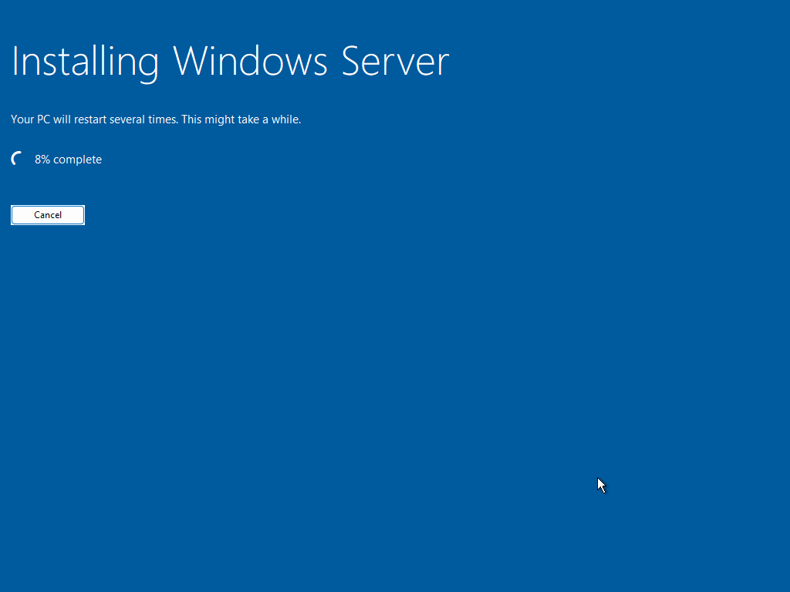

### 1.2. Установка Windows 10 Pro

Клиентская машина загружена с образа Windows 10. На первом экране оставлены английский язык интерфейса и раскладка United Kingdom.


После перехода к следующему окну выбрана команда **Install now**.


На экране активации выбран вариант **I don't have a product key**. Ключ продукта при установке не вводился.


В списке редакций выбрана `Windows 10 Pro`.


После ознакомления с лицензионным соглашением отмечено поле **I accept the licence terms**.


Для чистой установки выбран вариант **Custom: Install Windows only (advanced)**.


На клиентской машине обнаружен один диск объёмом 64 ГиБ. Старая разметка содержала системный, основной и служебный разделы.


Для удаления старой разметки через `Shift+F10` открыта командная строка установщика. Выполнены команды:

```text
diskpart
select disk 0
clean
exit
```

После закрытия командной строки и нажатия **Refresh** установщик показал единственный участок `Drive 0 Unallocated Space` размером 64 ГиБ. Старые разделы отсутствуют.


Неразмеченный диск выбран в качестве места установки. После нажатия **Next** запущена установка Windows 10 Pro.

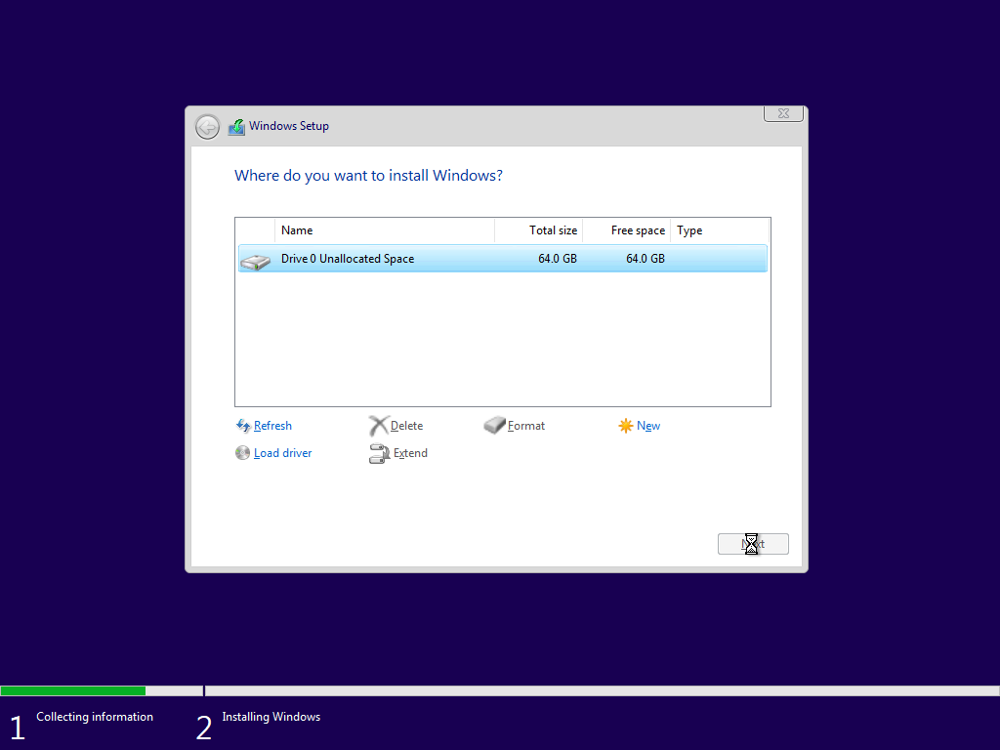

### 1.3. Первичная настройка Windows 10

После установки выбран регион United Kingdom.


Для ввода оставлена раскладка United Kingdom; добавление второй раскладки пропущено.


Машина находится в изолированной сети. На экране подключения выбран пункт **I don't have internet**, затем **Continue with limited setup**. Внешний сетевой адаптер для прохождения первоначальной настройки не добавлялся.


Создана локальная учётная запись `LabAdmin` для первоначальной настройки клиента. Пароль и ответы на контрольные вопросы в отчёт не включены.


Необязательные функции определения местоположения, поиска устройства, отправки данных рукописного ввода, персонализированных рекомендаций и рекламного идентификатора отключены. Для диагностики оставлены только обязательные данные.


### 1.4. Завершение установки сервера и настройка имён

После завершения установки Windows Server выполнен вход локальным администратором. Открылся Server Manager.

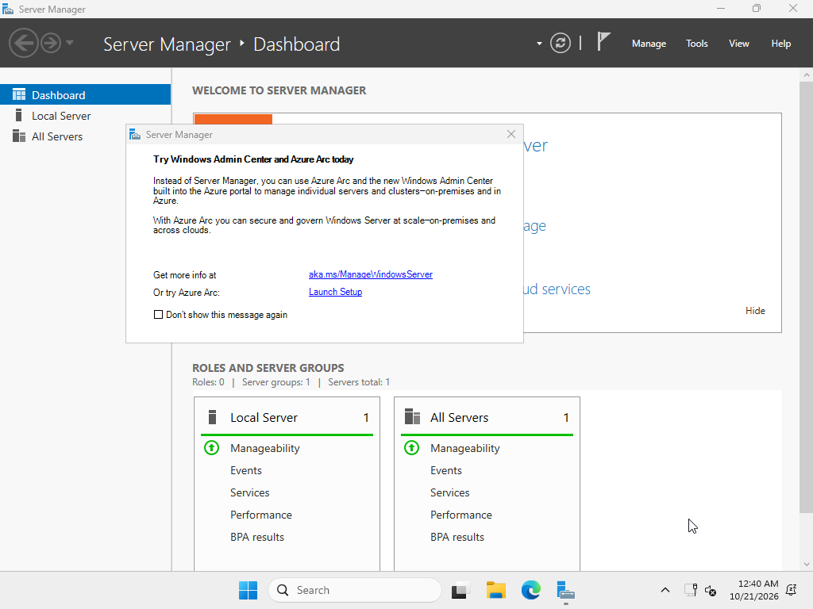

Сервер переименован в `ad-srv`, клиент – в `ad-client`. Для применения имён обе машины перезагружены. Использована команда `Rename-Computer` с соответствующим именем:

```powershell
Rename-Computer -NewName ad-srv -Force
```

```powershell
Rename-Computer -NewName ad-client -Force
```

После перезагрузки на клиенте повторно выполнен вход `LabAdmin`. Команды `whoami` и `hostname` подтвердили локальную учётную запись `ad-client\labadmin` и имя `ad-client`.


### 1.5. Настройка изолированной сети

На сервере адаптер `Ethernet` сопоставлен с единственным сетевым устройством VM 104 по MAC `BC-24-11-DE-ED-1E`. Установлены параметры:

| Параметр | Значение |
|---|---|
| IPv4 | `10.0.0.1` |
| Маска | `255.0.0.0` |
| DNS | `10.0.0.1` |
| Шлюз сервера | Не задан: выхода из учебной LAN нет |

В текущей установке этот адаптер имеет InterfaceIndex `6`.

```powershell
Set-NetIPInterface -InterfaceIndex 6 -Dhcp Disabled
New-NetIPAddress -InterfaceIndex 6 -IPAddress 10.0.0.1 -PrefixLength 8
Set-DnsClientServerAddress -InterfaceIndex 6 -ServerAddresses 10.0.0.1
```

После перезагрузки выполнены `hostname` и `ipconfig /all`. Вывод подтверждает имя `ad-srv`, статический IPv4, маску и DNS.


Для первоначальной передачи гостевых инструментов клиенту временно назначался адрес `10.0.0.100/8`. Этот адрес на данном этапе задан вручную; настройка получения адреса через DHCP выполняется после развёртывания серверной роли.

### 1.6. Гостевые инструменты и базовые снимки

На обеих машинах установлены QEMU Guest Agent и драйвер VirtIO Serial. Это позволяет получать сведения о гостевой ОС из среды виртуализации. Установка драйвера на клиенте завершена сообщением `Driver package installed on device`.


После перезагрузок и проверки входа сохранены базовые снимки `lab2-a1-server-os-ready` и `lab2-a1-client-os-ready`. Они относятся к состоянию до создания домена. Список снимков и параметры машин приведены в [файле проверки базового состояния](evidence/commands/os-ready.json).

## 2. Развёртывание Active Directory

### 2.1. Установка роли AD DS

На сервере в Server Manager выбрана команда **Add roles and features**. Мастер начал работу с окна **Before You Begin**.

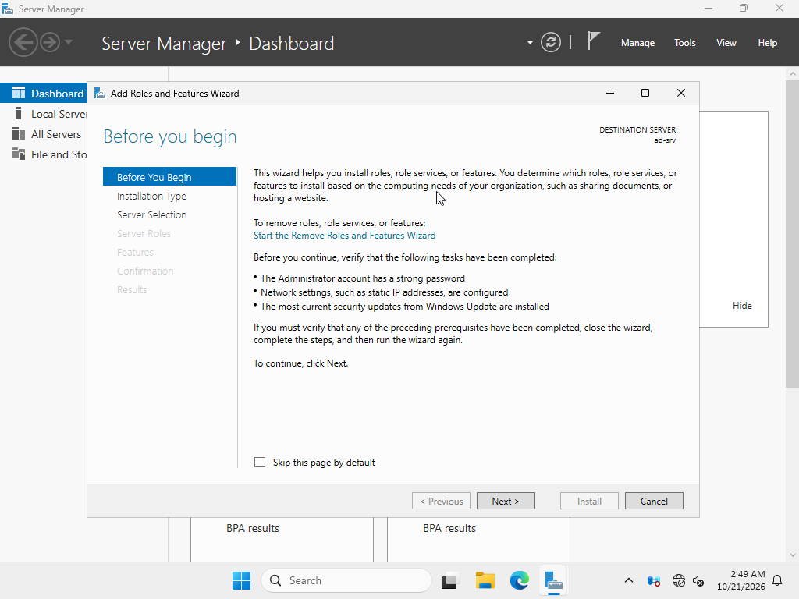

Для установки роли на текущую машину оставлен вариант **Role-based or feature-based installation**.

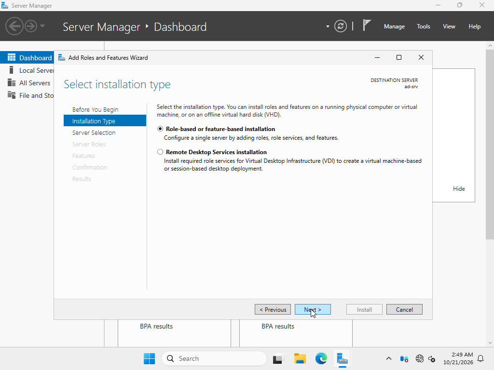

В списке серверов выбран `ad-srv`.


В **Server Roles** отмечена роль **Active Directory Domain Services**. Мастер предложил добавить Group Policy Management, средства администрирования AD и модуль Active Directory для PowerShell. Оставлено включённым поле **Include management tools**, затем нажата кнопка **Add Features**.


Выбранная роль отображается в списке Server Roles.


На странице Features показаны выбранные компоненты. Дополнительные роли AD CS, AD FS и AD LDS не выбирались.


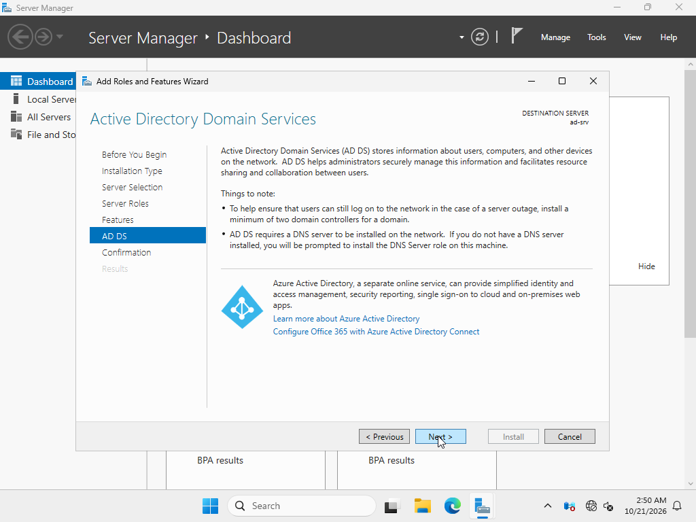

Перед установкой проверен итоговый список. Нажата кнопка **Install**.


Роль установлена с сообщением **Installation succeeded on ad-srv**. На этой стадии сервер ещё требует повышения до контроллера домена: в мастере появилась ссылка **Promote this server to a domain controller**.

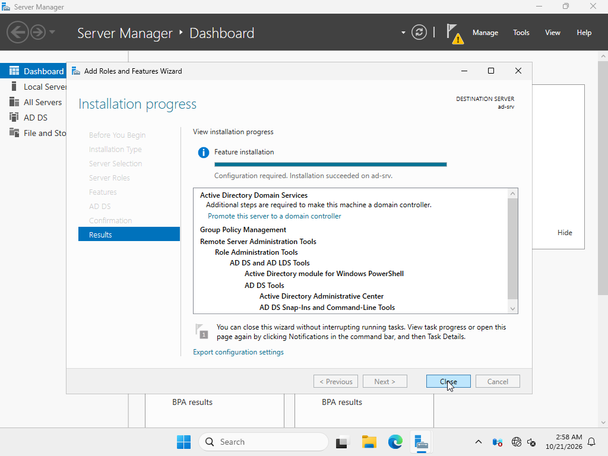

### 2.2. Создание нового леса и домена

По ссылке **Promote this server to a domain controller** открыт мастер AD DS Configuration Wizard. Выбран вариант **Add a new forest**, в поле Root domain name введено `GMAKMA.local`.


В Domain Controller Options оставлены уровни леса и домена **Windows Server 2025**. Отмечены **DNS server** и **Global Catalog**; RODC не выбран. Для Directory Services Restore Mode задан отдельный пароль, который не включён в отчёт.

На странице DNS Options показано предупреждение о невозможности создать делегирование: родительская авторитетная зона не найдена. В работе создаётся самостоятельный лес в изолированной сети, поэтому создание делегирования оставлено выключенным.


Мастер предложил NetBIOS-имя `GMAKMA`. Это имя оставлено без изменения.

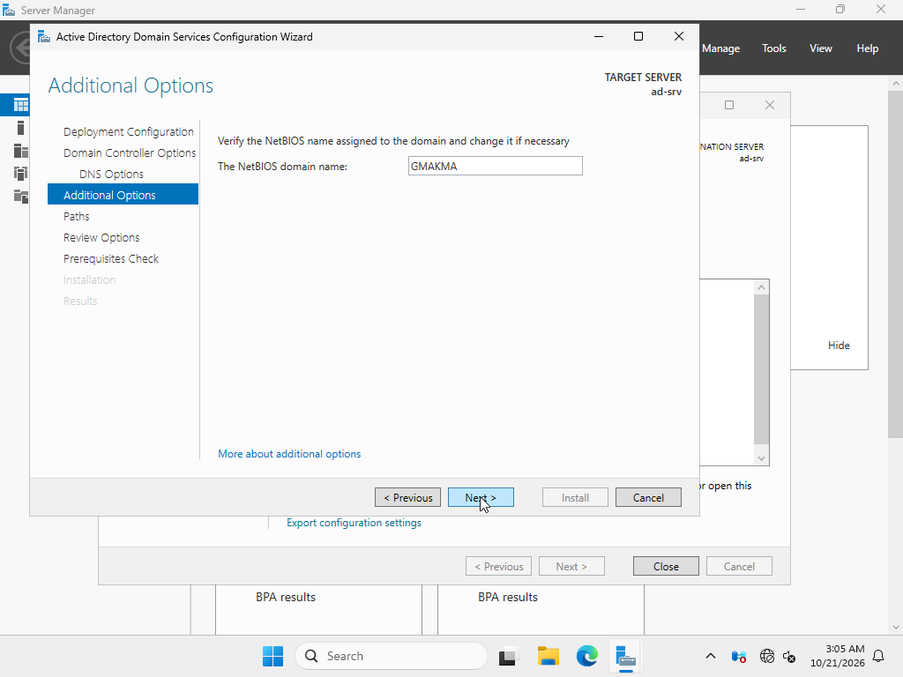

На странице **Paths** оставлены стандартные каталоги. В полях **Database folder** и **Log files folder** указан `C:\WINDOWS\NTDS`, в поле **SYSVOL folder** – `C:\WINDOWS\SYSVOL`. После проверки путей нажата кнопка **Next**.

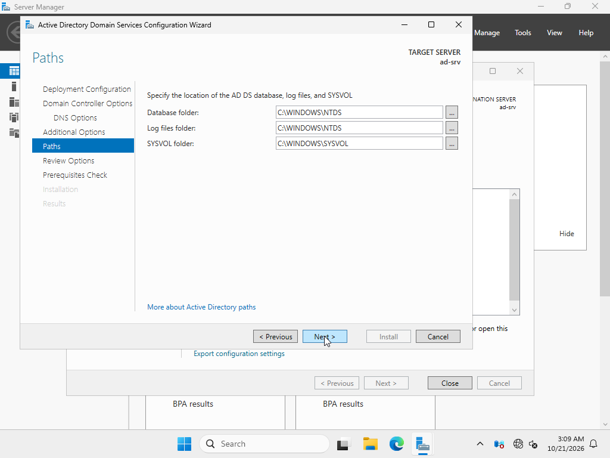

Перед применением просмотрены итоговые параметры развёртывания.


Мастер завершил prerequisites check сообщением **All prerequisite checks passed successfully**. Предупреждение о DNS delegation осталось в результатах и не препятствовало установке.


После нажатия **Install** запущено создание леса и повышение сервера. По завершении этой операции началась автоматическая перезагрузка.


После перезагрузки выполнен вход на сервер под администратором домена. Открылся рабочий стол Windows Server.


Результат развёртывания проверен по сведениям о домене, лесе, службах и общих папках. В [сохранённой проверке Active Directory](evidence/commands/domain-initial.json) указаны `DNSRoot = GMAKMA.local`, `NetBIOSName = GMAKMA` и `PDCEmulator = ad-srv.GMAKMA.local`. Корневой домен леса также равен `GMAKMA.local`. Службы `NTDS`, `DNS` и `Netlogon` находятся в состоянии Running; в сохранённом JSON это значение перечисления `4`.

На сервере появились общие папки `SYSVOL` и `NETLOGON`. Для `SYSVOL` указан путь `C:\WINDOWS\SYSVOL\sysvol`, для `NETLOGON` – `C:\WINDOWS\SYSVOL\sysvol\GMAKMA.local\SCRIPTS`. Таким образом, после перезагрузки проверены не только установленная роль, но и созданный домен со службами и системными общими папками.

### 2.3. Проверка автоматически настроенного DNS

На сервере открыта оснастка **DNS Manager**. В дереве **AD-SRV -> Forward Lookup Zones** проверены зоны прямого просмотра. Мастер создал `GMAKMA.local` и `_msdcs.GMAKMA.local`. Для обеих зон отображаются тип **Active Directory-Integrated** и состояние **Running**.


Затем открыта зона `GMAKMA.local`. В ней присутствуют записи **SOA**, **NS**, запись **Host (A)** для `ad-srv` с адресом `10.0.0.1`, а также узлы `_msdcs`, `_sites`, `_tcp` и `_udp`. На этом этапе дополнительные зоны и записи вручную не создавались.


Разрешение имени сервера дополнительно проверено с клиента. В [выводе проверки сетевых параметров](evidence/commands/client-dhcp.txt) запрос имени `ad-srv.GMAKMA.local` возвращает запись типа `A` с адресом `10.0.0.1`. Это соответствует адресу контроллера домена, заданному в серверной конфигурации.

### 2.4. Установка и авторизация DHCP-сервера

В Server Manager повторно открыт мастер **Add Roles and Features**. После страницы **Before You Begin** выбран вариант **Role-based or feature-based installation**.


В **Server Selection** выбран сервер `ad-srv.GMAKMA.local` с адресом `10.0.0.1`. После создания домена в списке отображается полное доменное имя сервера.


На странице **Server Roles** отмечена роль **DHCP Server**. В открывшемся окне подтверждено добавление **DHCP Server Tools**. Поле **Include management tools (if applicable)** оставлено включённым, затем нажата кнопка **Add Features**.

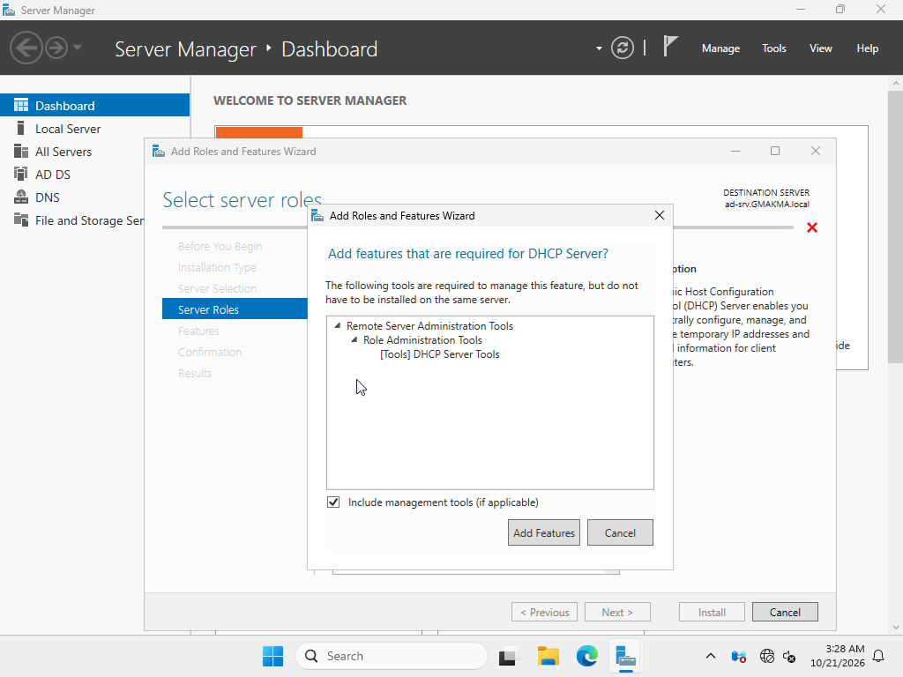

После закрытия окна роль **DHCP Server** отмечена в списке. Здесь же роли **Active Directory Domain Services** и **DNS Server** уже имеют пометку **Installed**.


На странице **Features** дополнительные компоненты вручную не добавлялись. После нажатия **Next** открылась информационная страница **DHCP Server**. Сервер уже имеет статический адрес `10.0.0.1`, поэтому его адрес не зависит от создаваемой области выдачи.

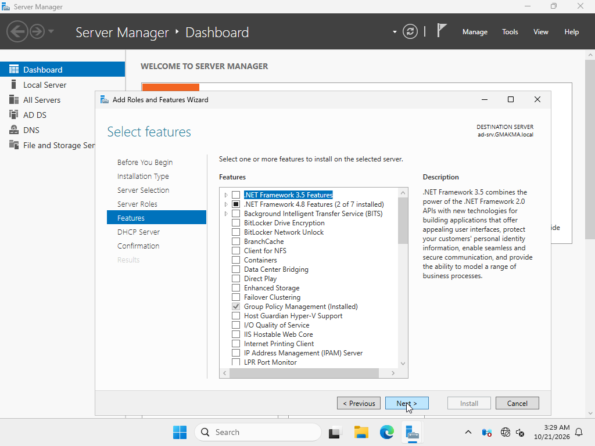


На странице **Confirmation** проверен состав установки: **DHCP Server** и средства управления **DHCP Server Tools**. Для запуска установки нажата кнопка **Install**.


Установка завершилась сообщением **Installation succeeded on ad-srv.GMAKMA.local**. В результатах появилась ссылка **Complete DHCP configuration**, по которой открыт мастер первоначальной настройки DHCP.


На странице **Description** перечислены действия первоначальной настройки: создание групп безопасности **DHCP Administrators** и **DHCP Users**, а также авторизация сервера в Active Directory. Для продолжения нажата кнопка **Next**.


На странице **Authorization** выбран вариант **Use the following user's credentials** с текущей учётной записью `GMAKMA\Administrator`. Пропуск авторизации не выбран. После проверки учётной записи нажата кнопка **Commit**.


В **Summary** для **Creating security groups** и **Authorizing DHCP server** показан результат **Done**. Мастер закрыт кнопкой **Close**.


Авторизация дополнительно подтверждена в [проверке DHCP](evidence/commands/dhcp-initial.json): в поле `Authorized` сохранены имя `ad-srv.gmakma.local` и адрес `10.0.0.1`.

### 2.5. Создание и настройка области DHCP

Через средства администрирования сервера открыта консоль **DHCP**. В дереве выбран сервер `ad-srv.gmakma.local` и его раздел **IPv4**.


Для IPv4 запущена команда **New Scope...**. На начальной странице **New Scope Wizard** нажата кнопка **Next**.


На странице **Scope Name** в поле **Name** введено `Lab2Scope`. Поле описания оставлено пустым.


На странице **IP Address Range** заданы границы пула и маска сети:

| Поле мастера | Значение |
|---|---|
| Start IP address | `10.0.0.100` |
| End IP address | `10.0.0.110` |
| Length | `8` |
| Subnet mask | `255.0.0.0` |

Пул ограничен адресами от `10.0.0.100` до `10.0.0.110`, а маска соответствует учебной сети `10.0.0.0/8`. Статический адрес сервера `10.0.0.1` в этот пул не входит.


На странице **Add Exclusions and Delay** исключения не добавлялись: список **Excluded address range** остался пустым. Задержка выдачи оставлена равной `0` мс. После проверки нажата кнопка **Next**.

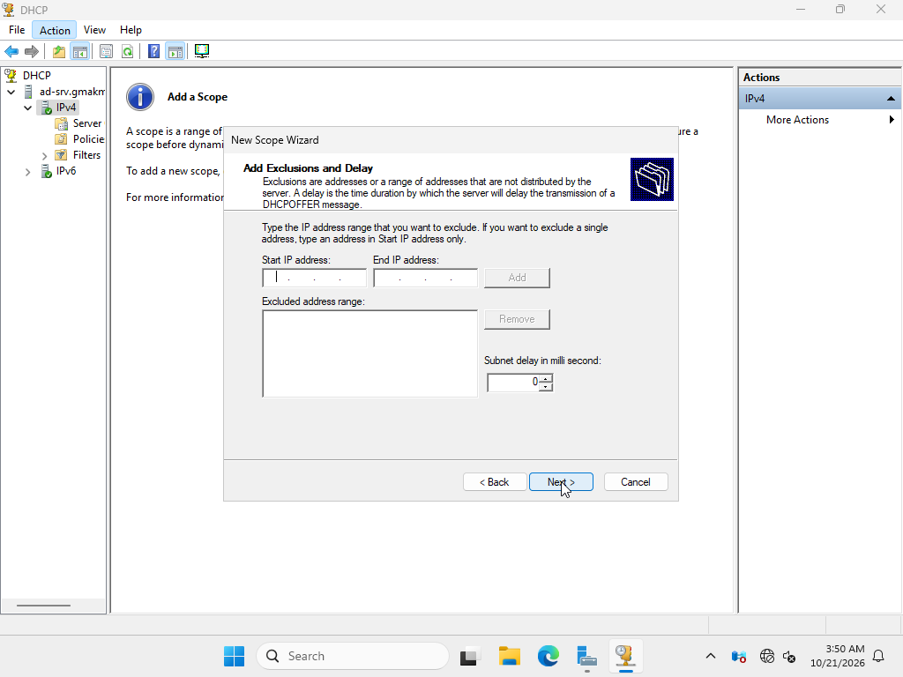

На странице **Lease Duration** оставлен срок аренды **8 дней, 0 часов, 0 минут**.

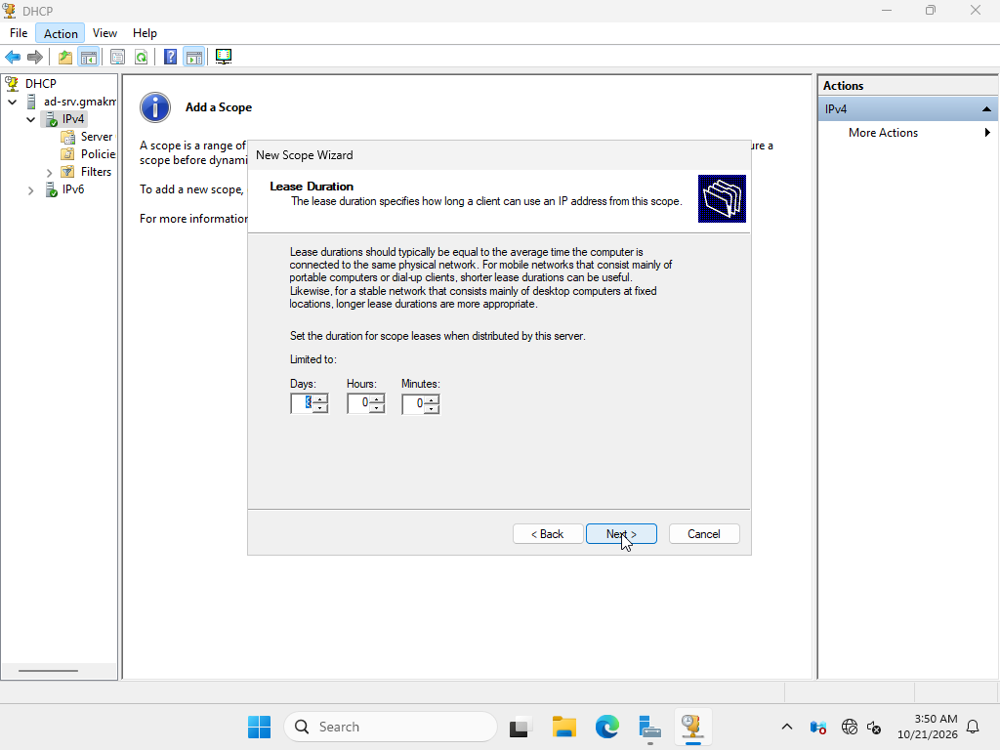

В **Configure DHCP Options** выбран вариант **Yes, I want to configure these options now**. Параметры DNS и шлюза настроены в том же мастере до активации области.


На странице **Router (Default Gateway)** введён адрес `10.0.0.1`, затем нажата кнопка **Add**. Адрес появился в списке, после чего выполнен переход к следующей странице. В учебной сети этот адрес выдаётся как шлюз по условию задания; наличие такого параметра само по себе не означает доступ в Интернет.


В **Domain Name and DNS Servers** в поле **Parent domain** указано `GMAKMA.local`. В список DNS-серверов добавлен адрес `10.0.0.1`. Клиентам области передаются имя учебного домена и адрес установленного на контроллере DNS.


На странице **WINS Servers** серверы не добавлялись. Список оставлен пустым, затем нажата кнопка **Next**.


На странице **Activate Scope** выбран вариант **Yes, I want to activate this scope now**.


Мастер завершён кнопкой **Finish** на странице **Completing the New Scope Wizard**.


В консоли DHCP появилась область **Scope [10.0.0.0] Lab2Scope** со статусом **Active**.


Итоговые параметры сверены с [сохранённой конфигурацией DHCP](evidence/commands/dhcp-initial.json). В ней подтверждены `ScopeId = 10.0.0.0`, границы `10.0.0.100` и `10.0.0.110`, маска `255.0.0.0` и состояние `Active`. Параметры области имеют следующие значения:

| Параметр DHCP | Значение |
|---|---|
| 003 Router | `10.0.0.1` |
| 006 DNS Servers | `10.0.0.1` |
| 015 DNS Domain Name | `GMAKMA.local` |
| 051 Lease | `691200` секунд, 8 дней |

После настройки DHCP сервер перезагружен. Повторная проверка показала, что служба `DHCPServer` запущена, а область осталась активной. Результаты сохранены в [итоговой проверке домена и DHCP](evidence/commands/domain-stage-verified.json).

### 2.6. Получение сетевой конфигурации клиентом

На клиенте открыты **Network Connections**, свойства адаптера **Ethernet**, затем свойства **Internet Protocol Version 4 (TCP/IPv4)**. Вместо первоначальной ручной конфигурации выбраны **Obtain an IP address automatically** и **Obtain DNS server address automatically**. Изменения сохранены кнопкой **OK**.


После получения конфигурации на клиенте выполнена команда:

```bat
ipconfig /all
```

Проверены имя компьютера, MAC-адрес адаптера, признак DHCP и выданные сетевые параметры. Итоговый вывод после вступления в домен приведён на рисунке ниже.


| Проверяемое поле | Фактическое значение |
|---|---|
| Host Name | `ad-client` |
| Physical Address | `BC-24-11-53-4F-29` |
| DHCP Enabled | `Yes` |
| IPv4 Address | `10.0.0.100` |
| Subnet Mask | `255.0.0.0` |
| Default Gateway | `10.0.0.1` |
| DHCP Server | `10.0.0.1` |
| DNS Servers | `10.0.0.1` |
| Connection-specific DNS Suffix | `GMAKMA.local` |

Адрес `10.0.0.100` совпал с ранее использованным ручным адресом, поэтому одного значения IPv4 недостаточно для проверки DHCP. В выводе теперь указаны **DHCP Enabled: Yes**, сервер аренды `10.0.0.1` и время получения и окончания аренды. Эти поля подтверждают получение адреса через DHCP.

На сервере дополнительно проверена активная аренда. В [записи аренды клиента](evidence/commands/dhcp-client-lease.json) указаны адрес `10.0.0.100`, имя `ad-client.GMAKMA.local`, идентификатор клиента `bc-24-11-53-4f-29` и состояние `Active`. Идентификатор совпадает с MAC-адресом адаптера клиента. Первоначальная проверка до вступления в домен сохранена в [client-dhcp.txt](evidence/commands/client-dhcp.txt).

### 2.7. Вступление ad-client в домен

После проверки DHCP и разрешения имени контроллера на клиенте в PowerShell с правами локального администратора выполнено присоединение к домену:

```powershell
Add-Computer -DomainName 'GMAKMA.local' -Credential $cred -PassThru
```

Параметр `-DomainName` задаёт домен `GMAKMA.local`. В переменной `$cred` передан объект `PSCredential` администратора домена `Administrator@GMAKMA.local`. Пароль в отчёте не приводится. Параметр `-PassThru` использован для возврата результата операции.

После выполнения команды клиент перезагружен:

```bat
shutdown /r /t5
```

После перезагрузки проверены членство компьютера и защищённый канал с доменом. В [файле проверки клиента](evidence/commands/client-domain-verified.txt) сохранены следующие значения:

```text
Name: AD-CLIENT
Domain: GMAKMA.local
PartOfDomain: true
```

Проверка защищённого канала вернула `True`. После присоединения основной DNS-суффикс компьютера также стал `GMAKMA.local`; автоматическая конфигурация DHCP сохранилась. Наличие объекта `AD-CLIENT` в каталоге дополнительно проверено в оснастке Active Directory, как показано в разделе 2.9.

### 2.8. Вход на клиент под администратором домена

После перезагрузки клиента на экране входа выбран пункт **Other user**. Для входа использована доменная учётная запись в формате UPN: `administrator@GMAKMA.local`. После аутентификации открылся рабочий стол Windows 10.


Для проверки текущего пользователя и компьютера в открытой сессии выполнены команды:

```bat
whoami
hostname
```

Команда `whoami` вернула `gmakma\administrator`, а `hostname` – `ad-client`. Следовательно, на клиентской машине открыт сеанс администратора домена, а не локального пользователя `LabAdmin`.


В [проверке доменной сессии](evidence/commands/client-domain-verified.txt) поле `UserName` имеет значение `GMAKMA\Administrator`. Оно совпадает с результатом `whoami` на рабочем столе клиента.

### 2.9. Проверка объектов компьютеров в Active Directory

На контроллере домена открыта оснастка **Active Directory Users and Computers**. В дереве раскрыт домен `GMAKMA.local` и выбран контейнер **Computers**. В правой части окна найден объект **AD-CLIENT** с типом **Computer**.


Затем в том же домене выбрано подразделение **Domain Controllers**. В нём найден объект **AD-SRV** с типом **Computer**. В столбце **DC Type** отображается **GC**.

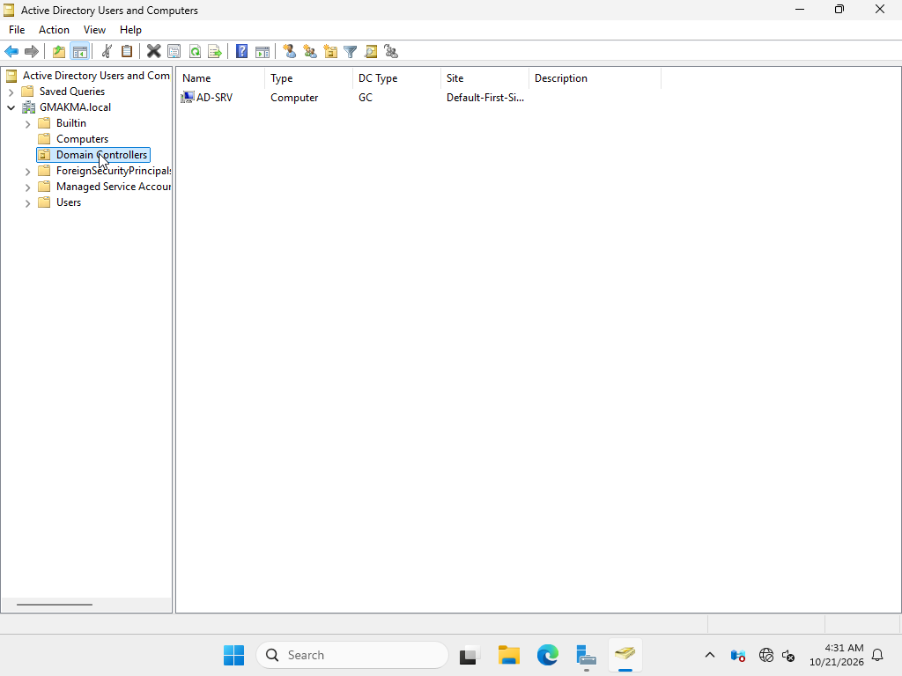

По результатам проверки сервер `ad-srv` работает как контроллер домена `GMAKMA.local`, а `ad-client` включён в этот домен как рабочая станция. Для клиента подтверждены получение адреса из заданного пула DHCP, DNS и шлюза `10.0.0.1`, работоспособный защищённый канал и интерактивный вход под администратором домена.
