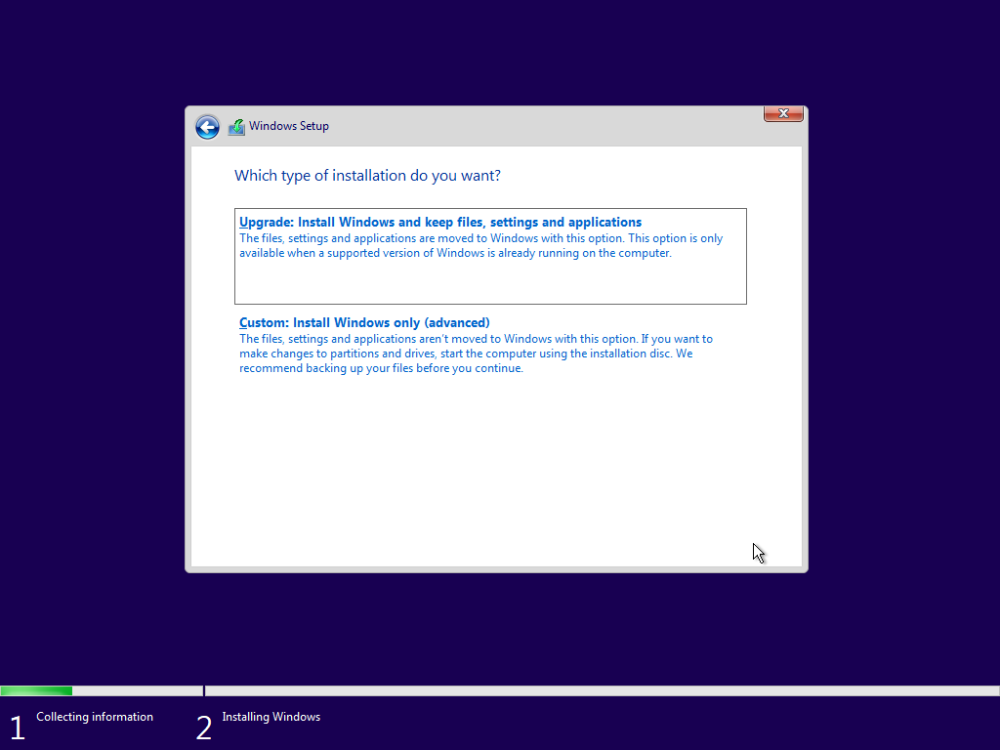
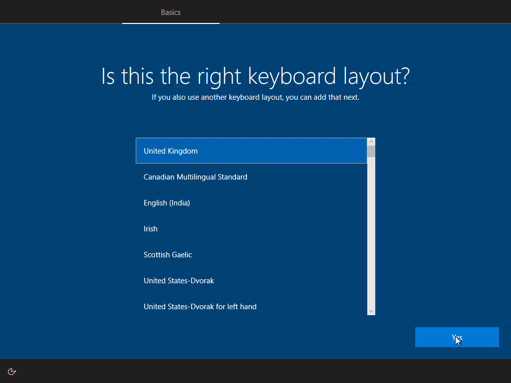
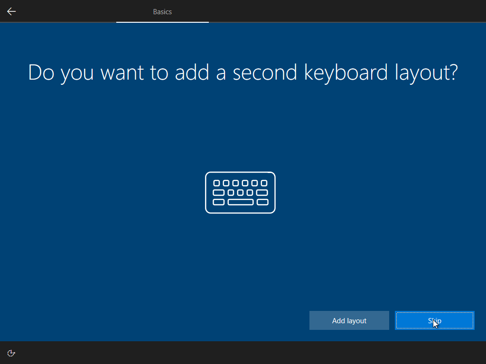
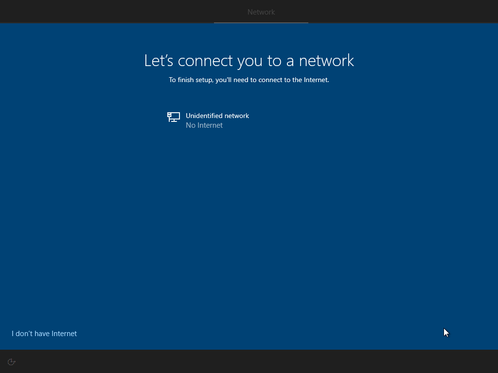
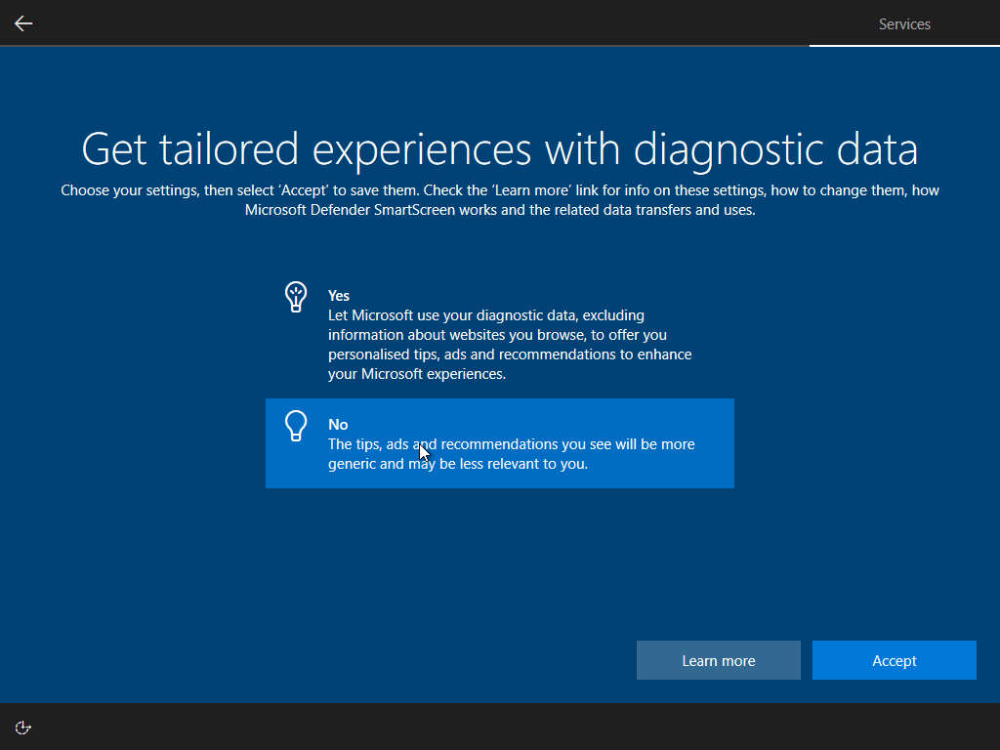

# Ход выполнения практической работы №2

## Цель работы

Получить практические навыки развёртывания Active Directory, управления пользователями и группами домена, настройки прав NTFS и SMB, применения групповых политик, автоматизации создания объектов и восстановления удалённых учётных записей.

## Среда выполнения

Для работы выделены две виртуальные машины в Proxmox VE. Сервер устанавливается в редакции Windows Server 2025 Standard Evaluation с графической оболочкой Desktop Experience. Для клиента выбрана Windows 10 Pro.

| Машина | Назначение | Процессоры | Оперативная память | Диск |
|---|---|---|---|---|
| VM 104 | Сервер `ad-srv` | 4 | 8 ГиБ | 64 ГиБ, SATA |
| VM 105 | Клиент `ad-client` | 2 | 4 ГиБ | 64 ГиБ, SATA |

Вместо указанной в задании VirtualBox использована доступная среда Proxmox VE. Для обеих машин выбран один изолированный мост `vmbr1_lab`. Подключения к внешнему мосту `vmbr0` нет.

Конфигурация машин сохранена отдельно: [VM 104](evidence/commands/vm104-configuration.json), [VM 105](evidence/commands/vm105-configuration.json).

## 1. Подготовка операционных систем

### 1.1. Установка Windows Server

Сервер загружен с установочного образа Windows Server. Перед началом копирования файлов выбрана редакция `Windows Server 2025 Standard Evaluation (Desktop Experience)` и вариант установки без сохранения старых данных.


После нажатия **Install** началась установка операционной системы. На экране отображаются процент выполнения и предупреждение об автоматических перезагрузках.


### 1.2. Установка Windows 10 Pro

Клиентская машина загружена с образа Windows 10. На первом экране оставлены английский язык интерфейса и раскладка United Kingdom.


После перехода к следующему окну выбрана команда **Install now**.


На экране активации выбран вариант **I don't have a product key**. Ключ продукта при установке не вводился.


В списке редакций выбрана `Windows 10 Pro`.


После ознакомления с лицензионным соглашением отмечено поле **I accept the licence terms**.


Для чистой установки выбран вариант **Custom: Install Windows only (advanced)**.



На клиентской машине обнаружен один диск объёмом 64 ГиБ. Старая разметка содержала системный, основной и служебный разделы.


Для удаления старой разметки через `Shift+F10` открыта командная строка установщика. Выполнены команды:

```text
diskpart
select disk 0
clean
exit
```

После закрытия командной строки и нажатия **Refresh** установщик показал единственный участок `Drive 0 Unallocated Space` размером 64 ГиБ. Старые разделы отсутствуют.


Неразмеченный диск выбран в качестве места установки. После нажатия **Next** запущена установка Windows 10 Pro.


### 1.3. Первичная настройка Windows 10

После установки выбран регион United Kingdom.


Для ввода оставлена раскладка United Kingdom; добавление второй раскладки пропущено.





Машина находится в изолированной сети. На экране подключения выбран пункт **I don't have internet**, затем **Continue with limited setup**. Внешний сетевой адаптер для прохождения первоначальной настройки не добавлялся.




Создана локальная учётная запись `LabAdmin` для первоначальной настройки клиента. Пароль и ответы на контрольные вопросы в отчёт не включены.


Необязательные функции определения местоположения, поиска устройства, отправки данных рукописного ввода, персонализированных рекомендаций и рекламного идентификатора отключены. Для диагностики оставлены только обязательные данные.





### 1.4. Завершение установки сервера и настройка имён

После завершения установки Windows Server выполнен вход локальным администратором. Открылся Server Manager.


Сервер переименован в `ad-srv`, клиент – в `ad-client`. Для применения имён обе машины перезагружены. Использована команда `Rename-Computer` с соответствующим именем:

```powershell
Rename-Computer -NewName ad-srv -Force
```

```powershell
Rename-Computer -NewName ad-client -Force
```

После перезагрузки на клиенте повторно выполнен вход `LabAdmin`. Команды `whoami` и `hostname` подтвердили локальную учётную запись `ad-client\labadmin` и имя `ad-client`.


### 1.5. Настройка изолированной сети

На сервере адаптер `Ethernet` сопоставлен с единственным сетевым устройством VM 104 по MAC `BC-24-11-DE-ED-1E`. Установлены параметры:

| Параметр | Значение |
|---|---|
| IPv4 | `10.0.0.1` |
| Маска | `255.0.0.0` |
| DNS | `10.0.0.1` |
| Шлюз сервера | Не задан: выхода из учебной LAN нет |

В текущей установке этот адаптер имеет InterfaceIndex `6`.

```powershell
Set-NetIPInterface -InterfaceIndex 6 -Dhcp Disabled
New-NetIPAddress -InterfaceIndex 6 -IPAddress 10.0.0.1 -PrefixLength 8
Set-DnsClientServerAddress -InterfaceIndex 6 -ServerAddresses 10.0.0.1
```

После перезагрузки выполнены `hostname` и `ipconfig /all`. Вывод подтверждает имя `ad-srv`, статический IPv4, маску и DNS.


Для первоначальной передачи гостевых инструментов клиенту временно назначался адрес `10.0.0.100/8`. Этот адрес на данном этапе задан вручную; настройка получения адреса через DHCP выполняется после развёртывания серверной роли.

### 1.6. Гостевые инструменты и базовые снимки

На обеих машинах установлены QEMU Guest Agent и драйвер VirtIO Serial. Это позволяет получать сведения о гостевой ОС из среды виртуализации. Установка драйвера на клиенте завершена сообщением `Driver package installed on device`.


После перезагрузок и проверки входа сохранены базовые снимки `lab2-a1-server-os-ready` и `lab2-a1-client-os-ready`. Они относятся к состоянию до создания домена. Список снимков и параметры машин приведены в [файле проверки базового состояния](evidence/commands/os-ready.json).
