# Ход выполнения практической работы №2

## Цель работы

Получить практические навыки развёртывания Active Directory, управления пользователями и группами домена, настройки прав NTFS и SMB, применения групповых политик, автоматизации создания объектов и восстановления удалённых учётных записей.

## Среда выполнения

Для работы выделены две виртуальные машины в Proxmox VE. Сервер устанавливается в редакции Windows Server 2025 Standard Evaluation с графической оболочкой Desktop Experience. Для клиента выбрана Windows 10 Pro.

| Машина | Назначение | Процессоры | Оперативная память | Диск |
|---|---|---|---|---|
| VM 104 | Сервер `ad-srv` | 4 | 8 ГиБ | 64 ГиБ, SATA |
| VM 105 | Клиент `ad-client` | 2 | 4 ГиБ | 64 ГиБ, SATA |

Вместо указанной в задании VirtualBox использована доступная среда Proxmox VE. Для обеих машин выбран один изолированный мост `vmbr1_lab`. Подключения к внешнему мосту `vmbr0` нет.

Конфигурация машин сохранена отдельно: [VM 104](evidence/commands/vm104-configuration.json), [VM 105](evidence/commands/vm105-configuration.json).

## 1. Подготовка операционных систем

### 1.1. Установка Windows Server

Сервер загружен с установочного образа Windows Server. Перед началом копирования файлов выбрана редакция `Windows Server 2025 Standard Evaluation (Desktop Experience)` и вариант установки без сохранения старых данных.


После нажатия **Install** началась установка операционной системы. На экране отображаются процент выполнения и предупреждение об автоматических перезагрузках.


### 1.2. Установка Windows 10 Pro

Клиентская машина загружена с образа Windows 10. На первом экране оставлены английский язык интерфейса и раскладка United Kingdom.

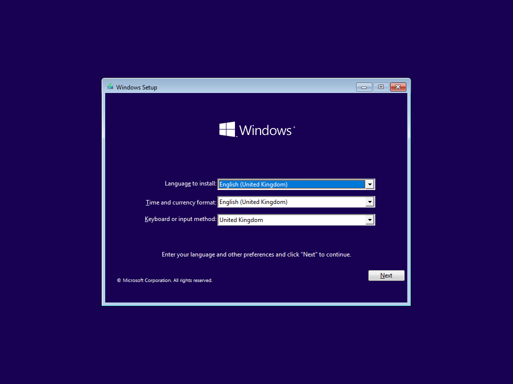

После перехода к следующему окну выбрана команда **Install now**.

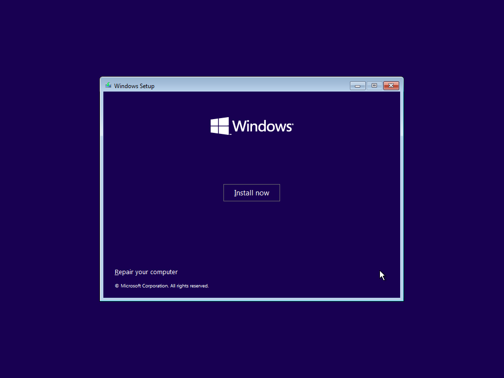

На экране активации выбран вариант **I don't have a product key**. Ключ продукта при установке не вводился.


В списке редакций выбрана `Windows 10 Pro`.


После ознакомления с лицензионным соглашением отмечено поле **I accept the licence terms**.

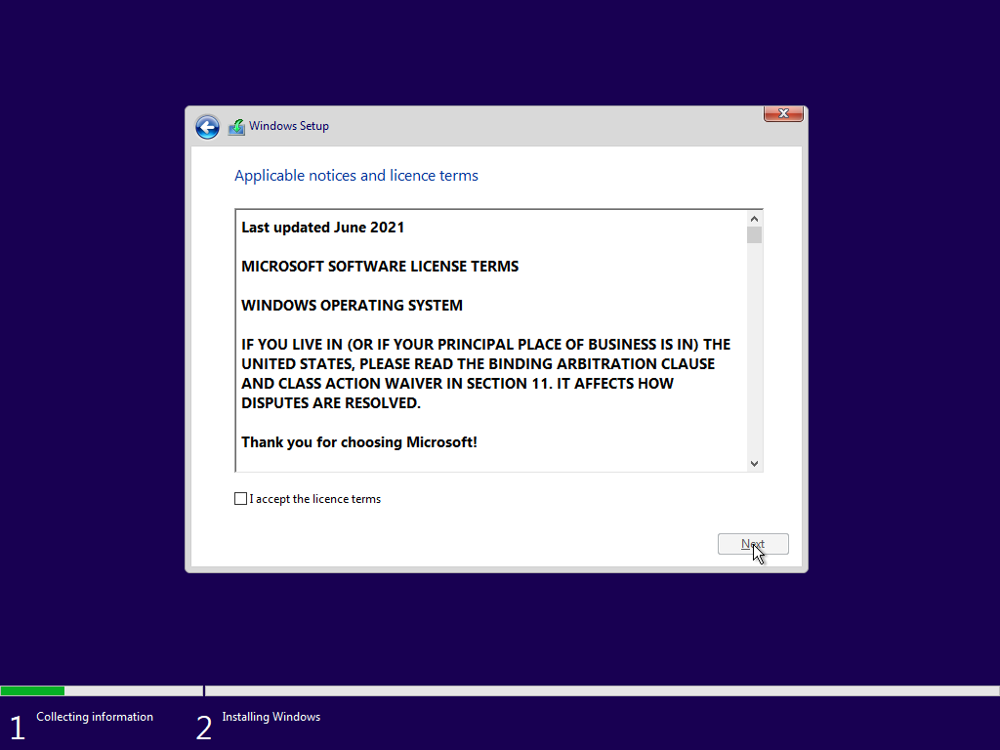

Для чистой установки выбран вариант **Custom: Install Windows only (advanced)**.


На клиентской машине обнаружен один диск объёмом 64 ГиБ. Старая разметка содержала системный, основной и служебный разделы.


Для удаления старой разметки через `Shift+F10` открыта командная строка установщика. Выполнены команды:

```text
diskpart
select disk 0
clean
exit
```

После закрытия командной строки и нажатия **Refresh** установщик показал единственный участок `Drive 0 Unallocated Space` размером 64 ГиБ. Старые разделы отсутствуют.


Неразмеченный диск выбран в качестве места установки. После нажатия **Next** запущена установка Windows 10 Pro.


### 1.3. Первичная настройка Windows 10

После установки выбран регион United Kingdom.


Для ввода оставлена раскладка United Kingdom; добавление второй раскладки пропущено.


Машина находится в изолированной сети. На экране подключения выбран пункт **I don't have internet**, затем **Continue with limited setup**. Внешний сетевой адаптер для прохождения первоначальной настройки не добавлялся.


Создана локальная учётная запись `LabAdmin` для первоначальной настройки клиента. Пароль и ответы на контрольные вопросы в отчёт не включены.

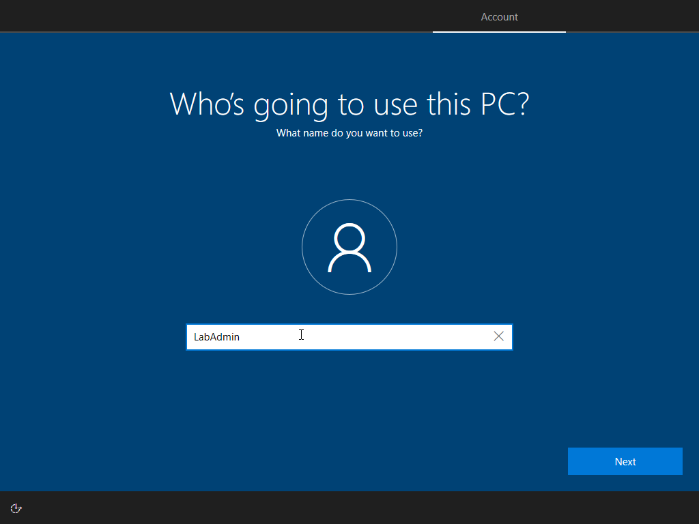

Необязательные функции определения местоположения, поиска устройства, отправки данных рукописного ввода, персонализированных рекомендаций и рекламного идентификатора отключены. Для диагностики оставлены только обязательные данные.

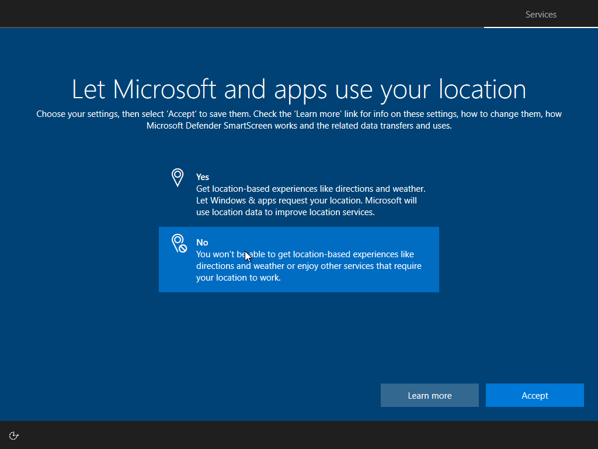


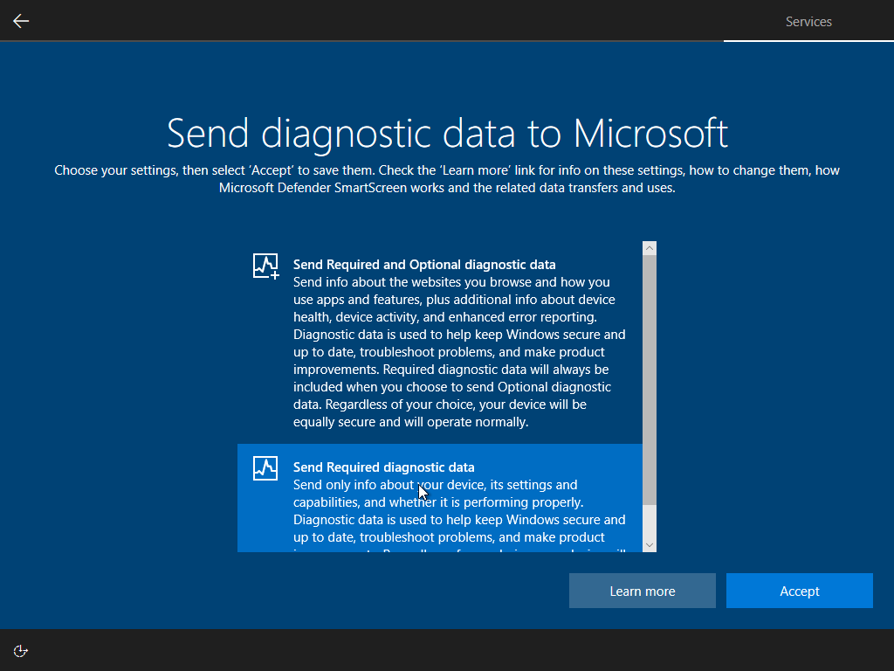

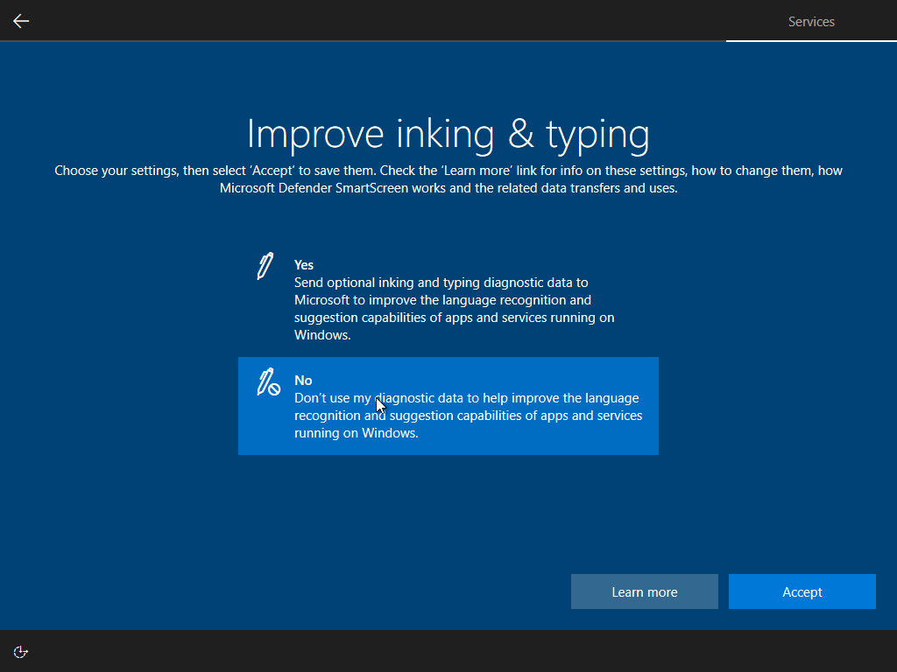


### 1.4. Завершение установки сервера и настройка имён

После завершения установки Windows Server выполнен вход локальным администратором. Открылся Server Manager.


Сервер переименован в `ad-srv`, клиент – в `ad-client`. Для применения имён обе машины перезагружены. Использована команда `Rename-Computer` с соответствующим именем:

```powershell
Rename-Computer -NewName ad-srv -Force
```

```powershell
Rename-Computer -NewName ad-client -Force
```

После перезагрузки на клиенте повторно выполнен вход `LabAdmin`. Команды `whoami` и `hostname` подтвердили локальную учётную запись `ad-client\labadmin` и имя `ad-client`.


### 1.5. Настройка изолированной сети

На сервере адаптер `Ethernet` сопоставлен с единственным сетевым устройством VM 104 по MAC `BC-24-11-DE-ED-1E`. Установлены параметры:

| Параметр | Значение |
|---|---|
| IPv4 | `10.0.0.1` |
| Маска | `255.0.0.0` |
| DNS | `10.0.0.1` |
| Шлюз сервера | Не задан: выхода из учебной LAN нет |

В текущей установке этот адаптер имеет InterfaceIndex `6`.

```powershell
Set-NetIPInterface -InterfaceIndex 6 -Dhcp Disabled
New-NetIPAddress -InterfaceIndex 6 -IPAddress 10.0.0.1 -PrefixLength 8
Set-DnsClientServerAddress -InterfaceIndex 6 -ServerAddresses 10.0.0.1
```

После перезагрузки выполнены `hostname` и `ipconfig /all`. Вывод подтверждает имя `ad-srv`, статический IPv4, маску и DNS.


Для первоначальной передачи гостевых инструментов клиенту временно назначался адрес `10.0.0.100/8`. Этот адрес на данном этапе задан вручную; настройка получения адреса через DHCP выполняется после развёртывания серверной роли.

### 1.6. Гостевые инструменты и базовые снимки

На обеих машинах установлены QEMU Guest Agent и драйвер VirtIO Serial. Это позволяет получать сведения о гостевой ОС из среды виртуализации. Установка драйвера на клиенте завершена сообщением `Driver package installed on device`.

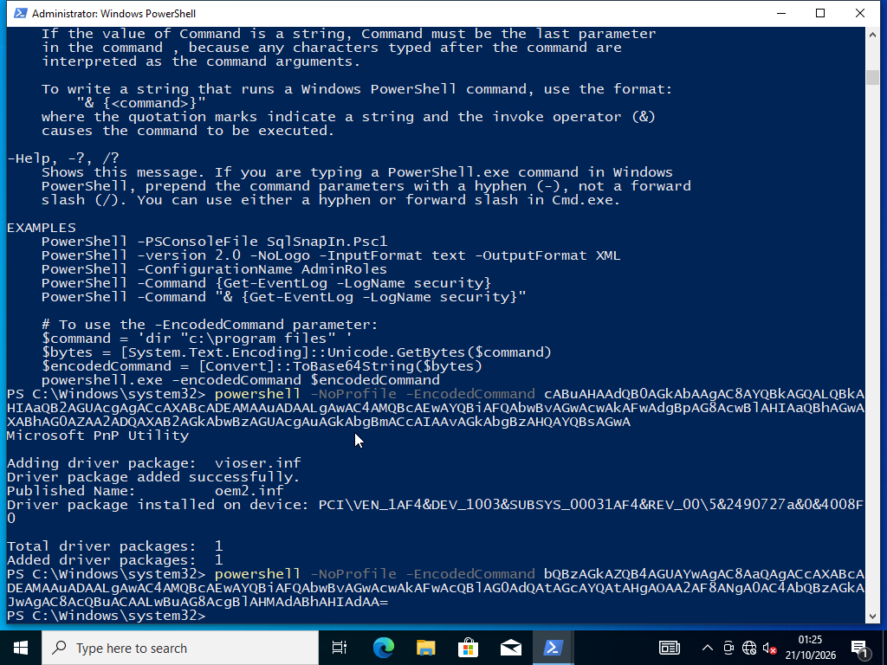

После перезагрузок и проверки входа сохранены базовые снимки `lab2-a1-server-os-ready` и `lab2-a1-client-os-ready`. Они относятся к состоянию до создания домена. Список снимков и параметры машин приведены в [файле проверки базового состояния](evidence/commands/os-ready.json).

## 2. Развёртывание Active Directory

### 2.1. Установка роли AD DS

На сервере в Server Manager выбрана команда **Add roles and features**. Мастер начал работу с окна **Before You Begin**.


Для установки роли на текущую машину оставлен вариант **Role-based or feature-based installation**.


В списке серверов выбран `ad-srv`.


В **Server Roles** отмечена роль **Active Directory Domain Services**. Мастер предложил добавить Group Policy Management, средства администрирования AD и модуль Active Directory для PowerShell. Оставлено включённым поле **Include management tools**, затем нажата кнопка **Add Features**.

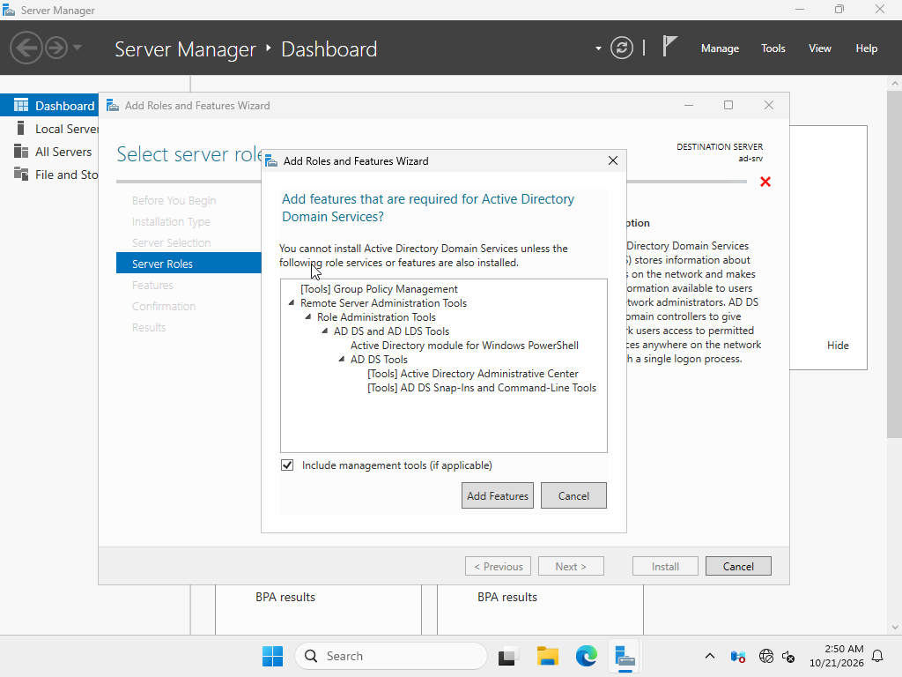

Выбранная роль отображается в списке Server Roles.


На странице Features показаны выбранные компоненты. Дополнительные роли AD CS, AD FS и AD LDS не выбирались.

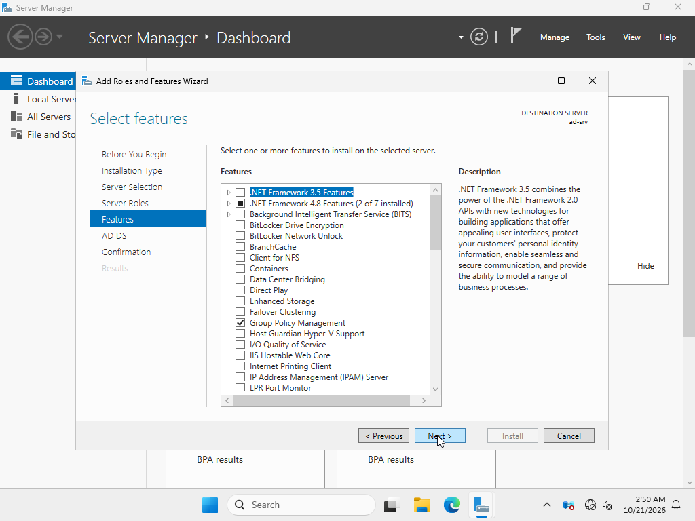


Перед установкой проверен итоговый список. Нажата кнопка **Install**.

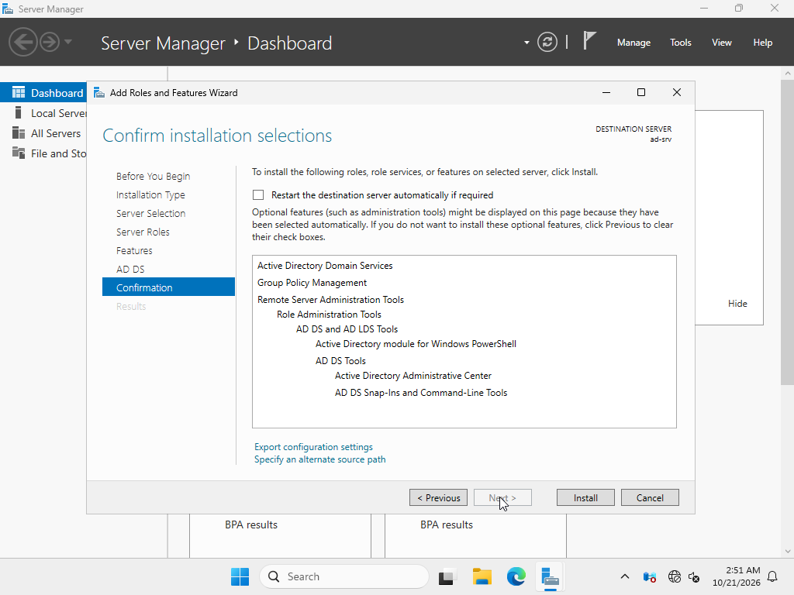

Роль установлена с сообщением **Installation succeeded on ad-srv**. На этой стадии сервер ещё требует повышения до контроллера домена: в мастере появилась ссылка **Promote this server to a domain controller**.


### 2.2. Создание нового леса и домена

По ссылке **Promote this server to a domain controller** открыт мастер AD DS Configuration Wizard. Выбран вариант **Add a new forest**, в поле Root domain name введено `GMAKMA.local`.

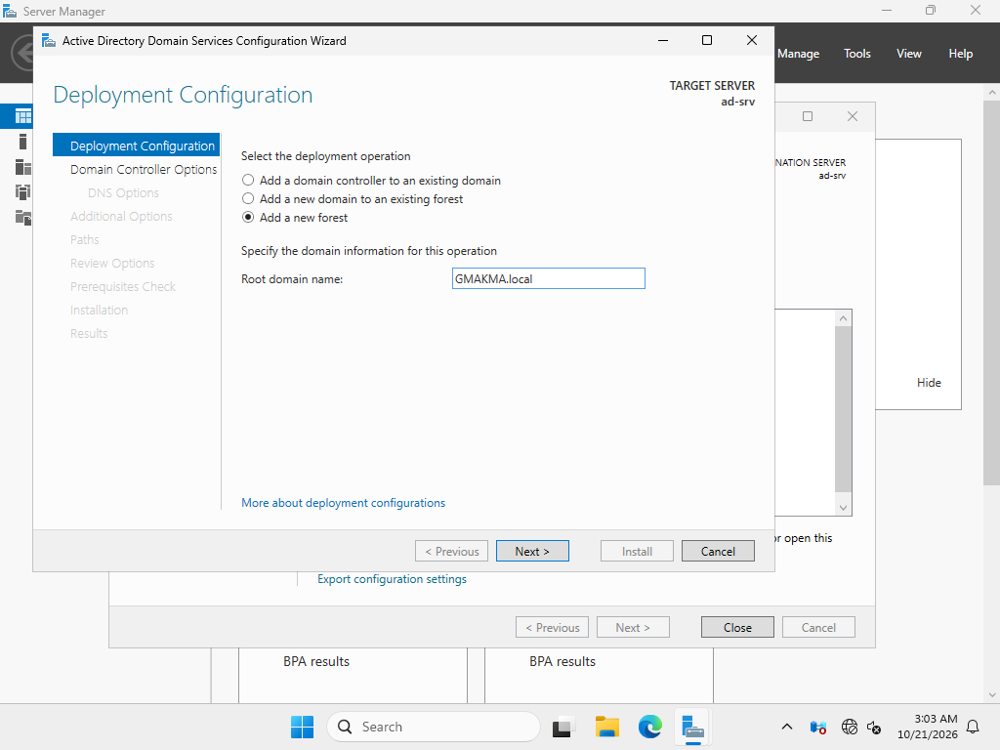

В Domain Controller Options оставлены уровни леса и домена **Windows Server 2025**. Отмечены **DNS server** и **Global Catalog**; RODC не выбран. Для Directory Services Restore Mode задан отдельный пароль, который не включён в отчёт.

На странице DNS Options показано предупреждение о невозможности создать делегирование: родительская авторитетная зона не найдена. В работе создаётся самостоятельный лес в изолированной сети, поэтому создание делегирования оставлено выключенным.


Мастер предложил NetBIOS-имя `GMAKMA`. Это имя оставлено без изменения.


На странице **Paths** оставлены стандартные каталоги. В полях **Database folder** и **Log files folder** указан `C:\WINDOWS\NTDS`, в поле **SYSVOL folder** – `C:\WINDOWS\SYSVOL`. После проверки путей нажата кнопка **Next**.


Перед применением просмотрены итоговые параметры развёртывания.

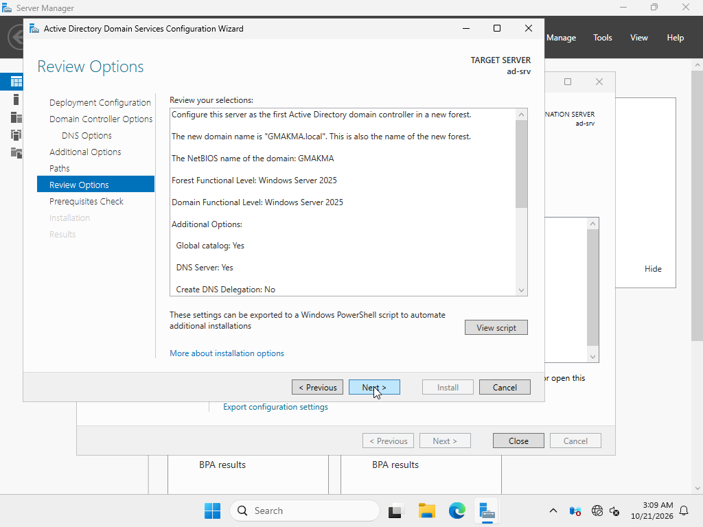

Мастер завершил prerequisites check сообщением **All prerequisite checks passed successfully**. Предупреждение о DNS delegation осталось в результатах и не препятствовало установке.

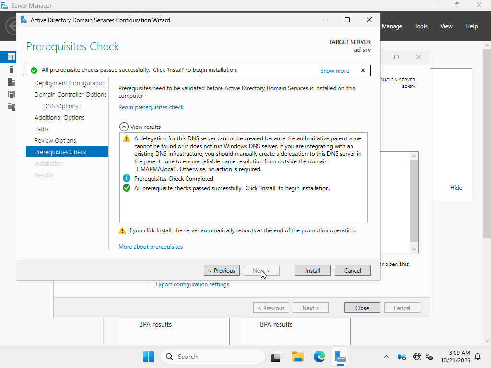

После нажатия **Install** запущено создание леса и повышение сервера. По завершении этой операции началась автоматическая перезагрузка.

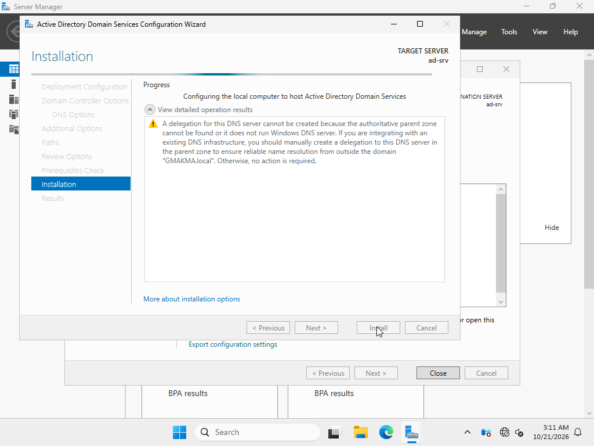

После перезагрузки выполнен вход на сервер под администратором домена. Открылся рабочий стол Windows Server.


Результат развёртывания проверен по сведениям о домене, лесе, службах и общих папках. В [сохранённой проверке Active Directory](evidence/commands/domain-initial.json) указаны `DNSRoot = GMAKMA.local`, `NetBIOSName = GMAKMA` и `PDCEmulator = ad-srv.GMAKMA.local`. Корневой домен леса также равен `GMAKMA.local`. Службы `NTDS`, `DNS` и `Netlogon` находятся в состоянии Running; в сохранённом JSON это значение перечисления `4`.

На сервере появились общие папки `SYSVOL` и `NETLOGON`. Для `SYSVOL` указан путь `C:\WINDOWS\SYSVOL\sysvol`, для `NETLOGON` – `C:\WINDOWS\SYSVOL\sysvol\GMAKMA.local\SCRIPTS`. Таким образом, после перезагрузки проверены не только установленная роль, но и созданный домен со службами и системными общими папками.

### 2.3. Проверка автоматически настроенного DNS

На сервере открыта оснастка **DNS Manager**. В дереве **AD-SRV -> Forward Lookup Zones** проверены зоны прямого просмотра. Мастер создал `GMAKMA.local` и `_msdcs.GMAKMA.local`. Для обеих зон отображаются тип **Active Directory-Integrated** и состояние **Running**.


Затем открыта зона `GMAKMA.local`. В ней присутствуют записи **SOA**, **NS**, запись **Host (A)** для `ad-srv` с адресом `10.0.0.1`, а также узлы `_msdcs`, `_sites`, `_tcp` и `_udp`. На этом этапе дополнительные зоны и записи вручную не создавались.


Разрешение имени сервера дополнительно проверено с клиента. В [выводе проверки сетевых параметров](evidence/commands/client-dhcp.txt) запрос имени `ad-srv.GMAKMA.local` возвращает запись типа `A` с адресом `10.0.0.1`. Это соответствует адресу контроллера домена, заданному в серверной конфигурации.

### 2.4. Установка и авторизация DHCP-сервера

В Server Manager повторно открыт мастер **Add Roles and Features**. После страницы **Before You Begin** выбран вариант **Role-based or feature-based installation**.


В **Server Selection** выбран сервер `ad-srv.GMAKMA.local` с адресом `10.0.0.1`. После создания домена в списке отображается полное доменное имя сервера.


На странице **Server Roles** отмечена роль **DHCP Server**. В открывшемся окне подтверждено добавление **DHCP Server Tools**. Поле **Include management tools (if applicable)** оставлено включённым, затем нажата кнопка **Add Features**.


После закрытия окна роль **DHCP Server** отмечена в списке. Здесь же роли **Active Directory Domain Services** и **DNS Server** уже имеют пометку **Installed**.

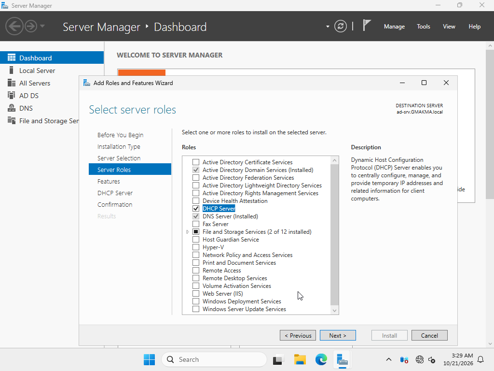

На странице **Features** дополнительные компоненты вручную не добавлялись. После нажатия **Next** открылась информационная страница **DHCP Server**. Сервер уже имеет статический адрес `10.0.0.1`, поэтому его адрес не зависит от создаваемой области выдачи.


На странице **Confirmation** проверен состав установки: **DHCP Server** и средства управления **DHCP Server Tools**. Для запуска установки нажата кнопка **Install**.

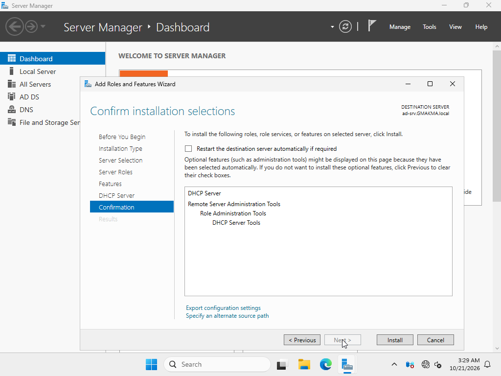

Установка завершилась сообщением **Installation succeeded on ad-srv.GMAKMA.local**. В результатах появилась ссылка **Complete DHCP configuration**, по которой открыт мастер первоначальной настройки DHCP.


На странице **Description** перечислены действия первоначальной настройки: создание групп безопасности **DHCP Administrators** и **DHCP Users**, а также авторизация сервера в Active Directory. Для продолжения нажата кнопка **Next**.

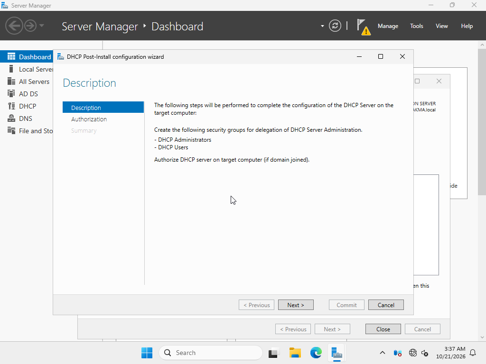

На странице **Authorization** выбран вариант **Use the following user's credentials** с текущей учётной записью `GMAKMA\Administrator`. Пропуск авторизации не выбран. После проверки учётной записи нажата кнопка **Commit**.


В **Summary** для **Creating security groups** и **Authorizing DHCP server** показан результат **Done**. Мастер закрыт кнопкой **Close**.


Авторизация дополнительно подтверждена в [проверке DHCP](evidence/commands/dhcp-initial.json): в поле `Authorized` сохранены имя `ad-srv.gmakma.local` и адрес `10.0.0.1`.

### 2.5. Создание и настройка области DHCP

Через средства администрирования сервера открыта консоль **DHCP**. В дереве выбран сервер `ad-srv.gmakma.local` и его раздел **IPv4**.

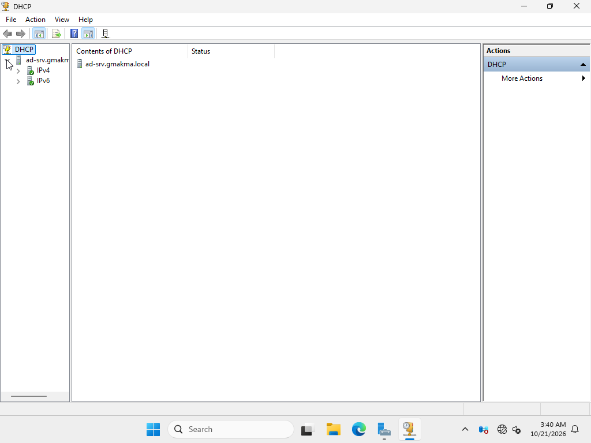

Для IPv4 запущена команда **New Scope...**. На начальной странице **New Scope Wizard** нажата кнопка **Next**.


На странице **Scope Name** в поле **Name** введено `Lab2Scope`. Поле описания оставлено пустым.


На странице **IP Address Range** заданы границы пула и маска сети:

| Поле мастера | Значение |
|---|---|
| Start IP address | `10.0.0.100` |
| End IP address | `10.0.0.110` |
| Length | `8` |
| Subnet mask | `255.0.0.0` |

Пул ограничен адресами от `10.0.0.100` до `10.0.0.110`, а маска соответствует учебной сети `10.0.0.0/8`. Статический адрес сервера `10.0.0.1` в этот пул не входит.


На странице **Add Exclusions and Delay** исключения не добавлялись: список **Excluded address range** остался пустым. Задержка выдачи оставлена равной `0` мс. После проверки нажата кнопка **Next**.


На странице **Lease Duration** оставлен срок аренды **8 дней, 0 часов, 0 минут**.


В **Configure DHCP Options** выбран вариант **Yes, I want to configure these options now**. Параметры DNS и шлюза настроены в том же мастере до активации области.


На странице **Router (Default Gateway)** введён адрес `10.0.0.1`, затем нажата кнопка **Add**. Адрес появился в списке, после чего выполнен переход к следующей странице. В учебной сети этот адрес выдаётся как шлюз по условию задания; наличие такого параметра само по себе не означает доступ в Интернет.


В **Domain Name and DNS Servers** в поле **Parent domain** указано `GMAKMA.local`. В список DNS-серверов добавлен адрес `10.0.0.1`. Клиентам области передаются имя учебного домена и адрес установленного на контроллере DNS.

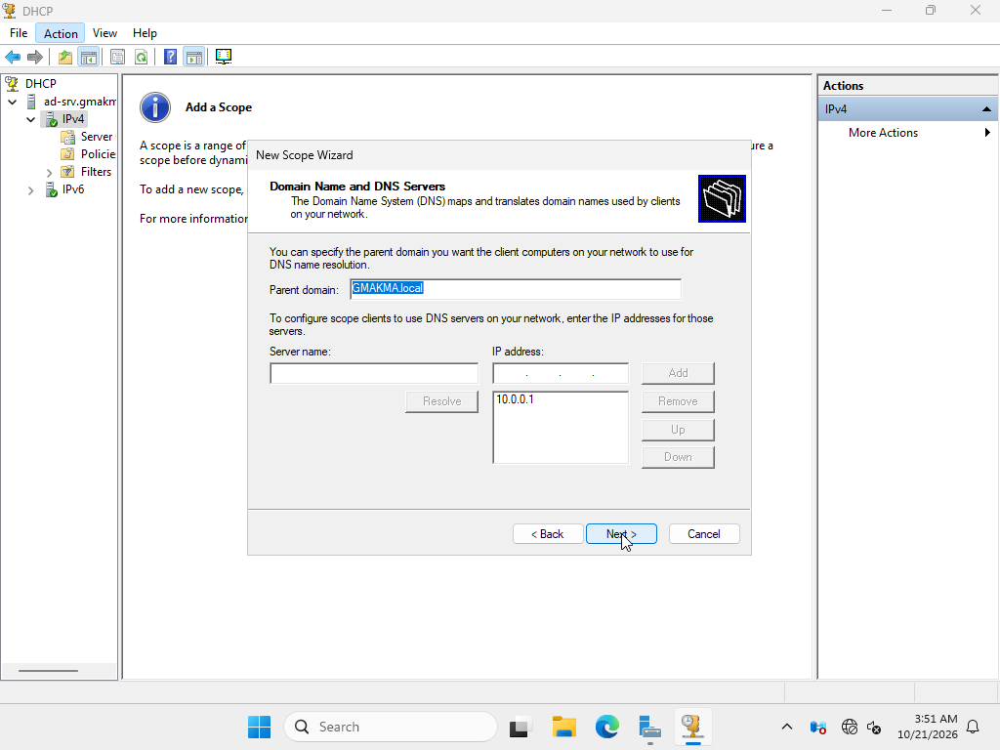

На странице **WINS Servers** серверы не добавлялись. Список оставлен пустым, затем нажата кнопка **Next**.

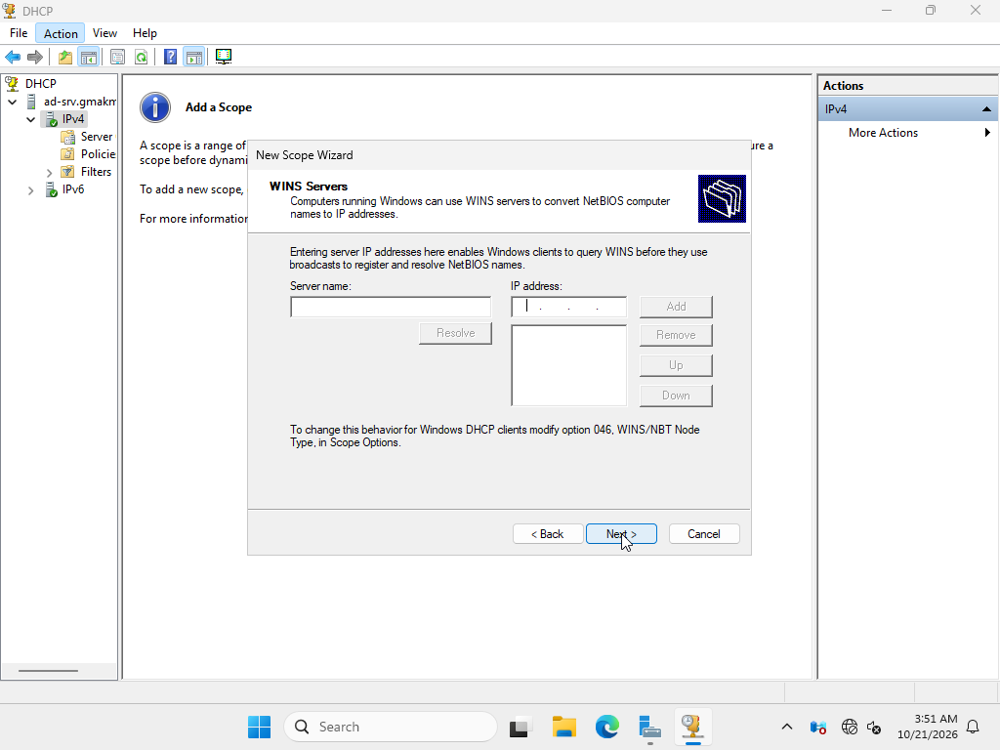

На странице **Activate Scope** выбран вариант **Yes, I want to activate this scope now**.


Мастер завершён кнопкой **Finish** на странице **Completing the New Scope Wizard**.

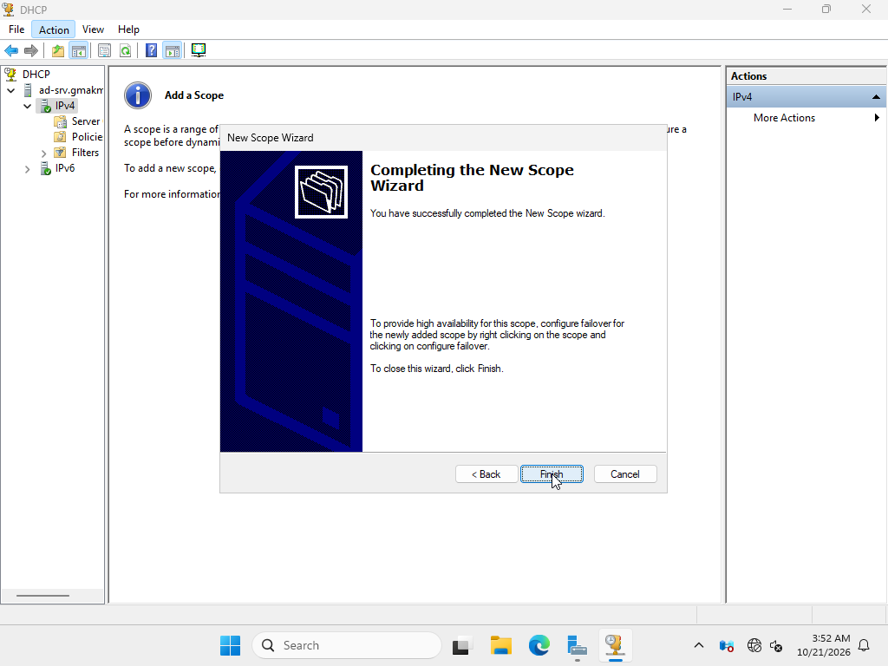

В консоли DHCP появилась область **Scope [10.0.0.0] Lab2Scope** со статусом **Active**.


Итоговые параметры сверены с [сохранённой конфигурацией DHCP](evidence/commands/dhcp-initial.json). В ней подтверждены `ScopeId = 10.0.0.0`, границы `10.0.0.100` и `10.0.0.110`, маска `255.0.0.0` и состояние `Active`. Параметры области имеют следующие значения:

| Параметр DHCP | Значение |
|---|---|
| 003 Router | `10.0.0.1` |
| 006 DNS Servers | `10.0.0.1` |
| 015 DNS Domain Name | `GMAKMA.local` |
| 051 Lease | `691200` секунд, 8 дней |

После настройки DHCP сервер перезагружен. Повторная проверка показала, что служба `DHCPServer` запущена, а область осталась активной. Результаты сохранены в [итоговой проверке домена и DHCP](evidence/commands/domain-stage-verified.json).

### 2.6. Получение сетевой конфигурации клиентом

На клиенте открыты **Network Connections**, свойства адаптера **Ethernet**, затем свойства **Internet Protocol Version 4 (TCP/IPv4)**. Вместо первоначальной ручной конфигурации выбраны **Obtain an IP address automatically** и **Obtain DNS server address automatically**. Изменения сохранены кнопкой **OK**.

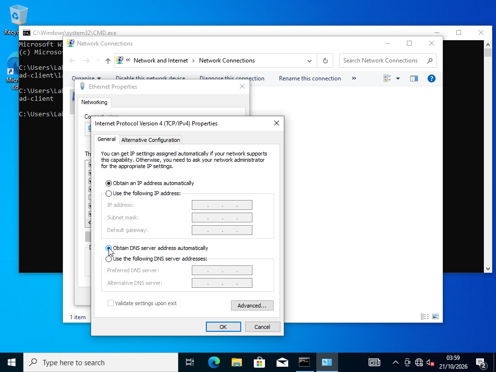

После получения конфигурации на клиенте выполнена команда:

```bat
ipconfig /all
```

Проверены имя компьютера, MAC-адрес адаптера, признак DHCP и выданные сетевые параметры. Итоговый вывод после вступления в домен приведён на рисунке ниже.


| Проверяемое поле | Фактическое значение |
|---|---|
| Host Name | `ad-client` |
| Physical Address | `BC-24-11-53-4F-29` |
| DHCP Enabled | `Yes` |
| IPv4 Address | `10.0.0.100` |
| Subnet Mask | `255.0.0.0` |
| Default Gateway | `10.0.0.1` |
| DHCP Server | `10.0.0.1` |
| DNS Servers | `10.0.0.1` |
| Connection-specific DNS Suffix | `GMAKMA.local` |

Адрес `10.0.0.100` совпал с ранее использованным ручным адресом, поэтому одного значения IPv4 недостаточно для проверки DHCP. В выводе теперь указаны **DHCP Enabled: Yes**, сервер аренды `10.0.0.1` и время получения и окончания аренды. Эти поля подтверждают получение адреса через DHCP.

На сервере дополнительно проверена активная аренда. В [записи аренды клиента](evidence/commands/dhcp-client-lease.json) указаны адрес `10.0.0.100`, имя `ad-client.GMAKMA.local`, идентификатор клиента `bc-24-11-53-4f-29` и состояние `Active`. Идентификатор совпадает с MAC-адресом адаптера клиента. Первоначальная проверка до вступления в домен сохранена в [client-dhcp.txt](evidence/commands/client-dhcp.txt).

### 2.7. Вступление ad-client в домен

После проверки DHCP и разрешения имени контроллера на клиенте в PowerShell с правами локального администратора выполнено присоединение к домену:

```powershell
Add-Computer -DomainName 'GMAKMA.local' -Credential $cred -PassThru
```

Параметр `-DomainName` задаёт домен `GMAKMA.local`. В переменной `$cred` передан объект `PSCredential` администратора домена `Administrator@GMAKMA.local`. Пароль в отчёте не приводится. Параметр `-PassThru` использован для возврата результата операции.

После выполнения команды клиент перезагружен:

```bat
shutdown /r /t5
```

После перезагрузки проверены членство компьютера и защищённый канал с доменом. В [файле проверки клиента](evidence/commands/client-domain-verified.txt) сохранены следующие значения:

```text
Name: AD-CLIENT
Domain: GMAKMA.local
PartOfDomain: true
```

Проверка защищённого канала вернула `True`. После присоединения основной DNS-суффикс компьютера также стал `GMAKMA.local`; автоматическая конфигурация DHCP сохранилась. Наличие объекта `AD-CLIENT` в каталоге дополнительно проверено в оснастке Active Directory, как показано в разделе 2.9.

### 2.8. Вход на клиент под администратором домена

После перезагрузки клиента на экране входа выбран пункт **Other user**. Для входа использована доменная учётная запись в формате UPN: `administrator@GMAKMA.local`. После аутентификации открылся рабочий стол Windows 10.


Для проверки текущего пользователя и компьютера в открытой сессии выполнены команды:

```bat
whoami
hostname
```

Команда `whoami` вернула `gmakma\administrator`, а `hostname` – `ad-client`. Следовательно, на клиентской машине открыт сеанс администратора домена, а не локального пользователя `LabAdmin`.


В [проверке доменной сессии](evidence/commands/client-domain-verified.txt) поле `UserName` имеет значение `GMAKMA\Administrator`. Оно совпадает с результатом `whoami` на рабочем столе клиента.

### 2.9. Проверка объектов компьютеров в Active Directory

На контроллере домена открыта оснастка **Active Directory Users and Computers**. В дереве раскрыт домен `GMAKMA.local` и выбран контейнер **Computers**. В правой части окна найден объект **AD-CLIENT** с типом **Computer**.

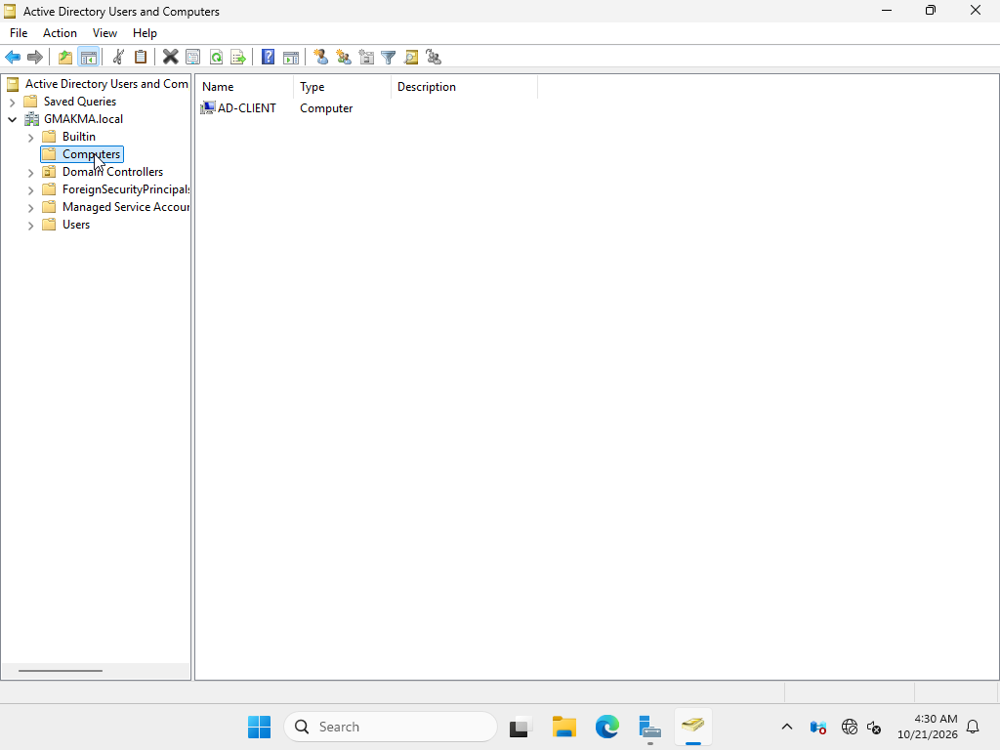

Затем в том же домене выбрано подразделение **Domain Controllers**. В нём найден объект **AD-SRV** с типом **Computer**. В столбце **DC Type** отображается **GC**.


По результатам проверки сервер `ad-srv` работает как контроллер домена `GMAKMA.local`, а `ad-client` включён в этот домен как рабочая станция. Для клиента подтверждены получение адреса из заданного пула DHCP, DNS и шлюза `10.0.0.1`, работоспособный защищённый канал и интерактивный вход под администратором домена.

## 3. Управление объектами AD, NTFS и SMB

### 3.1. Подразделения и размещение компьютера

На сервере `ad-srv` открыта оснастка `dsa.msc`. В домене `GMAKMA.local` через **New -> Organizational Unit** созданы подразделения `ouSellers`, `ouManagers`, `ouComputers` и `unit-for-delete`. В поле **Name** каждого диалога указано соответствующее имя.

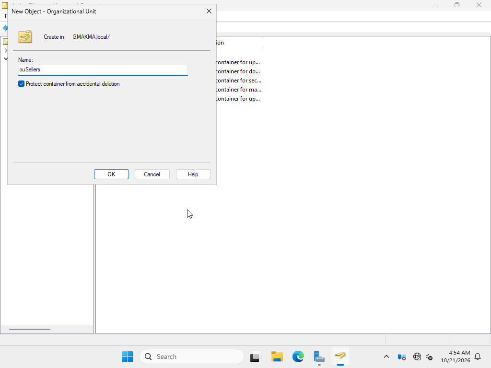


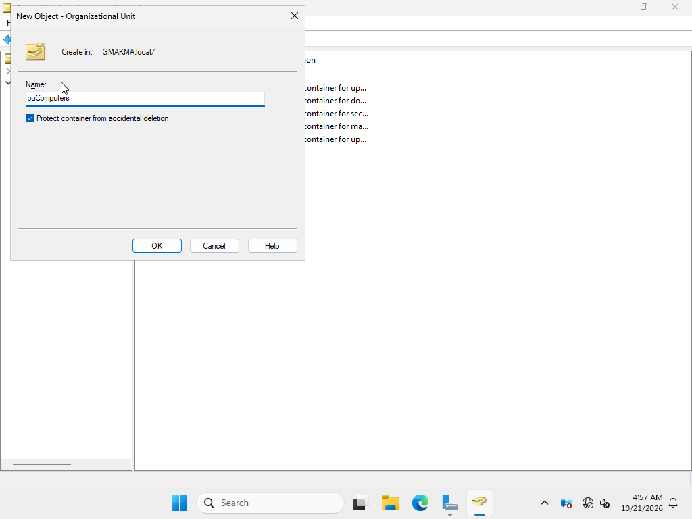


Объект рабочей станции перенесён из стандартного контейнера `Computers` в `ouComputers`:

```powershell
Get-ADComputer ad-client |
    Move-ADObject -TargetPath 'OU=ouComputers,DC=GMAKMA,DC=local'
```

После обновления представления оснастки объект `AD-CLIENT` отображается в `ouComputers`.


Контроль выполнен командами `Get-ADOrganizationalUnit -Filter *` и `Get-ADComputer -Filter *`. В [инвентаризации](evidence/commands/stage-c-state.json) сохранены четыре OU и итоговые DN компьютеров:

```text
CN=AD-CLIENT,OU=ouComputers,DC=GMAKMA,DC=local
CN=AD-SRV,OU=Domain Controllers,DC=GMAKMA,DC=local
```

Контроллер домена оставлен в `Domain Controllers`.

### 3.2. Пользователи и группы отделов

В `ouSellers` через **New -> User** создан пользователь `uSeller1`, в `ouManagers` - `uManager1`. В мастерах заданы полные имена и имена входа; парольные страницы в отчёт не включены.

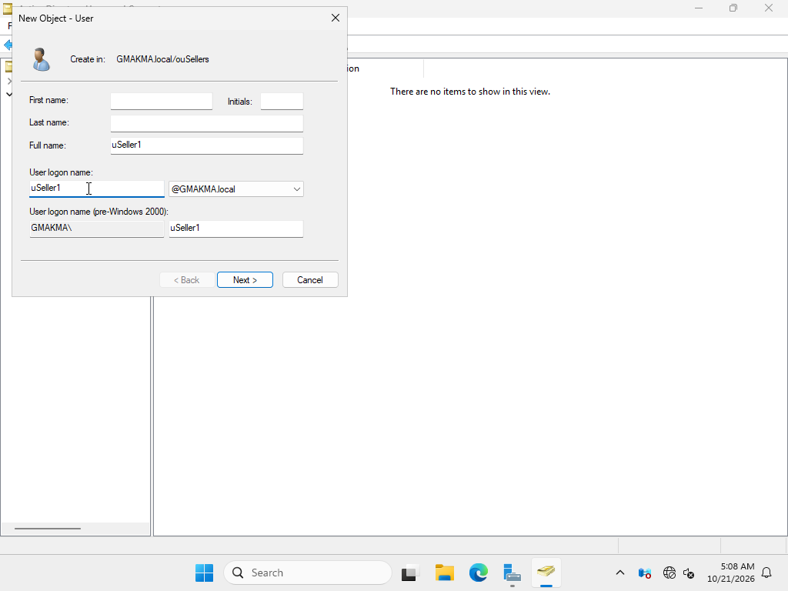


Обе учётные записи включены. Для учебных входов отключено требование сменить пароль при первом входе и установлен флаг **Password never expires**. Эти параметры относятся к созданным пользователям; доменная политика паролей на данном этапе не изменялась.

В тех же OU через **New -> Group** созданы `gSellers` и `gManagers`. Для каждой группы выбраны **Group scope: Global** и **Group type: Security**.

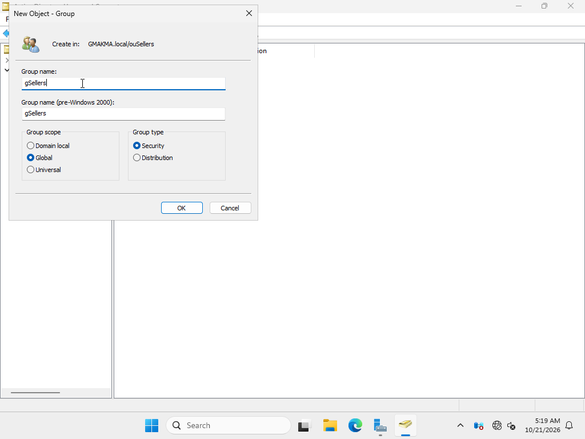

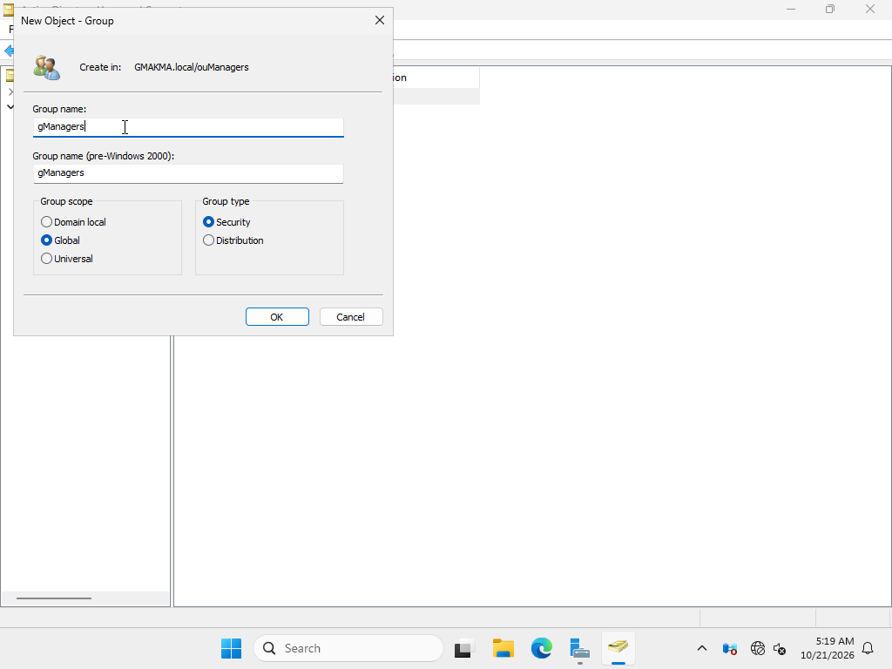

Пользователи добавлены в соответствующие группы:

```powershell
Add-ADGroupMember gSellers uSeller1
Add-ADGroupMember gManagers uManager1
Get-ADGroupMember gSellers
Get-ADGroupMember gManagers
```

Во вкладке **Members** группы `gSellers` находится `uSeller1`, а группы `gManagers` - `uManager1`.


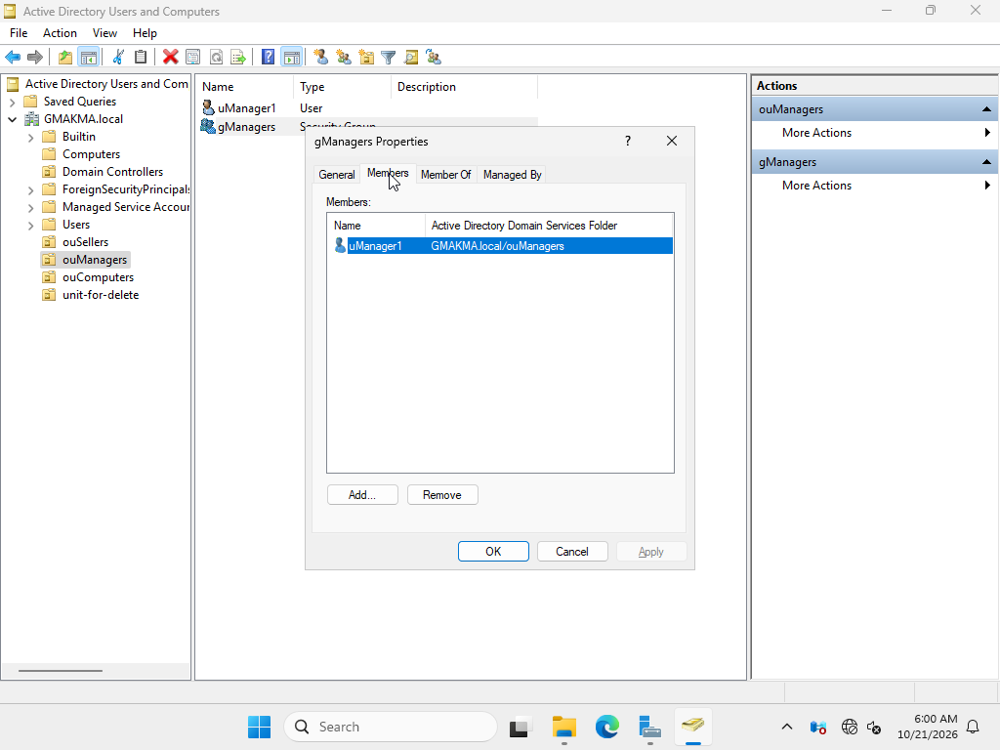

Членство, тип и область групп дополнительно сохранены в `stage-c-state.json`. Обычные пользователи не добавлялись в административные группы; при функциональной проверке каждая пользовательская сессия вывела `ADMIN: False`.

### 3.3. Общий каталог AllUsers и ресурс AllUsersCom

На диске `C:` сервера создан каталог `AllUsers` с четырьмя дочерними папками:

```text
C:\AllUsers
  Sellers
  Managers
  BlackHole
  Common
```

Каталоги созданы командой `New-Item -ItemType Directory`, затем проверены в Проводнике.


Каталог опубликован под сетевым именем `AllUsersCom`. На уровне SMB группе `GMAKMA\Domain Users` предоставлен доступ **Change**, группе `GMAKMA\Domain Admins` - **Full**. Запрещающие SMB-записи не использовались. Доступ к содержимому отдельных папок ограничен NTFS.

```powershell
New-SmbShare -Name AllUsersCom -Path C:\AllUsers `
    -ChangeAccess 'GMAKMA\Domain Users' `
    -FullAccess 'GMAKMA\Domain Admins' -CachingMode None
Get-SmbShare -Name AllUsersCom
Get-SmbShareAccess -Name AllUsersCom
```

В **Properties -> Sharing -> Advanced Sharing** проверено имя общего ресурса.


В **Permissions** для `Domain Users` отмечены **Change** и **Read**, но не **Full Control**.


Для корня `C:\AllUsers` создан защищённый DACL. `SYSTEM` и `Administrators` имеют полный доступ ко всей этой учебной папке. `Domain Users` имеют **Read & execute** только на сам корень (**This folder only**). Поэтому чтение корня не распространяется на защищённые папки отделов и `BlackHole`.

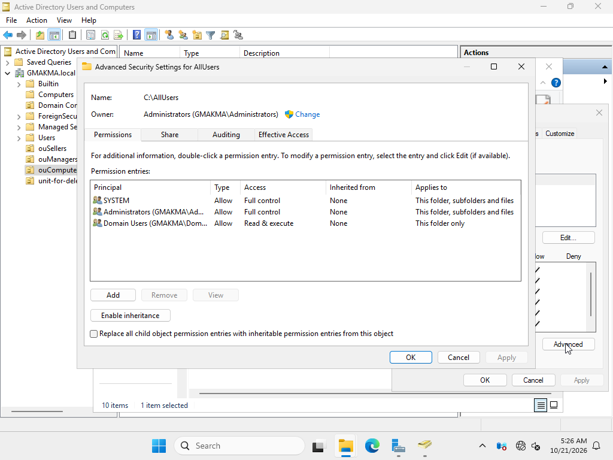

Фактические пути ресурсов, SMB-разрешения и NTFS-записи проверены чтением состояния после настройки. Выполненные команды настройки приведены в [stage-c-configuration.ps1](evidence/commands/stage-c-configuration.ps1), а команда инвентаризации - в [stage-c-read-state.ps1](evidence/commands/stage-c-read-state.ps1). Изменения ограничены учебными каталогами, а не диском `C:` целиком.

### 3.4. Разрешения папок Sellers и Managers

Для обеих папок отключено неподходящее наследование. Сохранены наследуемые **Full control** для `SYSTEM` и `Administrators`. Права соответствующей группы отдела разделены на две записи:

| Объект | Субъект | Область | Разрешения |
|---|---|---|---|
| `Sellers` | `gSellers` | This folder only | Read & execute, Write, Delete subfolders and files |
| `Sellers` | `gSellers` | Subfolders and files only | Modify |
| `Managers` | `gManagers` | This folder only | Read & execute, Write, Delete subfolders and files |
| `Managers` | `gManagers` | Subfolders and files only | Modify |

В первой записи отсутствуют **Delete**, **Change permissions** и **Take ownership**. Пользователь может удалять вложенные объекты, но не корневую папку отдела и не её DACL. Общая запрещающая запись `Deny Delete` на всё дерево не создавалась.

В **Security -> Advanced** папки `Sellers` видны две записи для `gSellers` с разными областями применения.

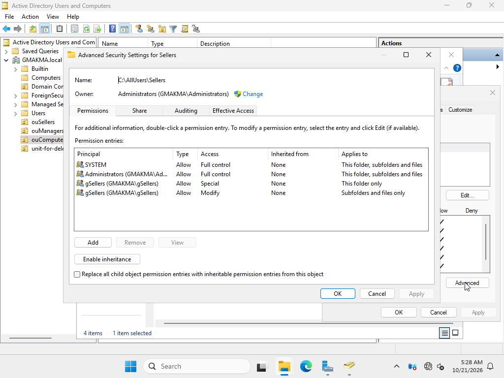

В расширенном представлении первой записи включено **Delete subfolders and files**, а **Delete**, **Change permissions** и **Take ownership** выключены.

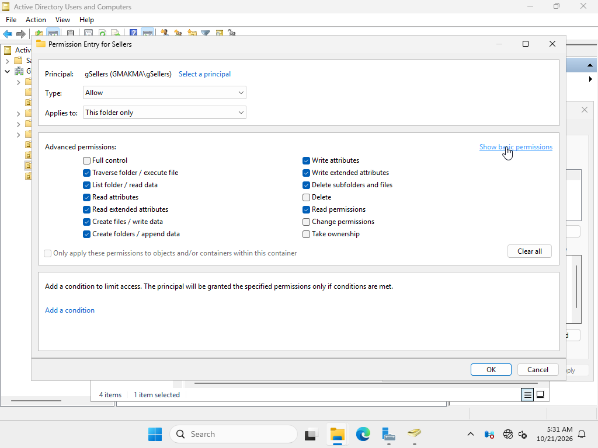

Аналогичная настройка выполнена для `Managers` и `gManagers`.


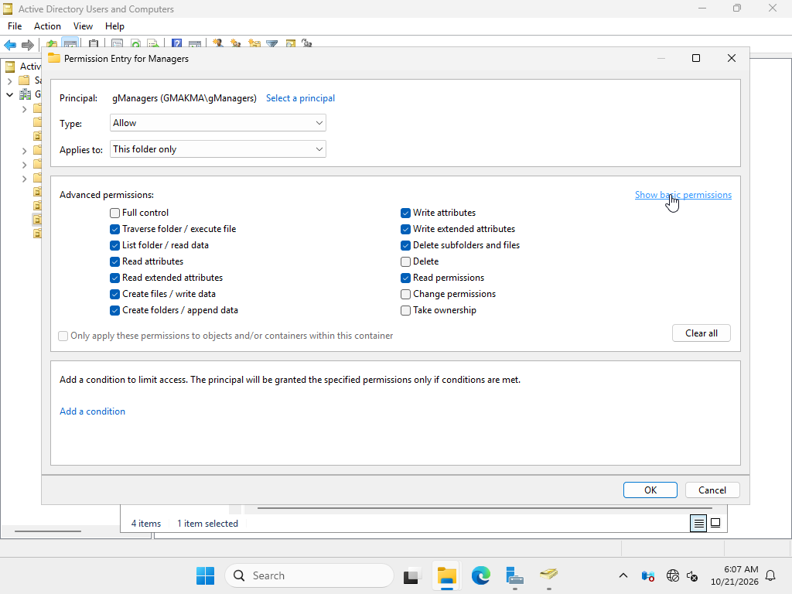

Контроль DACL выполнен для обеих папок:

```powershell
(Get-Acl C:\AllUsers\Sellers).Access |
    Format-Table IdentityReference,FileSystemRights,InheritanceFlags,PropagationFlags
(Get-Acl C:\AllUsers\Managers).Access |
    Format-Table IdentityReference,FileSystemRights,InheritanceFlags,PropagationFlags
```

### 3.5. Проверка доступа к отделам под обычными пользователями

До отрицательных проверок сохранены согласованные снимки двух машин `lab2-stage-c-before-acl-tests`. Проверки выполнялись на `ad-client` через UNC-пути `\\ad-srv\AllUsersCom\...`, а не локально на сервере.

На клиенте выполнен интерактивный вход как `uSeller1@GMAKMA.local`. В пользовательской сессии запущены [команды проверки](evidence/commands/stage-c-user-tests.ps1); идентичность определена через `WindowsIdentity.GetCurrent()`, наличие административной роли проверено отдельно. Для продавца использована папка `Sellers`, для менеджера после отдельного входа - `Managers`.

| Операция | uSeller1 в Sellers | uManager1 в Managers |
|---|---|---|
| Создать вложенный каталог | Разрешено | Разрешено |
| Создать файл внутри него | Разрешено | Разрешено |
| Изменить и прочитать файл | Разрешено | Разрешено |
| Удалить файл | Разрешено | Разрешено |
| Удалить созданный вложенный каталог | Разрешено | Разрешено |
| Удалить пустой корень отдела | Access denied | Access denied |
| Записать DACL корня через Set-Acl | Access denied | Access denied |
| Перечислить содержимое другого отдела | Access denied | Access denied |

Перед попыткой удалить корень тестовый файл и вложенный каталог удалены. Поэтому отрицательный результат не подменён ошибкой «каталог не пуст». Для изменения DACL использована попытка `Get-Acl` -> `Set-Acl` того же дескриптора; она требует права записи разрешений и завершилась отказом.

Первая серия продавца завершилась результатом `TOTAL=17 PASS=17 FAIL=0`. Кроме прав отдела она включает проверки `BlackHole`, `Common` и домашнего диска, описанные ниже.

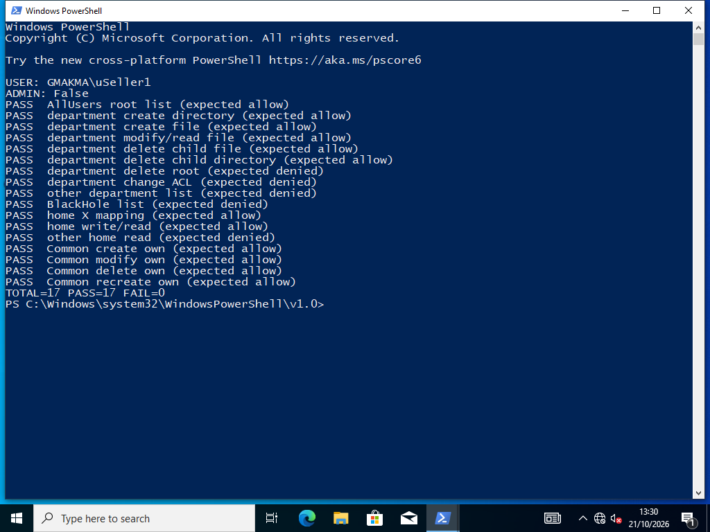

Первая серия менеджера завершилась результатом `TOTAL=20 PASS=20 FAIL=0`. Дополнительные три проверки относятся к чтению, изменению и запрещённому удалению файла продавца в `Common`.


Каждая операция, ожидаемое разрешение, фактический результат и текст исключения сохранены в [журнале продавца](evidence/commands/stage-c-seller-first.json) и [журнале менеджера](evidence/commands/stage-c-manager-first.json). В обоих случаях отказ удаления корня и отказ `Set-Acl` получены в неадминистративном контексте.

### 3.6. BlackHole: копирование без просмотра содержимого

Для `C:\AllUsers\BlackHole` создан отдельный защищённый DACL. `SYSTEM` и `Administrators` имеют **Full control**. Группы `gSellers` и `gManagers` получают на саму папку **Traverse**, **Write**, чтение атрибутов и разрешений, а также **Synchronize**, но не **List folder / read data**. Общая запись `Domain Users Read` сюда не наследуется.

Для **CREATOR OWNER** задано **Modify** только на дочерние каталоги и файлы. Эта запись позволяет создателю завершить копирование собственного файла и не даёт права перечислять корень `BlackHole`.

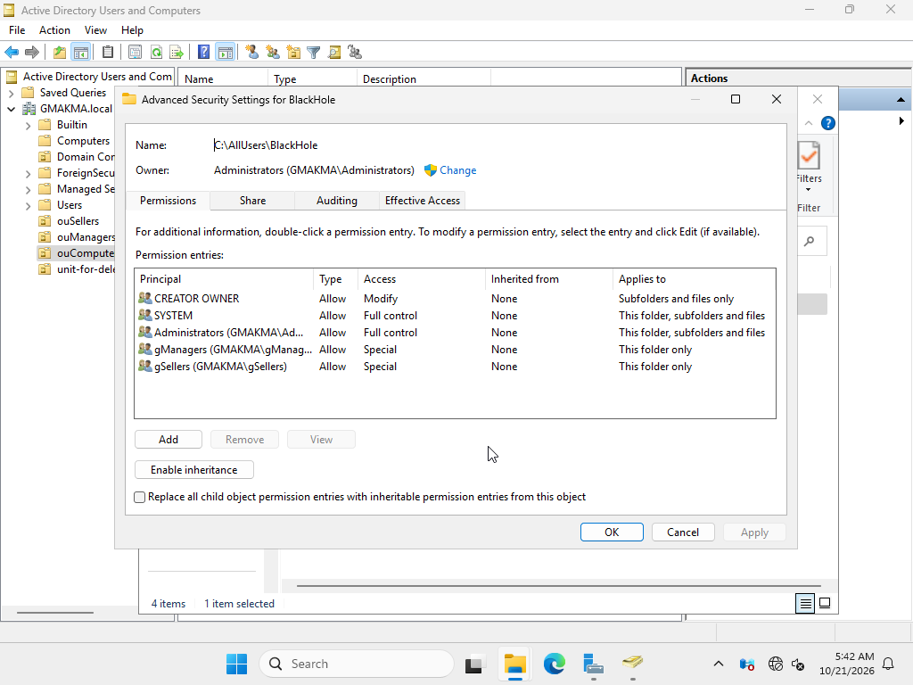

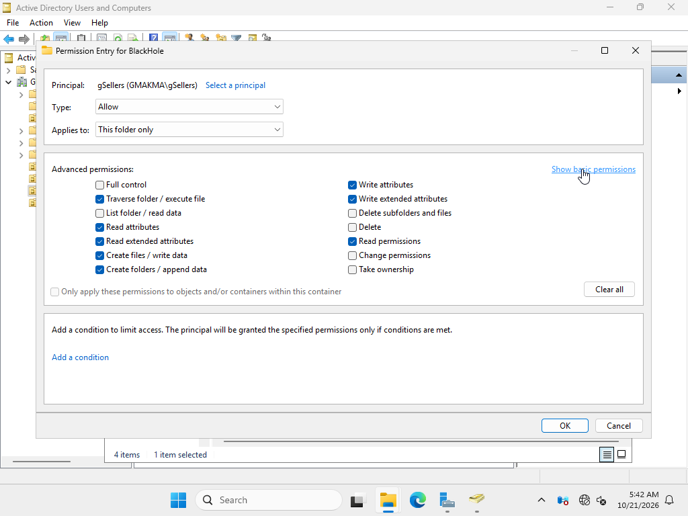

Под `uSeller1` на рабочем столе создан файл `DropSource\seller-drop.txt`. В двух окнах Проводника открыты локальная папка-источник и `\\ad-srv\AllUsersCom`. Файл мышью перетащен на значок папки `BlackHole`.


После копирования попытка открыть `BlackHole` из той же сессии завершилась сообщением **You don't currently have permission to access this folder**. Каталог нельзя просмотреть, хотя запись файла разрешена.

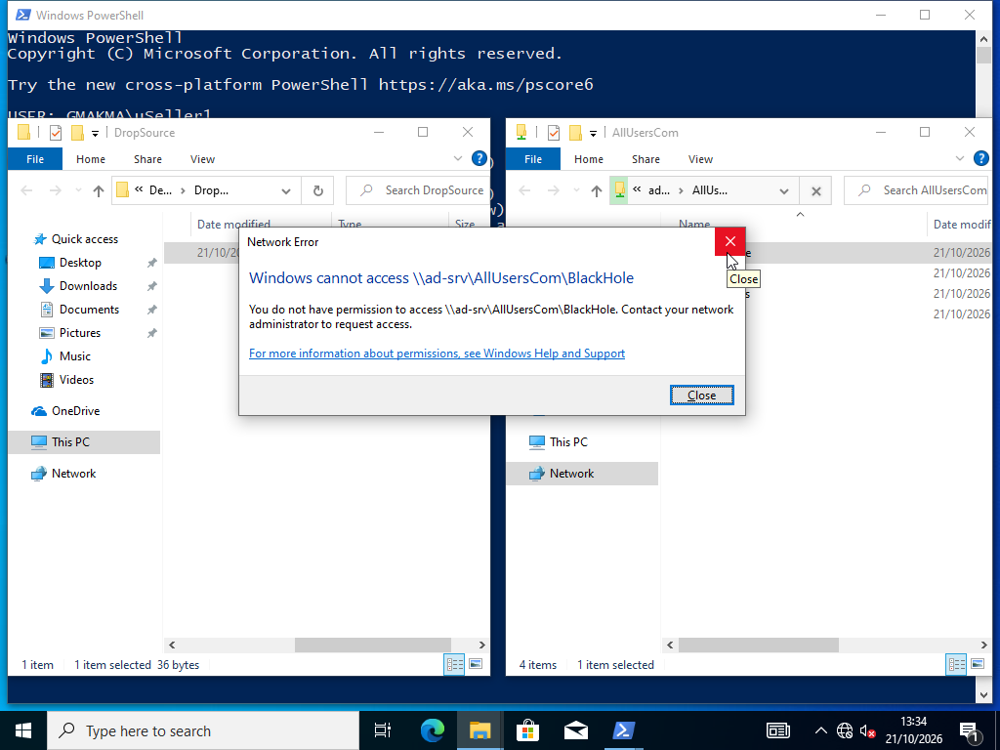

После отдельного интерактивного входа `uManager1` таким же способом перетащен локальный `manager-drop.txt`.


Открытие `BlackHole` под менеджером также завершилось отказом.


На сервере проверено наличие обоих доставленных файлов. Размер `seller-drop.txt` составил 36 байт, `manager-drop.txt` - 37 байт. Владельцами являются соответственно `GMAKMA\uSeller1` и `GMAKMA\uManager1`. Внутри файлов находятся строки с идентичностью отправителя.

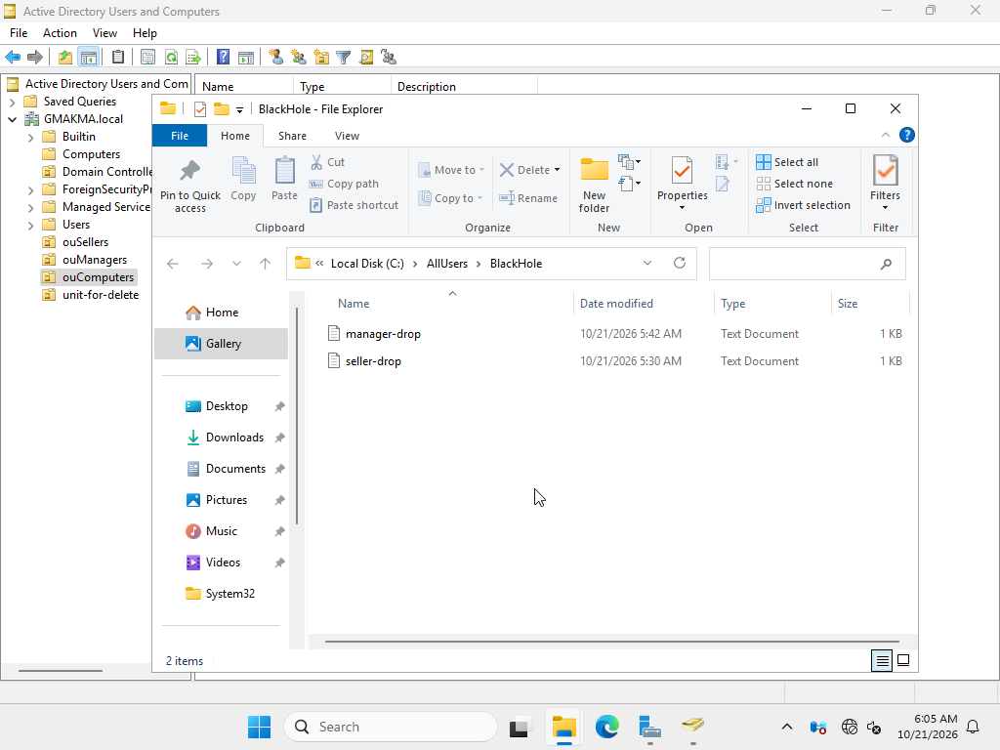

Серверная проверка содержимого и владельцев сохранена в [stage-c-blackhole-delivered.json](evidence/commands/stage-c-blackhole-delivered.json). Кроме графического отказа, обе пользовательские серии получили `Access denied` от `Get-ChildItem` по SMB. Таким образом, проверены отдельно запись, фактическая доставка и запрет перечисления для двух пользователей.

### 3.7. Common: изменять общие файлы, удалять только свои

В `C:\AllUsers\Common` настроены следующие записи:

- `SYSTEM` и `Administrators` - **Full control** на папку и потомков;
- `Domain Users` - **Read & execute, Write** на папку и потомков, без **Delete** и **Delete subfolders and files**;
- `CREATOR OWNER` - **Modify** только на дочерние объекты.

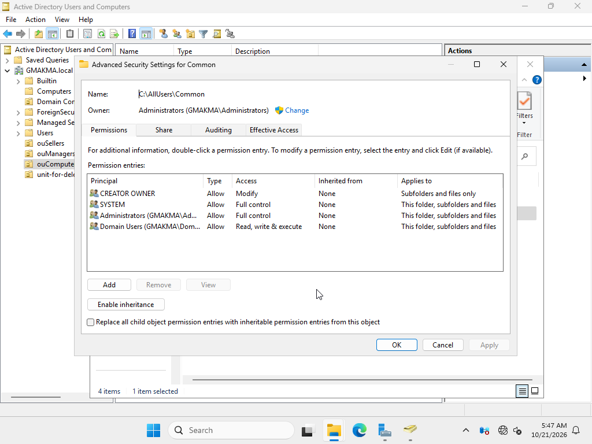

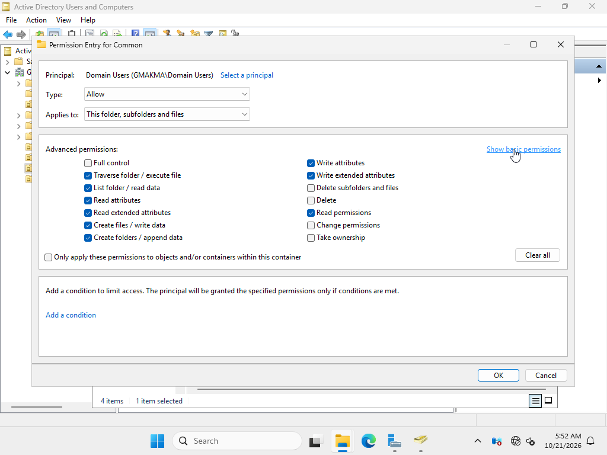

Продавец создал `seller-owned.txt`, менеджер - `manager-owned.txt`. Каждый сначала изменил, удалил и повторно создал собственный файл. Затем проверены операции над файлом другого пользователя:

| Операция через SMB | uSeller1 | uManager1 |
|---|---|---|
| Создать собственный файл | Разрешено | Разрешено |
| Изменить собственный файл | Разрешено | Разрешено |
| Удалить собственный файл | Разрешено | Разрешено |
| Прочитать чужой файл | Разрешено | Разрешено |
| Дописать строку в чужой файл | Разрешено | Разрешено |
| Удалить чужой файл | Access denied | Access denied |

Менеджер выполнил проверку над `seller-owned.txt` в первой серии. Проверка продавца над `manager-owned.txt` выполнена после повторного входа, когда файл менеджера уже существовал. Вторая серия продавца завершилась результатом `TOTAL=7 PASS=7 FAIL=0`; она также проверила сохранение данных после перезагрузки.

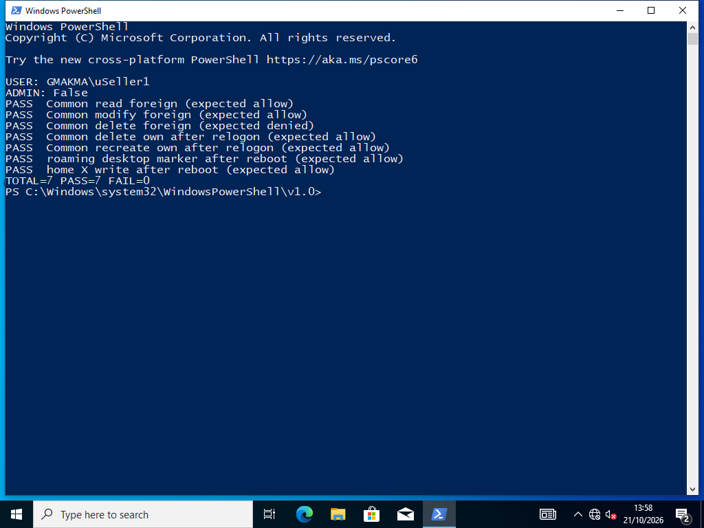

Подробности находятся в [stage-c-seller-second.json](evidence/commands/stage-c-seller-second.json) и журнале менеджера. Итоговые владельцы и содержимое файлов сохранены в [stage-c-common-final-owners.json](evidence/commands/stage-c-common-final-owners.json). В `manager-owned.txt` осталась строка `edited by GMAKMA\uSeller1`, но владельцем файла остался `GMAKMA\uManager1`. Оба файла сохранены для повторной проверки.

### 3.8. Домашние каталоги и скрытые ресурсы

На сервере созданы `C:\UsersHome\uSeller1` и `C:\UsersHome\uManager1`. На каждой домашней папке отключено наследование. В DACL оставлены только `SYSTEM`, `Administrators` и соответствующий пользователь. Первые два субъекта имеют **Full control**, пользователь - **Modify** с наследованием на дочерние объекты.


Папки опубликованы как `uSeller1$` и `uManager1$`. Знак `$` входит в имя каждого ресурса. На уровне SMB доступ **Full** выдан только владельцу домашнего ресурса и `Domain Admins`; ограничения фактических файлов остаются в NTFS. Для ресурсов установлен `CachingMode None`.

```powershell
Get-SmbShare -Name 'uSeller1$','uManager1$'
Get-SmbShareAccess -Name 'uSeller1$'
Get-SmbShareAccess -Name 'uManager1$'
```


В свойствах пользователей ADUC открыта вкладка **Profile** и выбрано **Home folder -> Connect X:**. Для подключения использованы UNC-пути:

| Пользователь | HomeDrive | HomeDirectory | ProfilePath |
|---|---|---|---|
| `uSeller1` | `X:` | `\\ad-srv\uSeller1$` | `\\ad-srv\uSeller1$\_profile` |
| `uManager1` | `X:` | `\\ad-srv\uManager1$` | `\\ad-srv\uManager1$\_profile` |


Для обоих пользователей в реальных клиентских сессиях проверены подключение `X:`, запись и чтение `X:\home-proof.txt`. Попытка перечислить домашний ресурс другого пользователя в обоих направлениях получила **Access denied**.

Дополнительно под продавцом выполнена команда `net view \\ad-srv`. В списке отображаются `AllUsersCom`, `NETLOGON` и `SYSVOL`, но отсутствуют домашние ресурсы с `$`. Одновременно `Get-PSDrive X` показывает подключение `\\ad-srv\uSeller1$`.


### 3.9. Перемещаемый профиль

Для профилей выбрана единая схема хранения внутри домашнего ресурса. В AD записаны UNC-пути `\\ad-srv\uSeller1$\_profile` и `\\ad-srv\uManager1$\_profile`. Локальный путь `X:\_profile` в поле **Profile path** не использовался: сетевой профиль должен быть доступен службе профилей до подключения пользовательского диска.

После первого входа и выхода Windows 10 создала на сервере фактические каталоги `_profile.V6`. Внутри появились `Desktop`, `AppData`, другие папки профиля, `NTUSER.DAT` и `ntuser.ini`. Таким образом, фактический путь для изучения данных с клиента - `X:\_profile.V6`; суффикс `.V6` установлен по созданным файлам и свойству `RoamingPath`, а не выбран заранее.

Созданные Windows каталоги профиля имели защищённый DACL с полным доступом пользователя и `SYSTEM`. Для административной проверки добавлена отдельная наследуемая запись `Administrators Full control`, без смены владельца и без разрешений для остальных пользователей:

```powershell
$acl = Get-Acl 'C:\UsersHome\uSeller1\_profile.V6'
$acl.AddAccessRule(
    [Security.AccessControl.FileSystemAccessRule]::new(
        [Security.Principal.SecurityIdentifier]'S-1-5-32-544',
        'FullControl','ContainerInherit,ObjectInherit','None','Allow'))
Set-Acl 'C:\UsersHome\uSeller1\_profile.V6' $acl
```

Та же операция выполнена для профиля менеджера. Точные команды и контроль неизменности владельца приведены в [stage-c-profile-admin-access.ps1](evidence/commands/stage-c-profile-admin-access.ps1). Начальные и итоговые DACL сохранены отдельно в `stage-c-generated-profile-acls-before.json` и `stage-c-generated-profile-acls-final.json`.


Серверная проверка показала владельца `GMAKMA\uSeller1`, файл `NTUSER.DAT` размером 786432 байта и файл-маркер рабочего стола. Запись AD `ProfilePath` при этом остаётся без суффикса: `\\ad-srv\uSeller1$\_profile`.

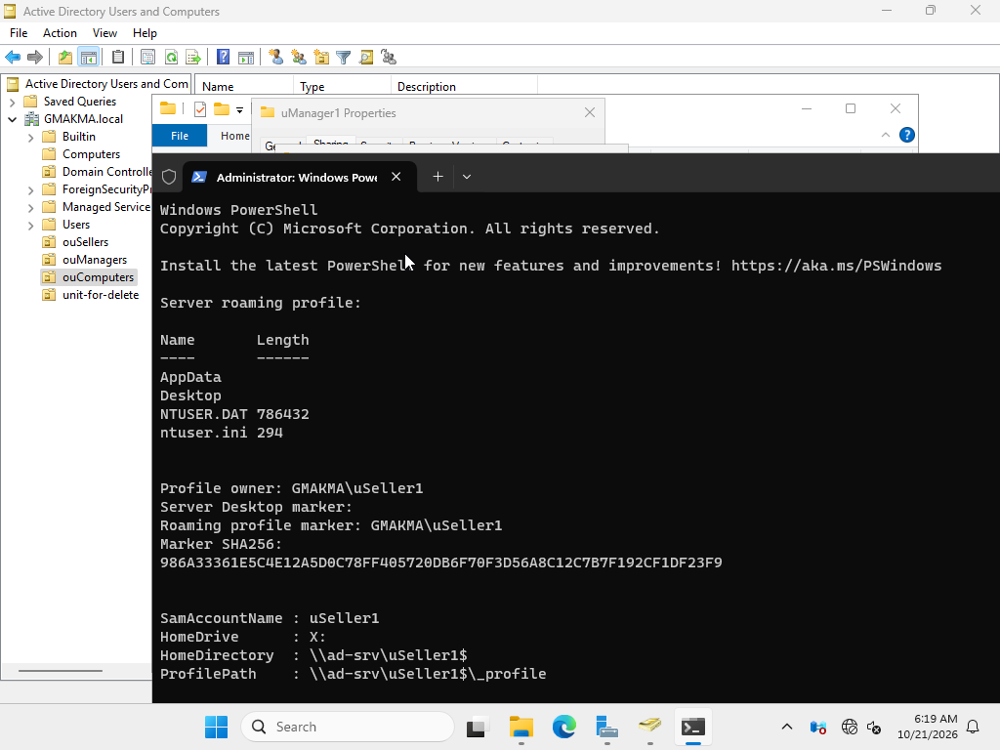

Отдельный общий ресурс `Profiles$` не создавался: в выбранной схеме оба профиля находятся в уже защищённых домашних ресурсах. Пустой каталог на `X:` не использовался как доказательство перемещаемого профиля.

### 3.10. Перезагрузка, повторный вход и синхронизация профиля

При первом интерактивном входе `uSeller1` на рабочем столе создан `roaming-proof.txt` со строкой `Roaming profile marker: GMAKMA\uSeller1`. Независимый файл `X:\home-proof.txt` создан в домашней папке. Затем сеанс продавца завершён командой `logoff`, после чего на сервере проверено появление `_profile.V6` и файлов профиля.

После входа менеджера и завершения его проверок клиент действительно перезагружен:

```bat
shutdown.exe /r /t 5
```

Сведения `Win32_OperatingSystem.LastBootUpTime` сохранены [до перезагрузки](evidence/commands/stage-c-boot-before.json) и [после неё](evidence/commands/stage-c-boot-after.json). Итоговое время загрузки Windows - `2026-10-21 13:46:44`, часовой пояс клиентской ОС - `GMT Standard Time`. Это время гостевой Windows, а не время сервера или хоста виртуализации.

После загрузки снова выполнен вход именно как `uSeller1@GMAKMA.local`. Команда `whoami` вернула `gmakma\useller1`, диск `X:` подключился к прежнему UNC. На рабочем столе сохранился файл-маркер, а домашний файл был прочитан и дополнен строкой `reboot/relogon verified`.

```powershell
whoami
Get-PSDrive X
Get-Content "$env:USERPROFILE\Desktop\roaming-proof.txt"
Get-Content X:\home-proof.txt
Get-ChildItem X:\_profile.V6 -Force
```

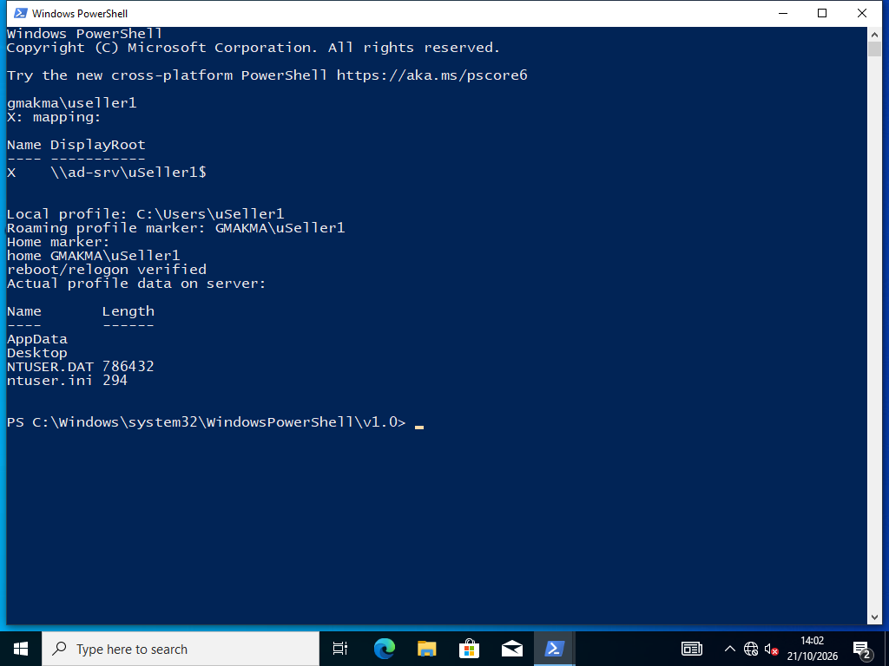

Для загруженного профиля `Win32_UserProfile` вернул:

```text
LocalPath          C:\Users\uSeller1
RoamingConfigured  True
RoamingPath        \\ad-srv\uSeller1$\_profile.V6
Status             2
Loaded             True
LastDownloadTime   21/10/2026 13:56:10
LastUploadTime     21/10/2026 13:35:01
```

Проверен журнал **Microsoft-Windows-User Profile Service/Operational**. Событие `7` содержит фактическое направление синхронизации с сервера на клиент и успешный результат:

```text
Finished synchronize profile from \\ad-srv\uSeller1$\_profile.V6
  to C:\Users\uSeller1.
Result: The operation completed successfully.
```

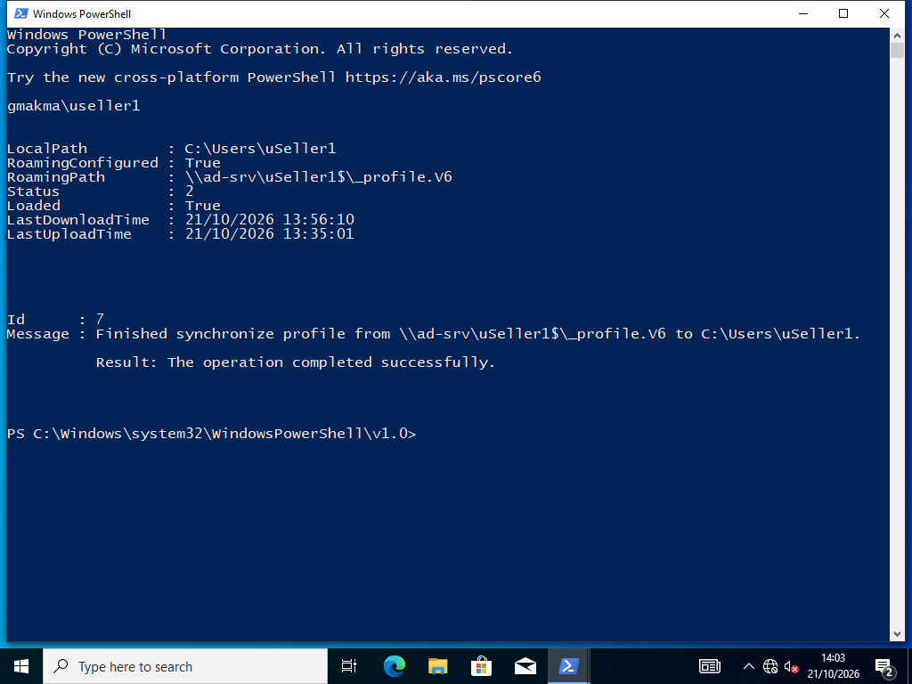

В том же журнале событие `67` указывает **Logon type: Regular** и **Profile type: Roaming**. В [выборке ошибок Application](evidence/commands/stage-c-profile-error-events.json) за проверенный интервал количество событий с идентификаторами `1500, 1502, 1505, 1508, 1509, 1511, 1515, 1521, 1542` равно нулю. В Operational есть предупреждение `69` о том, что `NTUSER.DAT` не копировался поверх локального файла из-за сравнения временных меток; завершение синхронизации при этом зарегистрировано как успешное. Предупреждение сохранено в журнале и не скрыто.

Контрольные суммы SHA-256 серверного и клиентского `Desktop\roaming-proof.txt` совпали:

```text
986A33361E5C4E12A5D0C78FF405720DB6F70F3D56A8C12C7B7F192CF1DF23F9
```

Исходные результаты находятся в `stage-c-server-profile-hashes.json` и `stage-c-client-marker-hash.json`. Данные `Win32_UserProfile` сохранены в [stage-c-client-profiles.json](evidence/commands/stage-c-client-profiles.json); события - в [JSON-журнале](evidence/commands/stage-c-profile-service-events.json) и настоящем экспортированном [EVTX](evidence/commands/stage-c-profile-service.evtx).

Перемещаемый профиль подтверждён не только наличием файла на домашнем диске: на сервер выгружены файлы профиля, после перезагрузки выполнен обычный вход, служба профилей зарегистрировала загрузку из UNC, а файл рабочего стола совпал с серверной копией. Локальный кеш профиля не удалялся.

### 3.11. Итоговая функциональная проверка

Итоговые журналы содержат 44 проверки с ожидаемым результатом:

| Серия | Проверок | Успешно | Неуспешно |
|---|---:|---:|---:|
| `uSeller1`, первый вход | 17 | 17 | 0 |
| `uManager1`, отдельный вход | 20 | 20 | 0 |
| `uSeller1`, после reboot/relogon | 7 | 7 | 0 |
| Всего | 44 | 44 | 0 |

Два графических перетаскивания файлов в `BlackHole` проверены отдельно по содержимому и владельцам реально доставленных файлов; они не включены в число 44.

Подтверждены четыре OU, размещение клиента в `ouComputers`, две глобальные группы безопасности и их состав, разделение NTFS-прав отделов, запрет изменения DACL и удаления корней, запись без просмотра `BlackHole`, удаление только собственных файлов в `Common`, два скрытых домашних ресурса, подключение `X:` у обоих пользователей и реальная синхронизация перемещаемого профиля продавца после перезагрузки.

После проверок обе машины оставлены работающими. На клиенте открыт доменный сеанс `GMAKMA\uSeller1`, проверка `Test-ComputerSecureChannel` вернула `True`. Сетевые интерфейсы обеих машин подключены только к `vmbr1_lab`. Сохранены и проверены итоговые снимки `lab2-stage-c-verified` для VM104 и VM105. Состояние машин и список снимков находятся в [stage-c-final-vm-state.json](evidence/commands/stage-c-final-vm-state.json). Эти снимки не заменяют отдельную итоговую резервную копию.

## 4. Работа с групповыми политиками

Настройка выполнена в домене `GMAKMA.local`. Политики продавцов и менеджеров проверены на `AD-CLIENT` под обычными доменными пользователями `uSeller1` и `uManager1`. Параметры компьютера проверены после перезагрузки клиента. Наличие настроек на контроллере домена отдельно от проверки клиента не считалось подтверждением их действия.

### 4.1. Доменная политика паролей

В `Group Policy Management` открыт объект `Default Domain Policy`. В редакторе выбран путь:

```text
Computer Configuration -> Policies -> Windows Settings -> Security Settings
-> Account Policies -> Password Policy
```

В окне `Minimum password length` установлено значение `6`. Флажок определения параметра включён.


В параметре `Password must meet complexity requirements` выбрано `Disabled`. Изменение выполнено именно в доменной GPO, а не в локальной политике отдельной машины.


После обновления компьютерной политики на сервере выполнена проверка:

```powershell
gpupdate /target:computer /force
Get-ADDefaultDomainPasswordPolicy |
    Select-Object MinPasswordLength,ComplexityEnabled
```

Получены `MinPasswordLength = 6`, `ComplexityEnabled = False`. Проверка размещения компьютеров также показала, что `AD-CLIENT` находится в `ouComputers`, а `AD-SRV` остался в `Domain Controllers`. Службы `NTDS`, `DNS`, `DHCPServer` и `Netlogon` работают.


### 4.2. Политика подразделения продавцов

Для создания объектов GPO и привязки к нужным OU использован модуль `GroupPolicy`. Например, политика продавцов создана командами:

```powershell
$g = New-GPO -Name 'Lab2-Sellers'
New-GPLink -Guid $g.Id `
    -Target 'OU=ouSellers,DC=GMAKMA,DC=local' -LinkEnabled Yes
```

Аналогично созданы `Lab2-Managers`, `Lab2-Computers` и отдельная `Lab2-Deploy-7Zip`. Все фактически выполненные команды создания и начальной настройки сохранены в [stage-d-create-gpo.ps1](evidence/commands/stage-d-create-gpo.ps1).

В GPMC проверена область действия `Lab2-Sellers`: единственная ссылка ведёт на `ouSellers`, фильтр безопасности содержит `Authenticated Users`. Это не ссылка на весь домен. Пользователи других подразделений не получают эту пользовательскую GPO только из-за членства в `Authenticated Users`.


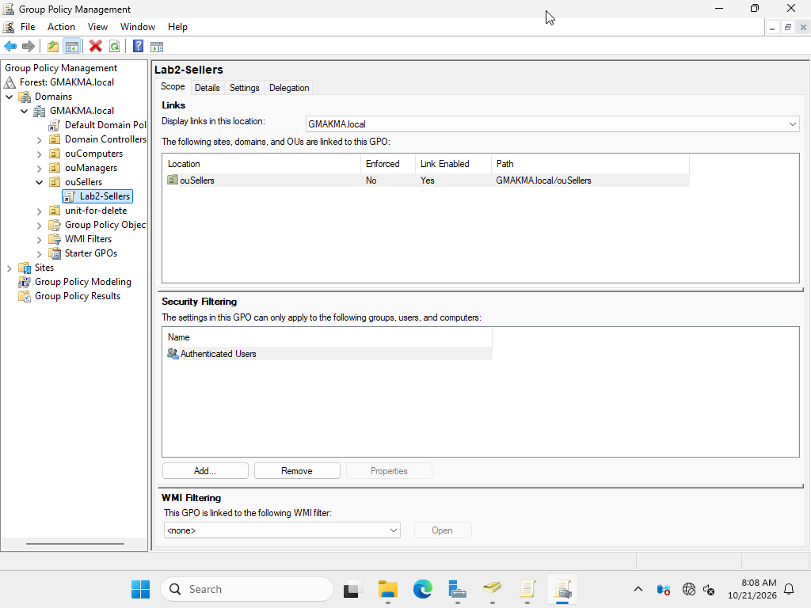

Параметры административных шаблонов внесены командлетом `Set-GPRegistryValue`. После записи каждый параметр отдельно открыт в `Group Policy Management Editor` и проверен в соответствующем окне. Поэтому приведённые ниже снимки показывают чтение реального состояния GPO, а не заменяют клиентские тесты.

В `User Configuration -> Policies -> Administrative Templates -> Control Panel` параметр `Prohibit access to Control Panel and PC settings` имеет состояние `Enabled`. Ему соответствует значение:

```powershell
Set-GPRegistryValue -Name 'Lab2-Sellers' `
    -Key 'HKCU\Software\Microsoft\Windows\CurrentVersion\Policies\Explorer' `
    -ValueName NoControlPanel -Type DWord -Value 1
```


В разделе `System` включён `Prevent access to registry editing tools`. Значение `DisableRegistryTools = 1` записано в `HKCU\Software\Microsoft\Windows\CurrentVersion\Policies\System`. В открытом окне также видно запрещение бесшумного запуска `regedit`.


В `Windows Components -> File Explorer` включён `Hide these specified drives in My Computer`. В списке выбрано `Restrict C drive only`. Соответствующее значение `NoDrives = 4` скрывает только C. Политика запрета доступа к диску вместо скрытия не использовалась.


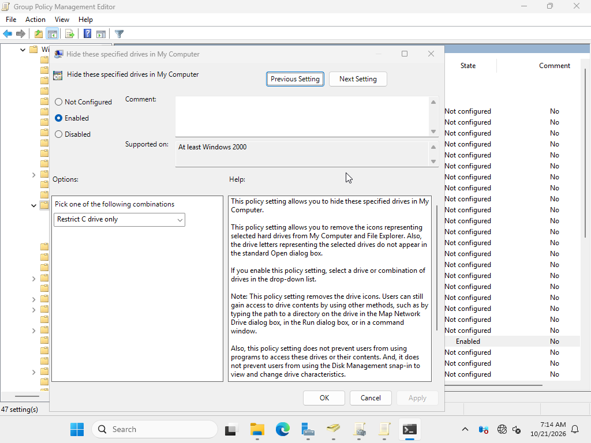

Для блокировки через заставку выбран раздел `Control Panel -> Personalization`. В нём включён `Enable screen saver`.


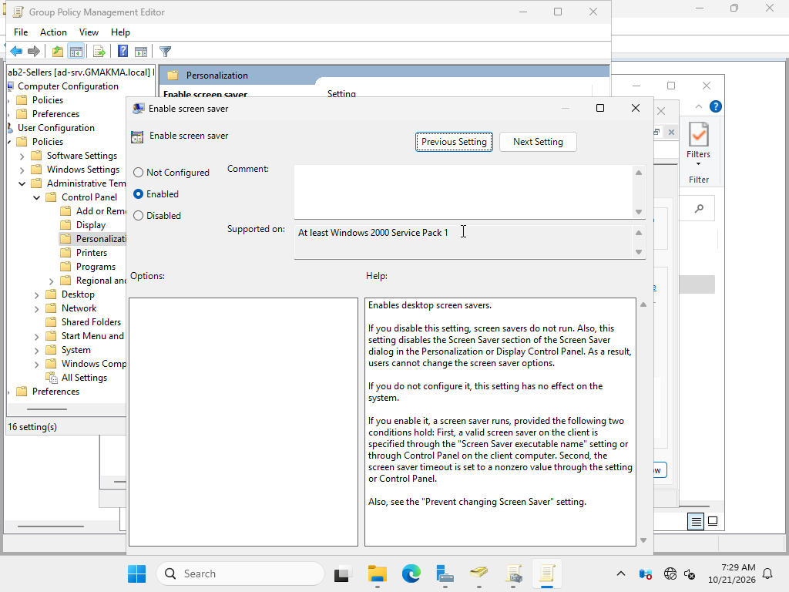

Параметр `Password protect the screen saver` установлен в `Enabled`. После завершения заставки требуется повторная аутентификация.


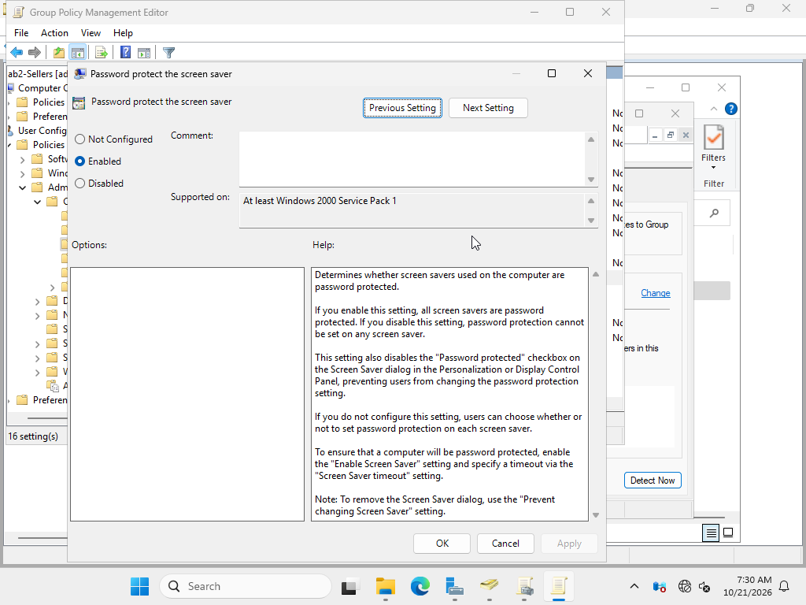

В `Screen saver timeout` установлено `Enabled` и значение `60` секунд.


Параметр `Prevent changing screen saver` включён. Изменение параметров заставки пользователем запрещено.


Дополнительно включён `Force specific screen saver`, указано `scrnsave.scr`. Это гарантирует выбор существующей заставки, а не только таймаута при отсутствии выбранного файла.

В GPO проверены строковые значения в `HKCU\Software\Policies\Microsoft\Windows\Control Panel\Desktop`:

| Значение | Данные |
|---|---|
| `ScreenSaveActive` | `1` |
| `ScreenSaverIsSecure` | `1` |
| `ScreenSaveTimeOut` | `60` |
| `SCRNSAVE.EXE` | `scrnsave.scr` |

Запрет изменения задан значением `NoDispScrSavPage = 1` в пользовательском разделе `Policies\System`.


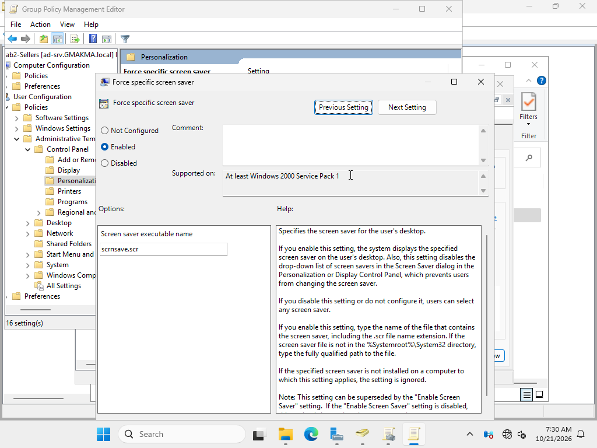

### 4.3. Проверка ограничений под uSeller1

На клиенте выполнено обновление пользовательской политики:

```cmd
gpupdate /target:user /force
gpresult /r /scope user
```

После этого пользователь вышел из системы и выполнил повторный доменный вход. Проверки проведены без административного токена.

Первой из окна `Run` запущена команда `control.exe`. Вместо Панели управления получено сообщение `Restrictions`: операция отменена из-за действующих ограничений.


При попытке запуска `regedit.exe` появилось сообщение `Registry editing has been disabled by your administrator`. Это отказ редактора реестра, а не только отсутствие прав на изменение отдельного ключа.


Командой `shell:mycomputerfolder` открыт раздел «Этот компьютер». Локальный диск C не отображается, а домашний диск X присутствует. Скрытие проверено именно в Проводнике текущего продавца.


Попытка открыть параметры заставки выполнена командой:

```text
rundll32.exe shell32.dll,Control_RunDLL desk.cpl,,1
```

Получено сообщение `Your system administrator has disabled launching of the Display Settings Control Panel`. Пользователь не смог изменить параметры заставки. Отдельная настройка `NoDispScrSavPage = 1` подтверждена также чтением пользовательского раздела политик.


В пользовательском `gpresult /r /scope user` присутствует `Lab2-Sellers`. В той же обычной сессии выполнены функциональные проверки записи:

- файл `X:\stage-d-seller-after-gpo.txt` создан и прочитан обратно;
- файл в `C:\Users\uSeller1\Documents` создан и прочитан обратно;
- создание файла непосредственно в корне `C:\` отклонено.

В результате сохранены имя действующего пользователя `GMAKMA\uSeller1`, прочитанные данные и `RootWriteDenied = true`. [JSON проверки](evidence/reports/stage-d-seller-functional.json) содержит также фактические значения всех пользовательских ограничений. HTML сформирован командой `gpresult /h` в обычной сессии: [отчёт продавца](evidence/reports/stage-d-seller-gpresult.html).


Для проверки блокировки сессия оставлена без клавиатурного и мышиного ввода. Перед ожиданием зафиксирован открытый рабочий стол с результатами проверки.


При заданном таймауте `60` секунд выдержано `75` секунд без ввода. Снятие изображения через VNC не отправляло клавиши или движение мыши. После ожидания рабочий стол перестал отображаться. Фактический интервал записан в [stage-d-idle-test.json](evidence/commands/stage-d-idle-test.json).


После возвращения к консоли появился экран входа `uSeller1` с полем пароля. Таким образом, проверена не только запись таймаута в GPO, но и реальная защита сессии после простоя.


### 4.4. Политика менеджеров и проверка разрешённых приложений

`Lab2-Managers` связана только с `ouManagers`. Фильтрация безопасности проверена в GPMC.


До включения ограничения из обычной сессии менеджера получены `gpresult /r` и `gpresult /h`: [исходный отчёт](evidence/reports/stage-d-manager-before.html). Затем включён параметр:

```text
User Configuration -> Policies -> Administrative Templates -> System
-> Run only specified Windows applications = Enabled
```

Значение `RestrictRun = 1` задано в `HKCU\Software\Microsoft\Windows\CurrentVersion\Policies\Explorer`. Команды настройки сохранены в [stage-d-manager-policy.ps1](evidence/commands/stage-d-manager-policy.ps1).


В окне `Show Contents` проверен разрешённый список. В нём ровно три имени: `mspaint.exe`, `calc.exe`, `notepad.exe`. Другие программы в список не добавлялись.


После `gpupdate /target:user /force`, выхода и повторного входа `uManager1` из оболочки запущен `mspaint.exe`. Открылся Paint.


Команда `notepad.exe` открыла Блокнот.


Команда `calc.exe` открыла Калькулятор Windows 10. Это запуск разрешённого штатного launcher; фактический процесс UWP имеет имя `Calculator.exe`. Расширять разрешённый список ради него не потребовалось.


Попытка запуска `wordpad.exe`, которого нет в разрешённом списке, завершилась сообщением `Restrictions`.


Отдельно выполнен запуск неразрешённого приложения из самого Проводника. Командой `shell:system` открыт `System32`, выбран файл `cmd`, после Enter получен отказ политики. Командная строка в сессии менеджера не открылась.


После применения компьютерной GPO и перезагрузки клиент снова проверен под `uManager1`: Paint, Калькулятор и Блокнот работают. В Блокноте создан файл, в окне `Save As` выбран домашний диск `X:`, сохранён `stage-d-manager-home.txt`. На сервере прочитано его содержимое `Stage D manager home write after computer GPO`.

Административное чтение процессов подтвердило владельца `GMAKMA\uManager1` у `mspaint.exe`, `Calculator.exe` и `notepad.exe`; `cmd.exe` и `powershell.exe` в этой сессии среди проверяемых процессов отсутствуют. Результат находится в [stage-d-manager-post-reboot-verification.json](evidence/commands/stage-d-manager-post-reboot-verification.json).


Финальный пользовательский RSoP считан административно:

```cmd
gpresult /user GMAKMA\uManager1 /scope user /r
gpresult /user GMAKMA\uManager1 /scope user /h C:\Lab2Private\stage-d-manager-final.html /f
```

В нём применена `Lab2-Managers`: [финальный HTML](evidence/reports/stage-d-manager-final.html). Запрещённые менеджеру PowerShell или cmd для получения этого отчёта в его сессии не запускались. Согласно документации Microsoft, `Run only specified Windows applications` ограничивает запуск через Explorer; эта политика не является полноценной изоляцией выполнения произвольного кода.

### 4.5. Политика компьютеров

Перед применением компьютерной политики обеих машин созданы согласованные снимки `lab2-stage-d-before-gpo`. На клиенте сохранён ACL-файл `C:\Lab2Private\stage-d-before-c-acl.txt`. Каталог защищён разрешениями Administrators/SYSTEM.

Размер ACL-файла составляет `97 926 918` байт, SHA-256 и сведения о чтении находятся в [манифесте резервной копии](evidence/commands/stage-d-acl-backup-manifest.json). Журнал содержит `108` отказов чтения отдельных защищённых или служебных путей; этот файл не рассматривается как безусловно полная резервная копия каждого объекта. Для восстановления всего состояния сохранены снимки VM, а исходные ACL проверяемых объектов отдельно записаны в JSON.

Политика `Lab2-Computers` связана только с `ouComputers`, где находится клиент. Контроллер домена не перемещался в это OU.


В `Computer Configuration -> Policies -> Administrative Templates -> Windows Components -> Windows Error Reporting` установлен `Disable Windows Error Reporting = Enabled`.

Настройка задана командой:

```powershell
Set-GPRegistryValue -Name 'Lab2-Computers' `
    -Key 'HKLM\Software\Policies\Microsoft\Windows\Windows Error Reporting' `
    -ValueName Disabled -Type DWord -Value 1
```

В редакторе проверено состояние `Enabled`.


В разделе `Network -> Offline Files` параметр `Allow or Disallow use of the Offline Files feature` имеет состояние `Disabled`. Значение GPO:

```powershell
Set-GPRegistryValue -Name 'Lab2-Computers' `
    -Key 'HKLM\Software\Policies\Microsoft\Windows\NetCache' `
    -ValueName Enabled -Type DWord -Value 0
```


В `Windows Settings -> Security Settings -> Local Policies -> Security Options` открыт `Accounts: Administrator account status`. Включён флажок определения параметра, выбрано `Disabled` и сохранено изменение. Это настройка встроенного локального Administrator, определяемого SID с окончанием `-500`, а не доменного администратора и не отдельного локального `LabAdmin`.


### 4.6. ACL файловой системы C и граница безопасного применения

В `Lab2-Computers` открыт раздел `Computer Configuration -> Policies -> Windows Settings -> Security Settings -> File System`. Через `Add File` добавлен корень `C:\`.

В шаблоне ACL оставлены три записи. Для `GMAKMA\Domain Users` установлены `Read & execute`, `List folder contents`, `Read`. Разрешение записи не предоставлено.


Для `SYSTEM` выбран `Full control`.


Для `Administrators` также выбран `Full control`.


В следующем окне выбран режим `Propagate inheritable permissions to all subfolders and files`. Режим полной замены `Replace existing permissions on all subfolders and files with inheritable permissions` не применялся.

В реальном файле `GptTmpl.inf` сохранено:

```ini
[System Access]
EnableAdminAccount = 0
[File Security]
"%SystemDrive%\",0,"D:PAR(A;OICI;FA;;;SY)(A;OICI;FA;;;BA)(A;OICI;0x1200a9;;;DU)"
```

Здесь `0` обозначает распространение наследуемых разрешений; по спецификации Microsoft режим `1` означал бы замену существующих дочерних разрешений. Выбранный вариант не подменён отдельной учебной папкой: политика применена к корню системного тома.


После обновления политики и перезагрузки прочитаны реальные DACL клиента. На корне C получены Administrators/SYSTEM FullControl и Domain Users ReadAndExecute. Но у защищённых системных объектов и профиля сохранились исходные специальные разрешения.

| Проверенный объект | Фактический результат |
|---|---|
| `C:\` | Три заданные записи, наследование на дочерние объекты |
| `C:\Windows\System32\notepad.exe` | Защищённая DACL; сохранены TrustedInstaller и группы приложений, SYSTEM/Administrators имеют RX |
| `C:\Program Files\Windows NT\Accessories\wordpad.exe` | Защищённая DACL с исходными системными ACE |
| `C:\Users\uSeller1` | Защищённая DACL: SYSTEM, Administrators и собственный пользователь имеют FullControl |
| `C:\Users\uSeller1\NTUSER.DAT` | Права наследуются от защищённого профиля; пользователь сохраняет FullControl |

Снимки DACL находятся в [исходном JSON](evidence/commands/stage-d-client-acl-before.json) и [JSON после перезагрузки](evidence/commands/stage-d-client-acl-after-reboot.json). Профиль, домашний диск и разрешённые приложения реально использованы после перезагрузки; проверена и невозможность обычного продавца писать в корень C.


Требование задания «для всех файловых объектов на C» в буквальном варианте единой DACL из трёх субъектов не выполнено. Защищённые системные ACL и собственные права пользователя на профиль намеренно не заменялись. Удаление этих ACE изменило бы права TrustedInstaller, пакетов приложений и записи пользовательского профиля. Полное выравнивание всего тома не заявляется результатом этой работы.

Таким образом, подтверждена настройка корня C: корень и наследуемые разрешения настроены политикой, системные и профильные исключения явно зафиксированы. Остальные параметры GPO и установка MSI проверены независимо от этого ограничения.

### 4.7. Отдельная политика назначения MSI 7-Zip

Для установки использован заранее полученный с официальной страницы 7-Zip пакет `7z2604-x64.msi`, версия `26.04`, x64. Источник записан в [7zip-package-source.json](evidence/commands/7zip-package-source.json).

Файл размером `2 009 088` байт передан через guest agent частями и собран на сервере в `C:\Lab2Packages`. SHA-256 исходника, серверного файла и файла, прочитанного по SMB с клиента, совпал:

```text
0b01334a418654293513449f61d6bfc99e5196ca371e3c3dc961eda57cd535c6
```

Создан ресурс `LabPackages$`. На уровне NTFS группа `Domain Computers` имеет ReadAndExecute, SYSTEM и Administrators имеют FullControl. На уровне SMB `Domain Computers` имеет Read, `Domain Admins` имеет Full. Чтение пакета с клиента выполнено из `NT AUTHORITY\SYSTEM`; фактическое соединение SMB к `LabPackages$` использовало `GMAKMA\AD-CLIENT$`, что дополнительно подтверждено серверной SMB-сессией с адреса `10.0.0.100`. [Команда и результат SHA-256](evidence/commands/stage-d-client-machine-package-read.json), [учётная запись соединения SMB](evidence/commands/stage-d-package-smb-machine-credential.json).

`Lab2-Deploy-7Zip` создана как отдельная GPO и связана только с `ouComputers`. Ссылка и фильтр безопасности проверены в GPMC.


В редакторе выбрана ветвь:

```text
Computer Configuration -> Policies -> Software Settings
-> Software installation -> New -> Package
```

В поле имени пакета введён полный UNC-путь, а не локальный путь сервера:

```text
\\ad-srv\LabPackages$\7z2604-x64.msi
```


В окне `Deploy Software` выбран вариант `Assigned`.


В Software installation появился `7-Zip 26.04 (x64 edition)`. Для пакета указаны назначение `Assigned`, источник UNC и архитектура x64. Установка вручную через `msiexec` вместо GPO не выполнялась.


### 4.8. Проверка компьютерной политики и установки после перезагрузки

На клиенте запущено принудительное обновление компьютерной политики и выполнена штатная перезагрузка Windows. В фоновом цикле Software Installation зарегистрировала необходимость foreground-обработки (`1274`); после загрузки назначение и установка завершились успешно. Это подтверждено последующими событиями, а не только фактом отправки команды перезагрузки.

В административной сессии клиента выполнены:

```powershell
gpresult /r /scope computer
Get-LocalUser | Where-Object { $_.SID.Value -match '-500$' } |
    Select-Object Name,Enabled,SID
Get-ItemProperty 'HKLM:\Software\Policies\Microsoft\Windows\Windows Error Reporting'
Get-ItemProperty 'HKLM:\Software\Policies\Microsoft\Windows\NetCache'
Test-ComputerSecureChannel
```

В применённых GPO присутствуют `Lab2-Computers`, `Lab2-Deploy-7Zip`, `Default Domain Policy`. Встроенный локальный `Administrator` отключён, отдельный `LabAdmin` остаётся включённым. Получены `WER Disabled = 1`, `Offline Files Enabled = 0`, доверительный канал `True`.


Параметры дополнительно считаны из настоящего WMI RSoP `root\RSOP\Computer`. Записи `RSOP_RegistryPolicySetting` для WER и NetCache ссылаются на GUID `Lab2-Computers`; `RSOP_SecuritySettingBoolean` содержит `EnableAdminAccount = false` из той же GPO. Это отличает итоговую проверку от чтения только настроенного объекта на сервере. [Результат RSoP](evidence/commands/stage-d-client-rsop-wmi.json), [компьютерный HTML gpresult](evidence/reports/stage-d-computer-gpresult.html).

Наличие 7-Zip проверено без `Win32_Product`:

```powershell
Test-Path 'C:\Program Files\7-Zip\7z.exe'
& 'C:\Program Files\7-Zip\7z.exe' i
```

Первый результат `True`; консоль сообщает `7-Zip 26.04 (x64)`. В `Programs and Features` клиента присутствует `7-Zip 26.04 (x64 edition)`, издатель `Igor Pavlov`, версия `26.04.00.0`.


Из установленного каталога запущен `7zFM.exe`. Открылся штатный 7-Zip File Manager.


В системном журнале клиента источник `Application Management Group Policy` зарегистрировал:

| Event ID | Record ID | Фактическое сообщение |
|---|---|---|
| `301` | `584` | Назначение 7-Zip из `Lab2-Deploy-7Zip` выполнено успешно |
| `302` | `586` | Установка 7-Zip из `Lab2-Deploy-7Zip` выполнена успешно |
| `308` | `587` | Изменения Software Installation применены успешно |

Связь установки с конкретной GPO прямо указана в событиях. Дополнительно сохранены транзакции `MsiInstaller`, события `SceCli` об успешном применении security policy и журнал `Microsoft-Windows-GroupPolicy/Operational`. [Выборка Application Management](evidence/commands/stage-d-application-management-events.json), [MSI/security events](evidence/commands/stage-d-client-installation-events.json), [Group Policy Operational](evidence/commands/stage-d-client-group-policy-events.json).


### 4.9. Итог проверки

| Требование | Результат |
|---|---|
| Доменный пароль от 6 символов, без сложности | Подтверждено `Get-ADDefaultDomainPasswordPolicy` |
| Продавцы: Панель управления и regedit | Реальные отказы под `uSeller1` |
| Продавцы: C скрыт, X доступен | Подтверждено Проводником |
| Продавцы: заставка 60 секунд, защита паролем, запрет изменения | Параметры GPO, отказ изменения и реальная блокировка после простоя |
| Менеджеры: три разрешённых приложения | Все три запущены, повторно проверены после computer GPO |
| Менеджеры: запрет другого приложения | WordPad и cmd из Explorer запрещены |
| Компьютер: WER, Offline Files, RID-500 | Подтверждено клиентом и RSoP, `LabAdmin` не отключён |
| Единая DACL на каждом объекте C | Не заявляется: защищённые ACL ОС и профилей сохранены |
| Отдельное назначение MSI 7-Zip | Установка через GPO доказана версиями и событиями 301/302 |
| Домен, профиль и домашние каталоги после изменений | Доверие True, обе roaming-сессии загружены; запись в оба домашних каталога работает |

После проверок обе VM оставлены работающими в изолированной сети `vmbr1_lab`. На клиенте сохранены обычные сессии продавца и менеджера с соответствующими политиками; административная сессия клиента завершена.

#### Использованные источники Microsoft

- [Развёртывание программ через Group Policy: UNC, Assigned и установка при старте](https://learn.microsoft.com/en-us/troubleshoot/windows-server/group-policy/use-group-policy-to-install-software).
- [MS-GPSB: File Security и значения PermPropagationMode](https://learn.microsoft.com/en-us/openspecs/windows_protocols/ms-gpsb/abeebe06-49aa-44d4-ae5b-d6aff458e8e7).
- [Правила распространения наследуемых ACE](https://learn.microsoft.com/en-us/windows/win32/secauthz/automatic-propagation-of-inheritable-aces).
- [Run only specified Windows applications: соответствие ADMX и область ограничений](https://learn.microsoft.com/en-us/windows/client-management/mdm/policy-csp-admx-shellcommandpromptregedittools).
- [Параметры таймаута, активности и защиты заставки](https://learn.microsoft.com/en-us/troubleshoot/windows-server/remote/troubleshoot-unexpected-rds-session-locks-or-disconnections).
- [Accounts: Administrator account status](https://learn.microsoft.com/en-us/windows/security/threat-protection/security-policy-settings/accounts-administrator-account-status).

Административные экспорты настроек: [Default Domain Policy](evidence/reports/stage-d-Default-Domain-Policy.html), [Lab2-Sellers](evidence/reports/stage-d-Lab2-Sellers.html), [Lab2-Managers](evidence/reports/stage-d-Lab2-Managers.html), [Lab2-Computers](evidence/reports/stage-d-Lab2-Computers.html), [Lab2-Deploy-7Zip](evidence/reports/stage-d-Lab2-Deploy-7Zip.html). Эти экспорты дополняют, но не заменяют клиентские функциональные проверки.
