# Отчёт по практической работе №2

<style>
pre { break-inside: auto; page-break-inside: auto; }
p code, li code, td code { font: inherit; background: none; padding: 0; border: 0; }
</style>

## Основы работы с Active Directory в Windows Server

### Цель работы

Получить базовые навыки развёртывания Active Directory, управления объектами домена, правами NTFS и SMB, групповыми политиками, создания пользователей по CSV и восстановления удалённых объектов

### Среда выполнения

Сервер и клиент подключили к одной изолированной локальной сети

| Параметр | ad-srv | ad-client |
|---|---|---|
| Операционная система | Windows Server 2025 Standard Evaluation, Desktop Experience | Windows 10 Pro |
| IPv4 и маска | `10.0.0.1/8`, статически | `10.0.0.100/8`, DHCP |
| DNS | `10.0.0.1` | `10.0.0.1` |
| Шлюз | Не задан | `10.0.0.1`, выдан DHCP |
| Домен / NetBIOS | `GMAKMA.local` / `GMAKMA` | Член домена `GMAKMA.local` |

### Используемые термины

| Термин | Значение |
|---|---|
| AD DS | Служба каталогов, хранящая объекты домена: пользователей, группы и компьютеры |
| Домен и лес | Домен объединяет управляемые объекты. Лес объединяет домены с общей схемой и конфигурацией |
| OU | Подразделение для размещения объектов AD и привязки групповых политик |
| DNS | Служба разрешения имён и поиска служб домена |
| DHCP | Служба автоматической выдачи IP-адресов и сетевых параметров |
| GPO и RSoP | Объект групповой политики и результирующие настройки пользователя или компьютера |
| NTFS и ACL | Файловая система и списки разрешений доступа к её объектам |
| SMB и UNC | Протокол доступа к общим папкам и формат сетевого пути, например `\\ad-srv\AllUsersCom` |
| Домашняя папка | Личный сетевой каталог пользователя, подключаемый как X: |
| Перемещаемый профиль | Настройки и данные среды пользователя, синхронизируемые между сервером и клиентом |
| GUID, SID и DN | Идентификатор объекта AD, идентификатор безопасности и путь объекта в каталоге |
| DSRM | Режим обслуживания и восстановления AD DS с отдельным паролем администратора |

## 1. Подготовка операционных систем

Установили Windows Server с графической оболочкой и Windows 10 Pro. Сервер переименовали в `ad-srv`, клиент - в `ad-client`, после чего перезагрузили обе машины. Для первоначальной настройки клиента создали локальную учётную запись `LabAdmin`


Рисунок 1: Выбранная редакция Windows Server с Desktop Experience

На сервере настроили статический адрес `10.0.0.1` с маской `255.0.0.0`, DNS направили на сам сервер. Командами `hostname` и `ipconfig /all` проверили имя и сетевые параметры

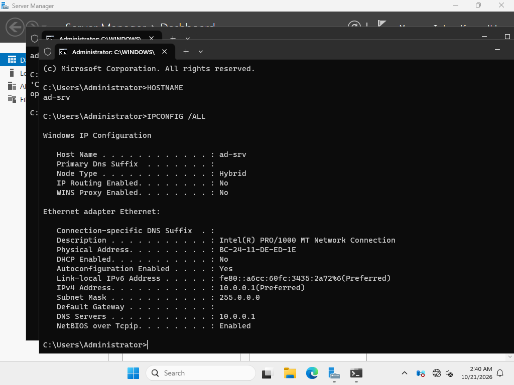

Рисунок 2: Имя и статическая сетевая конфигурация ad-srv


Рисунок 3: Выбранная редакция Windows 10 Pro

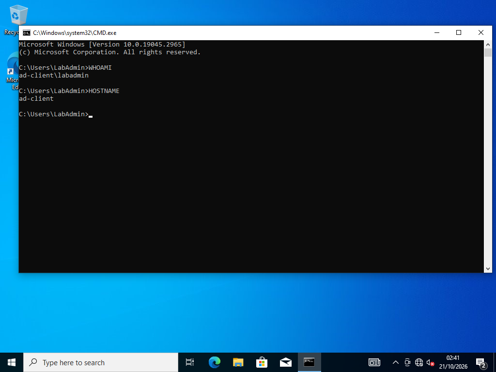

Рисунок 4: Имя ad-client и локальная учётная запись LabAdmin

После установки и проверки входа сохранили базовые снимки обеих виртуальных машин

## 2. Развёртывание AD DS, DNS и DHCP

### 2.1. Создание домена и проверка DNS

Через Server Manager -> Add roles and features установили роль Active Directory Domain Services вместе со средствами управления. В мастере повышения сервера выбрали Add a new forest и создали домен `GMAKMA.local`. Для леса и домена выбрали функциональный уровень Windows Server 2025, включили DNS Server и Global Catalog. NetBIOS-имя - `GMAKMA`. Для DSRM задали отдельный пароль. Пути базы и журналов оставили `C:\Windows\NTDS`, SYSVOL - `C:\Windows\SYSVOL`


Рисунок 5: Создание нового леса GMAKMA.local

После установки и перезагрузки вошли администратором домена. Проверили домен, работающие службы NTDS, DNS, Netlogon и наличие общих папок SYSVOL и NETLOGON. DNS настроен мастером: созданы интегрированные в AD зоны `GMAKMA.local` и `_msdcs.GMAKMA.local`, запись `ad-srv` указывает на `10.0.0.1`. С клиента имя `ad-srv.GMAKMA.local` разрешается в этот адрес

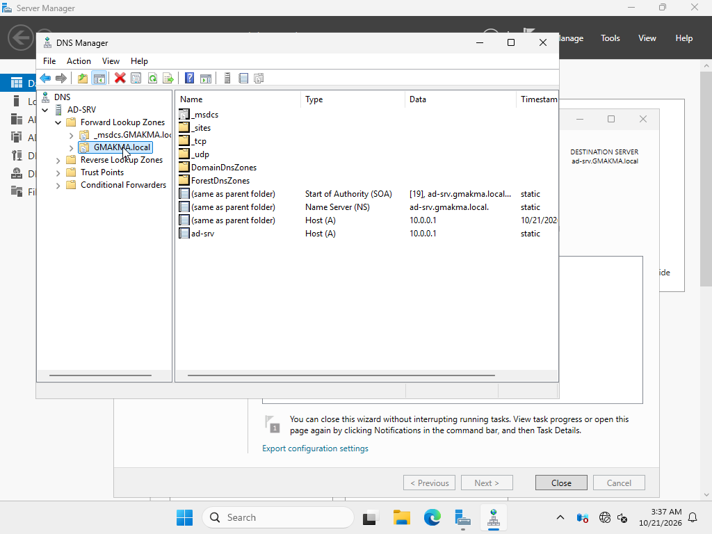

Рисунок 6: Записи автоматически созданной DNS-зоны GMAKMA.local

### 2.2. Авторизация DHCP и область выдачи

Через мастер добавления ролей установили DHCP Server, затем выполнили первоначальную настройку и авторизацию сервера в AD от имени администратора домена

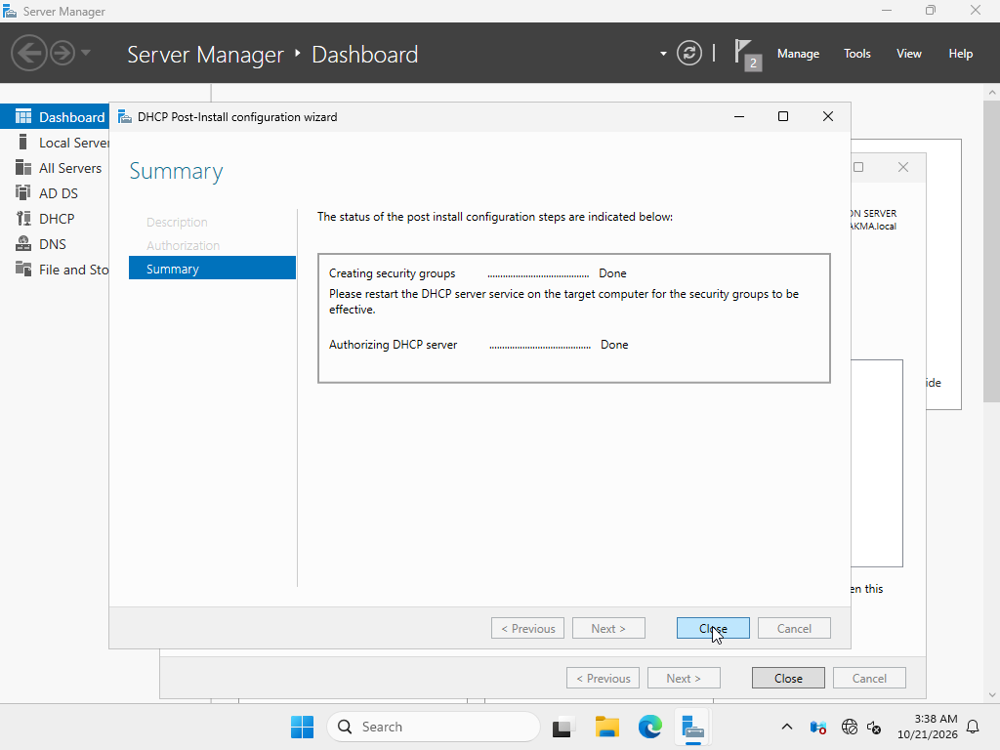

Рисунок 7: Успешная авторизация DHCP-сервера и создание служебных групп

В консоли DHCP создали и активировали область `Lab2Scope` со следующими параметрами:

| Параметр | Значение |
|---|---|
| Сеть / маска | `10.0.0.0/8` / `255.0.0.0` |
| Пул адресов | `10.0.0.100-10.0.0.110` |
| 003 Router | `10.0.0.1` |
| 006 DNS Servers | `10.0.0.1` |
| 015 DNS Domain Name | `GMAKMA.local` |
| Срок аренды | 8 дней |

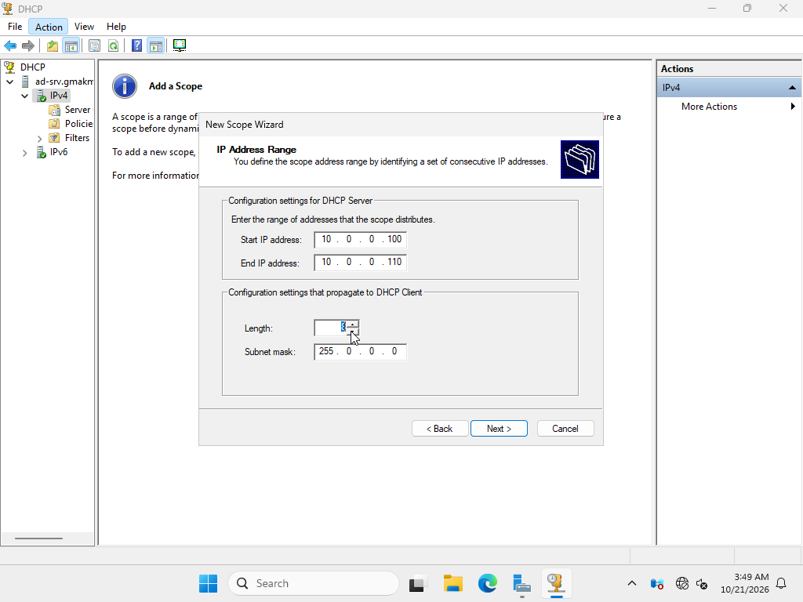

Рисунок 8: Границы адресного пула DHCP и маска сети /8

После настройки перезагрузили сервер. Служба DHCPServer запущена, область активна. На клиенте включили автоматическое получение IPv4 и DNS. В `ipconfig /all` получили `DHCP Enabled: Yes`, адрес `10.0.0.100`, маску `255.0.0.0`, шлюз, DHCP-сервер и DNS `10.0.0.1`. На сервере подтверждена активная аренда для `ad-client.GMAKMA.local`


Рисунок 9: Конфигурация ad-client, полученная через DHCP

### 2.3. Присоединение клиента к домену

В повышенной консоли PowerShell клиента выполнили команду с объектом учётных данных администратора домена в переменной `$cred`:

```powershell
Add-Computer -DomainName 'GMAKMA.local' -Credential $cred -PassThru
```

Перезагрузили клиент и вошли как `administrator@GMAKMA.local`. Команды `whoami` и `hostname` подтвердили доменную сессию на `ad-client`, `PartOfDomain = True`, проверка защищённого канала вернула `True`


Рисунок 10: Вход администратора домена на ad-client

В оснастке Active Directory Users and Computers нашли `AD-SRV` в `Domain Controllers`, а `AD-CLIENT` - первоначально в `Computers`. Для последующих компьютерных политик перенесли клиент в созданную OU `ouComputers`. Контроллер домена оставили в `Domain Controllers`


Рисунок 11: Объект AD-SRV в Domain Controllers

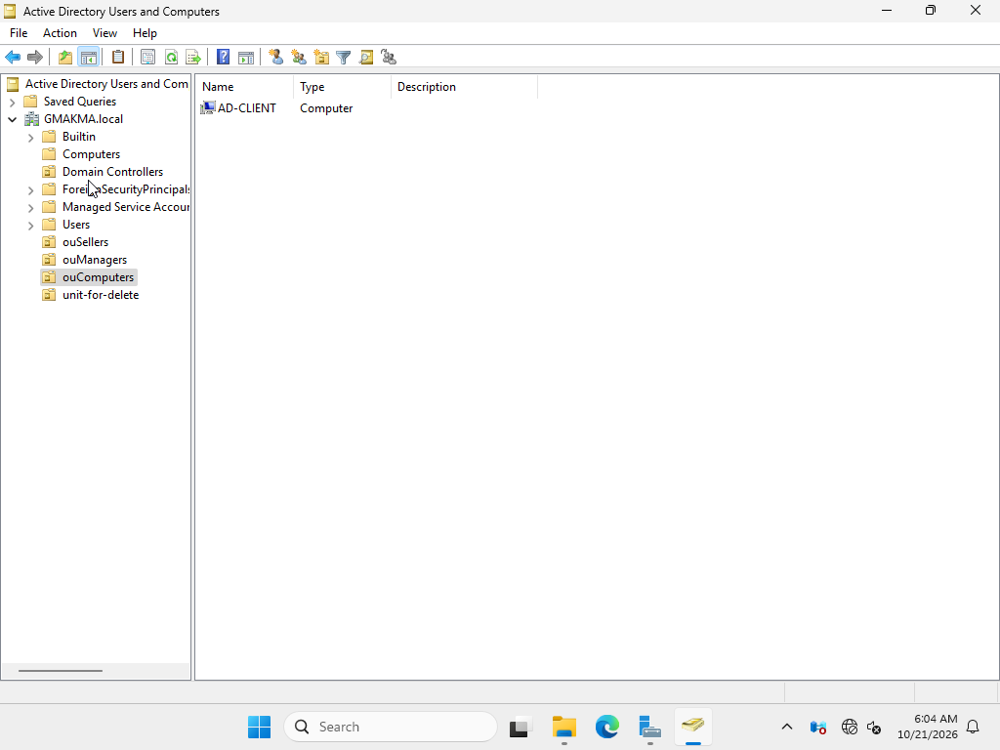

Рисунок 12: Объект AD-CLIENT в подразделении ouComputers

Результаты сетевой и доменной проверки: [состояние домена и DHCP](evidence/commands/domain-stage-verified.json), [членство клиента в домене](evidence/commands/client-domain-verified.txt)

## 3. Объекты AD, права NTFS и SMB

### 3.1. Подразделения, пользователи и группы

В ADUC создали OU `ouSellers` и `ouManagers`, пользователей `uSeller1` и `uManager1`, глобальные группы безопасности `gSellers` и `gManagers`. Пользователей включили в группы соответствующих отделов. Также создали `ouComputers` и `unit-for-delete` для следующих частей работы. Обычные пользователи не входят в административные группы

| OU | Пользователь | Группа | Тип и область группы |
|---|---|---|---|
| `ouSellers` | `uSeller1` | `gSellers` | Security, Global |
| `ouManagers` | `uManager1` | `gManagers` | Security, Global |


Рисунок 13: Пользователь uSeller1 в группе gSellers


Рисунок 14: Пользователь uManager1 в группе gManagers

### 3.2. Общий ресурс и права отделов

Создали `C:\AllUsers` с папками `Sellers`, `Managers`, `BlackHole` и `Common`. Опубликовали каталог под именем `AllUsersCom`. На уровне SMB выдали `Domain Users` право Change, `Domain Admins` - Full. Доступ к отдельным папкам разграничили NTFS


Рисунок 15: Структура каталога C:\AllUsers

На корень `AllUsers` предоставили `Domain Users` чтение и выполнение только для самой папки. `SYSTEM` и `Administrators` имеют полный доступ к учебному дереву. Разрешения отделов разделили по области действия:

| Папка / группа | Область применения | Разрешения |
|---|---|---|
| `Sellers` / `gSellers` | Только эта папка | Чтение, выполнение, запись, удаление вложенных файлов и папок |
| `Sellers` / `gSellers` | Только вложенные папки и файлы | Modify |
| `Managers` / `gManagers` | Только эта папка | Чтение, выполнение, запись, удаление вложенных файлов и папок |
| `Managers` / `gManagers` | Только вложенные папки и файлы | Modify |

На корни отделов не выдавали Delete, Change permissions и Take ownership. Поэтому пользователи могут работать с вложенными объектами, но не удалять сам каталог отдела или изменять его разрешения. Доступ к чужому отделу отсутствует


Рисунок 16: Специальные права gSellers без удаления корня и изменения разрешений

### 3.3. BlackHole и Common

В `BlackHole` предоставили `gSellers` и `gManagers` запись, проход к папке, чтение атрибутов и разрешений без List folder / read data. Для `CREATOR OWNER` назначили Modify только на потомков. Чтение корня `AllUsers` сюда не наследуется


Рисунок 17: Разрешение записи в BlackHole без просмотра содержимого

Под каждым из двух обычных пользователей перетащили мышью локальный файл на значок сетевой папки `BlackHole`. На сервере появились `seller-drop.txt` и `manager-drop.txt`, владельцы соответствуют отправителям. После копирования оба пользователя получили отказ при попытке просмотреть папку


Рисунок 18: Исходный файл менеджера и сетевой каталог для drag-and-drop


Рисунок 19: Оба доставленных файла в BlackHole на сервере


Рисунок 20: Проверка запрета просмотра BlackHole под uManager1

Для `Common` назначили `Domain Users` чтение, выполнение и запись без Delete и Delete subfolders and files. Запись `CREATOR OWNER: Modify` действует только на дочерние объекты. В результате все пользователи домена могут создавать и изменять файлы, но удалять - только свои


Рисунок 21: Права Common с отдельной записью CREATOR OWNER

### 3.4. Проверка операций через SMB

Проверки выполнили на `ad-client` через `\\ad-srv\AllUsersCom` в отдельных интерактивных сессиях `uSeller1` и `uManager1`, без административных прав

| Операция | Результат для обоих пользователей |
|---|---|
| Создать, изменить, прочитать и удалить вложенный файл своего отдела | Разрешено |
| Создать и удалить вложенную папку своего отдела | Разрешено |
| Удалить пустой корень отдела или записать его DACL | Запрещено |
| Просмотреть чужой отдел | Запрещено |
| Скопировать файл в BlackHole | Разрешено |
| Перечислить BlackHole | Запрещено |
| Создать, изменить и удалить свой файл в Common | Разрешено |
| Прочитать и изменить чужой файл в Common | Разрешено |
| Удалить чужой файл в Common | Запрещено |
| Записать и прочитать файл на X: | Разрешено |
| Просмотреть чужой домашний ресурс | Запрещено |

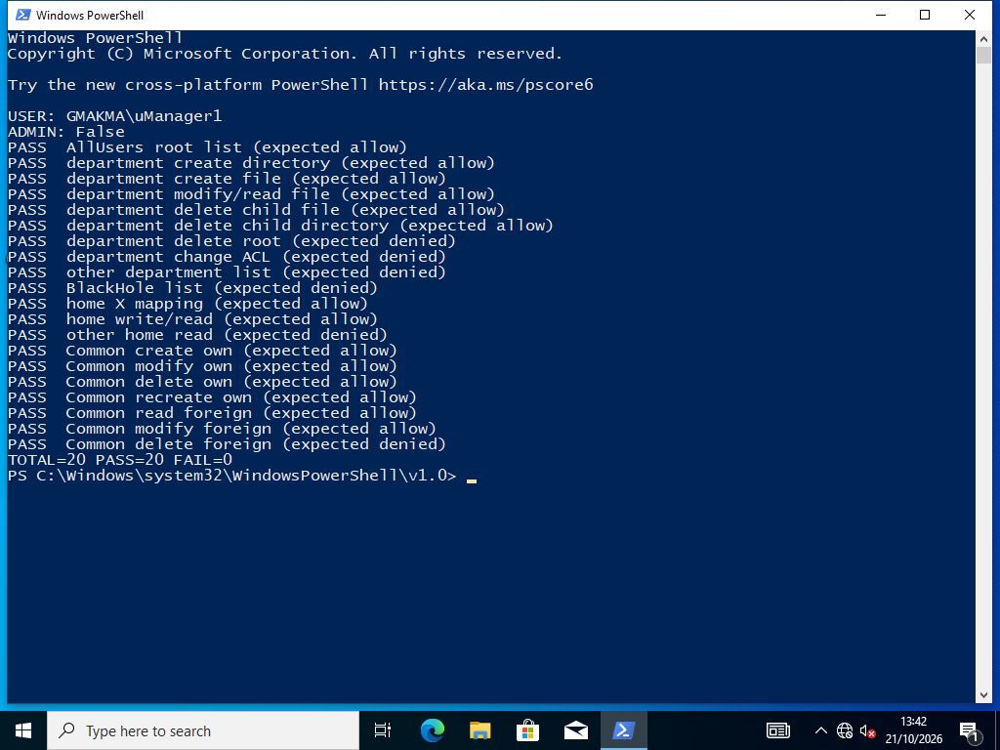

Рисунок 22: Результаты функциональных проверок под uManager1


Рисунок 23: Взаимная проверка Common и данных после повторного входа uSeller1

Всего получили 44 ожидаемых результата: 17 при первом входе продавца, 20 при входе менеджера и 7 после перезагрузки и повторного входа продавца. Неуспешных проверок нет. Два графических перетаскивания в BlackHole в это число не входят. Журналы: [продавец, первый вход](evidence/commands/stage-c-seller-first.json), [менеджер](evidence/commands/stage-c-manager-first.json), [продавец, повторный вход](evidence/commands/stage-c-seller-second.json)

### 3.5. Домашние папки и перемещаемые профили

Создали `C:\UsersHome\uSeller1` и `C:\UsersHome\uManager1`, отключили наследование. В NTFS оставили `SYSTEM` и `Administrators` с полным доступом и владельца с Modify. Опубликовали скрытые ресурсы `uSeller1$` и `uManager1$`: SMB Full для владельца и Domain Admins, кэширование отключено. В свойствах пользователей задали UNC-пути и подключение диска `X:`

| Пользователь | HomeDrive | HomeDirectory | ProfilePath |
|---|---|---|---|
| `uSeller1` | `X:` | `\\ad-srv\uSeller1$` | `\\ad-srv\uSeller1$\_profile` |
| `uManager1` | `X:` | `\\ad-srv\uManager1$` | `\\ad-srv\uManager1$\_profile` |

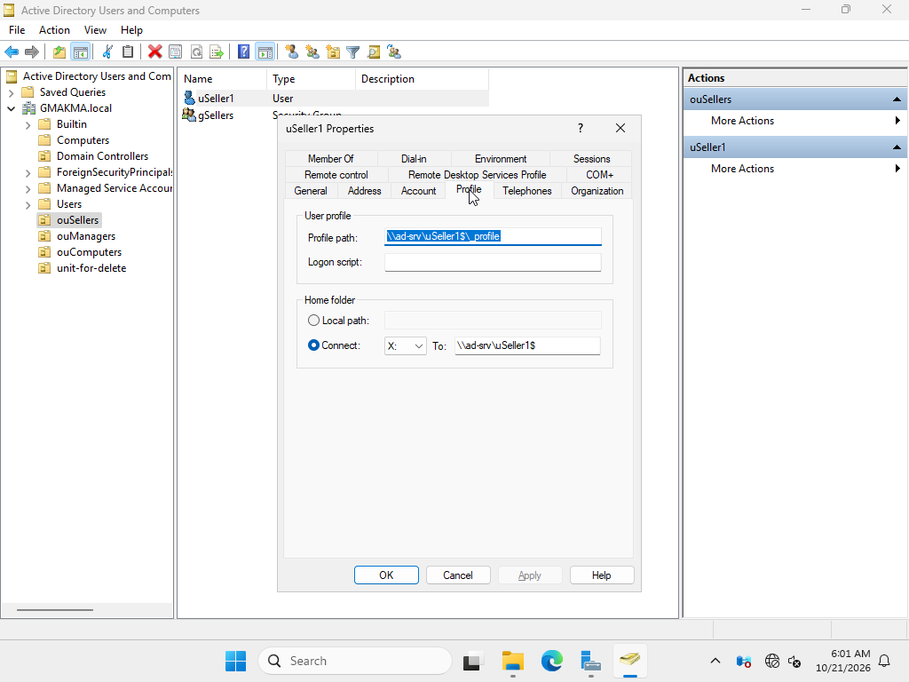

Рисунок 24: UNC-пути домашней папки и перемещаемого профиля uSeller1

`net view \\ad-srv` не показывает домашние ресурсы с `$`, при этом диск X: подключается и доступен владельцу для записи


Рисунок 25: Домашний ресурс скрыт из общего списка, диск X: подключён

После первого выхода Windows создала фактическую папку `_profile.V6` с `NTUSER.DAT`, `AppData` и рабочим столом. Поэтому данные профиля изучили по `X:\_profile.V6`, а не по папке без версионного суффикса. Для административной проверки добавили Administrators FullControl без смены владельца, доступ другим пользователям не открывали

Клиент перезагрузили, снова вошли как `uSeller1`. Домашний диск подключился, файлы на X: и маркер рабочего стола сохранились. `Win32_UserProfile` показал `RoamingConfigured=True`, `Status=2`, `RoamingPath=\\ad-srv\uSeller1$\_profile.V6`. Событие 7 User Profile Service подтвердило успешную синхронизацию с сервера на клиент. Серверная и клиентская копии маркера совпали


Рисунок 26: Перемещаемый профиль и успешная синхронизация после перезагрузки и входа

Сохранены [параметры загруженного профиля](evidence/commands/stage-c-client-profiles.json) и [события службы профилей](evidence/commands/stage-c-profile-service-events.json)

## 4. Групповые политики и установка 7-Zip

### 4.1. Области действия и параметры

Изменили `Default Domain Policy`. Отдельные GPO создали и связали с OU через модуль GroupPolicy, параметры административных шаблонов задали `Set-GPRegistryValue`, затем проверили в GPMC. Настройки безопасности и Software Installation проверили в редакторе политик. Компьютерные GPO действуют на `ouComputers`, где находится только клиент, контроллер домена остаётся в своей OU

| GPO / область | Параметр | Установленное значение |
|---|---|---|
| Default Domain Policy / домен | Minimum password length | 6 символов |
| Default Domain Policy / домен | Password must meet complexity requirements | Disabled |
| Lab2-Sellers / ouSellers, User | Prohibit access to Control Panel and PC settings | Enabled, `NoControlPanel=1` |
| Lab2-Sellers / ouSellers, User | Prevent access to registry editing tools | Enabled, `DisableRegistryTools=1` |
| Lab2-Sellers / ouSellers, User | Hide these specified drives in My Computer | Только C:, `NoDrives=4` |
| Lab2-Sellers / ouSellers, User | Enable screen saver | Enabled, `ScreenSaveActive=1` |
| Lab2-Sellers / ouSellers, User | Password protect the screen saver | Enabled, `ScreenSaverIsSecure=1` |
| Lab2-Sellers / ouSellers, User | Screen saver timeout | Enabled, 60 секунд |
| Lab2-Sellers / ouSellers, User | Prevent changing screen saver | Enabled, `NoDispScrSavPage=1` |
| Lab2-Sellers / ouSellers, User | Force specific screen saver | Enabled, `scrnsave.scr` |
| Lab2-Managers / ouManagers, User | Run only specified Windows applications | Enabled, `RestrictRun=1`, только `mspaint.exe`, `calc.exe`, `notepad.exe` |
| Lab2-Computers / ouComputers, Computer | Disable Windows Error Reporting | Enabled, `Disabled=1` |
| Lab2-Computers / ouComputers, Computer | Accounts: Administrator account status | Disabled, встроенная локальная учётная запись с RID 500 |
| Lab2-Computers / ouComputers, Computer | Allow or Disallow use of the Offline Files feature | Disabled, `NetCache Enabled=0` |
| Lab2-Computers / ouComputers, Computer | File System, корень C:\ | Administrators и SYSTEM FullControl, Domain Users ReadAndExecute, распространение наследуемых разрешений, режим 0 |
| Lab2-Deploy-7Zip / ouComputers, Computer | Software Installation | `7z2604-x64.msi`, Assigned, отдельная GPO |

Сохранили отчёты о параметрах политик в формате HTML: [Default Domain Policy](evidence/reports/stage-d-Default-Domain-Policy.html), [Lab2-Sellers](evidence/reports/stage-d-Lab2-Sellers.html), [Lab2-Managers](evidence/reports/stage-d-Lab2-Managers.html), [Lab2-Computers](evidence/reports/stage-d-Lab2-Computers.html), [Lab2-Deploy-7Zip](evidence/reports/stage-d-Lab2-Deploy-7Zip.html)

Команда `Get-ADDefaultDomainPasswordPolicy` вернула `MinPasswordLength=6` и `ComplexityEnabled=False`

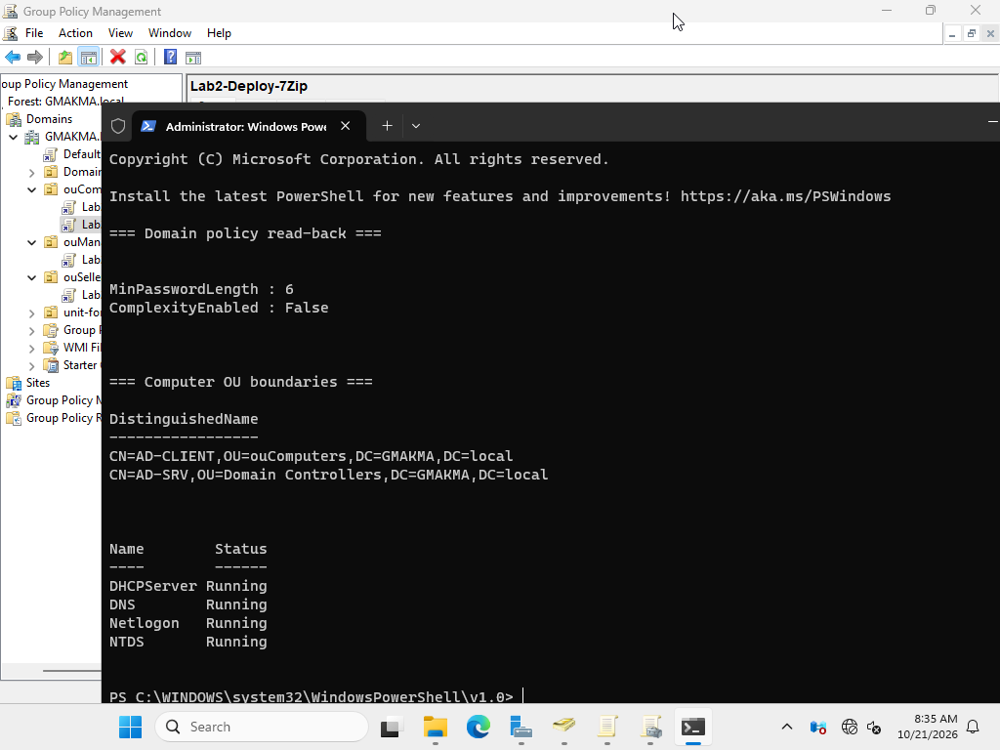

Рисунок 27: Проверка доменной политики паролей

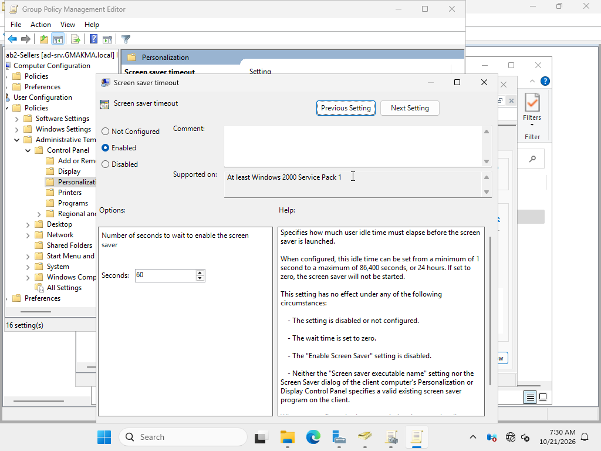

Рисунок 28: Настройка таймаута заставки 60 секунд

### 4.2. Проверка пользовательских политик

После `gpupdate /target:user /force`, выхода и повторного входа продавца проверили запуск Панели управления и regedit: обе операции запрещены политикой. На снимках показаны ожидаемые запреты задания


Рисунок 29: Проверка запрета Панели управления под uSeller1

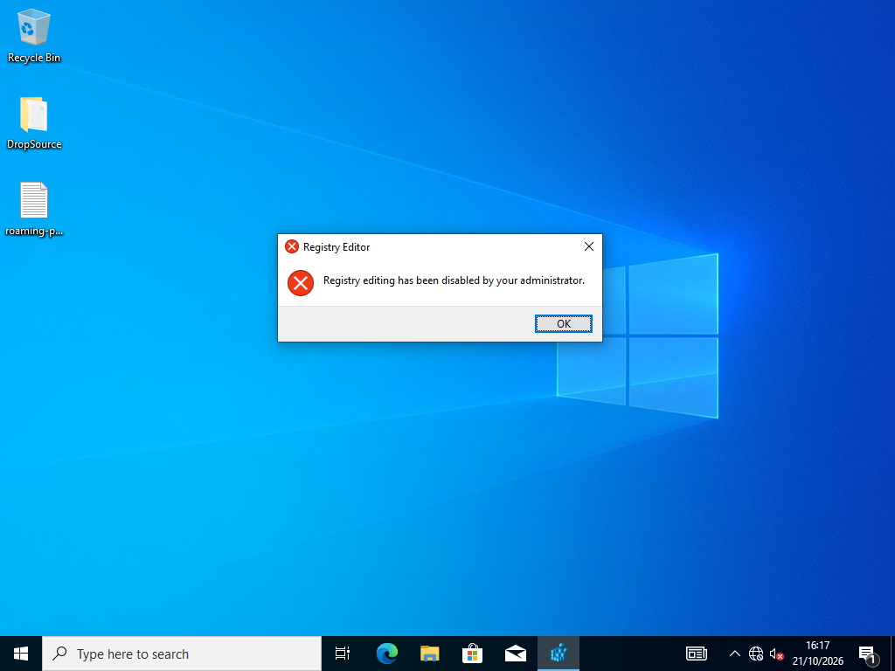

Рисунок 30: Проверка запрета редактора реестра под uSeller1

В «Этот компьютер» диск C: скрыт, X: доступен. Изменение заставки запрещено. При отсутствии ввода более 60 секунд сессия блокируется. Для возврата требуется пароль


Рисунок 31: Диск C: скрыт, домашний диск X: доступен продавцу

Для менеджеров включили запуск только заданных Windows-приложений. Список из трёх имён приведён в таблице и в сохранённом отчёте о параметрах GPO


Рисунок 32: Включён параметр запуска только заданных Windows-приложений

После обновления политики, повторного входа и последующей перезагрузки под `uManager1` запустились Paint, Калькулятор и Блокнот. В Блокноте сохранили файл на X:. Запуск `cmd.exe` из Проводника и WordPad запрещён. Политика ограничивает запуск через Explorer, но не является полной изоляцией произвольного кода


Рисунок 33: Разрешённые приложения менеджера и файл домашней папки после перезагрузки


Рисунок 34: Проверка запрета cmd.exe при запуске из Проводника

Применение пользовательских GPO подтверждено отчётами RSoP: [продавец](evidence/reports/stage-d-seller-gpresult.html), [менеджер](evidence/reports/stage-d-manager-final.html)

### 4.3. Проверка политики компьютера и ограничение по ACL

После `gpupdate /target:computer /force` и перезагрузки в клиентском RSoP присутствуют `Lab2-Computers` и `Lab2-Deploy-7Zip`. Получены `WER Disabled=1`, `Offline Files Enabled=0`, встроенный локальный Administrator отключён. Отдельный локальный `LabAdmin` сохранён включённым. Защищённый канал с доменом исправен


Рисунок 35: Применённые компьютерные GPO, отключённый RID 500 и параметры клиента

Для `C:\` в разделе Security Settings -> File System задали три записи: Administrators и SYSTEM - полный доступ, Domain Users - чтение, просмотр каталогов и выполнение. Выбрали Propagate inheritable permissions to all subfolders and files, а не полную замену дочерних ACL


Рисунок 36: Распространение наследуемых прав C: без полной замены защищённых ACL

На корне C: подтвердили заданные три записи, запись обычного пользователя в корень запрещена. Защищённые ACL Windows и пользовательских профилей сохранили. Поэтому требование единой трёхсубъектной ACL буквально на каждом объекте диска C: выполнено не полностью: применена политика корня и наследуемых разрешений с сохранением системных и профильных исключений. Профиль пользователя, домашний диск и разрешённые приложения после изменения работают

Подтверждения: [компьютерный gpresult](evidence/reports/stage-d-computer-gpresult.html), [DACL после перезагрузки](evidence/commands/stage-d-client-acl-after-reboot.json)

### 4.4. Назначение MSI через отдельную GPO

Для 7-Zip 26.04 x64 создали ресурс `LabPackages$`. Компьютерам домена предоставили чтение пакета по SMB и NTFS. В `Lab2-Deploy-7Zip` открыли Computer Configuration -> Policies -> Software Settings -> Software installation, указали UNC-путь `\\ad-srv\LabPackages$\7z2604-x64.msi` и выбрали Assigned


Рисунок 37: Выбор назначения MSI компьютерам в режиме Assigned

После перезагрузки клиента `7z.exe i` показал `7-Zip 26.04 (x64)`, пакет появился в Programs and Features, File Manager запустился. Установка выполнена политикой, а не ручным запуском `msiexec`. В системном журнале источник Application Management Group Policy зарегистрировал события 301 об успешном назначении и 302 об успешной установке из `Lab2-Deploy-7Zip`


Рисунок 38: События успешного назначения и установки 7-Zip через GPO

Исходная [выборка событий установки](evidence/commands/stage-d-application-management-events.json) содержит связь пакета с отдельной политикой развёртывания

## 5. Автоматизация создания объектов по CSV

### 5.1. Скрипт и входные данные

Подготовили [Provision-Lab2.ps1](scripts/Provision-Lab2.ps1). Полный текст приведён в приложении А. Скрипт принимает путь к CSV в параметре `CsvPath` и работает в текущем домене, определённом через `Get-ADDomain`

Сначала скрипт проверяет весь CSV, имена объектов и пути. Затем создаёт недостающие OU и группы, создаёт пользователей или обновляет их атрибуты, добавляет членство в группах. После этого готовит домашние папки, ресурс для профилей и права NTFS и SMB, задаёт диск X: и путь профиля. В конце записывает HTML с количеством и именами созданных объектов. При повторном запуске существующие объекты не создаются заново, пароли пользователей не сбрасываются

| Поле CSV | Содержимое |
|---|---|
| FullName | ФИО, DisplayName |
| Title | Должность |
| Department | Название отдела |
| Email | E-mail, mail |
| Phone | Телефон, telephoneNumber |
| SamAccountName | Логин |
| Password | Начальный пароль |
| OrganizationalUnit | Имя OU или её DN в текущем домене |
| Groups | Список групп, имена разделены точкой с запятой |
| HomeDirectory | Домашняя папка, подключаемая на X: |
| ProfilePath | UNC-путь перемещаемого профиля |

Пароли в отчёте не приводим. [Публичный пример CSV](data/lab2-users.example.csv) содержит заменители вместо действующих паролей

Для проверки создания использовали новые объекты:

| Пользователь | OU | Группы | HomeDirectory / ProfilePath |
|---|---|---|---|
| `uCsvSeller1` | `ouCsvSellers` | `gCsvSellers;gCsvStaff` | `\\ad-srv\uCsvSeller1$` / `\\ad-srv\Profiles$\uCsvSeller1` |
| `uCsvManager1` | `ouCsvManagers` | `gCsvManagers;gCsvStaff` | `\\ad-srv\uCsvManager1$` / `\\ad-srv\Profiles$\uCsvManager1` |

Для этих пользователей скрипт подготовил `C:\Profiles`, опубликованный как `Profiles$`. Ранее заданные пути `_profile` внутри домашних ресурсов `uSeller1` и `uManager1` не изменяли

### 5.2. Два запуска и HTML-отчёт

На AD-SRV выполнили:

```powershell
C:\Lab2\Provision-Lab2.ps1 -CsvPath C:\Lab2Private\lab2-users.csv -ReportPath C:\Lab2\provision-first.html
C:\Lab2\Provision-Lab2.ps1 -CsvPath C:\Lab2Private\lab2-users.csv -ReportPath C:\Lab2\provision-second.html
```

Оба запуска завершились со статусом `Completed`

| Созданные объекты | Первый запуск | Повторный запуск |
|---|---:|---:|
| OU | 2 | 0 |
| Группы | 3 | 0 |
| Пользователи | 2 | 0 |
| Каталоги | 3 | 0 |
| SMB-ресурсы | 3 | 0 |
| Файлы HTML-отчётов | 1 | 1 |

Три каталога - корень профилей и две домашние папки. Три ресурса - `Profiles$` и две домашние папки с `$`. Сравнение GUID обеих OU, трёх групп и двух пользователей подтвердило сохранение тех же семи объектов при повторном запуске


Рисунок 39: Первый и повторный запуск скрипта без повторного создания объектов


Рисунок 40: HTML-отчёт с количеством и именами созданных объектов

Приложены [HTML первого запуска](evidence/reports/provision-first.html), [HTML повторного запуска](evidence/reports/provision-second.html), [GUID после первого](evidence/commands/stage-e-identities-first.json) и [второго запуска](evidence/commands/stage-e-identities-second.json)

### 5.3. Проверка созданной учётной записи

Сверили с CSV ФИО, должность, отдел, почту, телефон, группы и UNC-пути. Серверная проверка дала 14 успешных результатов. Для домашних папок подтверждены защищённые DACL с полным доступом пользователя, SYSTEM и Administrators, для ресурсов - шифрование SMB, AccessBased enumeration и отключённое кэширование. Корень профилей допускает создание собственной папки с наследуемыми правами CREATOR OWNER

Вошли на `ad-client` под `uCsvSeller1`: X: подключился, запись и чтение файла выполнились, доступ к чужому домашнему ресурсу запрещён. После выхода на сервер выгрузился профиль `uCsvSeller1.V6`, при повторном входе домашний диск и маркер рабочего стола сохранились. Параметры профиля и события службы подтвердили успешную загрузку по UNC, контрольные суммы маркера на сервере и клиенте совпали

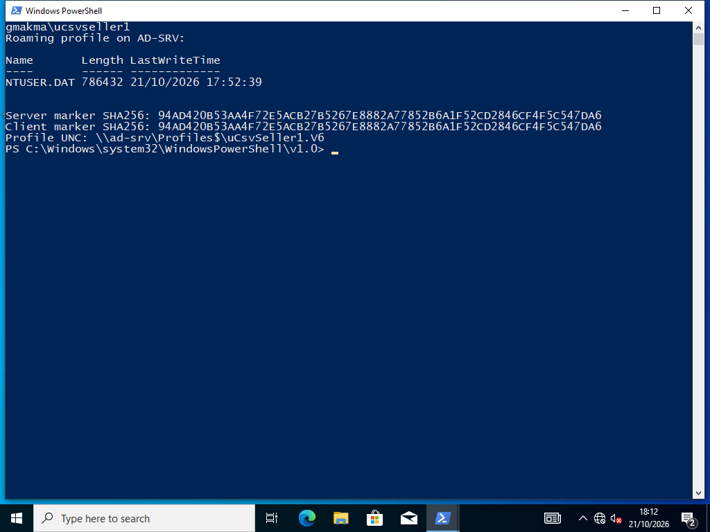

Рисунок 41: Реальный профиль CSV-пользователя на сервере и совпадение маркера с клиентом

Результаты: [атрибуты CSV и AD](evidence/commands/stage-e-csv-metadata.json), [серверная проверка](evidence/commands/stage-e-server-verification.json), [повторный вход](evidence/commands/stage-e-csv-client-second.json), [события перемещаемого профиля](evidence/commands/stage-e-csv-roaming-events.json)

## 6. Восстановление удалённых объектов AD

### 6.1. Корзина и создание пользователей

Включили корзину до удаления объектов:

```powershell
Enable-ADOptionalFeature 'Recycle Bin Feature' -Scope ForestOrConfigurationSet -Target 'GMAKMA.local' -Confirm:$false
(Get-ADOptionalFeature 'Recycle Bin Feature').EnabledScopes
```

Проверили непустой `EnabledScopes`. Затем тем же скриптом части 5 создали пять пользователей `uDelete1`-`uDelete5` в `unit-for-delete`:

```powershell
C:\Lab2\Provision-Lab2.ps1 -CsvPath C:\Lab2Private\lab2-delete-users.csv -ReportPath C:\Lab2\provision-delete.html
```

Созданы пять пользователей, одна группа, пять домашних папок и пять личных SMB-ресурсов. OU уже существовала. Группу `gDeleteLab2` перенесли в `ouCsvSellers`, сохранив членство, чтобы в `unit-for-delete` остались только пять пользователей. Их GUID, SID и DN записали в [manifest](evidence/reports/delete-users-manifest.xml), атрибуты, группы и состояние домашних папок сохранили для сравнения

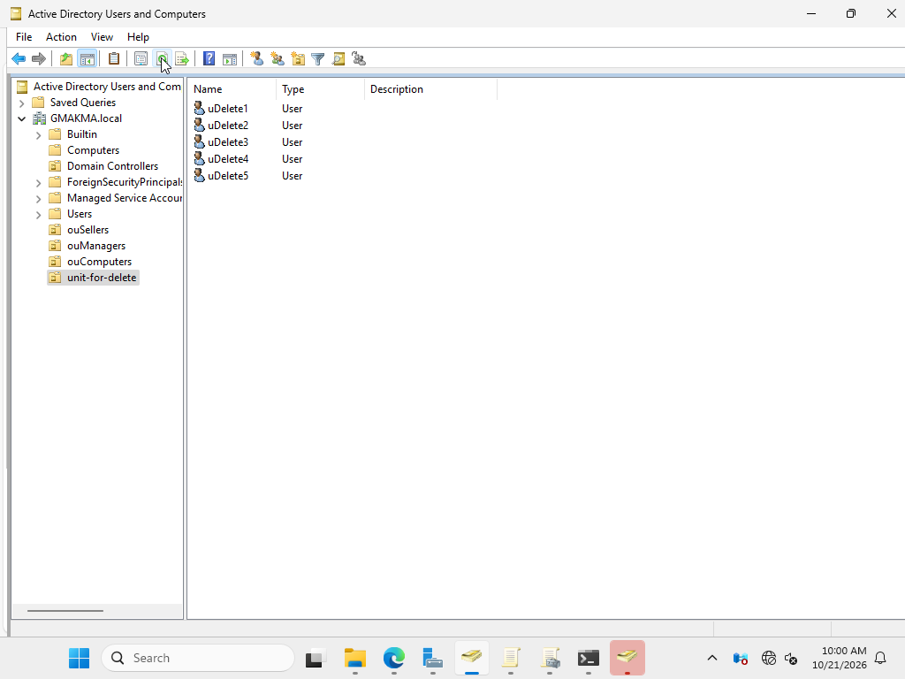

Рисунок 42: Пять пользователей в unit-for-delete до удаления

### 6.2. Удаление пользователей

Проверили точный состав OU и выполнили в CMD конвейер из [Remove-Lab2DeletedUsers.cmd](scripts/Remove-Lab2DeletedUsers.cmd):

```bat
dsquery user "OU=unit-for-delete,DC=GMAKMA,DC=local" -limit 0 | dsrm -noprompt
```

Для всех пяти пользователей получено `dsrm succeeded`, код завершения 0. Контрольный запрос вернул 0 пользователей, сама OU сохранена. Группы и объекты других контейнеров не удалялись

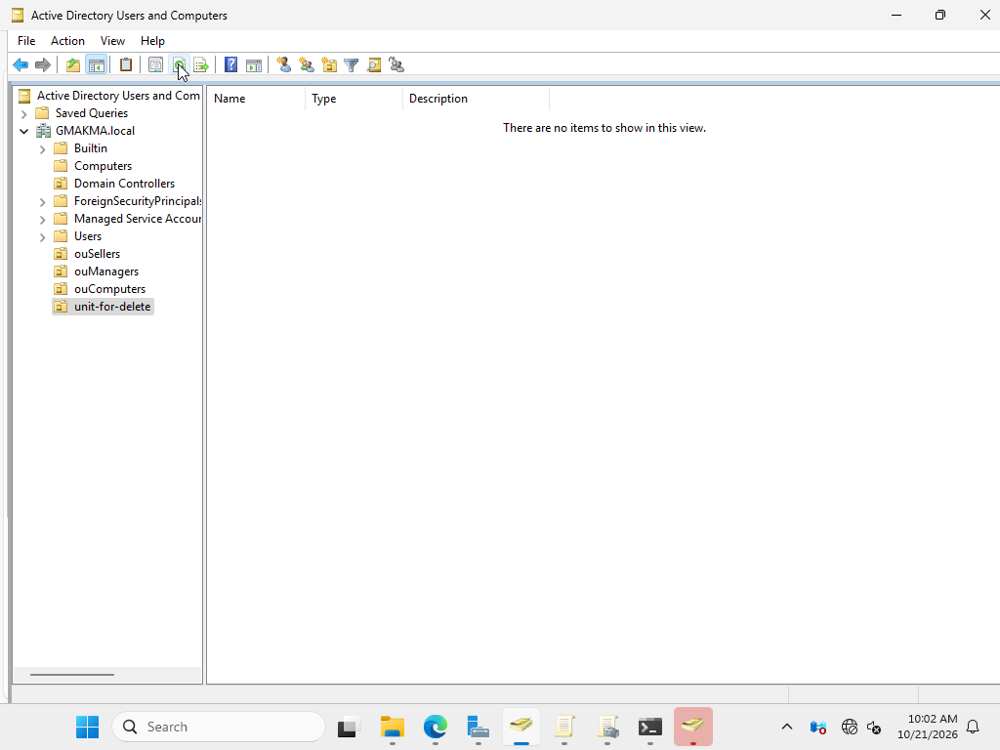

Рисунок 43: Пустое подразделение unit-for-delete после удаления пользователей

### 6.3. Восстановление по исходным GUID

Для восстановления удалённого объекта PowerShell использует `Get-ADObject -IncludeDeletedObjects | Restore-ADObject`. В работе выбирали только GUID пяти пользователей из manifest. Скрипт сначала проверяет количество записей, `isDeleted` и исходную OU всех объектов, затем восстанавливает их в существующий контейнер и сверяет идентичность

Полный текст выполненного [Restore-Lab2DeletedUsers.ps1](scripts/Restore-Lab2DeletedUsers.ps1):

```powershell
#requires -Modules ActiveDirectory
[CmdletBinding()]
param([string]$ManifestPath = 'C:\Lab2\delete-users-manifest.xml')
$ErrorActionPreference = 'Stop'
$base = 'OU=unit-for-delete,DC=GMAKMA,DC=local'
$expected = @(Import-Clixml -LiteralPath $ManifestPath)
if ($expected.Count -ne 5) { throw 'Expected a five-user manifest' }
foreach ($entry in $expected) {
    $object = Get-ADObject -Identity $entry.ObjectGUID -IncludeDeletedObjects -Properties isDeleted,lastKnownParent
    if (-not $object.isDeleted -or $object.lastKnownParent -ne $base) {
        throw 'Unexpected object state or original OU; no broad restore is allowed'
    }
}
foreach ($entry in $expected) {
    Get-ADObject -Identity $entry.ObjectGUID -IncludeDeletedObjects | Restore-ADObject -TargetPath $base
}
foreach ($entry in $expected) {
    $user = Get-ADUser -Identity $entry.ObjectGUID
    if ($user.SID.Value -ne $entry.SID.Value -or $user.SamAccountName -ne $entry.SamAccountName) {
        throw 'Restored identity differs from the original manifest'
    }
    $user | Select-Object SamAccountName,ObjectGUID,SID,DistinguishedName
}
```

Выполненная команда запуска:

```powershell
C:\Lab2\Restore-Lab2DeletedUsers.ps1 -ManifestPath C:\Lab2\delete-users-manifest.xml
```

Таким образом, конвейер восстановления из части 6 имеет вид:

```powershell
foreach ($entry in $expected) {
    Get-ADObject -Identity $entry.ObjectGUID -IncludeDeletedObjects | Restore-ADObject -TargetPath $base
}
```

Переменные и проверки заданы в полном листинге выше. Восстановление всех удалённых объектов домена без отбора не выполняли

В OU снова получили пять исходных пользователей. У каждого совпали GUID, SID, DN, открытые атрибуты, членство в `gDeleteLab2`, домашние пути, SMB-ресурсы и их ACL. Исходные группы сохранились, повторное создание пользователей не потребовалось


Рисунок 44: Совпадение GUID, SID, атрибутов, групп и домашних папок после восстановления

Вошли на клиент под `uDelete1` с исходным паролем, без сброса. SID совпал с исходным, X: подключился к `\\ad-srv\uDelete1$`, файл в домашней папке записан и прочитан


Рисунок 45: Вход восстановленного uDelete1 и работа домашнего диска X:

Подтверждения: [HTML создания пяти пользователей](evidence/reports/provision-delete.html), [результат удаления](evidence/commands/stage-e-delete-cmd-result.json), [сравнение после восстановления](evidence/commands/stage-e-restore-identity-comparison.json), [проверка восстановленной учётной записи](evidence/commands/stage-e-restored-client-check.json)

## 7. Ответы на контрольные вопросы

### 7.1. Раскройте смысл терминов дерево доменов, лес и схема Active Directory?

Дерево доменов - иерархия доменов с непрерывным пространством DNS-имён, например `example.local` и `sales.example.local`, и доверительными отношениями. Лес объединяет одно или несколько деревьев с общей схемой, конфигурацией и глобальным каталогом, имена деревьев могут различаться. Схема задаёт классы объектов, их атрибуты и правила построения каталога. В работе создан лес с одним корневым доменом `GMAKMA.local`

### 7.2. Где на контроллере домена хранится данные об объектах Active Directory в виде файлов? Какие файлы за что отвечают?

В стандартной конфигурации база и журналы AD DS находятся в `C:\Windows\NTDS`, такой путь оставили и в работе. `ntds.dit` содержит базу объектов, атрибутов и данных безопасности. `edb.log` и нумерованные `edb*.log` - журналы транзакций для согласованности и восстановления, `edb.chk` - контрольная точка применённых транзакций, `edb*.jrs` - резервные журналы на случай нехватки места, `temp.edb` - временная база движка ESE

### 7.3. Где на контроллере домена хранятся файлы, содержащие групповые политики домена?

Файловая часть GPO, GPT, хранится в SYSVOL: на стенде `C:\Windows\SYSVOL\sysvol\GMAKMA.local\Policies\{GUID-GPO}`, по сети - `\\GMAKMA.local\SYSVOL\GMAKMA.local\Policies\{GUID-GPO}`. Она содержит файлы параметров и сценарии. Вторая часть, GPC, является объектом AD с метаданными политики и сведениями о версии, поэтому одной папки SYSVOL недостаточно для полного представления GPO

### 7.4. Какие компоненты автоматически устанавливаются мастером при добавлении ролей Active Directory?

Мастер AD DS предлагает необходимые компоненты и средства администрирования. В работе добавили Group Policy Management, средства управления AD DS/AD LDS, оснастки и командные утилиты, модуль Active Directory для PowerShell. Средства управления AD LDS не означают установку самой роли AD LDS. DNS Server установлен при повышении сервера с выбранной опцией DNS, DHCP добавлен отдельно. AD CS и AD FS автоматически частью AD DS не становятся

### 7.5. Для чего нужен пароль DSRM?

Пароль DSRM используется для входа локальным администратором контроллера домена в Directory Services Restore Mode, когда выполняют обслуживание или восстановление AD DS, в том числе состояния системы из резервной копии. Его задают при повышении сервера, это отдельный пароль, не обычный пароль доменного Administrator

### 7.6. Как восстановить пароль DSRM, если он был утерян после установки?

Утраченный пароль заменяют новым: на работающем в обычном режиме контроллере открывают повышенную командную строку с правами администратора домена и последовательно выполняют `ntdsutil`, `set dsrm password`, `reset password on server null`. Значение `null` обозначает текущий сервер, для другого контроллера указывают его DNS-имя. Затем вводят и подтверждают новый пароль и дважды выполняют `q` для выхода. Способ не применяется к серверу, уже загруженному в DSRM. Это справочная процедура, в ходе работы сброс DSRM не выполняли

### 7.7. Зачем нужно имя домена NetBIOS?

NetBIOS-имя - короткое имя домена для совместимости и формата входа `ДОМЕН\пользователь`. Для созданного домена это `GMAKMA`, например `GMAKMA\uSeller1`, DNS-имя - `GMAKMA.local`, UPN пользователя - `uSeller1@GMAKMA.local`. Короткое имя не заменяет DNS-имя домена

### 7.8. Какие группы пользователей создаются в AD автоматически? Опишите минимум 5 из них

| Группа | Назначение |
|---|---|
| Domain Users | Основная группа новых доменных пользователей, административных прав сама по себе не даёт |
| Domain Admins | Администрирование домена, по умолчанию входит в Administrators на его контроллерах и присоединённых компьютерах |
| Enterprise Admins | Администрирование леса, создаётся в корневом домене |
| Schema Admins | Изменение общей схемы, создаётся в корневом домене |
| Group Policy Creator Owners | Создание GPO и управление собственными созданными политиками, но не автоматически любыми GPO |
| Backup Operators | Резервное копирование и восстановление файлов на контроллерах, в рамках этих операций - независимо от обычных файловых разрешений |

### 7.9. Какие записи в DNS создаются специально для AD? Перечислите их, укажете их назначение

| Тип и пример имени для GMAKMA.local | Назначение |
|---|---|
| SRV `_ldap._tcp.GMAKMA.local` | Поиск LDAP |
| SRV `_ldap._tcp.dc._msdcs.GMAKMA.local` | Поиск контроллеров домена |
| SRV `_kerberos._tcp.GMAKMA.local`, `_kerberos._udp.GMAKMA.local` | Поиск KDC Kerberos |
| SRV `_kpasswd._tcp.GMAKMA.local`, `_kpasswd._udp.GMAKMA.local` | Смена пароля Kerberos |
| SRV `_gc._tcp.GMAKMA.local` | Поиск глобального каталога леса |
| SRV `_ldap._tcp.pdc._msdcs.GMAKMA.local` | Поиск PDC Emulator |
| SRV `_ldap._tcp.<сайт>._sites.dc._msdcs.GMAKMA.local` | Поиск контроллера в заданном сайте |
| SRV `_ldap._tcp.<GUID-домена>.domains._msdcs.GMAKMA.local` | Поиск контроллера по GUID домена |
| CNAME `<GUID-NTDS-Settings>._msdcs.GMAKMA.local` | Поиск контроллера по GUID объекта NTDS Settings для репликации |

Это справочный перечень типовых записей. Для получения IP найденного сервера нужны A/AAAA, которые не специфичны для AD. На стенде отдельно проверили зоны `GMAKMA.local`, `_msdcs.GMAKMA.local` и A-запись `ad-srv -> 10.0.0.1`

## 8. Вывод

Развернули домен `GMAKMA.local` с AD DS, DNS и авторизованным DHCP. Подключили клиент к домену, создали подразделения, группы и пользователей. Проверили права отделов, запись без просмотра в BlackHole, удаление только собственных файлов в Common, скрытые домашние ресурсы и синхронизацию перемещаемого профиля после перезагрузки

Настроили и проверили пользовательские и компьютерные GPO, установили 7-Zip через отдельную политику назначения MSI. Для ACL диска C: сохранили исключение: политика задаёт корень и наследуемые разрешения, но не заменяет защищённые системные и профильные ACL. Скриптом CSV создали новые объекты без дублирования при повторном запуске. Пять удалённых пользователей восстановили с исходными идентификаторами, группами и работоспособным входом. Сохранили итоговые снимки обеих виртуальных машин

## Приложение А. Полный скрипт части 5

Полный текст фактически выполненного [Provision-Lab2.ps1](scripts/Provision-Lab2.ps1). Функции до основного кода отвечают за чтение CSV, проверку входных данных, права каталогов и ресурсов, запись HTML. В блоке Phase 1 проверяются данные без изменений в домене. В блоке Phase 2 создаются и настраиваются объекты. Листинг включает проверки повторного запуска и прав доступа

```powershell
#requires -Version 5.1
#requires -Modules ActiveDirectory, SmbShare
<#
.SYNOPSIS
Provision lab users from a private CSV on the domain-joined file server.
.DESCRIPTION
Run elevated in Windows PowerShell 5.1 on Windows Server 2025. No credentials
are requested or generated. The private CSV is read only at runtime; do not put
it in the repository or run this script under a transcript that records input.

Required headers: FullName,Title,Department,Email,Phone,SamAccountName,Password,
OrganizationalUnit,Groups,HomeDirectory,ProfilePath. Groups are separated by ;.
OU may be a simple top-level name or an OU-only DN in the current domain.
HomeDirectory must be HomeRoot\SamAccountName or \\THIS-SERVER\SamAccountName$.
ProfilePath must be \\THIS-SERVER\Profiles$\SamAccountName (or the configured
ProfileShareName). Short and domain-qualified local server names are accepted.
Only simple SAM names (1-20 letters/digits/._-, starting with a letter) are
supported. Reserved local/privileged account names are refused.

The complete CSV and existing target state are checked before any writes.
Existing users must already be in the requested OU. Passwords on existing users
are NEVER reset; existing memberships are preserved and missing ones added.
Only dedicated home/profile roots, per-user home folders, and their shares are
reconciled. No recursive reset, delete, move, or system-wide ACL change occurs.
Roaming profile folders are created by Windows at first logon, not precreated.
Profile root NTFS: SYSTEM/Administrators full; CREATOR OWNER inheritable full;
Authenticated Users root-only read/traverse and create directories. SMB is full
for Authenticated Users/Administrators; NTFS isolates user profile descendants.
The home NTFS DACL contains only the user, SYSTEM and Administrators (full).

The HTML inventory counts only successful creations in THIS invocation, including
new directories and the report file itself. Existing objects have a zero count.
A partial HTML inventory is attempted on execution failure. AD/SMB/filesystem
operations are not transactional; preflight cannot predict password policy,
quota, replication, or concurrent administrative changes. Never publish the CSV.
.EXAMPLE
.\Provision-Lab2.ps1 -CsvPath C:\Private\lab2.csv -ReportPath C:\Private\lab2-results.html
#>
[CmdletBinding()]
param(
    [Parameter(Mandatory = $true)][string]$CsvPath,
    [string]$HomeRoot = 'C:\UsersHome',
    [string]$ProfileRoot = 'C:\Profiles',
    [string]$ProfileShareName = 'Profiles$',
    [string]$ReportPath = (Join-Path $PSScriptRoot 'Provision-Lab2-report.html')
)
Set-StrictMode -Version 2.0
$ErrorActionPreference = 'Stop'

function Read-Lab2Csv {
    param([string]$Path)
    # Import-Csv silently discards excess cells. Check record widths explicitly.
    Add-Type -AssemblyName Microsoft.VisualBasic
    $expectedHeaders = @('FullName','Title','Department','Email','Phone','SamAccountName','Password','OrganizationalUnit','Groups','HomeDirectory','ProfilePath')
    $parser = New-Object Microsoft.VisualBasic.FileIO.TextFieldParser($Path, [Text.Encoding]::UTF8, $true)
    $parser.TextFieldType = [Microsoft.VisualBasic.FileIO.FieldType]::Delimited
    $parser.SetDelimiters(',')
    $parser.HasFieldsEnclosedInQuotes = $true
    $parser.TrimWhiteSpace = $false
    try {
        if ($parser.EndOfData) { throw 'CSV is empty.' }
        $columnNames = $parser.ReadFields()
        if ($columnNames.Count -ne $expectedHeaders.Count -or @(Compare-Object $expectedHeaders $columnNames -CaseSensitive).Count -or @($columnNames | Select-Object -Unique).Count -ne $expectedHeaders.Count) { throw 'CSV header does not match the required schema.' }
        $records = New-Object 'System.Collections.Generic.List[object]'
        while (-not $parser.EndOfData) {
            $cells = $parser.ReadFields()
            if ($cells.Count -ne $columnNames.Count) { throw 'CSV record has an incorrect number of fields.' }
            $values = [ordered]@{}
            for ($i = 0; $i -lt $columnNames.Count; $i++) { $values[$columnNames[$i]] = [string]$cells[$i] }
            $records.Add([pscustomobject]$values)
            if ($records.Count -gt 1000) { throw 'CSV exceeds the 1000-user limit.' }
        }
        return $records.ToArray()
    } finally { $parser.Dispose() }
}
function Assert-Lab2Sam {
    param([string]$Value)
    if ($Value -cnotmatch '^[A-Za-z][A-Za-z0-9._-]{0,19}$' -or
        $Value -match '[.]$|^(CON|PRN|AUX|NUL|COM[1-9]|LPT[1-9]|Administrator|Guest|krbtgt|DefaultAccount|WDAGUtilityAccount)$') {
        throw 'Invalid or reserved SAM name.'
    }
}
function ConvertTo-Lab2OuDn {
    param([string]$Value, [string]$DomainDn)
    $namePattern = '[\p{L}\p{N}][\p{L}\p{N} _-]{0,63}'
    if ($Value -match ('^' + $namePattern + '$')) { return ('OU={0},{1}' -f $Value, $DomainDn) }
    $suffix = ',' + $DomainDn
    if (-not $Value.EndsWith($suffix, [StringComparison]::OrdinalIgnoreCase)) { throw 'OU must be in the current domain.' }
    $prefix = $Value.Substring(0, $Value.Length - $suffix.Length)
    if ($prefix -notmatch ('^OU=' + $namePattern + '(,OU=' + $namePattern + ')*$')) { throw 'Only simple OU-only distinguished names are supported.' }
    return $Value
}
function Assert-Lab2Root {
    param([string]$Path)
    if ($Path -notmatch '^[A-Za-z]:\\[A-Za-z0-9_-]+(?:\\[A-Za-z0-9_-]+)*$' -or
        $Path -match '(?i)(^|\\)(Windows|Users|ProgramData|Program Files|System Volume Information|Recovery|Boot|PerfLogs|CON|PRN|AUX|NUL|COM[1-9]|LPT[1-9])(\\|$)') {
        throw 'Use a dedicated absolute local directory without system, dot, UNC, or reserved components.'
    }
}
function Assert-Lab2NoReparse {
    param([string]$Path)
    $current = $Path
    while ($current) {
        if (Test-Path -LiteralPath $current) {
            $item = Get-Item -LiteralPath $current -Force
            if (-not $item.PSIsContainer -or ($item.Attributes -band [IO.FileAttributes]::ReparsePoint)) { throw 'Target or ancestor is not a regular directory.' }
        }
        $parent = Split-Path -Path $current -Parent
        if ($parent -eq $current) { break }
        $current = $parent
    }
}
function Get-Lab2AdUser {
    param([string]$Identity)
    try { return Get-ADUser -Identity $Identity -Server $script:dc -Properties HomeDirectory,HomeDrive,ProfilePath,MemberOf,DisplayName,Title,Department,mail,telephoneNumber,Enabled }
    catch [Microsoft.ActiveDirectory.Management.ADIdentityNotFoundException] { return $null }
}
function Get-Lab2AdGroup {
    param([string]$Identity)
    try { return Get-ADGroup -Identity $Identity -Server $script:dc }
    catch [Microsoft.ActiveDirectory.Management.ADIdentityNotFoundException] { return $null }
}
function Get-Lab2Ou {
    param([string]$Dn)
    try { return Get-ADOrganizationalUnit -Identity $Dn -Server $script:dc }
    catch [Microsoft.ActiveDirectory.Management.ADIdentityNotFoundException] { return $null }
}
function Add-Lab2Directory {
    param([string]$Path)
    if (-not (Test-Path -LiteralPath $Path)) {
        # Account separately for every ancestor actually created by this run.
        $missing = New-Object 'System.Collections.Generic.List[string]'
        $p = $Path
        while (-not (Test-Path -LiteralPath $p)) { $missing.Add($p); $p = Split-Path -Path $p -Parent }
        for ($i = $missing.Count - 1; $i -ge 0; $i--) {
            [void](New-Item -ItemType Directory -Path $missing[$i])
            $script:created.Directories.Add($missing[$i])
        }
    }
}
function Set-Lab2DirectoryAcl {
    param([string]$Path, [string]$UserSid, [switch]$Profiles)
    $acl = New-Object System.Security.AccessControl.DirectorySecurity
    $acl.SetAccessRuleProtection($true, $false)
    $admin = New-Object System.Security.Principal.SecurityIdentifier('S-1-5-32-544')
    $system = New-Object System.Security.Principal.SecurityIdentifier('S-1-5-18')
    $acl.SetOwner($admin)
    $inherit = [System.Security.AccessControl.InheritanceFlags]'ContainerInherit,ObjectInherit'
    foreach ($sid in @($admin, $system)) {
        $rule = New-Object System.Security.AccessControl.FileSystemAccessRule($sid, 'FullControl', $inherit, 'None', 'Allow')
        [void]$acl.AddAccessRule($rule)
    }
    if ($Profiles) {
        $creator = New-Object System.Security.Principal.SecurityIdentifier('S-1-3-0')
        $auth = New-Object System.Security.Principal.SecurityIdentifier('S-1-5-11')
        [void]$acl.AddAccessRule((New-Object System.Security.AccessControl.FileSystemAccessRule($creator, 'FullControl', $inherit, 'InheritOnly', 'Allow')))
        $rights = [System.Security.AccessControl.FileSystemRights]'ReadAndExecute,CreateDirectories,Synchronize'
        [void]$acl.AddAccessRule((New-Object System.Security.AccessControl.FileSystemAccessRule($auth, $rights, 'None', 'None', 'Allow')))
    } elseif ($UserSid) {
        $user = New-Object System.Security.Principal.SecurityIdentifier($UserSid)
        [void]$acl.AddAccessRule((New-Object System.Security.AccessControl.FileSystemAccessRule($user, 'FullControl', $inherit, 'None', 'Allow')))
    }
    Set-Acl -LiteralPath $Path -AclObject $acl
    $readBack = Get-Acl -LiteralPath $Path
    if (-not $readBack.AreAccessRulesProtected -or $readBack.GetOwner([Security.Principal.SecurityIdentifier]).Value -ne $admin.Value) { throw 'NTFS owner/protection read-back mismatch.' }
    $expected = @($acl.GetAccessRules($true, $true, [Security.Principal.SecurityIdentifier]) | ForEach-Object {
        '{0}|{1}|{2}|{3}|{4}|{5}' -f $_.IdentityReference.Value, [int]$_.FileSystemRights, $_.AccessControlType, $_.InheritanceFlags, $_.PropagationFlags, $_.IsInherited
    } | Sort-Object)
    $actual = @($readBack.GetAccessRules($true, $true, [Security.Principal.SecurityIdentifier]) | ForEach-Object {
        '{0}|{1}|{2}|{3}|{4}|{5}' -f $_.IdentityReference.Value, [int]$_.FileSystemRights, $_.AccessControlType, $_.InheritanceFlags, $_.PropagationFlags, $_.IsInherited
    } | Sort-Object)
    if (@(Compare-Object $expected $actual).Count) { throw 'NTFS access rules read-back mismatch.' }
}
function Resolve-Lab2Sid {
    param([string]$Account)
    return (New-Object System.Security.Principal.NTAccount($Account)).Translate([System.Security.Principal.SecurityIdentifier]).Value
}
function Set-Lab2Share {
    param([string]$Name, [string]$Path, [string[]]$FullSids)
    $accounts = @($FullSids | ForEach-Object {
        (New-Object System.Security.Principal.SecurityIdentifier($_)).Translate([System.Security.Principal.NTAccount]).Value
    })
    $existing = @(Get-SmbShare | Where-Object { $_.Name -eq $Name })
    if (-not $existing.Count) {
        [void](New-SmbShare -Name $Name -Path $Path -FullAccess $accounts -CachingMode None -FolderEnumerationMode AccessBased -EncryptData $true)
        $script:created.Shares.Add(('\\{0}\{1} -> {2}' -f $env:COMPUTERNAME, $Name, $Path))
    } else {
        if ($existing.Count -ne 1 -or $existing[0].Path -ine $Path) { throw 'SMB target changed since validation.' }
        foreach ($ace in @(Get-SmbShareAccess -Name $Name)) {
            $sid = Resolve-Lab2Sid $ace.AccountName
            if ($ace.AccessControlType -ne 'Allow' -or $sid -notin $FullSids -or $ace.AccessRight -ne 'Full') {
                if ($ace.AccessControlType -eq 'Deny') { [void](Unblock-SmbShareAccess -Name $Name -AccountName $ace.AccountName -Force) }
                else { [void](Revoke-SmbShareAccess -Name $Name -AccountName $ace.AccountName -Force) }
            }
        }
        foreach ($account in $accounts) { [void](Grant-SmbShareAccess -Name $Name -AccountName $account -AccessRight Full -Force) }
        Set-SmbShare -Name $Name -CachingMode None -FolderEnumerationMode AccessBased -EncryptData $true -Force
    }
    # Read back the exact target before reporting a successful reconciliation.
    $share = Get-SmbShare -Name $Name
    if ($share.Path -ine $Path -or $share.CachingMode -ne 'None' -or -not $share.EncryptData -or $share.FolderEnumerationMode -ne 'AccessBased') { throw 'SMB read-back mismatch.' }
    $access = @(Get-SmbShareAccess -Name $Name)
    if ($access.Count -ne $FullSids.Count) { throw 'SMB ACL read-back mismatch.' }
    foreach ($ace in $access) {
        if ($ace.AccessControlType -ne 'Allow' -or $ace.AccessRight -ne 'Full' -or (Resolve-Lab2Sid $ace.AccountName) -notin $FullSids) { throw 'SMB ACL read-back mismatch.' }
    }
}
function Write-Lab2Inventory {
    param([string]$Status)
    $newReport = -not (Test-Path -LiteralPath $script:reportFile)
    if ($newReport) { $script:created.Files.Add($script:reportFile) }
    $html = New-Object System.Text.StringBuilder
    [void]$html.Append('<!doctype html><html lang="en"><head><meta charset="utf-8"><title>Lab 2 provisioning inventory</title></head><body>')
    [void]$html.Append(('<h1>Lab 2 provisioning inventory</h1><p>Status: {0}</p><p>Domain: {1}</p>' -f [Net.WebUtility]::HtmlEncode($Status), [Net.WebUtility]::HtmlEncode($script:domain.DNSRoot)))
    [void]$html.Append('<p>Only objects newly created in this invocation are listed. Directories and files are counted separately. No passwords are included.</p>')
    foreach ($kind in @('OUs','Groups','Users','Directories','Files','Shares')) {
        [void]$html.Append(('<h2>{0}: {1}</h2><ul>' -f $kind, $script:created[$kind].Count))
        foreach ($name in $script:created[$kind]) { [void]$html.Append(('<li>{0}</li>' -f [Net.WebUtility]::HtmlEncode($name))) }
        [void]$html.Append('</ul>')
    }
    [void]$html.Append('</body></html>')
    try { [IO.File]::WriteAllText($script:reportFile, $html.ToString(), (New-Object Text.UTF8Encoding($false))) }
    catch { if ($newReport) { [void]$script:created.Files.Remove($script:reportFile) }; throw }
}

# Phase 1: read-only validation of the entire input and every existing target.
$identity = [Security.Principal.WindowsIdentity]::GetCurrent()
$principal = New-Object Security.Principal.WindowsPrincipal($identity)
if (-not $principal.IsInRole([Security.Principal.WindowsBuiltInRole]::Administrator)) { throw 'Run elevated on the domain-joined file server.' }
Assert-Lab2Root $HomeRoot
Assert-Lab2Root $ProfileRoot
if ($HomeRoot -ieq $ProfileRoot -or $HomeRoot.StartsWith($ProfileRoot + '\', [StringComparison]::OrdinalIgnoreCase) -or $ProfileRoot.StartsWith($HomeRoot + '\', [StringComparison]::OrdinalIgnoreCase)) { throw 'Home and profile roots must be disjoint.' }
if ($ProfileShareName -notmatch '^[A-Za-z][A-Za-z0-9_-]{0,59}\$$' -or $ProfileShareName -match '^(ADMIN|IPC|NETLOGON|SYSVOL|[A-Za-z])\$$') { throw 'Use a dedicated hidden profile share name.' }
Assert-Lab2NoReparse $HomeRoot
Assert-Lab2NoReparse $ProfileRoot
$script:domain = Get-ADDomain -Current LocalComputer
$script:dc = $domain.PDCEmulator
$serverNames = @($env:COMPUTERNAME, ($env:COMPUTERNAME + '.' + $domain.DNSRoot))
$csvFile = (Resolve-Path -LiteralPath $CsvPath).ProviderPath
if ([IO.Path]::GetExtension($csvFile) -ine '.csv' -or -not (Test-Path -LiteralPath $csvFile -PathType Leaf)) { throw 'CsvPath must name an existing private CSV file.' }
$script:reportFile = [IO.Path]::GetFullPath($ReportPath)
if ($reportFile -ieq $csvFile -or [IO.Path]::GetExtension($reportFile) -ine '.html') { throw 'ReportPath must be a separate .html file.' }
$reportParent = Split-Path -Path $reportFile -Parent
if (-not (Test-Path -LiteralPath $reportParent -PathType Container)) { throw 'Report parent must already exist.' }
Assert-Lab2NoReparse $reportParent
if (Test-Path -LiteralPath $reportFile) {
    $ri = Get-Item -LiteralPath $reportFile -Force
    if ($ri.PSIsContainer -or ($ri.Attributes -band [IO.FileAttributes]::ReparsePoint)) { throw 'Unsafe report target.' }
}
$headers = @('FullName','Title','Department','Email','Phone','SamAccountName','Password','OrganizationalUnit','Groups','HomeDirectory','ProfilePath')
try { $rows = @(Read-Lab2Csv $csvFile) } catch { throw 'CSV cannot be parsed or has an invalid schema/record width; no changes made.' }
if (-not $rows.Count -or $rows.Count -gt 1000) { throw 'CSV must contain between 1 and 1000 users.' }
$actualHeaders = @($rows[0].PSObject.Properties.Name)
if (@(Compare-Object $headers $actualHeaders).Count) { throw 'CSV header names must exactly match the documented schema.' }
$plan = New-Object 'System.Collections.Generic.List[object]'
$seenUsers = @{}; $groups = @{}; $ous = @{}
$rowNumber = 1
foreach ($row in $rows) {
    $rowNumber++
    try {
        foreach ($header in $headers) {
            if ($null -eq $row.$header) { throw 'Missing CSV field.' }
            if ($header -ne 'Password' -and ($row.$header -match '[\x00-\x1f\x7f]' -or $row.$header -ne $row.$header.Trim())) { throw 'Control characters or surrounding whitespace are not supported.' }
        }
        Assert-Lab2Sam $row.SamAccountName
        $sam = $row.SamAccountName
        if ($seenUsers.ContainsKey($sam)) { throw 'Duplicate user.' }; $seenUsers[$sam] = $true
        if ([string]::IsNullOrWhiteSpace($row.FullName) -or $row.FullName.Length -gt 256 -or [string]::IsNullOrEmpty($row.Password) -or $row.Password.Length -gt 256) { throw 'Invalid display name or password field.' }
        if ($row.Title.Length -gt 128 -or $row.Department.Length -gt 64 -or $row.Phone.Length -gt 64 -or $row.Email.Length -gt 256) { throw 'Attribute length exceeded.' }
        if ($row.Email -and $row.Email -notmatch '^[^\s@]+@[^\s@]+\.[^\s@]+$') { throw 'Invalid email.' }
        $ouDn = ConvertTo-Lab2OuDn $row.OrganizationalUnit $domain.DistinguishedName
        $ouPart = $ouDn
        while ($ouPart -ine $domain.DistinguishedName) { $ous[$ouPart] = $true; $ouPart = $ouPart.Substring($ouPart.IndexOf(',') + 1) }
        $userGroups = @()
        if ($row.Groups) {
            foreach ($g in $row.Groups.Split(';')) { $g = $g.Trim(); Assert-Lab2Sam $g; if ($g -iin $userGroups) { throw 'Duplicate group in a row.' }; $userGroups += $g; if (-not $groups.ContainsKey($g)) { $groups[$g] = $ouDn } }
        }
        $homeLocal = Join-Path $HomeRoot $sam
        $homeUnc = '\\' + $env:COMPUTERNAME + '\' + $sam + '$'
        $homeAccepted = @($homeLocal) + @($serverNames | ForEach-Object { '\\' + $_ + '\' + $sam + '$' })
        if ($row.HomeDirectory -in $homeAccepted) { } else { throw 'HomeDirectory must resolve to the dedicated local per-user folder/share.' }
        if ($row.HomeDirectory.StartsWith('\\')) { $homeUnc = $row.HomeDirectory }
        $profilesAccepted = @($serverNames | ForEach-Object { '\\' + $_ + '\' + $ProfileShareName + '\' + $sam })
        if ($row.ProfilePath -notin $profilesAccepted) { throw 'ProfilePath must be the dedicated local profile share and matching user leaf.' }
        if (($sam + '$') -ieq $ProfileShareName) { throw 'Home/profile share name collision.' }
        Assert-Lab2NoReparse $homeLocal
        foreach ($root in @($HomeRoot,$ProfileRoot)) {
            if ($reportFile.StartsWith($root + '\', [StringComparison]::OrdinalIgnoreCase)) { throw 'Keep reports outside provisioned home/profile storage.' }
        }
        $plan.Add([pscustomobject]@{ Sam = $sam; OuDn = $ouDn; Groups = $userGroups; HomeLocal = $homeLocal; HomeUnc = $homeUnc; ProfilePath = $row.ProfilePath; Row = $row; Existing = $null })
    } catch { throw ('Invalid CSV row {0}; check the documented field/path rules. No changes made.' -f $rowNumber) }
}
foreach ($g in $groups.Keys) { if ($seenUsers.ContainsKey($g)) { throw 'A user and a group cannot share the same SAM name.' } }
$existingOus = @{}; $existingGroups = @{}
foreach ($dn in $ous.Keys) { $existingOus[$dn] = Get-Lab2Ou $dn }
foreach ($g in $groups.Keys) {
    $group = Get-Lab2AdGroup $g
    if ($group -and ($group.GroupScope -ne 'Global' -or $group.GroupCategory -ne 'Security' -or [int]($group.SID.Value.Split('-')[-1]) -lt 1000)) { throw 'Existing target group is built-in or is not a global security group.' }
    $existingGroups[$g] = $group
    # The expression is an AD filter AST with a variable, not interpolated LDAP.
    if (-not $group -and @(Get-ADObject -Filter { sAMAccountName -eq $g } -Server $dc).Count) { throw 'SAM name collides with a non-group object.' }
}
foreach ($entry in $plan) {
    $sam = $entry.Sam
    $user = Get-Lab2AdUser $sam
    if ($user) {
        $parent = $user.DistinguishedName.Substring($user.DistinguishedName.IndexOf(',') + 1)
        if ($parent -ine $entry.OuDn) { throw 'Existing user is outside the requested OU; no users are moved.' }
        if ([int]($user.SID.Value.Split('-')[-1]) -lt 1000 -or -not $user.Enabled) { throw 'Built-in or disabled accounts are not provisioning targets.' }
    } elseif (@(Get-ADObject -Filter { sAMAccountName -eq $sam } -Server $dc).Count) { throw 'SAM name collides with a non-user object.' }
    if (-not $user -and $existingOus[$entry.OuDn]) {
        $targetName = $sam
        if (@(Get-ADObject -SearchBase $entry.OuDn -SearchScope OneLevel -Filter { Name -eq $targetName } -Server $dc).Count) { throw 'User CN is occupied by another object.' }
    }
    $entry.Existing = $user
}
foreach ($g in $groups.Keys) {
    if (-not $existingGroups[$g] -and $existingOus[$groups[$g]]) {
        $targetName = $g
        if (@(Get-ADObject -SearchBase $groups[$g] -SearchScope OneLevel -Filter { Name -eq $targetName } -Server $dc).Count) { throw 'Group CN is occupied by another object.' }
    }
}
$allShares = @(Get-SmbShare)
$shareTargets = @(@{Name = $ProfileShareName; Path = $ProfileRoot})
foreach ($entry in $plan) { $shareTargets += @{Name = ($entry.Sam + '$'); Path = $entry.HomeLocal} }
foreach ($target in $shareTargets) {
    $matching = @($allShares | Where-Object { $_.Name -ieq $target.Name })
    if ($matching.Count -gt 1 -or ($matching.Count -and $matching[0].Path -ine $target.Path)) { throw 'A target share already points elsewhere or is clustered; no changes made.' }
    # Do not leave an alternate share that bypasses the intended hidden-share ACL.
    foreach ($s in $allShares) {
        $administrative = $s.Special -and $s.Name -match '^(ADMIN|IPC|[A-Za-z])\$$'
        if (-not $administrative -and $s.Path -and $s.Name -ine $target.Name -and
            ($target.Path -ieq $s.Path -or $target.Path.StartsWith($s.Path.TrimEnd('\') + '\', [StringComparison]::OrdinalIgnoreCase) -or $s.Path.StartsWith($target.Path.TrimEnd('\') + '\', [StringComparison]::OrdinalIgnoreCase))) { throw 'An existing non-administrative share overlaps target storage through another path.' }
    }
}

# Phase 2: only now may mutations begin. Passwords never leave the runtime row.
$script:created = [ordered]@{}
foreach ($kind in @('OUs','Groups','Users','Directories','Files','Shares')) { $created[$kind] = New-Object 'System.Collections.Generic.List[string]' }
$stage = 'initialization'
try {
    $stage = 'OU creation'
    foreach ($dn in @($ous.Keys | Sort-Object { ($_ -split ',').Count })) {
        if (-not $existingOus[$dn]) {
            $first = $dn.IndexOf(',')
            [void](New-ADOrganizationalUnit -Name $dn.Substring(3, $first - 3) -Path $dn.Substring($first + 1) -Server $dc -ProtectedFromAccidentalDeletion $true)
            $created.OUs.Add($dn)
            if (-not (Get-Lab2Ou $dn)) { throw 'OU read-back failed.' }
        }
    }
    $stage = 'group creation'
    foreach ($g in $groups.Keys) {
        if (-not $existingGroups[$g]) {
            [void](New-ADGroup -Name $g -SamAccountName $g -GroupScope Global -GroupCategory Security -Path $groups[$g] -Server $dc)
            $created.Groups.Add($g)
            $existingGroups[$g] = Get-Lab2AdGroup $g
            if (-not $existingGroups[$g]) { throw 'Group read-back failed.' }
        }
    }
    $stage = 'storage roots'
    Add-Lab2Directory $HomeRoot
    Set-Lab2DirectoryAcl -Path $HomeRoot
    Add-Lab2Directory $ProfileRoot
    Set-Lab2DirectoryAcl -Path $ProfileRoot -Profiles
    Set-Lab2Share -Name $ProfileShareName -Path $ProfileRoot -FullSids @('S-1-5-32-544','S-1-5-11')
    foreach ($entry in $plan) {
        $stage = 'user creation and attributes'
        $sam = $entry.Sam
        $row = $entry.Row
        if (-not $entry.Existing) {
            $securePassword = New-Object Security.SecureString
            foreach ($character in $row.Password.ToCharArray()) { $securePassword.AppendChar($character) }
            $securePassword.MakeReadOnly()
            $character = $null
            try {
                [void](New-ADUser -Name $sam -DisplayName $row.FullName -SamAccountName $sam -UserPrincipalName ($sam + '@' + $domain.DNSRoot) -Path $entry.OuDn -AccountPassword $securePassword -Enabled $true -Server $dc)
            } catch {
                # AD may create a disabled account before rejecting its password.
                # Include that real partial creation in the failure inventory.
                if (Get-Lab2AdUser $sam) { $created.Users.Add($sam) }
                throw
            } finally { if ($securePassword) { $securePassword.Dispose() }; $securePassword = $null }
            $created.Users.Add($sam)
        }
        $user = Get-Lab2AdUser $sam
        if (-not $user) { throw 'User read-back failed.' }
        $attributes = @{}
        $clear = @()
        foreach ($pair in @(@('title','Title'),@('department','Department'),@('mail','Email'),@('telephoneNumber','Phone'))) {
            if ($row.($pair[1])) { $attributes[$pair[0]] = $row.($pair[1]) } elseif ($user.PSObject.Properties[$pair[0]] -and $user.($pair[0])) { $clear += $pair[0] }
        }
        $set = @{Identity = $user.DistinguishedName; DisplayName = $row.FullName; HomeDrive = 'X:'; HomeDirectory = $entry.HomeUnc; ProfilePath = $entry.ProfilePath; Server = $dc}
        if ($attributes.Count) { $set.Replace = $attributes }
        if ($clear.Count) { $set.Clear = $clear }
        Set-ADUser @set
        $stage = 'group memberships'
        foreach ($g in $entry.Groups) {
            $group = $existingGroups[$g]
            if ($group.DistinguishedName -notin @($user.MemberOf)) { Add-ADGroupMember -Identity $group -Members $user -Server $dc }
        }
        $stage = 'individual home storage'
        Add-Lab2Directory $entry.HomeLocal
        Set-Lab2DirectoryAcl -Path $entry.HomeLocal -UserSid $user.SID.Value
        Set-Lab2Share -Name ($sam + '$') -Path $entry.HomeLocal -FullSids @('S-1-5-32-544', $user.SID.Value)
        $check = Get-Lab2AdUser $sam
        if (-not $check.Enabled -or $check.HomeDrive -ne 'X:' -or $check.HomeDirectory -ine $entry.HomeUnc -or $check.ProfilePath -ine $entry.ProfilePath -or $check.DisplayName -cne $row.FullName) { throw 'User attributes read-back failed.' }
        foreach ($pair in @(@('title','Title'),@('department','Department'),@('mail','Email'),@('telephoneNumber','Phone'))) {
            $actualValue = ''
            if ($check.PSObject.Properties[$pair[0]]) { $actualValue = [string]$check.($pair[0]) }
            if ($actualValue -cne [string]$row.($pair[1])) { throw 'CSV attribute read-back failed.' }
        }
        foreach ($g in $entry.Groups) { if ($existingGroups[$g].DistinguishedName -notin @($check.MemberOf)) { throw 'Membership read-back failed.' } }
        $row.Password = $null
    }
    $stage = 'HTML inventory'
    Write-Lab2Inventory 'Completed'
} catch {
    # Do not echo exception records or row objects: provider errors may include input.
    $safeStage = $stage
    try { Write-Lab2Inventory ('Failed during ' + $safeStage + '; partial creations listed, no rollback performed') } catch { Write-Warning 'Could not write the partial HTML inventory.' }
    throw ('Provisioning stopped during {0}. Inspect domain/filesystem state and the HTML inventory before retrying. No credentials are included in this error.' -f $safeStage)
} finally {
    foreach ($r in $rows) { $r.Password = $null }
}
[pscustomobject]@{
    Status = 'Completed'; ReportPath = $reportFile
    CreatedOUs = $created.OUs.Count; CreatedGroups = $created.Groups.Count
    CreatedUsers = $created.Users.Count; CreatedDirectories = $created.Directories.Count
    CreatedFiles = $created.Files.Count; CreatedShares = $created.Shares.Count
}
```
