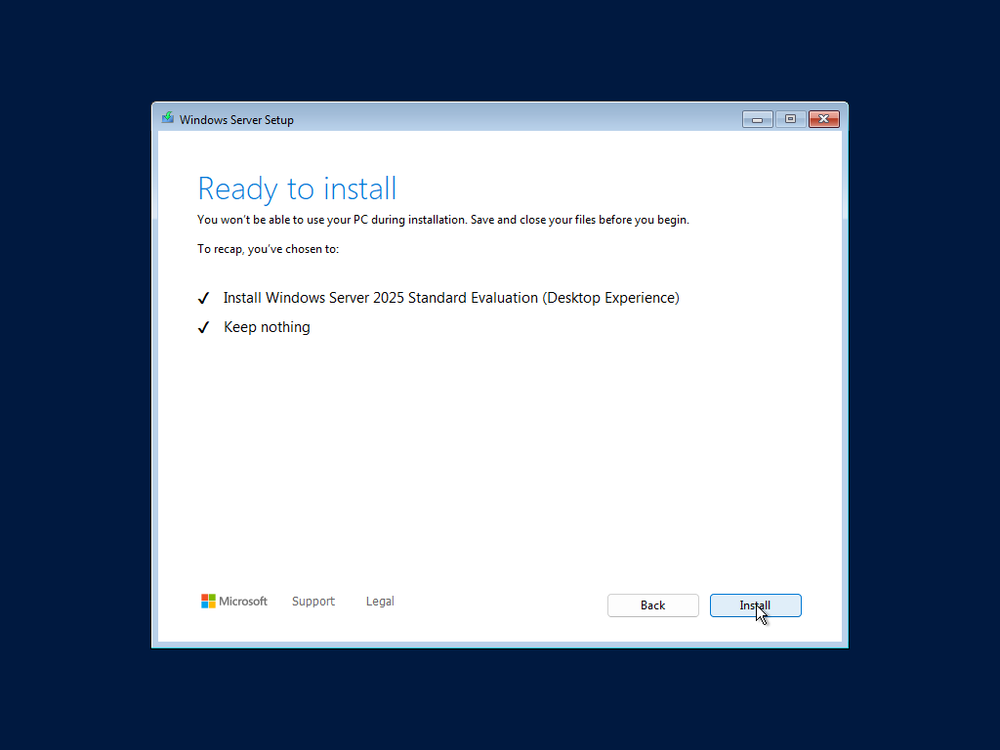
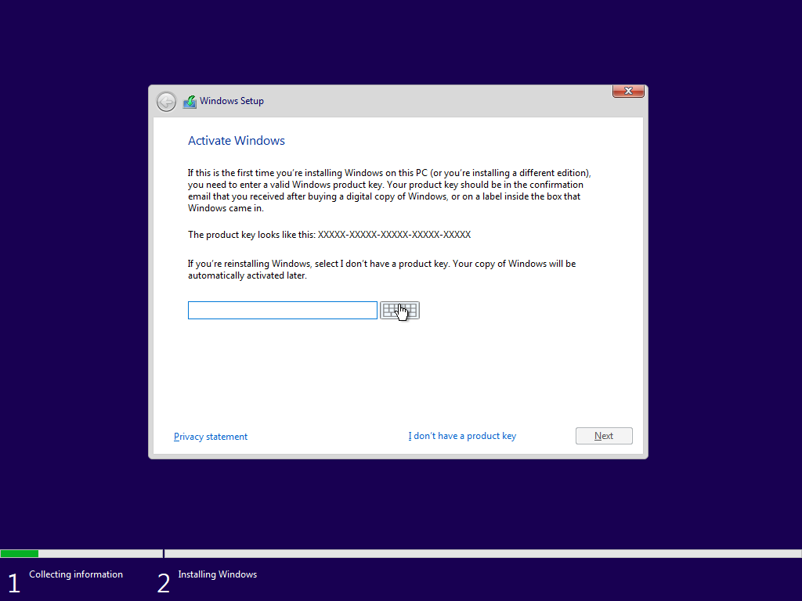
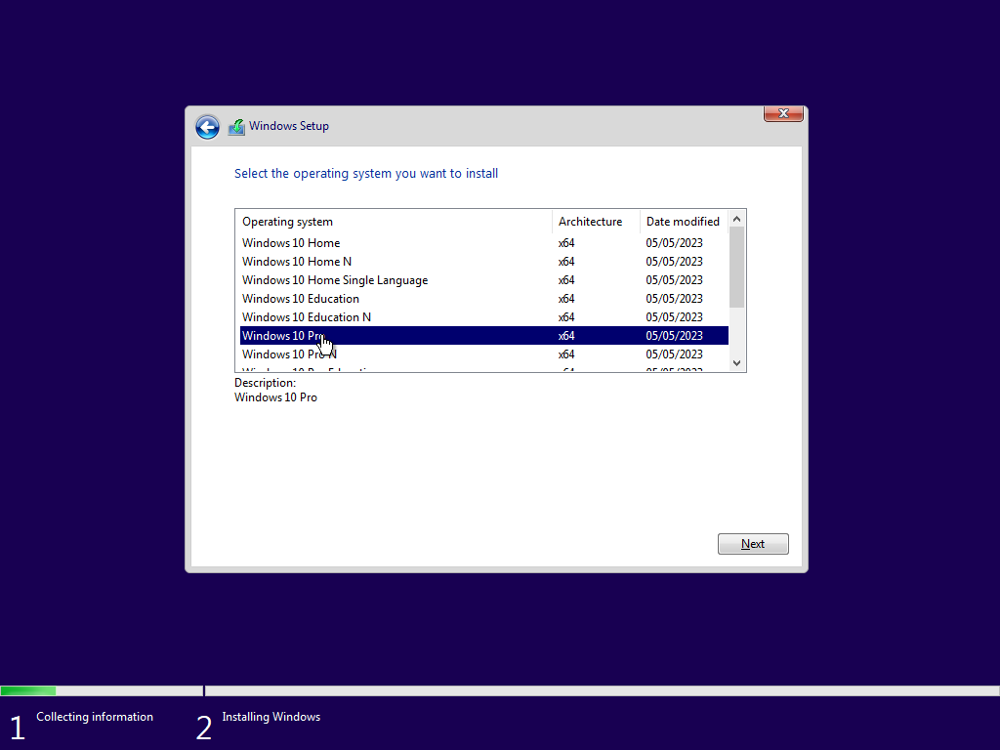
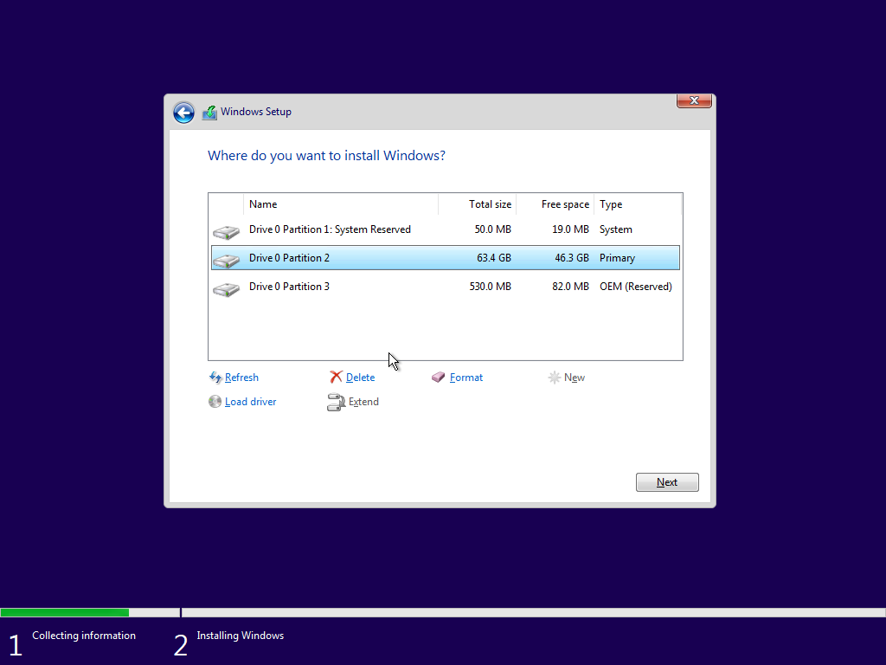

# Ход выполнения практической работы №2

## Цель работы

Получить практические навыки развёртывания Active Directory, управления пользователями и группами домена, настройки прав NTFS и SMB, применения групповых политик, автоматизации создания объектов и восстановления удалённых учётных записей.

## Среда выполнения

Для работы выделены две виртуальные машины в Proxmox VE. Сервер устанавливается в редакции Windows Server 2025 Standard Evaluation с графической оболочкой Desktop Experience. Для клиента выбрана Windows 10 Pro.

| Машина | Назначение | Процессоры | Оперативная память | Диск |
|---|---|---|---|---|
| VM 104 | Сервер `ad-srv` | 4 | 8 ГиБ | 64 ГиБ, SATA |
| VM 105 | Клиент `ad-client` | 2 | 4 ГиБ | 64 ГиБ, SATA |

Вместо указанной в задании VirtualBox использована доступная среда Proxmox VE. Для обеих машин выбран один изолированный мост `vmbr1_lab`. Подключения к внешнему мосту `vmbr0` нет.

Конфигурация машин сохранена отдельно: [VM 104](evidence/commands/vm104-configuration.json), [VM 105](evidence/commands/vm105-configuration.json).

## 1. Подготовка операционных систем

### 1.1. Установка Windows Server

Сервер загружен с установочного образа Windows Server. Перед началом копирования файлов выбрана редакция `Windows Server 2025 Standard Evaluation (Desktop Experience)` и вариант установки без сохранения старых данных.



После нажатия **Install** началась установка операционной системы. На экране отображаются процент выполнения и предупреждение об автоматических перезагрузках.


### 1.2. Установка Windows 10 Pro

Клиентская машина загружена с образа Windows 10. На первом экране оставлены английский язык интерфейса и раскладка United Kingdom.


После перехода к следующему окну выбрана команда **Install now**.


На экране активации выбран вариант **I don't have a product key**. Ключ продукта при установке не вводился.



В списке редакций выбрана `Windows 10 Pro`.



После ознакомления с лицензионным соглашением отмечено поле **I accept the licence terms**.


Для чистой установки выбран вариант **Custom: Install Windows only (advanced)**.


На клиентской машине обнаружен один диск объёмом 64 ГиБ. Старая разметка содержала системный, основной и служебный разделы.



Для удаления старой разметки через `Shift+F10` открыта командная строка установщика. Выполнены команды:

```text
diskpart
select disk 0
clean
exit
```

После закрытия командной строки и нажатия **Refresh** установщик показал единственный участок `Drive 0 Unallocated Space` размером 64 ГиБ. Старые разделы отсутствуют.


Неразмеченный диск выбран в качестве места установки. После нажатия **Next** запущена установка Windows 10 Pro.


