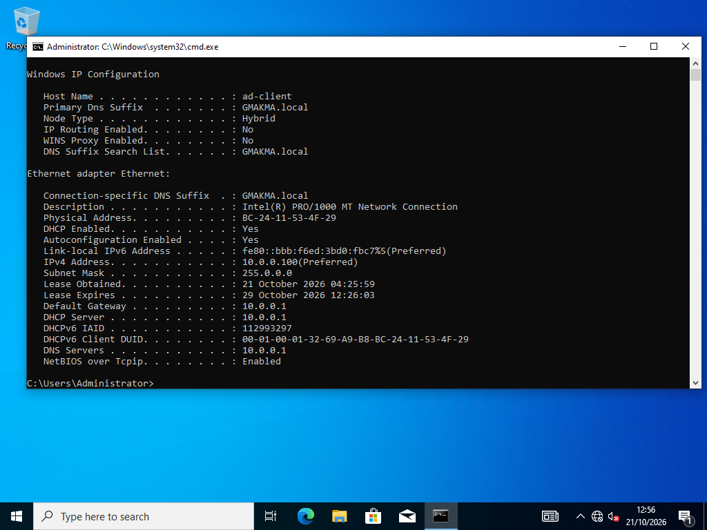
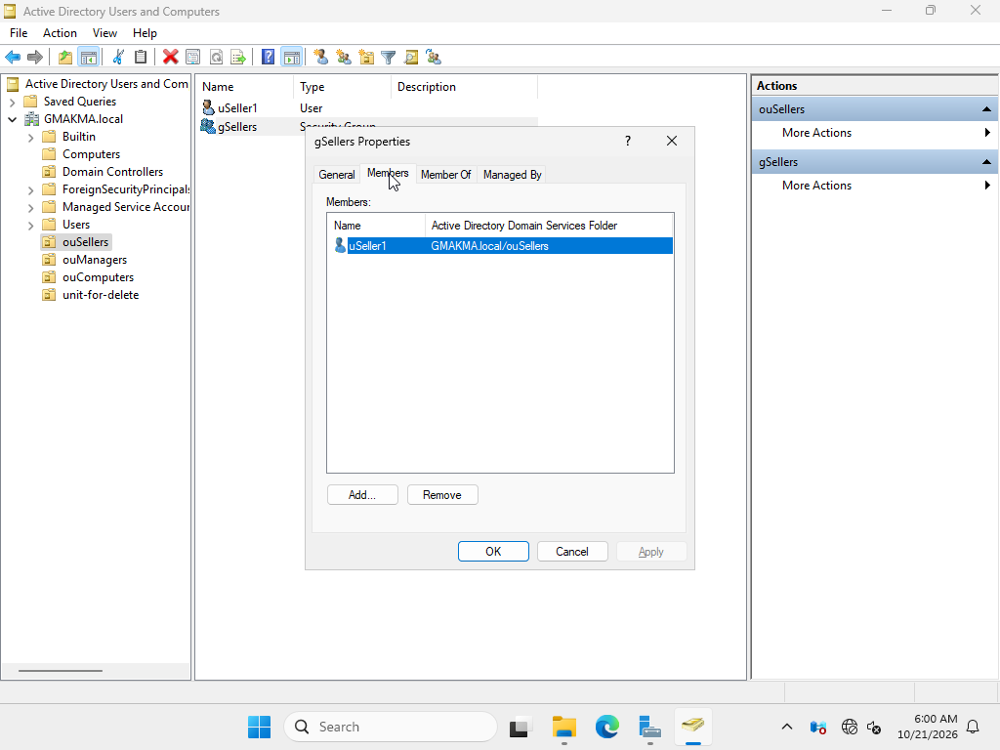
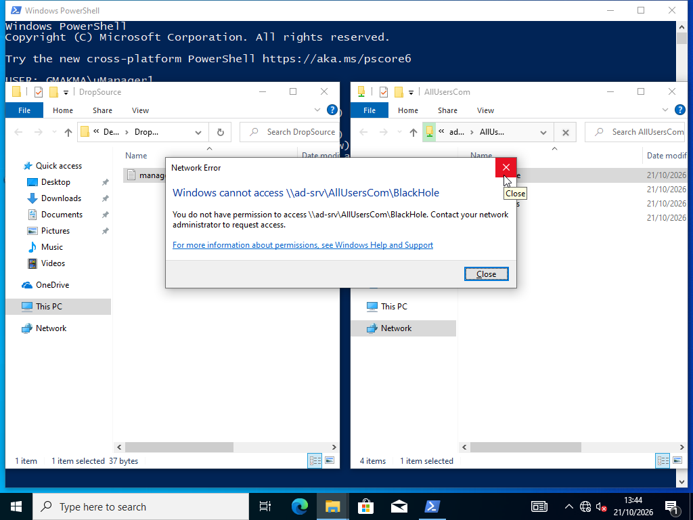
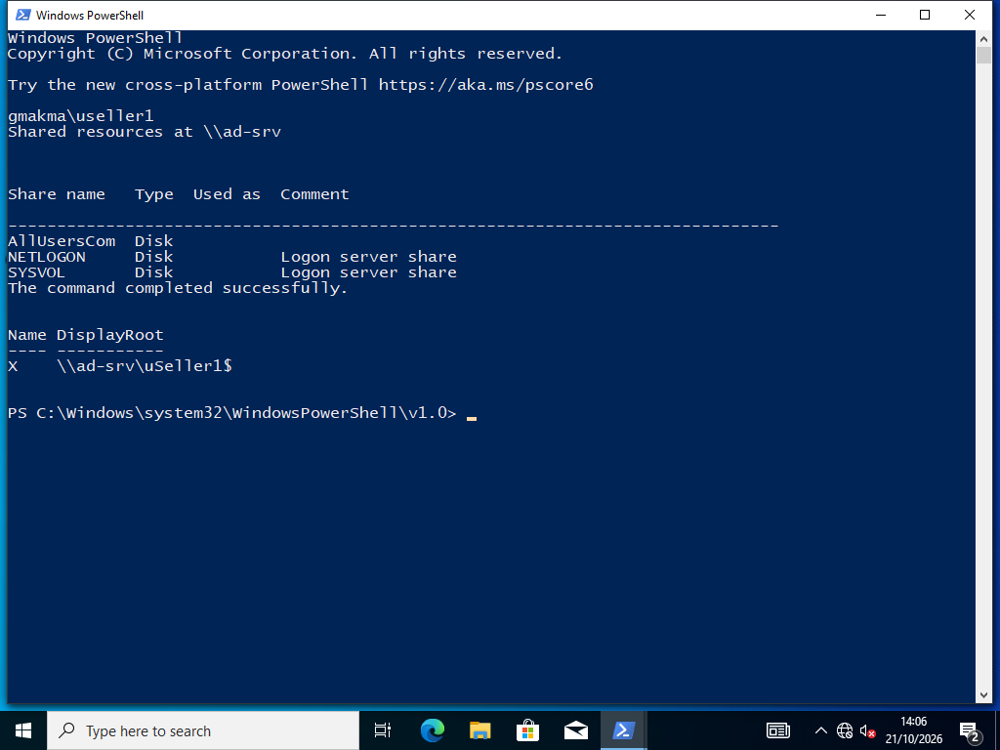
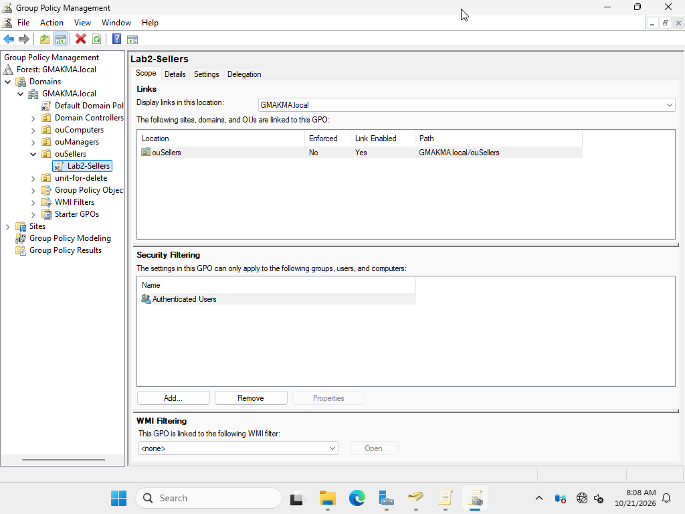
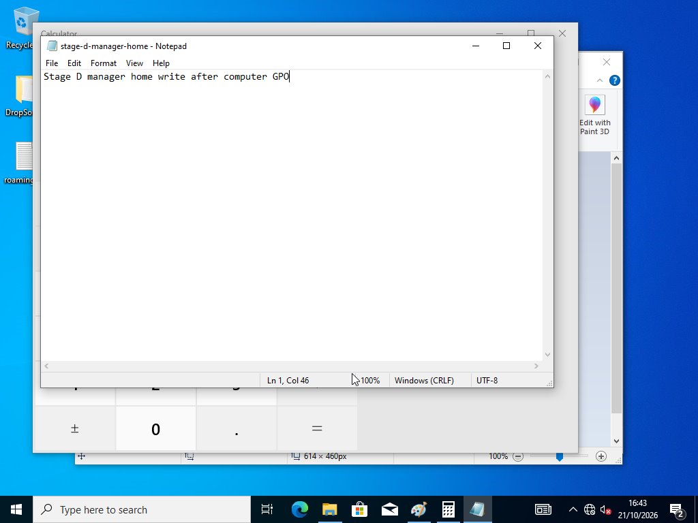
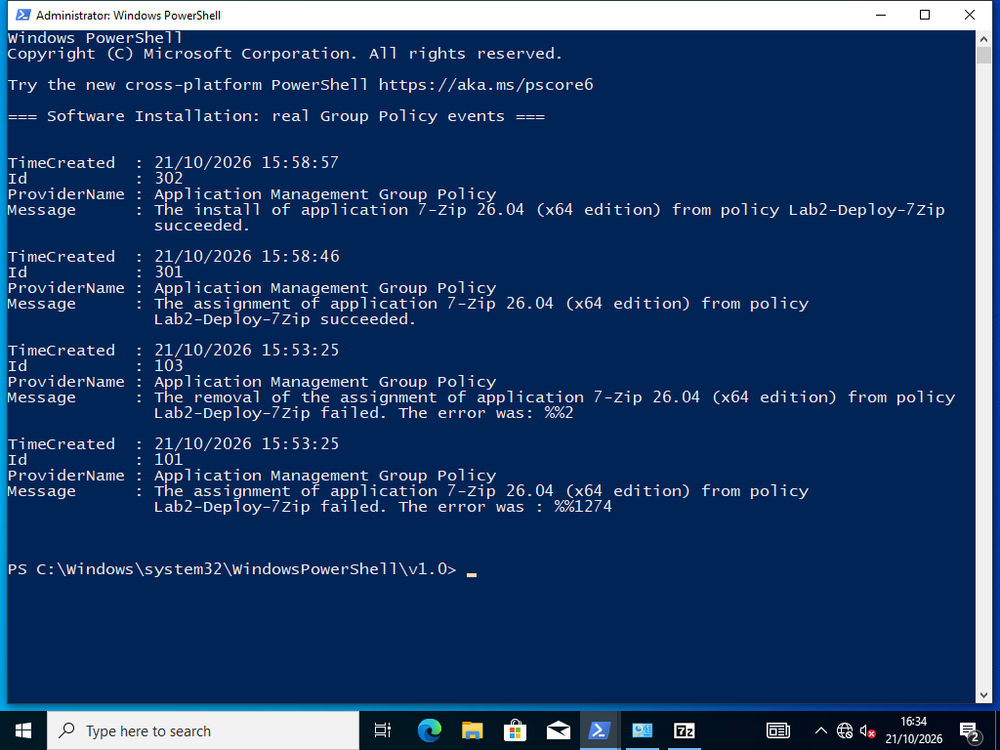
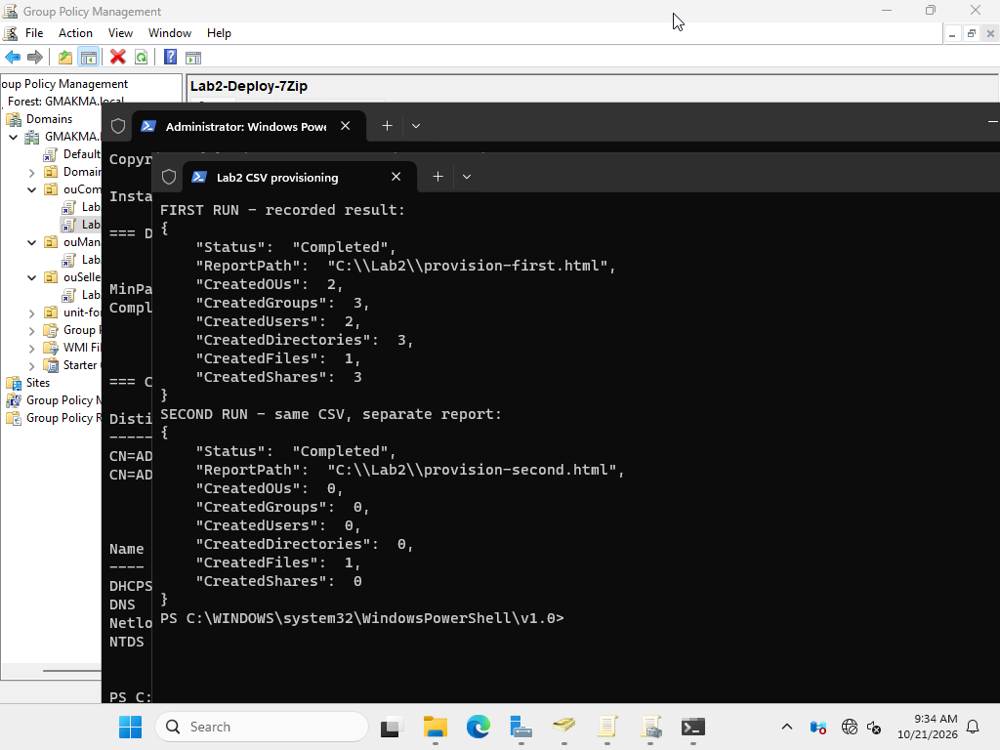
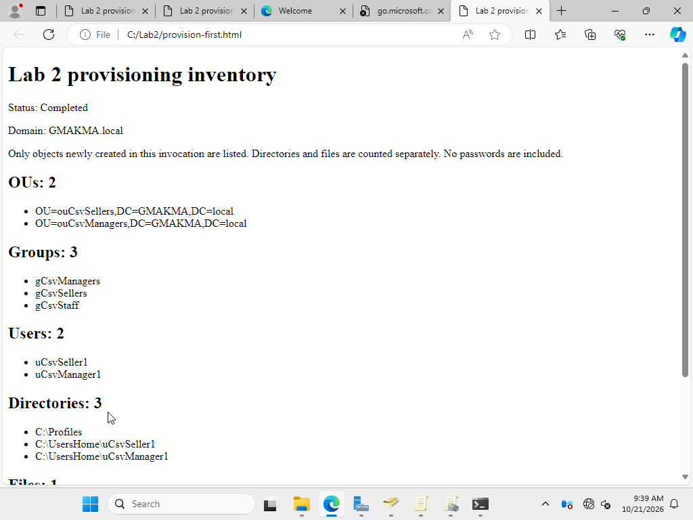
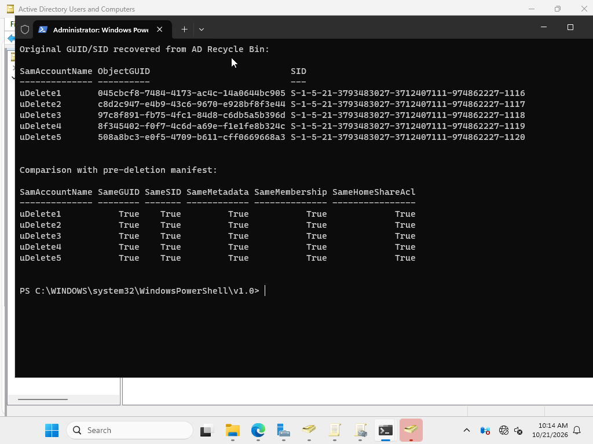

# Памятка для защиты лабораторной работы №2

Материал для понимания работы и подготовки к вопросам. Разделы 1-6 дают основу, 7-8 объясняют результаты, 9-13 разбирают технические детали, 14 помогает с диагностикой, 15 содержит короткие устные ответы, 16-18 показывают добавление, изменение и удаление строк CSV. В разделах 19-23 собран маршрут показа со скриншотами. [Рассказ на двоих](%D0%9B%D0%A02%20-%20%D0%A0%D0%B0%D1%81%D1%81%D0%BA%D0%B0%D0%B7%20%D0%B4%D0%BB%D1%8F%20%D0%B7%D0%B0%D1%89%D0%B8%D1%82%D1%8B.md) сохранён отдельно. Команды ниже служат примерами для объяснения, их добавление в памятку не означает выполнение на стенде

## 1. Что мы делаем в лабораторной

Мы собираем небольшую сеть организации: один сервер хранит доменные учётные записи и общие файлы, а другой компьютер работает как рабочее место сотрудника. Учимся создавать пользователей, выдавать им доступ, задавать ограничения и восстанавливать удалённые учётные записи

На стенде сервер `ad-srv` работает на Windows Server 2025, клиент `ad-client` - на Windows 10 Pro. Машины находятся в изолированной сети Proxmox. Домен называется `GMAKMA.local`, короткое имя домена - `GMAKMA`

Последовательность работы:

1. Подготовили сервер и клиент в одной сети. Серверу назначили постоянный адрес `10.0.0.1`
2. Установили AD DS и создали домен. Настроили DNS для поиска имён и служб домена
3. Установили DHCP с пулом `10.0.0.100-10.0.0.110`. Клиент получил сетевые параметры автоматически, затем вошёл в домен
4. Создали подразделения, группы и пользователей продавцов и менеджеров. Настроили доступ к общим и личным папкам
5. Через групповые политики ограничили действия пользователей, настроили компьютер и установили 7-Zip
6. Написали скрипт создания пользователей по CSV и проверили повторный запуск
7. Создали пять тестовых пользователей, удалили их и восстановили из корзины AD с исходными идентификаторами

Почему именно так: сначала нужна работающая сеть и домен, затем можно подключать клиент и управлять его пользователями. После ручной настройки мы автоматизировали создание объектов и проверили восстановление

На защите можно сказать: «Мы настроили централизованное управление учётными записями, рабочими местами и файловыми правами в домене Windows»

## 2. Что такое AD, домен, OU, пользователи и группы

Active Directory - служба каталогов Microsoft. В этой работе используется AD DS: она хранит сведения о пользователях, компьютерах, группах и других объектах домена и участвует в проверке доменных учётных данных

Контроллер домена - сервер с AD DS, который обслуживает домен. У нас это `ad-srv`. На клиенте работает обычная Windows, присоединённая к этому домену

Домен - область совместного управления объектами AD с собственным именем. В нашем домене `GMAKMA.local` находятся учётные записи, группы и компьютеры. Учётная запись `GMAKMA\uSeller1` - доменная, а `ad-client\LabAdmin` - локальная учётная запись конкретного клиента

Лес объединяет один или несколько доменов с общей схемой и конфигурацией. Дерево доменов объединяет домены с непрерывным пространством имён, например `example.local` и `sales.example.local`. У нас один лес с одним доменом. Схема описывает допустимые типы объектов и их атрибуты, например какие свойства может иметь пользователь

Пользователь - объект с логином, паролем и атрибутами: ФИО, должностью, отделом, почтой и другими. `uSeller1` и `uManager1` - созданные нами учётные записи. Объект компьютера представляет присоединённую к домену машину

Группа объединяет учётные записи для совместного назначения прав. В нашей работе `gSellers` получает доступ к папке продавцов, а `gManagers` - к папке менеджеров. Пользователь может состоять в нескольких группах одновременно. Скрипт создаёт глобальные группы безопасности

OU, Organizational Unit, - подразделение внутри каталога AD. Это контейнер для объектов, например `ouSellers`, `ouManagers` и `ouComputers`. Через OU удобно организовать каталог, делегировать управление и привязывать групповые политики. OU не является папкой на диске

Пример связи: `uSeller1` расположен в `ouSellers` и состоит в `gSellers`. Пользовательская политика привязана к OU, файловые права выданы группе. Группа может находиться в другой OU, её участники от этого не перемещаются

DNS помогает находить имена компьютеров и службы домена. DHCP выдаёт клиенту IP-адрес, маску, DNS и шлюз. Поэтому DNS и DHCP решают разные задачи. Выданный адрес шлюза сам по себе не включает маршрутизацию или интернет

## 3. Как менять пользователей, группы и подразделения

Основная оснастка на сервере - Server Manager -> Tools -> Active Directory Users and Computers, сокращённо ADUC. Её также открывает команда `dsa.msc`. Действия выполняют с административными правами на нужные объекты

Чтобы создать пользователя, выбрать OU -> правая кнопка -> New -> User, заполнить имя и логин, задать пароль и параметры учётной записи. Для новой группы выбрать New -> Group. Для подразделения выбрать New -> Organizational Unit

Чтобы добавить существующего пользователя в группу:

1. Открыть свойства пользователя -> Member Of -> Add
2. Ввести имя группы, например `gSellers`, нажать Check Names и подтвердить
3. Проверить появление группы в списке. Удаление из группы выполняется на той же вкладке через Remove

Состав группы можно посмотреть с другой стороны: свойства группы -> Members. ФИО и контакты меняются в свойствах пользователя, должность и отдел - на вкладке Organization. Домашний диск и путь перемещаемого профиля задаются на вкладке Profile

Чтобы переместить объект в другую OU, нажать на него правой кнопкой -> Move и выбрать OU. Это меняет размещение объекта и может изменить применяемые политики. Групповое членство таким переносом не меняется

Пример для понимания: если продавец становится менеджером, нужно отдельно решить вопрос членства в `gSellers` и `gManagers` и отдельно перенести пользователя из `ouSellers` в `ouManagers`, если ему должна применяться политика менеджеров. Поле Department в свойствах - текстовый атрибут, оно само не меняет OU, группы и права

То же через PowerShell на сервере:

```powershell
Get-ADPrincipalGroupMembership uSeller1 | Select-Object Name
Add-ADGroupMember -Identity gManagers -Members uSeller1
Remove-ADGroupMember -Identity gSellers -Members uSeller1
Get-ADUser uSeller1 | Move-ADObject `
    -TargetPath 'OU=ouManagers,DC=GMAKMA,DC=local'
```

Это учебный пример перевода между отделами, он меняет стенд. `Remove-ADGroupMember` запрашивает подтверждение. После изменения членства для проверки доступа выйти из пользовательского сеанса и войти заново. Для политик можно выполнить `gpupdate /force`, но некоторые настройки требуют повторного входа или перезагрузки

Вкладка Member Of и поля пользователя описаны в [документации ADUC](https://learn.microsoft.com/en-us/windows-server/identity/ad-ds/manage-user-accounts-in-windows-server). Команды членства: [Add-ADGroupMember](https://learn.microsoft.com/powershell/module/activedirectory/add-adgroupmember) и [Remove-ADGroupMember](https://learn.microsoft.com/powershell/module/activedirectory/remove-adgroupmember)

## 4. Почему скрипт такой большой и что он делает

`Provision-Lab2.ps1` автоматизирует часть 5 задания. Вместо ручного создания каждого пользователя администратор передаёт таблицу, а скрипт готовит объекты AD и файловые ресурсы. Домен, DNS, DHCP и GPO к этому моменту уже настроены

Большую часть кода занимают проверки входных данных, настройка разрешений и проверка результата. Скрипт работает от администратора, поэтому ошибка в имени или пути может затронуть существующие объекты и папки

Порядок выполнения:

1. Читает параметры и определяет текущий домен через `Get-ADDomain`
2. Целиком проверяет CSV: заголовки, число ячеек, логины, повторы пользователей, пути и существующие цели. До завершения этой фазы изменения не начинаются
3. Создаёт недостающие OU, затем глобальные группы безопасности
4. Создаёт недостающих пользователей, записывает атрибуты, домашний диск X: и путь профиля, добавляет членство в группах
5. Создаёт домашние папки и скрытые SMB-ресурсы, задаёт права NTFS и сетевого доступа, перечитывает результат
6. Формирует HTML с количеством и именами объектов, созданных за этот запуск

Как читать исходный файл:

- `param(...)` - входные параметры
- `Read-Lab2Csv` и функции `Assert-*` - чтение таблицы и проверки
- `Phase 1` - проверка всего плана до изменений
- `Phase 2` - создание объектов и настройка ресурсов
- `Set-Lab2DirectoryAcl` и `Set-Lab2Share` - файловые и сетевые права
- `Write-Lab2Inventory` - HTML с результатом
- `catch` - обработка ошибки с попыткой записать частичный результат
- `finally` - очистка полей паролей в загруженных строках

При повторном запуске скрипт использует существующие объекты. Он может обновить атрибуты и права, добавляет недостающее членство, сохраняет прежние группы и не сбрасывает пароли существующих пользователей. Переносить существующего пользователя в другую OU он не умеет: несовпадение OU остановит проверку

Папку конкретного перемещаемого профиля создаёт Windows при первом входе. Скрипт готовит общий корень профилей и сетевой ресурс. У него нет общего автоматического отката: ошибка после начала изменений может оставить частично созданные объекты

## 5. Что такое CSV и как устроена наша таблица

CSV - обычный текстовый файл с табличными данными. Первая строка содержит названия столбцов, следующие строки - значения. В нашей таблице одна строка соответствует одному пользователю, столбцы разделены запятыми

| Столбец | Что передаём скрипту |
|---|---|
| FullName | ФИО для отображаемого имени |
| Title | Должность |
| Department | Название отдела |
| Email | Электронную почту |
| Phone | Телефон |
| SamAccountName | Логин, например uCsvSeller1 |
| Password | Начальный пароль новой учётной записи |
| OrganizationalUnit | Имя OU или её полный DN в текущем домене |
| Groups | Имена групп, несколько имён разделяются символом `;` |
| HomeDirectory | Домашнюю папку пользователя |
| ProfilePath | Сетевой путь перемещаемого профиля |

Пример значений одной строки: логин `uCsvSeller1`, OU `ouCsvSellers`, группы `gCsvSellers;gCsvStaff`, домашняя папка `\\ad-srv\uCsvSeller1$`, профиль `\\ad-srv\Profiles$\uCsvSeller1`

Имена заголовков должны соответствовать скрипту. Не надо переводить их на русский или добавлять лишние столбцы. Если редактировать таблицу в Excel, нужно проверить, что сохранён CSV с запятыми и кодировкой UTF-8. В некоторых настройках Excel выбирает другой разделитель

В поле Groups точка с запятой разделяет группы внутри одной ячейки. Это не разделитель столбцов нашего CSV. Если внутри значения есть запятая, значение оформляют в двойных кавычках по правилам CSV

Рабочая таблица находится на сервере в `C:\Lab2Private\lab2-users.csv`. Она содержит пароли в открытом виде, поэтому каталог закрыт для обычных пользователей. Преобразование пароля в `SecureString` внутри скрипта не шифрует исходный CSV

В репозитории находится `data/lab2-users.example.csv` с заменителями паролей. Он показывает структуру, но не является готовым рабочим входом. При стандартных настройках скрипта домашние папки находятся в `C:\UsersHome`, профили - в `C:\Profiles`, опубликованном как `Profiles$`

## 6. Как запустить скрипт и проверить результат

Запуск выполняется на `ad-srv` администратором домена в Windows PowerShell 5.1, открытой через Run as administrator. Нужны модули `ActiveDirectory` и `SmbShare` и права на изменение объектов AD и файловых ресурсов

Перед запуском проверить наличие скрипта `C:\Lab2\Provision-Lab2.ps1`, рабочего CSV `C:\Lab2Private\lab2-users.csv` и каталога `C:\Lab2` для результата. Открывать CSV с паролями на экране защиты не нужно

Команда запуска:

```powershell
C:\Lab2\Provision-Lab2.ps1 `
    -CsvPath C:\Lab2Private\lab2-users.csv `
    -ReportPath C:\Lab2\provision-demo.html
```

Знак обратной кавычки в конце первых двух строк продолжает команду на следующей строке. После него не должно быть пробелов. Можно записать ту же команду одной строкой, убрав переносы и эти знаки

`-CsvPath` - обязательный путь к входной таблице. `-ReportPath` - путь к HTML с результатом, если его не передать, файл будет `Provision-Lab2-report.html` рядом со скриптом

Необязательные настройки хранилищ: `-HomeRoot` по умолчанию `C:\UsersHome`, `-ProfileRoot` - `C:\Profiles`, `-ProfileShareName` - `Profiles$`. Пути в таблице должны соответствовать выбранным настройкам

После запуска:

1. Найти `Status = Completed` в результате команды и открыть выходной HTML
2. В ADUC проверить OU, пользователей и их группы
3. В свойствах пользователя проверить HomeDrive = X:, HomeDirectory и ProfilePath
4. На клиенте войти созданным пользователем, открыть X: и записать файл. Для профиля проверить выход и повторный вход

При первом проверенном запуске созданы 2 OU, 3 группы и 2 пользователя. Повторный запуск не создал новых объектов AD, GUID сохранились. Это результат сохранённых проверок, повтор на уже подготовленном стенде снова не обязан создавать эти объекты

Новый HTML считается новым файлом. Нулевые счётчики объектов AD не означают отсутствие любых записей. Для демонстрации выбирать отдельное имя HTML, чтобы сохранить прежние результаты

Если произошла ошибка, посмотреть этап сбоя и частичный HTML, затем проверить фактическое состояние. Скрипт не реализует `-WhatIf`, обычный запуск меняет AD, права и ресурсы

## 7. Как работают папки, права и групповые политики

NTFS задаёт права на файлы и каталоги. ACL - список разрешений, в работе мы настраивали DACL. SMB предоставляет сетевой доступ к папкам. Операция по сети должна быть разрешена на обоих уровнях

UNC - сетевой путь вида `\\сервер\ресурс`. Например, `\\ad-srv\uSeller1$` ведёт к серверной папке, а `C:\UsersHome\uSeller1` - её локальный путь на сервере. Если записать локальный C: в качестве клиентского пути, он будет относиться к диску клиента

Символ `$` в конце имени скрывает ресурс из обычного списка общих папок. Защиту обеспечивают права доступа. Зная имя скрытого ресурса, можно обратиться к нему напрямую, но разрешения всё равно проверяются

В `Sellers` и `Managers` участники соответствующих групп работают с вложенными файлами, но не удаляют корневую папку отдела и не меняют её разрешения. В `BlackHole` можно передать файл, но нельзя просмотреть содержимое папки. В `Common` можно создавать и изменять файлы, а удалять только свои

Домашний диск X: хранит пользовательские файлы. Перемещаемый профиль сохраняет настройки и данные среды Windows на сервере. У пользователей ручной настройки профиль лежит в `_profile` внутри личного ресурса, у CSV-пользователей - в отдельном `Profiles$`

GPO - объект групповой политики с настройками пользователя или компьютера. В этой лабораторной пользовательские политики привязаны к OU пользователей, компьютерные - к `ouComputers`. Политиками управляют в Group Policy Management, команда открытия - `gpmc.msc`

У продавцов проверили запрет Панели управления и редактора реестра, скрытие C: и блокировку после 60 секунд бездействия. Скрытие диска меняет интерфейс, права на файлы задаются отдельно

У менеджеров проверили запуск Paint, Калькулятора и Блокнота и запрет других проверенных приложений через Проводник. Эта политика не обеспечивает полной изоляции произвольного кода

Отдельная GPO установила 7-Zip из MSI по UNC-пути. У компьютера также настроили отключение отчётов об ошибках, локального Administrator и Offline Files

Оговорка по заданию: на C: настроены корневая ACL и наследуемые разрешения, защищённые права Windows и профилей сохранены. Единую ACL буквально на каждом объекте диска не применяли

## 8. Как восстановили пользователей и что показать

До удаления включили корзину Active Directory. Скриптом создали пять пользователей `uDelete1`-`uDelete5` в OU `unit-for-delete` и сохранили manifest с исходными идентификаторами

После проверки состава OU удалили пользователей конвейером `dsquery | dsrm`. Скрипт `Restore-Lab2DeletedUsers.ps1` прочитал manifest, проверил, что все пять объектов удалены и происходят из нужной OU, затем восстановил их через `Restore-ADObject`

GUID идентифицирует объект AD, SID используется при проверке прав, DN показывает положение объекта в каталоге. После восстановления GUID и SID совпали с исходными, отдельно проверены группы, пользовательский вход и домашний диск

Создание пользователя с прежним логином создаёт новый объект с другими GUID и SID. В работе вернули исходные объекты из корзины, которая была включена до удаления. Удаление и восстановление не надо повторять только ради просмотра готового результата

Что открыть перед защитой:

- На сервере ADUC с пользователями, OU и группами, DHCP с арендой клиента и GPMC с политиками
- На клиенте сессию обычного пользователя, X:, ограничения политики и установленный 7-Zip
- Исходный `Provision-Lab2.ps1`, публичный пример CSV и сохранённые HTML первого и повторного запусков
- Сохранённое сравнение пользователей до удаления и после восстановления

Подробные обязательные ответы о лесе, схеме, файлах AD, SYSVOL, DSRM и DNS находятся в разделе 7 [guide](lab-2-guide.md). Ход удаления и восстановления с проверками приведён в его разделе 6

## 9. Как связаны сеть, DNS, DHCP и вход в домен

Представим первый вход сотрудника на `ad-client`. Сначала компьютеру нужны сетевые параметры. DHCP выдаёт ему адрес, маску, адрес DNS и шлюз. Затем клиент через DNS находит службы домена и обращается к контроллеру. После входа пользователь получает свою среду, политики и доступ к ресурсам в соответствии с настройками и правами

У сервера постоянный адрес `10.0.0.1/8`, у клиента в сохранённой проверке - `10.0.0.100/8`. Маска `/8` означает `255.0.0.0`. В настройках клиента DNS указывает на `10.0.0.1`, потому что именно сервер обслуживает DNS-зоны нашего домена

Обычная A-запись связывает имя сервера с IPv4-адресом. SRV-записи указывают, где находятся службы. Например, `_ldap._tcp.dc._msdcs.GMAKMA.local` помогает найти контроллеры домена. Поэтому успешный ping по IP ещё не доказывает, что клиент найдёт службы AD

Авторизация DHCP в AD - разрешение доменному DHCP-серверу работать в среде AD. Она не присоединяет клиент к домену. Получение IP-адреса и присоединение к домену - отдельные действия

Проверки на клиенте в PowerShell, если его запуск разрешён политикой:

```powershell
hostname
whoami
ipconfig /all
Resolve-DnsName ad-srv.GMAKMA.local
Resolve-DnsName -Type SRV `
    _ldap._tcp.dc._msdcs.GMAKMA.local
(Get-CimInstance Win32_ComputerSystem).PartOfDomain
```

`hostname` показывает имя машины, `whoami` - текущую учётную запись. В `ipconfig /all` проверяем адрес, маску, DHCP и DNS. Ожидаем разрешение имени сервера в `10.0.0.1`, для PartOfDomain - `True`

На сервере можно посмотреть область DHCP и выданные аренды:

```powershell
Get-DhcpServerv4Scope
Get-DhcpServerv4Lease -ScopeId 10.0.0.0
```

Если вход не работает, последовательно проверяем сеть, адрес DNS, разрешение имён, членство компьютера в домене и формат логина. Форматы `GMAKMA\uSeller1` и `uSeller1@GMAKMA.local` относятся к доменному пользователю. При входе локальной учётной записью проверяется другая учётная запись

## 10. Как применять и проверять групповые политики

В GPMC сначала смотрим, куда привязана политика, а затем её настройки. Созданная GPO без нужной связи с доменом или OU сама по себе не подтверждает применение к пользователю

У GPO есть User Configuration и Computer Configuration. В нашей схеме пользовательская часть зависит от размещения пользователя, компьютерная - от размещения компьютера. Поэтому перемещение `ad-client` в `ouComputers` нужно для компьютерных настроек, а размещение `uSeller1` в `ouSellers` - для политики продавцов

Политики обычно обрабатываются в порядке: локальные -> сайт -> домен -> родительская OU -> дочерняя OU. На итог влияют связи, наследование, приоритет и фильтрация. Для защиты нашего стенда достаточно показать нужную OU, связанную GPO и фактический результат на клиенте

После изменения можно запросить обновление:

```powershell
gpupdate /force
```

Это применяет настройки и может запросить повторный вход или перезагрузку. Команда не заменяет их для всех расширений политики. Компьютерное назначение MSI проверяем после перезагрузки клиента

Результат пользовательской политики смотрим в обычной сессии проверяемого пользователя:

```powershell
gpresult /r /scope user
```

Компьютерную часть смотрим в повышенной консоли клиента:

```powershell
gpresult /r /scope computer
```

GPMC показывает, что настроено, `gpresult` - сведения о результирующей политике, а попытка открыть Панель управления или запустить приложение показывает поведение. Для уверенного ответа нужны все эти уровни

У менеджера политика ограничивает запуск консоли через Проводник. Для показа используем разрешённые приложения и сохранённые отчёты RSoP. Не надо отключать его ограничение ради команды проверки

Парольную политику в этой работе меняли на уровне домена через Default Domain Policy: минимальная длина 6, сложность отключена. Это учебные значения из задания. Они не означают, что все пароли автоматически стали шестизначными или изменились у существующих пользователей

7-Zip назначен компьютеру из MSI по `\\ad-srv\LabPackages$\7z2604-x64.msi`. Доступ к пакету требуется компьютеру, поэтому чтение выдали компьютерам домена по SMB и NTFS. Установку подтвердили программа на клиенте и события Application Management Group Policy

Справка: [обработка GPO](https://learn.microsoft.com/en-us/windows-server/identity/ad-ds/manage/group-policy/group-policy-processing), [gpresult](https://learn.microsoft.com/en-us/windows-server/administration/windows-commands/gpresult)

## 11. Почему права на папки устроены именно так

Права можно выдать пользователю напрямую или через группу. Для папок отделов мы выбрали группы: пользователь -> gSellers -> доступ к Sellers. При смене сотрудников не приходится переписывать ACL папки под каждого человека

Чтение, запись, удаление и изменение разрешений - разные операции. Возможность создать файл не означает возможность удалить корневую папку отдела. Полный доступ также включает изменение разрешений, поэтому он не подходит для ограничения из задания на папку отдела

Запись ACL имеет область действия: только текущая папка, вложенные папки, файлы или их сочетание. Наследование переносит подходящие записи на дочерние объекты. Отключение наследования требует отдельно проверить, какие разрешения сохранились и кому доступен объект

Для папок отделов настроили работу с потомками, сохранив ограничения для корневой папки. Поэтому проверяли отдельно создание файла, его изменение, удаление вложенного объекта, попытку удалить папку отдела и доступ другого отдела

В Common используется CREATOR OWNER: запись связывает разрешения дочернего объекта с его создателем-владельцем. В нашей настройке пользователь может удалить свой файл. Общие права Domain Users при этом позволяют другим пользователям изменять файлы, поэтому Common не подходит для хранения данных, которые коллеги вообще не должны менять

В BlackHole убрали просмотр содержимого, но оставили операции, нужные для передачи файла. Проверка была прикладной: перетащили файл в папку, на сервере убедились, что он появился, затем под обычным пользователем получили отказ при просмотре папки. Это подтверждает проверенный сценарий, а не универсальную невозможность обращения к файлу по известному имени

У личной домашней папки CSV-пользователя права NTFS имеют сам пользователь, SYSTEM и Administrators. На личном SMB-ресурсе полный доступ выдан пользователю и Administrators. Наличие SYSTEM в NTFS нужно для системных операций, оно не означает отдельного обычного сетевого входа от его имени

Для общего корня Profiles$ схема другая: пользователи могут создать свою папку профиля, а права потомков задаются с учётом CREATOR OWNER. Доступ к общему ресурсу профилей сам по себе не означает доступ ко всем личным профилям

Проверки на сервере:

```powershell
Get-SmbShare -Name 'uCsvSeller1$'
Get-SmbShareAccess -Name 'uCsvSeller1$'
Get-Acl 'C:\UsersHome\uCsvSeller1' |
    Format-List Owner,AreAccessRulesProtected,Access
```

Положительный тест подтверждает разрешённое действие. Отрицательный тест подтверждает, что посторонний пользователь или запрещённая операция получают отказ. Проверка администратором не заменяет тест под обычным сотрудником

## 12. Как доказать, что скрипт работает правильно

У нас несколько сценариев с разными задачами. `Provision-Lab2.ps1` создаёт и настраивает объекты. `Test-Lab2Provisioning.ps1` читает состояние и проверяет конфигурацию. `Restore-Lab2DeletedUsers.ps1` восстанавливает удалённых пользователей. `Remove-Lab2DeletedUsers.cmd` выполняет удаление тестовых пользователей

Скрипт проверки не читает пароли и не создаёт объекты. Он сверяет OU, членство, пути, диск X:, личные ресурсы SMB и правила NTFS. Клиентский вход и синхронизацию профиля он не воспроизводит, их проверяли отдельно

Для проверки CSV-пользователя можно явно передать ожидаемые данные. Запуск на сервере:

```powershell
$fixtures = @(
    [pscustomobject]@{
        SamAccountName = 'uCsvSeller1'
        OrganizationalUnit = 'ouCsvSellers'
        Groups = @('gCsvSellers','gCsvStaff')
    }
)
C:\Lab2\Test-Lab2Provisioning.ps1 -FixtureUsers $fixtures
```

Запуск проверки без параметров использует uSeller1 и uManager1, но выводит ожидаемые пути профилей через Profiles$. У пользователей ручной настройки путь другой. Для них нужно явно задать HomeDirectory и ProfilePath в ожидаемых данных, иначе несовпадение не доказывает поломку профиля

Что подтвердили сохранённые испытания:

- Первый запуск создал 2 OU, 3 группы, 2 пользователей, 3 каталога и 3 SMB-ресурса. Новый файл в сводке - HTML
- Повторный запуск не создал новых OU, групп и пользователей. Их GUID совпали, новый HTML учтён отдельно
- CSV без Phone и CSV с лишней ячейкой отклонены до изменений. В отрицательных проверках новые объекты AD, SMB и каталоги не появились
- Под CSV-пользователем выполнен клиентский вход, проверены X:, запись файла, выход и повторный вход с сохранением профиля

Почему сначала проверяется весь CSV: ошибка в последней строке не должна обнаруживаться только после создания пользователей из первых строк. Однако предварительная проверка не может гарантировать успешность всех последующих операций, например принятие пароля политикой или наличие места на диске

HTML содержит новые объекты за конкретный запуск, а не полную инвентаризацию домена. Статус Completed означает завершение скрипта, но не заменяет пользовательские тесты. При сбое частичный HTML помогает понять, что успело появиться, общего отката нет

## 13. Теория, которую могут спросить по заданию

Установка роли AD DS добавляет компоненты службы. Повышение сервера до контроллера создаёт или подключает домен и настраивает контроллер. Это разные этапы. В нашей работе DNS установили при создании леса, DHCP добавили отдельно

Основная база каталога - `ntds.dit`, на стенде для базы и журналов оставили каталог `C:\Windows\NTDS`. Файлы `edb.log` и нумерованные журналы содержат операции изменения базы, `edb.chk` хранит контрольную точку, `edb*.jrs` - резервные журналы, `temp.edb` - временная база. Это назначение файлов, отдельную инвентаризацию каждого файла в работе не заявляли

Файловая часть GPO хранится в SYSVOL, например:

```text
\\GMAKMA.local\SYSVOL\GMAKMA.local\Policies\{GUID-GPO}
```

У политики есть файловая часть GPT в SYSVOL и объект GPC с метаданными в AD. Поэтому для восстановления политики одного копирования её папки недостаточно

DSRM - режим обслуживания и восстановления AD DS. Его пароль задаётся при повышении сервера и отличается от обычного пароля доменного Administrator. При утрате администратор может задать новый пароль через `ntdsutil`. Точная справочная процедура находится в разделе 7.6 guide, в ходе работы сброс не выполнялся

NetBIOS-имя домена у нас `GMAKMA`, оно используется в записи `GMAKMA\uSeller1`. UPN той же учётной записи - `uSeller1@GMAKMA.local`. DNS-имя домена - `GMAKMA.local`

Автоматически создаваемые группы, которые стоит знать:

- Domain Users - базовая группа доменных пользователей, сама по себе не даёт административных прав
- Domain Admins - администраторы домена
- Enterprise Admins - администрирование леса, группа создаётся в корневом домене
- Schema Admins - изменение общей схемы леса, группа создаётся в корневом домене
- Group Policy Creator Owners - создание GPO и управление созданными участником политиками
- Backup Operators - резервное копирование и восстановление в пределах полномочий этой группы

Группа безопасности используется для назначения прав, группа рассылки - для почтовых списков. Группы gSellers и gManagers создали мы, это не встроенные группы AD. Области Global, Domain Local и Universal определяют допустимый состав и использование групп. Наш скрипт работает с Global Security, поддержки всех вариантов он не реализует

Global Catalog - служба глобального каталога леса для поиска объектов. На стенде она включена на единственном контроллере. Функциональный уровень домена и леса определяет доступные возможности AD, он не означает глубину OU или версию Windows на клиенте

Основа этого раздела - ответы и источники в разделе 7 guide. По группам: [документация Microsoft](https://learn.microsoft.com/en-us/windows-server/identity/ad-ds/manage/understand-security-groups)

## 14. Что проверять, если на защите что-то не работает

Этот порядок - памятка для диагностики, а не описание новых неисправностей нашего стенда. Сначала смотрим состояние, затем меняем настройки, когда понятна причина

Клиент не получил ожидаемый адрес: проверить подключение обеих VM к одной сети, автоматическое получение IPv4, активность области DHCP и аренду на сервере. В `ipconfig /all` смотреть фактический адрес, DHCP и DNS

Сервер доступен по IP, но домен не находится: проверить DNS клиента и разрешение имени и SRV-записей командами из раздела 9. Ответ на ping не подтверждает работу всех служб домена

Не получается войти: проверить, выбран ли доменный пользователь, правильны ли логин и пароль, включена ли учётная запись и присоединён ли компьютер к домену. Не сбрасывать пароль первым действием без выяснения причины

Пользователя добавили в группу, но доступ прежний: проверить членство в AD и выйти из клиентского сеанса с последующим входом. Если доступа всё равно нет, проверить одновременно SMB и NTFS. Перемещение в OU само не выдаёт права группы

Не подключился домашний диск: проверить HomeDrive = X: и HomeDirectory в свойствах пользователя, существование личного SMB-ресурса и его путь. Затем проверить доступ обычным пользователем и разрешения на обоих уровнях

Не сохраняется профиль: проверить ProfilePath, доступность ресурса и разрешения. Выполнить выход из пользовательского сеанса, проверить появление данных профиля на сервере и события службы профилей, затем повторный вход. Наличие записи ProfilePath в AD ещё не доказывает синхронизацию

Не применилась GPO: проверить OU пользователя или компьютера, связь и нужную часть политики. Посмотреть gpresult, обновить политику и выполнить требуемый повторный вход или перезагрузку. Не менять несколько политик одновременно наугад

Не установился 7-Zip: проверить привязку компьютерной GPO, доступность MSI по UNC для компьютера, перезагрузку и события Application Management Group Policy. Ручной запуск установщика не подтверждает установку через GPO

Скрипт не запускается: прочитать сообщение, проверить Windows PowerShell 5.1, модули, административный запуск и пути. Ошибки CSV проверять по заголовкам, разделителям и числу ячеек. Если сообщает о существующем пользователе в другой OU, исправить план размещения, скрипт не переносит его сам

Completed получен, но новых объектов ноль: сначала проверить, не существовали ли они ранее. Нули при повторном запуске ожидаемы. Если запуск завершился ошибкой, посмотреть частичный HTML и состояние перед повтором

## 15. Короткие ответы для устных вопросов

Зачем домен, если можно создать локальных пользователей? Чтобы централизованно управлять учётными записями и рабочими местами. В работе одна доменная учётная запись используется для входа на клиент и доступа к серверным ресурсам

Чем авторизация отличается от проверки пароля? Проверка учётных данных устанавливает, кто пользователь. Авторизация определяет, какие действия ему разрешены. Успешный вход не даёт доступ ко всем папкам

Если пользователь в двух группах, у него будет две OU? Нет, объект расположен в одной OU, а членств в группах может быть несколько. Политики и файловые права проверяются с учётом своих правил

Почему упростили парольную политику? Так требует учебное задание: минимум 6 символов и отключённая сложность. Скрипт проверяет наличие поля Password, но окончательно пароль принимает AD согласно действующей политике

Почему домашняя папка и профиль разделены? У них разное назначение: документы пользователя и данные его среды Windows. Для CSV-пользователей скрипт использует отдельный Profiles$, а ранние ручные настройки сохраняет

Почему скрытая папка не означает защищённая? Суффикс $ скрывает ресурс из обычного списка, а возможность чтения и записи определяют права. Их мы проверяли отдельно

Почему SID важнее одинакового логина при восстановлении? Права связаны с идентификаторами безопасности. Новая учётная запись с прежним логином получит другой SID. После восстановления мы сравнили исходные идентификаторы

Можно ли менять только CSV при переводе сотрудника? Наш скрипт добавляет группы из CSV, но старые не удаляет. Кроме того, он не переносит существующего пользователя в другую OU. Для перевода нужны отдельные действия с проверкой прав и политик

Зачем второй запуск? Проверить, что существующие объекты используются повторно. Дополнительно сравнили GUID, чтобы подтвердить сохранение тех же объектов

Что доказывают отрицательные тесты? Что определённые ошибочные данные и запрещённые действия действительно отклонены. Они не доказывают правильность всех возможных входов и сценариев

Почему не переписали все ACL на C:? Сохранили защищённые разрешения Windows и профилей для работоспособности клиента. Буквальное требование единой ACL каждого объекта не выполнено, это ограничение указано в отчёте

Достаточно ли корзины и снимков VM вместо резервной копии? Нет. Корзина решает задачу восстановления удалённых объектов при нужных условиях, снимки сохраняют состояние VM. Полная резервная копия и восстановление среды - отдельная задача

## 16. Пример: добавить нового пользователя в CSV

Все примеры в разделах 16-18 объясняют поведение текущего Provision-Lab2.ps1 по его исходному коду. Это учебные изменения, на стенде в ходе подготовки памятки они не выполнялись

Предположим, появился второй продавец. В рабочем CSV сохраняем заголовок и прежние строки, затем добавляем одну строку с новым логином `uCsvSeller2`. Ниже показаны все значения этой новой строки в удобном для чтения виде

| Поле новой строки | Значение |
|---|---|
| FullName | CSV Seller Two |
| Title | Sales specialist |
| Department | Sales CSV |
| Email | uCsvSeller2@GMAKMA.local |
| Phone | +7-495-555-01-12 |
| SamAccountName | uCsvSeller2 |
| Password | Начальный пароль, соответствующий политике домена |
| OrganizationalUnit | ouCsvSellers |
| Groups | `gCsvSellers;gCsvStaff` |
| HomeDirectory | `\\ad-srv\uCsvSeller2$` |
| ProfilePath | `\\ad-srv\Profiles$\uCsvSeller2` |

В Password нужно записать действительный учебный пароль в закрытом рабочем файле. Текст из таблицы не является значением пароля. Заголовки и все 11 ячеек строки сохраняем, файл оставляем в UTF-8 с разделителем-запятой

После повторного запуска скрипт создаст uCsvSeller2, если логин ещё не занят и проверки пройдут. Он добавит пользователя в две указанные группы, создаст личную папку и скрытый ресурс, задаст X: и ProfilePath. Уже существующие OU и группы будут использованы повторно

Если всё остальное на стенде уже подготовлено, ожидаем одного нового пользователя, одну домашнюю папку и один личный SMB-ресурс. Папку его перемещаемого профиля создаст Windows при первом входе. Отдельный новый HTML также попадёт в счётчик новых файлов

Нельзя просто скопировать строку uCsvSeller1 и поменять только ФИО. Для нового пользователя нужно изменить SamAccountName и согласованные с ним HomeDirectory и ProfilePath. Email и контактные данные также задаём для нового сотрудника

Если оставить два одинаковых SamAccountName в одном CSV, предварительная проверка остановит весь запуск до изменений. Новый логин должен быть уникальным, а пути должны соответствовать текущему серверу и настройкам хранилищ

Короткий ответ для защиты: «Добавляем новую строку с новым логином и соответствующими путями. Скрипт создаёт недостающую учётную запись и ресурсы, существующие OU и группы использует повторно»

## 17. Пример: изменить существующую строку и группы

Предположим, у uCsvSeller1 изменились должность и телефон. Находим его строку по SamAccountName, оставляем логин, OU и пути прежними, меняем нужные значения

Ниже приведена вырезка из четырёх столбцов до правки. Это иллюстрация, для запуска нужен полный CSV со всеми 11 столбцами

```csv
SamAccountName,Title,Department,Phone
uCsvSeller1,Sales specialist,Sales CSV,+7-495-555-01-10
```

Та же вырезка после правки:

```csv
SamAccountName,Title,Department,Phone
uCsvSeller1,Senior seller,Sales CSV,+7-495-555-01-20
```

При повторном запуске скрипт найдёт того же пользователя по логину, обновит атрибуты и сохранит GUID и SID. Если новых объектов нет, CreatedUsers будет 0. Это не означает, что должность и телефон остались прежними

Так можно изменить FullName, Title, Department, Email и Phone. FullName изменяет DisplayName, а не логин. Email записывается в mail, существующий UserPrincipalName этим полем не меняется. Изменение Department не переносит пользователя в OU и не меняет членство в группах

Если очистить Title, Department, Email или Phone, скрипт удалит прежнее значение соответствующего атрибута, если оно было заполнено. Пустые FullName и Password не допускаются. Изменённый Password у существующего пользователя не сбрасывает его пароль, но поле всё равно должно пройти проверку

Теперь пример с группами. До правки Groups равно `gCsvSellers;gCsvStaff`. Хотим дополнительно включить пользователя в новую группу gCsvReviewers, меняем значение на `gCsvSellers;gCsvStaff;gCsvReviewers`

Скрипт создаст gCsvReviewers, если её нет, и добавит пользователя. Для новой группы берётся OU из обрабатываемой строки. Обычная новая группа не даёт доступ сама по себе, пока ей не назначены права на ресурс или другие полномочия

Если затем убрать gCsvStaff из CSV и оставить `gCsvSellers;gCsvReviewers`, прежнее членство в gCsvStaff сохранится в AD. Скрипт только добавляет недостающие группы. Даже пустое поле Groups не удалит существующее членство. Для исключения нужна отдельная операция через ADUC или Remove-ADGroupMember

Для изменения OU существующего пользователя тоже нужна отдельная операция. Если он ещё в ouCsvSellers, а в строке заменить OU на ouCsvManagers, скрипт остановится до изменений. Он не выполнит перевод автоматически

Короткий ответ: «Обычные атрибуты обновятся у того же пользователя. Группы из CSV добавятся, но удаление имени группы из таблицы не исключит из неё. OU и пароль существующей учётной записи скрипт сам не меняет»

## 18. Пример: удалить строку, сменить логин и проверить правки

Предположим, в CSV были строки uCsvSeller1 и uCsvManager1. Удаляем строку uCsvManager1 целиком и запускаем скрипт с оставшейся строкой продавца

У менеджера сохранятся учётная запись, группы, домашняя папка, профиль и сетевой ресурс. Скрипт обрабатывает только присутствующие строки и не удаляет объекты, которых в файле больше нет. Поэтому удаление строки не отзывает доступ и не отключает сотрудника

Если убрать все строки данных и оставить только заголовок, скрипт отклонит пустой список. Это также не удалит пользователей домена. Для удаления или отключения учётных записей нужны отдельные административные действия, а для части 6 у нас подготовлен отдельный сценарий удаления тестовых пользователей

Другая ситуация: в существующей строке заменить uCsvSeller1 на uCsvSeller2. Это не команда переименования. Если новый логин свободен, а HomeDirectory и ProfilePath тоже заменены на пути uCsvSeller2, скрипт создаст новую учётную запись. Старая останется. Если пути оставить от uCsvSeller1, проверка остановит запуск

При создании нового пользователя GUID и SID будут другими. Изменение поля FullName безопаснее для задачи «исправить отображаемое имя»: оно обновляет DisplayName у прежней учётной записи без подмены логина

Как провести демонстрацию правок:

1. Сохранить закрытую копию рабочего CSV. Файл содержит пароли, поэтому копия должна оставаться в каталоге с такими же ограничениями доступа
2. Выбрать один сценарий: добавить строку, исправить должность или дополнить Groups. Не менять одновременно логин, OU и пути без разбора результата
3. Сохранить полный CSV с исходными заголовками и проверить число ячеек, разделитель и пути
4. Запустить Provision-Lab2.ps1 с этим файлом и новым именем выходного HTML, например `C:\Lab2\provision-after-edit.html`
5. Проверить не только CreatedUsers в HTML, но и фактические атрибуты и членство в AD

Команды чтения на сервере для существующего uCsvSeller1:

```powershell
Get-ADUser uCsvSeller1 `
    -Properties DisplayName,Title,Department,mail,telephoneNumber |
    Format-List SamAccountName,DisplayName,Title,Department,
        mail,telephoneNumber,ObjectGUID,SID
Get-ADPrincipalGroupMembership uCsvSeller1 | Select-Object Name
```

Возврат старого CSV не является полным откатом. Он может вернуть изменённые атрибуты, но не удалит созданного пользователя или новую группу и не отменит добавленное членство. Итог всегда сверяем с AD и файловыми ресурсами

Короткий ответ: «CSV задаёт, что создать и обновить для перечисленных пользователей. Он не является полным списком разрешённых объектов домена. Удаление строки не удаляет пользователя, а новый логин может привести к созданию другой учётной записи»


## 19. Что показать: сеть и объекты AD

Снимки ниже показывают результаты выполненной лабораторной, текущее состояние стенда нужно проверить перед выступлением. Для короткого показа достаточно группы, X:, одной GPO, 7-Zip, двух запусков скрипта и сравнения восстановления. Остальные окна открывайте по вопросам

На ad-client открыть ipconfig /all. Найти DHCP Enabled, адрес 10.0.0.100 и DNS 10.0.0.1. На сервере аренду можно открыть в DHCP -> IPv4 -> Lab2Scope -> Address Leases



Рисунок 1: Сетевая конфигурация клиента, полученная через DHCP

На ad-srv открыть ADUC -> ouSellers -> gSellers -> Properties -> Members. Показать uSeller1. Объяснить: OU задаёт размещение объекта, членство в группе используется для прав



Рисунок 2: Пользователь uSeller1 в группе gSellers


## 20. Что показать: файловый доступ и домашний диск

На ad-client в сессии uManager1 открыть \\ad-srv\AllUsersCom\BlackHole. Объяснить отказ просмотра. Для подтверждения успешной передачи файла открыть сохранённые артефакты части 3 отчёта



Рисунок 3: Отказ просмотра BlackHole под обычным пользователем

В сессии uSeller1 показать X: в Проводнике. На снимке команда Get-PSDrive X показывает путь, а net view - обычный список ресурсов без личной папки. Объяснить роль суффикса $



Рисунок 4: Скрытый домашний ресурс и подключённый диск X:


## 21. Что показать: связь GPO и результат на клиенте

На ad-srv открыть GPMC -> GMAKMA.local -> ouSellers -> Lab2-Sellers -> Scope. Показать ссылку на OU. Параметры можно открыть через Edit, результат проверяется отдельно на клиенте



Рисунок 5: Политика Lab2-Sellers связана с ouSellers

На ad-client войти uManager1 и открыть Paint, Калькулятор и Блокнот. Показать файл на X:. Для запрета запуска cmd.exe использовать сохранённый рисунок 34 отчёта



Рисунок 6: Разрешённые приложения менеджера после перезагрузки


## 22. Что показать: установка программы и автоматизация

На клиенте открыть Event Viewer -> Windows Logs -> Application, найти события Application Management Group Policy 301 и 302. Дополнительно показать 7-Zip в списке установленных программ. На снимке видны и ошибки отдельных попыток, итог подтверждаем сообщениями об успешной установке и установленной программой



Рисунок 7: События назначения и установки 7-Zip через GPO

Открыть Provision-Lab2.ps1 и публичный lab2-users.example.csv, затем сохранённые результаты запусков. Показать 2 OU, 3 группы и 2 пользователей в первом и нули объектов AD во втором



Рисунок 8: Первый и повторный запуск скрипта с разными счётчиками


## 23. Что показать: HTML и восстановление пользователей

На ad-srv открыть C:\Lab2\provision-first.html и provision-second.html. Сопоставить списки и счётчики. Рабочий CSV с паролями не показывать, повторный запуск для просмотра не нужен



Рисунок 9: HTML со списком созданных объектов

Открыть сохранённое сравнение из части 6 отчёта, затем ADUC -> unit-for-delete. Показать пять пользователей и совпадение GUID и SID. Удаление заново для демонстрации не требуется



Рисунок 10: Сравнение исходных и восстановленных пользователей

