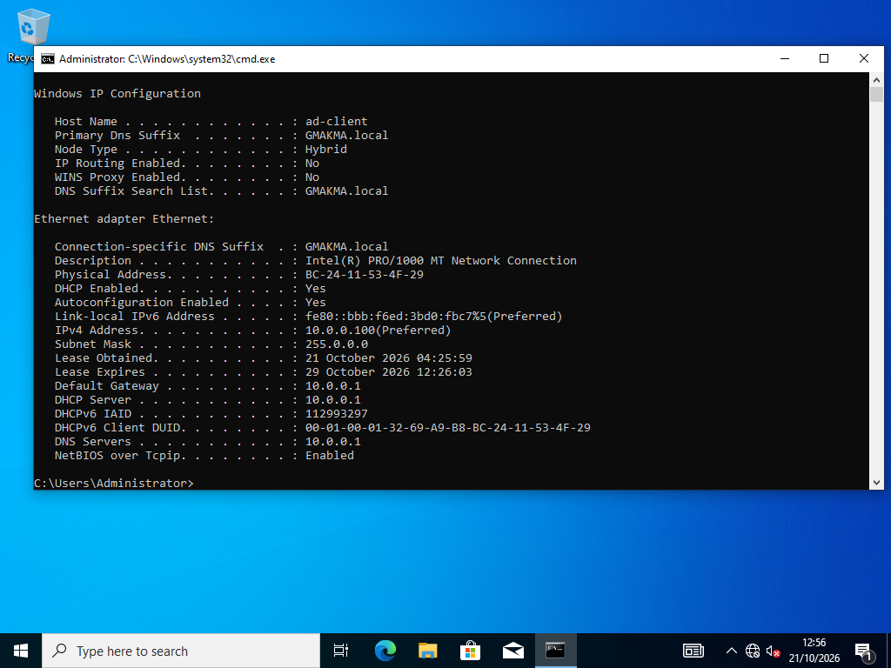
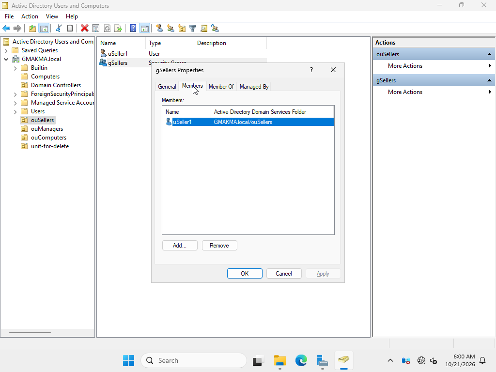
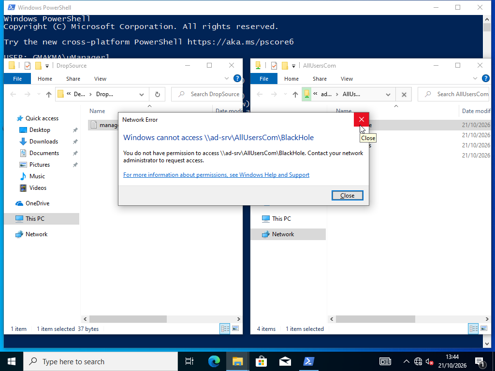
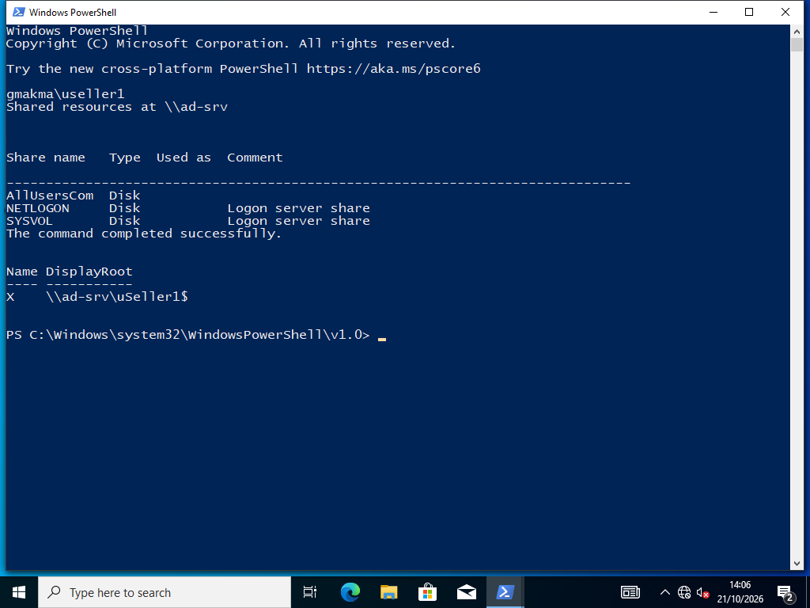
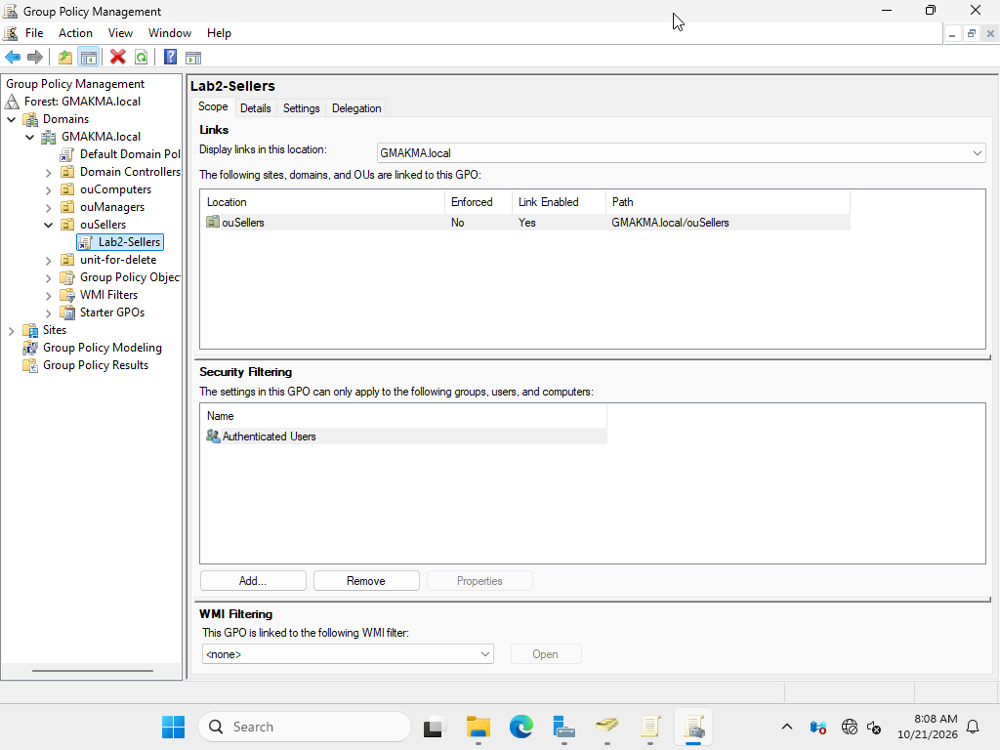
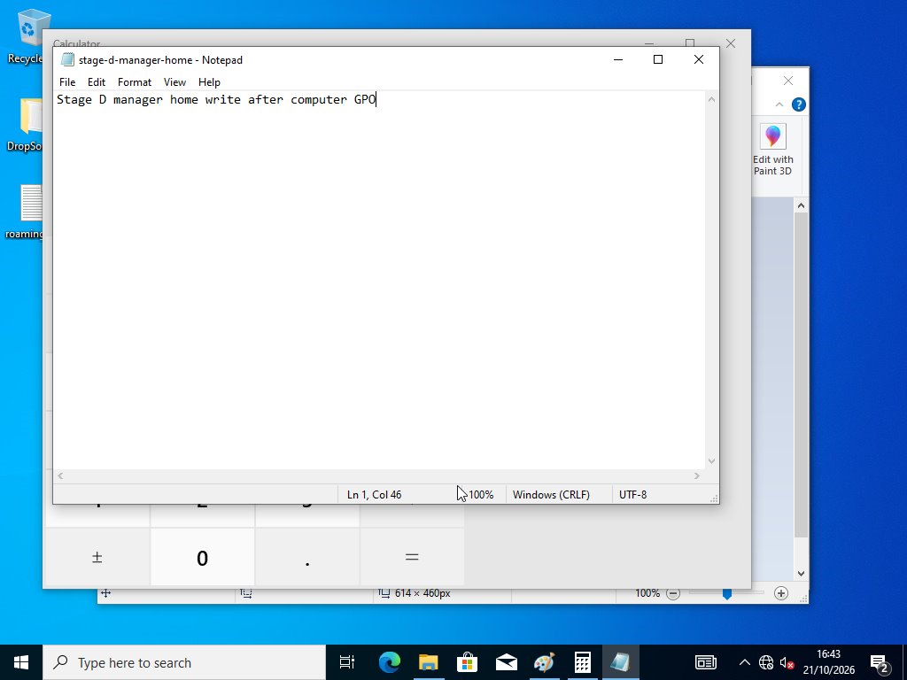
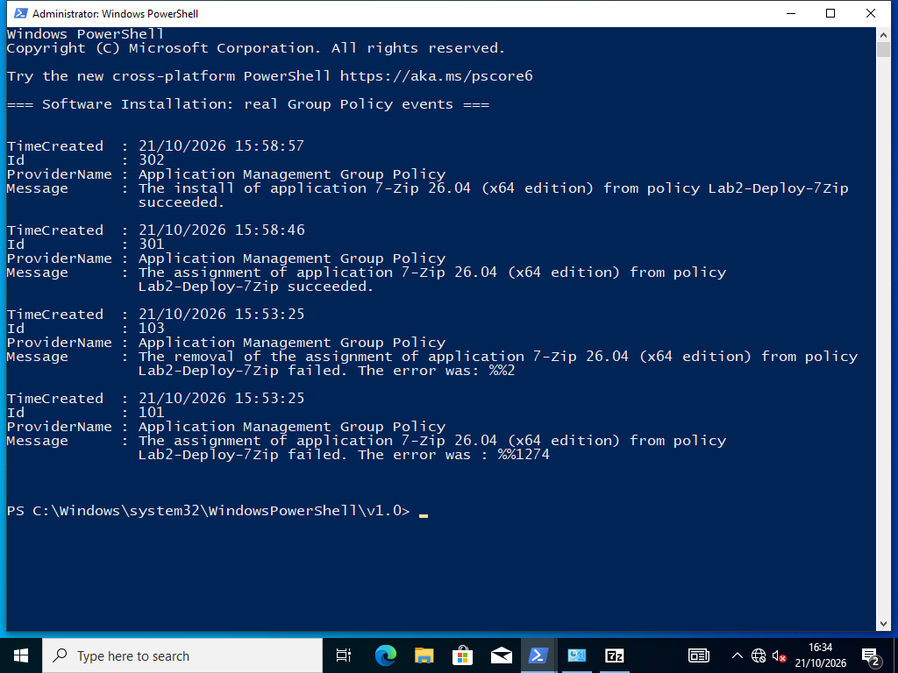
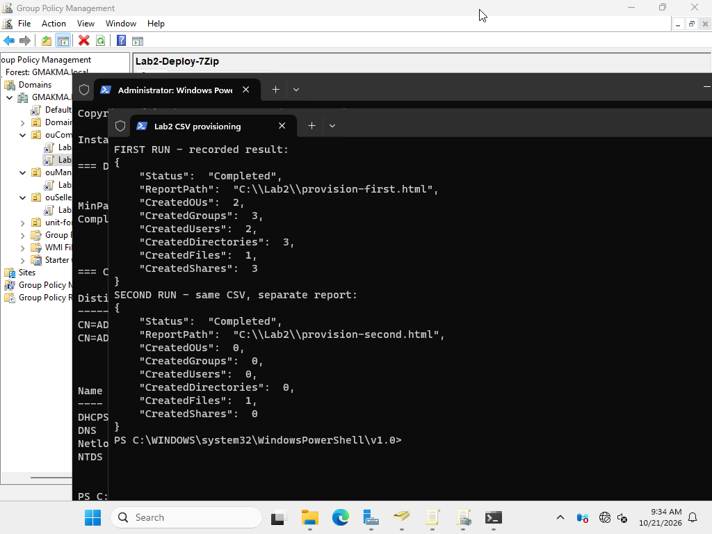
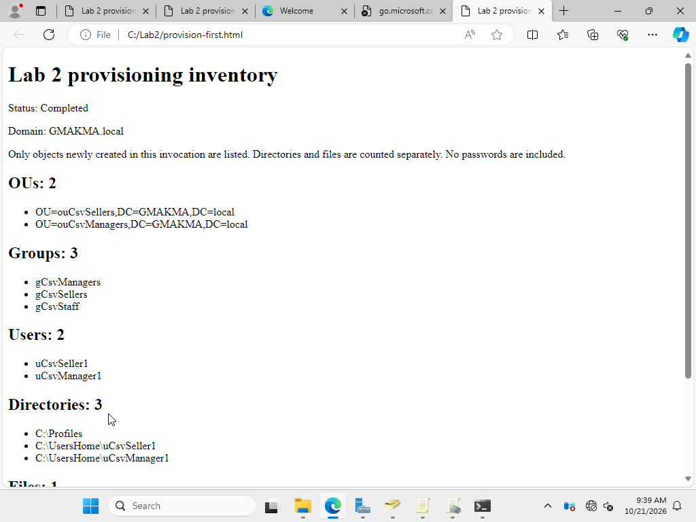
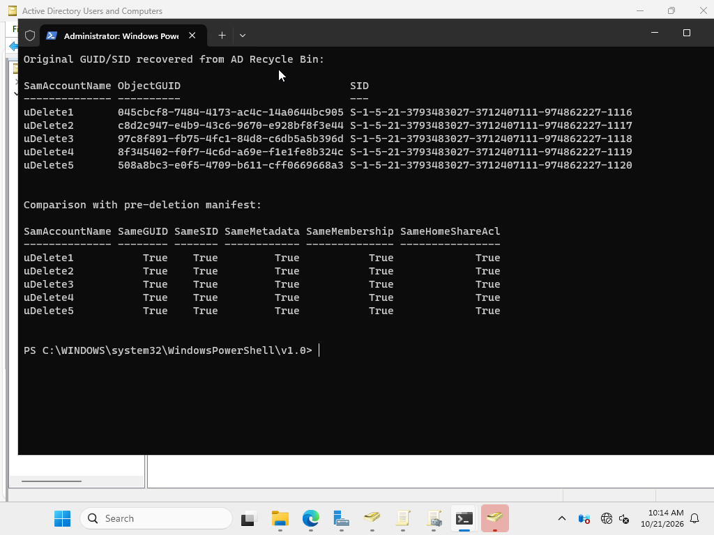

# Рассказ для защиты лабораторной работы №2

Текст рассчитан примерно на 5-6 минут на двоих. Демонстрация окон займёт дополнительное время. В конце приложены 10 скриншотов с маршрутами открытия и подсказками, на что обратить внимание. Заголовки и подсказки «Показать» нужны для подготовки, вслух их читать не нужно. Распределение реплик не означает распределение выполненной работы

## Первый участник: стенд, домен и доступ к файлам

В этой работе мы развернули учебную сеть организации с централизованным управлением пользователями, компьютерами и общими файлами. Подготовили две виртуальные машины: сервер ad-srv на Windows Server 2025 и клиент ad-client на Windows 10 Pro. Обе машины подключили к одной изолированной сети в Proxmox

Серверу назначили постоянный адрес 10.0.0.1, установили Active Directory Domain Services и создали лес с одним доменом GMAKMA.local. Active Directory хранит учётные записи пользователей, группы и объекты компьютеров. Благодаря этому пользователь может входить на клиент доменной учётной записью, а администратор управляет ею на сервере

Вместе с доменом настроили DNS. Он нужен, чтобы клиент находил сервер и службы домена. Затем установили и авторизовали DHCP, задали пул адресов от 10.0.0.100 до 10.0.0.110. Клиент получил адрес и сетевые параметры автоматически, после чего мы присоединили его к домену. Проверили доменный вход и появление объекта клиента в Active Directory

Показать: сеть и объекты AD по рисункам 1-2. На рисунке 1 сохранена конфигурация клиента, аренду дополнительно можно открыть на сервере в DHCP

Дальше создали подразделения продавцов и менеджеров, пользователей uSeller1 и uManager1 и группы gSellers и gManagers. Подразделения нужны для размещения объектов и назначения групповых политик. Группы мы использовали для файловых прав: нового сотрудника можно включить в группу отдела, чтобы он получил соответствующий доступ

На сервере создали общую папку AllUsers и опубликовали её как AllUsersCom. Внутри настроили папки отделов. Сотрудники могут работать с файлами своего отдела, но не удалять саму папку отдела и не менять её разрешения. Для доступа по сети учитываются права SMB и NTFS, поэтому мы настроили оба уровня

Отдельно сделали BlackHole и Common. В BlackHole пользователь может передать файл перетаскиванием, но не просмотреть содержимое папки. В Common все пользователи домена могут создавать и изменять файлы, а удалять только свои. Эти правила проверили под обычными пользователями обоих отделов

Каждому пользователю также создали личную домашнюю папку, подключаемую как диск X:, и настроили перемещаемый профиль. На X: хранятся пользовательские файлы, а профиль сохраняет настройки и данные среды Windows на сервере. Работу профиля проверили после выхода и повторного входа

Показать: OU и группы, домашний диск и файловый доступ по рисункам 2-4

## Второй участник: политики, скрипт и восстановление

Следующий этап - групповые политики. Для продавцов запретили Панель управления и редактор реестра, скрыли диск C: в Проводнике и настроили блокировку после минуты бездействия. Для менеджеров разрешили запуск Paint, Калькулятора и Блокнота. Ограничение запуска проверяли через Проводник, полной изоляции произвольного кода эта политика не обеспечивает

Для компьютера настроили отключение отчётов об ошибках, локального Administrator и Offline Files. На диске C: задали корневую ACL и наследуемые разрешения, сохранив защищённые права Windows и пользовательских профилей. Поэтому единую ACL буквально на каждом объекте C: мы не применяли

Отдельной политикой установили 7-Zip из MSI-пакета по сетевому пути. После перезагрузки проверили установленную программу и события успешной установки политикой

Показать: связь политики с OU и приложения менеджера по рисункам 5-6, установку 7-Zip политикой по рисунку 7

Затем автоматизировали создание пользователей. Скрипт Provision-Lab2.ps1 получает путь к CSV. Одна строка описывает одного пользователя: его ФИО, должность, отдел, почту, телефон, логин, начальный пароль, OU, группы и пути домашней папки и профиля

Скрипт запускаем на ad-srv в Windows PowerShell 5.1 от имени администратора. Параметр CsvPath указывает рабочую таблицу, ReportPath - выходной HTML. Рабочий CSV хранится отдельно с закрытыми правами, потому что содержит пароли. В публичном примере пароли заменены заглушками

Сначала скрипт определяет текущий домен и проверяет весь CSV и существующие объекты. После проверки создаёт недостающие OU и группы, затем пользователей. Записывает атрибуты, добавляет пользователей в группы, создаёт домашние папки и скрытые сетевые ресурсы, назначает права и прописывает подключение X: и путь профиля. Личную папку перемещаемого профиля создаёт Windows при первом входе

В конце скрипт формирует HTML с количеством и списком созданных объектов. В первом проверенном запуске созданы две OU, три группы и два пользователя. Во втором новых объектов AD не появилось, а GUID сохранились. При этом скрипт может заново записывать атрибуты и права, пароли существующих пользователей он не сбрасывает. Если ошибка возникает уже во время создания, автоматического отката всей работы нет

Показать: открыть параметры скрипта и публичный CSV, затем результаты двух запусков и HTML по рисункам 8-9. Команда запуска приведена в отдельной памятке

В последней части включили корзину Active Directory, создали пять тестовых пользователей в unit-for-delete и сохранили их идентификаторы. Затем удалили пользователей конвейером dsquery и dsrm. Скрипт восстановления выбрал именно эти удалённые объекты по GUID и восстановил их через Restore-ADObject

После восстановления сверили исходные GUID, SID и членство в группах, проверили вход пользователя и домашний диск. Это подтверждает, что вернулись прежние учётные записи. При создании пользователей заново с теми же логинами идентификаторы были бы другими

Показать: сохранённое сравнение пользователей до удаления и после восстановления по рисунку 10

## Показ 1. Сеть и объекты AD

Снимки ниже показывают результаты выполненной лабораторной, текущее состояние стенда нужно проверить перед выступлением. Для короткого показа достаточно группы, X:, одной GPO, 7-Zip, двух запусков скрипта и сравнения восстановления. Остальные окна открывайте по вопросам

На ad-client открыть ipconfig /all. Найти DHCP Enabled, адрес 10.0.0.100 и DNS 10.0.0.1. На сервере аренду можно открыть в DHCP -> IPv4 -> Lab2Scope -> Address Leases

Рисунок 1: Сетевая конфигурация клиента, полученная через DHCP

На ad-srv открыть ADUC -> ouSellers -> gSellers -> Properties -> Members. Показать uSeller1. Объяснить: OU задаёт размещение объекта, членство в группе используется для прав

Рисунок 2: Пользователь uSeller1 в группе gSellers

## Показ 2. Файловый доступ и домашний диск

На ad-client в сессии uManager1 открыть \\ad-srv\AllUsersCom\BlackHole. Объяснить отказ просмотра. Для подтверждения успешной передачи файла открыть сохранённые артефакты части 3 отчёта

Рисунок 3: Отказ просмотра BlackHole под обычным пользователем

В сессии uSeller1 показать X: в Проводнике. На снимке команда Get-PSDrive X показывает путь, а net view - обычный список ресурсов без личной папки. Объяснить роль суффикса $

Рисунок 4: Скрытый домашний ресурс и подключённый диск X:

## Показ 3. Связь GPO и результат на клиенте

На ad-srv открыть GPMC -> GMAKMA.local -> ouSellers -> Lab2-Sellers -> Scope. Показать ссылку на OU. Параметры можно открыть через Edit, результат проверяется отдельно на клиенте

Рисунок 5: Политика Lab2-Sellers связана с ouSellers

На ad-client войти uManager1 и открыть Paint, Калькулятор и Блокнот. Показать файл на X:. Для запрета запуска cmd.exe использовать сохранённый рисунок 34 отчёта

Рисунок 6: Разрешённые приложения менеджера после перезагрузки

## Показ 4. Установка программы и автоматизация

На клиенте открыть Event Viewer -> Windows Logs -> Application, найти события Application Management Group Policy 301 и 302. Дополнительно показать 7-Zip в списке установленных программ. На снимке видны и ошибки отдельных попыток, итог подтверждаем сообщениями об успешной установке и установленной программой

Рисунок 7: События назначения и установки 7-Zip через GPO

Открыть Provision-Lab2.ps1 и публичный lab2-users.example.csv, затем сохранённые результаты запусков. Показать 2 OU, 3 группы и 2 пользователей в первом и нули объектов AD во втором

Рисунок 8: Первый и повторный запуск скрипта с разными счётчиками

## Показ 5. HTML и восстановление пользователей

На ad-srv открыть C:\Lab2\provision-first.html и provision-second.html. Сопоставить списки и счётчики. Рабочий CSV с паролями не показывать, повторный запуск для просмотра не нужен

Рисунок 9: HTML со списком созданных объектов

Открыть сохранённое сравнение из части 6 отчёта, затем ADUC -> unit-for-delete. Показать пять пользователей и совпадение GUID и SID. Удаление заново для демонстрации не требуется

Рисунок 10: Сравнение исходных и восстановленных пользователей

