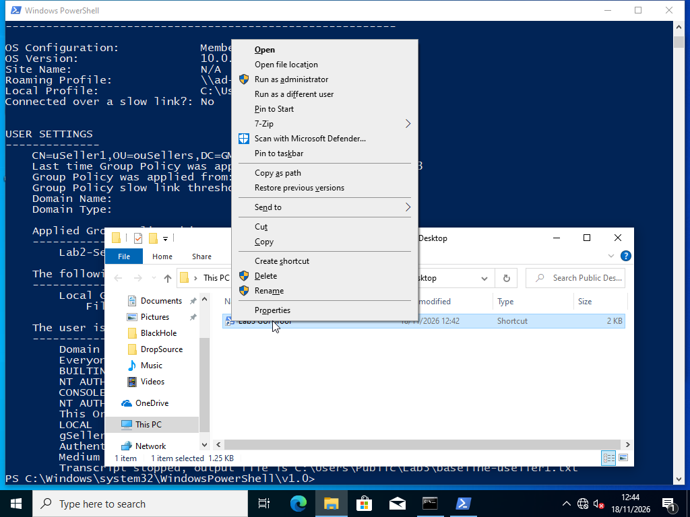
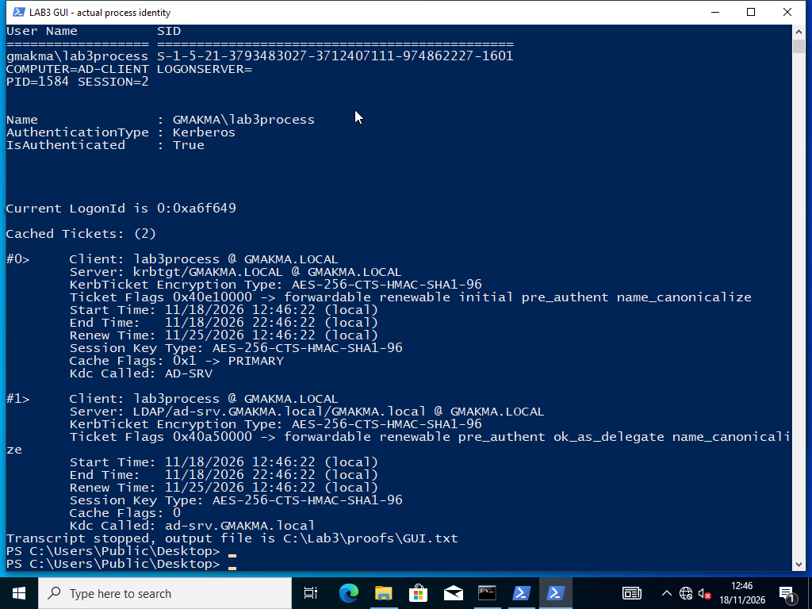
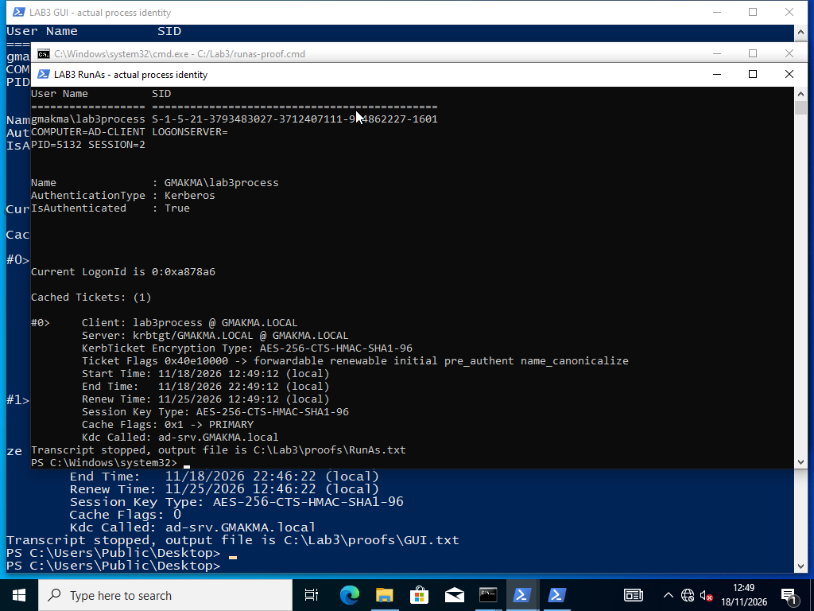
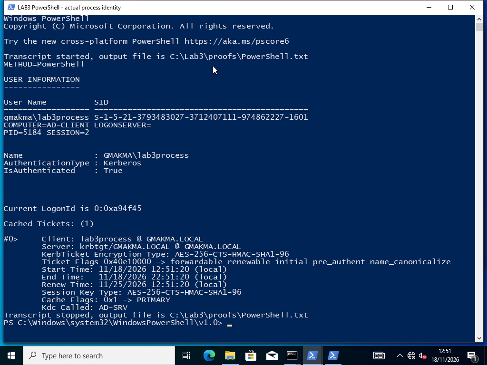
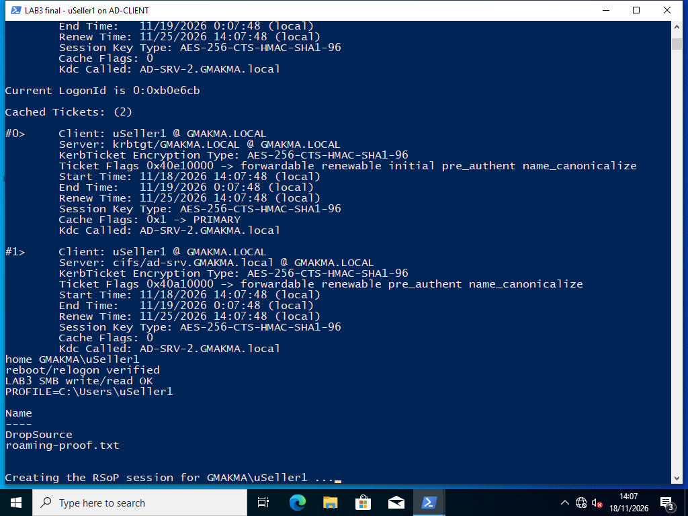

# Отчёт по практической работе №3

<style>
pre { break-inside: auto; page-break-inside: auto; }
p code, li code, td code { font: inherit; background: none; padding: 0; border: 0; }
a { overflow-wrap: anywhere; }
ol li { margin: 0.2mm 0; }
</style>

## Управление контроллерами домена в Active Directory

### Цель работы

Получить дополнительные навыки управления контроллерами домена Active Directory, резервирования состояния системы и запуска процессов с другой учётной записью

### Среда и термины

Работа выполнена 18.11.2026 на стенде ЛР2. Вместо VirtualBox используется Proxmox VE, все три машины подключены к изолированному мосту vmbr1_lab. Домен GMAKMA.local, уровни Windows2025Domain и Windows2025Forest

| VM | Имя и ОС | Адрес | Состояние после работы |
|---|---|---|---|
| 104 | AD-SRV, Windows Server 2025 Standard Evaluation | 10.0.0.1/8 | Сервер-член домена, DHCP и SMB сохранены, AD DS удалена |
| 109 | AD-SRV-2, Windows Server 2025 Standard Evaluation | 10.0.0.2/8 | Единственный DC, DNS, GC, все пять FSMO |
| 105 | AD-CLIENT, Windows 10 Pro 22H2 | 10.0.0.100/8, DHCP | Доменный клиент, DNS 10.0.0.2 |

В методичке встречаются as-srv-2 и ad-srv-2. На стенде используется фактическое имя AD-SRV-2. Версии Server 2012/2016/2019 из примера не использованы, поскольку текущий уровень леса 2025 требует совместимых DC [16]

| Термин | Значение |
|---|---|
| AD DS и DC | Служба каталогов и обслуживающий её контроллер домена |
| FSMO | Пять типов операций AD с единственным владельцем в своей области |
| GC | Глобальный каталог, не FSMO. Может работать на нескольких DC одновременно |
| DNS, SRV | Разрешение имён и записи обнаружения LDAP, Kerberos и GC |
| SYSVOL, NETLOGON | Общие ресурсы контроллера с политиками и сценариями |
| SID, RID | Идентификатор безопасности и его относительная часть |
| System State, DSRM | Копия состояния системы и режим восстановления AD DS |

Время внутри гостевых ОС отличается от часов оператора, а часовые пояса серверов и клиента различаются. Порядок действий подтверждён метками получения журналов UTC и результатами команд, а не прямым сравнением времени на скриншотах

## 1. Подготовка инфраструктуры

До изменений проверены имена ВМ, сеть, доступность агентов и AD-SRV. На нём работали NTDS, DNS, DHCP и ADWS. У клиента были домен GMAKMA.local, адрес DHCP 10.0.0.100, DNS 10.0.0.1. Реальный исходный вход uSeller1 и домашняя папка ЛР2 проверены до переноса

Сначала созданы снимки lab3-pre-systemstate-20261118 всех машин и полная выключенная копия VM104 на truenas-backup. Затем выполнен System State backup, поэтому изменения каталога начались только после успешного резервирования. Архив гипервизора: vzdump-qemu-104-2026_11_17-23_42_27.vma.zst, 16582601810 байт. Его наличие и размер перечитаны, тест восстановления не проводился

AD-SRV-2 введён в существующий домен командой Add-Computer, затем перезагружен. Результат присоединения:

```text
HasSucceeded : True
ComputerName : AD-SRV-2
```

После загрузки PartOfDomain=True, Test-ComputerSecureChannel=True. На новом сервере заранее установлены AD DS и средства управления. [Полный вывод](evidence/joined-and-promotion-help.txt)

## 2. Добавление контроллера домена

На AD-SRV-2 выполнена проверка предпосылок, затем установка дополнительного записываемого DC с DNS и GC, источником репликации указан AD-SRV. Значения паролей в материалы не включены

```powershell
Install-ADDSDomainController -DomainName GMAKMA.local `
    -Credential $c -InstallDns -NoGlobalCatalog:$false `
    -SiteName Default-First-Site-Name `
    -ReplicationSourceDC ad-srv.GMAKMA.local `
    -SafeModeAdministratorPassword $sec -NoRebootOnCompletion -Force
```


```text
Message        : You must restart this computer to complete the operation.

Context        : DCPromo.General.4
RebootRequired : True
Status         : Success
```

После команды сервер перезагружен. В каталоге были два DC, оба GC. Предупреждение мастера о невозможности создать внешнюю делегацию GMAKMA.local не является подтверждением поломки локального DNS. Внутренняя делегация _msdcs позднее проверена отдельно

Репликация не была признана готовой сразу после загрузки. После регистрации DNS и сходимости получен следующий результат до переноса FSMO:

```text
Replication Summary Start Time: 2026-11-18 04:39:29

Beginning data collection for replication summary, this may take awhile:
  .....

Source DSA          largest delta    fails/total %%   error
 AD-SRV                    01m:08s    0 /   5    0
 AD-SRV-2                     :30s    0 /   5    0

Destination DSA     largest delta    fails/total %%   error
 AD-SRV                       :30s    0 /   5    0
 AD-SRV-2                  01m:08s    0 /   5    0
```

На обоих DC отдельно прошли локальные Advertising, Services, SysVolCheck, NetLogons и Replications. SYSVOL и NETLOGON нового DC доступны. [Локальная проверка AD-SRV](evidence/pre-transfer-old-local-health-services.txt), [локальная проверка AD-SRV-2](evidence/pre-transfer-new-local-health.txt)

## 3. Получение информации о домене

### 3.1. Владельцы FSMO

На AD-SRV-2 до переноса выполнены команды PowerShell и пять независимых запросов dsquery. Полные команды и результаты:

```powershell
Get-ADForest | Select SchemaMaster,DomainNamingMaster
Get-ADDomain | Select PDCEmulator,RIDMaster,InfrastructureMaster
foreach ($r in 'schema','name','rid','pdc','infr') {
    dsquery server -forest -hasfsmo $r
    "EXIT=$LASTEXITCODE"
}
```


```text
SchemaMaster       : ad-srv.GMAKMA.local
DomainNamingMaster : ad-srv.GMAKMA.local

PDCEmulator          : ad-srv.GMAKMA.local
RIDMaster            : ad-srv.GMAKMA.local
InfrastructureMaster : ad-srv.GMAKMA.local

dsquery schema
"CN=AD-SRV,CN=Servers,CN=Default-First-Site-Name,CN=Sites,CN=Configuration,DC=GMAKMA,DC=local"
EXIT=0
dsquery name
"CN=AD-SRV,CN=Servers,CN=Default-First-Site-Name,CN=Sites,CN=Configuration,DC=GMAKMA,DC=local"
EXIT=0
dsquery rid
"CN=AD-SRV,CN=Servers,CN=Default-First-Site-Name,CN=Sites,CN=Configuration,DC=GMAKMA,DC=local"
EXIT=0
dsquery pdc
"CN=AD-SRV,CN=Servers,CN=Default-First-Site-Name,CN=Sites,CN=Configuration,DC=GMAKMA,DC=local"
EXIT=0
dsquery infr
"CN=AD-SRV,CN=Servers,CN=Default-First-Site-Name,CN=Sites,CN=Configuration,DC=GMAKMA,DC=local"
EXIT=0
```

Оба способа указали AD-SRV. PowerShell возвращает FQDN, dsquery возвращает DN объекта сервера, поэтому сравнивались имена владельцев, а не буквальное совпадение строк. [Полный протокол до переноса](evidence/fsmo-before-transfer-full-dcdiag.txt)

### 3.2. Изменения DNS

Сравнены экспорты GMAKMA.local и _msdcs.GMAKMA.local до и после повышения. Добавились адрес 10.0.0.2 для AD-SRV-2 и сервисных узлов зон, NS нового DNS, LDAP/Kerberos/GC SRV с целью ad-srv-2.gmakma.local, включая записи Default-First-Site-Name, а также GUID CNAME

| Зона | Пример реально добавленного имени | Тип и значение |
|---|---|---|
| GMAKMA.local | ad-srv-2 | A 10.0.0.2 |
| GMAKMA.local | @ | NS ad-srv-2.gmakma.local. |
| GMAKMA.local | _ldap._tcp | SRV ad-srv-2.gmakma.local.:389 |
| GMAKMA.local | _kerberos._tcp | SRV ad-srv-2.gmakma.local.:88 |
| GMAKMA.local | _gc._tcp.Default-First-Site-Name._sites | SRV ad-srv-2.gmakma.local.:3268 |
| _msdcs.GMAKMA.local | 3a787877-ec05-431b-9047-d2fda475a283 | CNAME ad-srv-2.gmakma.local. |
| _msdcs.GMAKMA.local | _ldap._tcp.dc | SRV ad-srv-2.gmakma.local.:389 |
| _msdcs.GMAKMA.local | _ldap._tcp.gc | SRV ad-srv-2.gmakma.local.:3268 |

Всего выявлено 28 новых записей без учёта изменений SOA. Полный вычисленный список: [DNS до/после](evidence/dns-added-records.md). Записей AAAA в разности нет. С клиента отдельно проверено разрешение A и SRV через 10.0.0.2, а после понижения исправлена старая делегация _msdcs на AD-SRV

### 3.3. Пользователь и три способа запуска

На AD-SRV-2 создан обычный доменный пользователь lab3process, Enabled=True, SID S-1-5-21-3793483027-3712407111-974862227-1601. Дополнительных административных групп нет. Этот же SID прочитан с AD-SRV после репликации. Позднее на обоих DC подтверждены Enabled=True, LockedOut=False и Valid=True через штатную проверку учётных данных. [SID на исходном DC](evidence/new-user-replicated-old-dc.txt), [проверка включённой записи на AD-SRV](evidence/process-user-auth-validation-104.txt), [проверка на AD-SRV-2](evidence/process-user-auth-validation-109.txt)

На AD-CLIENT в интерактивном сеансе 2 реально запущены три процесса:

| Способ | Что выполнено | Проверенный результат |
|---|---|---|
| GUI | Run as different user в контекстном меню ярлыка PowerShell | PID 1584, GMAKMA\lab3process |
| runas | runas /user:GMAKMA\lab3process с запуском process-proof.ps1 | PID 5132, GMAKMA\lab3process |
| PowerShell | Get-Credential и Start-Process -Credential -LoadUserProfile | PID 5184, GMAKMA\lab3process |

Каждый процесс вывел whoami /user, COMPUTER=AD-CLIENT, SESSION=2 и AuthenticationType=Kerberos. Пустой LOGONSERVER у вторичного процесса не использован как доказательство входа. Контекст подтверждён SID, токеном процесса и Kerberos TGT. Это локальные видимые процессы, не удалённые окна WinRM. [Три полных transcript и владельцы процессов](evidence/all-three-process-proofs-success.txt)



Рисунок 1: Команда Run as different user в меню ярлыка




Рисунок 2: Процесс GUI запущен от GMAKMA\lab3process




Рисунок 3: Процесс runas под lab3process, PID 5132




Рисунок 4: PowerShell Start-Process под lab3process, PID 5184

PowerShell-вариант использовал Start-Process, а не Invoke-Command. Возможности и ограничения Invoke-Command отдельно разобраны в ответе 8, успешный WinRM-сеанс от lab3process здесь не заявляется

## 4. Архивация Active Directory

На AD-SRV установлена служба Windows Server Backup. Команды установки и выполненного резервирования:

```powershell
Install-WindowsFeature Windows-Server-Backup -IncludeManagementTools
wbadmin start systemstatebackup -backupTarget:B: -quiet
wbadmin get versions -backupTarget:B:
wbadmin get items -version:11/18/2026-09:20 -backupTarget:B:
```

Для копии выделен отдельный виртуальный диск 32 GiB на sd240, SATA serial QM00015. До форматирования проверены RAW, IsBoot=False, IsSystem=False и отсутствие разделов. Получен NTFS B: LAB3_SYSTEMSTATE. Системный диск QM00013 не форматировался

Первая попытка была прервана штатным выключением из-за истечения evaluation-лицензии. После разрешённого поддерживаемого rearm и перезагрузки выполнена одна новая попытка. Она закончилась успешно, файл exitcode содержит 0:

```text
Summary of the backup operation:
------------------

The backup operation successfully completed.
The backup of the system state successfully completed [11/18/2026 11:03 AM].
Log of files successfully backed up:
C:\WINDOWS\Logs\WindowsServerBackup\Backup-18-11-2026_09-20-59.log
```


```text
wbadmin 1.0 - Backup command-line tool
(C) Copyright Microsoft Corporation. All rights reserved.

Backup time: 11/18/2026 1:20 AM
Backup target: 1394/USB Disk labeled B:
Version identifier: 11/18/2026-09:20
Can recover: Volume(s), File(s), Application(s), System State
Snapshot ID: {a43a3da0-191f-4295-ab36-8d8d83108334}

wbadmin 1.0 - Backup command-line tool
(C) Copyright Microsoft Corporation. All rights reserved.
```

В get items видны AD/ntds, Registry и компонент SYSVOL. [Результат задания](evidence/resume-backup-status.txt), [каталог и состав копии](evidence/backup-complete-and-before-promotion.txt)

System State находится на отдельном от C: виртуальном диске, но на том же гипервизоре. Полная копия VM104 отдельно хранится на NFS truenas-backup. После понижения с авторизованного административного подключения повторно прочитаны журнал успеха, exitcode=0 и каталог B:\WindowsImageBackup\AD-SRV. [Чтение носителя после завершения работы](evidence/resume2-final-backup-media-fqdn-readback.txt)

Наличие версии и журнал успеха подтверждают завершение и доступность копии, но не заменяют пробное восстановление. Восстановление на отдельном стенде не проводилось [6, 18]

## 5. Замена контроллера домена

### Перенос ролей, GC и DNS

Перед переносом на всех трёх ВМ созданы и перечитаны lab3-pre-fsmo-20261118, задачи завершились TASK OK. Выполнен обычный перенос пяти FSMO через Move-ADDirectoryServerOperationMasterRole без Force и без захвата. GC нового DC был включён ещё при повышении, AD-интегрированные зоны получены репликацией. GC не передавался как исключительная роль [7, 15]

```powershell
Move-ADDirectoryServerOperationMasterRole -Identity AD-SRV-2 `
    -OperationMasterRole SchemaMaster,DomainNamingMaster,PDCEmulator,`
        RIDMaster,InfrastructureMaster -Credential $c -Confirm:$false
```

Владельцы после переноса проверены через Get-ADForest, Get-ADDomain и netdom query fsmo. Все пять указывают AD-SRV-2. [Полный вывод](evidence/fsmo-after-transfer-readback.txt)

До понижения DHCP scope 10.0.0.0 option 006 изменён на 10.0.0.2, DNS обоих серверов и клиента направлен на новый DC. Клиент обновил аренду и успешно нашёл AD-SRV-2. DHCP и файловые ресурсы ЛР2 не переносились на 109: они сохранены на AD-SRV как на сервере-члене домена

### Проверка безопасности и штатное понижение

На исходном DC выполнена проверка с защищёнными учётными данными. Полная команда без значений секретов и полный возвращённый объект:

```powershell
Test-ADDSDomainControllerUninstallation -Credential $c `
    -LocalAdministratorPassword $sec -NoRebootOnCompletion |
    Format-List * | Out-String
```


```text
Message        : Operation completed successfully
Context        : Test.VerifyDcPromoCore.DCPromo.General.1
RebootRequired : False
Status         : Success
```

[Полный вывод](evidence/pre-demotion-Test-ADDSDomainControllerUninstallation.txt)

Штатное понижение зафиксировано журналами dcpromo.log и dcpromoui.log: NtdsDemote returned 0, DsRolepDemoteDs returned 0, This machine is no longer a domain controller. Новый DC больше не содержит объекта NTDS исходного DC, компьютер AD-SRV имеет PrimaryGroupID=515. Сохранённый журнал содержит также строку Setting security on server files failed with 2, но итоговый UI-журнал указал bHadNonCriticalFailures=false и необходимость перезагрузки. Эти строки не скрыты. Отдельный клиентский transcript вызова самой команды понижения не сохранился после обрыва исполнителя, поэтому результат подтверждён гостевыми журналами и независимым чтением каталога. Повторное понижение не выполнялось. [Журналы понижения](evidence/resume2-demotion-discovery.txt)

После штатной перезагрузки ProductType=ServerNT, NTDS остановлена, доверительный канал к AD-SRV-2 вернул NERR_Success. Затем выполнено удаление бинарных компонентов роли:

```powershell
Uninstall-WindowsFeature AD-Domain-Services -IncludeManagementTools
```


```text
Success       : True
RestartNeeded : Yes
FeatureResult : {Active Directory Domain Services, Group Policy Management, Active Directory Administrative Center, AD
                DS Tools...}
ExitCode      : SuccessRestartRequired
```

Выполнена ещё одна штатная перезагрузка. AD-Domain-Services имеет InstallState=Available, DHCP и FS-FileServer остаются Installed. DHCP по-прежнему авторизован на 10.0.0.1. [Полный вывод](evidence/resume2-member-dhcp-readback.txt)

### Диагностика после замены

Итоговый состав домена и владельцы:

```text
HostName        : AD-SRV-2.GMAKMA.local
IPv4Address     : 10.0.0.2
IsGlobalCatalog : True

SchemaMaster       : AD-SRV-2.GMAKMA.local
DomainNamingMaster : AD-SRV-2.GMAKMA.local
ForestMode         : Windows2025Forest

PDCEmulator          : AD-SRV-2.GMAKMA.local
RIDMaster            : AD-SRV-2.GMAKMA.local
InfrastructureMaster : AD-SRV-2.GMAKMA.local
DomainMode           : Windows2025Domain

Name     ScopeName Path                                          Description
----     --------- ----                                          -----------
NETLOGON *         C:\WINDOWS\SYSVOL\sysvol\GMAKMA.local\SCRIPTS Logon server share
SYSVOL   *         C:\WINDOWS\SYSVOL\sysvol                      Logon server share
```

Полный dcdiag /e /v сохранён до и после. До переноса удалённые проверки из контекста SYSTEM содержали Access denied/RPC, поэтому дополнительно выполнялись локальные проверки каждого DC. После замены рабочие тесты нового DC прошли, но DFSREvent ещё видит события за предыдущие 24 часа, включая инициализацию и остановку связи с пониженным партнёром. Журнал не очищался, общий dcdiag не объявлен полностью безошибочным

В актуальном отдельном чтении SYSVOL Share имеет State=4, SYSVOL/NETLOGON доступны, после удаления партнёра за последние 30 минут в DFS Replication прочитаны только информационные события. [Свежие события и состояние SYSVOL](evidence/resume2-final-dfsr-events.txt)

DNS-тест сначала обнаружил устаревшую делегацию _msdcs на 10.0.0.1. На 109 добавлена делегация на ad-srv-2, удалены старый NS исходного DNS и forwarder 10.0.0.1. Повторная проверка:

```text
Summary of DNS test results:

                                            Auth Basc Forw Del  Dyn  RReg Ext
            _________________________________________________________________
            Domain: GMAKMA.local
               AD-SRV-2                     PASS PASS PASS PASS PASS PASS n/a

         ......................... GMAKMA.local passed test DNS
```

[Полный dcdiag после замены](evidence/resume2-final-dcdiag-dns.txt), [DNS после исправления делегации](evidence/resume2-dns-readback-sysvol.txt)

### Новый вход и сохранность ЛР2

На VM105 завершён прежний сеанс uSeller1 и выполнен новый интерактивный вход в сеанс 3 после понижения AD-SRV. В пользовательском окне получены LOGONSERVER=AD-SRV-2, Kerberos TGT и билет cifs/ad-srv от нового KDC. На 109 в Security есть успешное событие 4768 для uSeller1 с адреса 10.0.0.100. Это подтверждает обращение к действующему DC, а не только кэшированный вход

```text
gmakma\useller1 S-1-5-21-3793483027-3712407111-974862227-1106
COMPUTER=AD-CLIENT LOGONSERVER=\\AD-SRV-2
AuthenticationType : Kerberos
IsAuthenticated    : True
A ticket to cifs/ad-srv.GMAKMA.local has been retrieved successfully.
        Kdc Called: AD-SRV-2.GMAKMA.local
        Kdc Called: AD-SRV-2.GMAKMA.local
        Kdc Called: AD-SRV-2.GMAKMA.local
        Kdc Called: AD-SRV-2.GMAKMA.local
LAB3 SMB write/read OK
PROFILE=C:\Users\uSeller1
roaming-proof.txt
Roaming Profile:             \\ad-srv\uSeller1$\_profile.V6
    Group Policy was applied from:      AD-SRV-2.GMAKMA.local
        Lab2-Sellers
```




Рисунок 5: Новый KDC AD-SRV-2, чтение и запись SMB после понижения

Домашняя папка uSeller1$ на AD-SRV доступна для чтения, записи и удаления тестового файла. Сохранились перемещаемый профиль \\ad-srv\uSeller1$\_profile.V6, файл roaming-proof.txt и GPO Lab2-Sellers, применённая от AD-SRV-2. Системный контекст клиента читает LabPackages$, обычный пользователь не получил новых прав на пакетный share. DHCP lease 10.0.0.100 Active, DHCP=10.0.0.1, DNS=10.0.0.2, доверительный канал клиента True. Повторная установка MSI не выполнялась

[Полный пользовательский proof и сетевые проверки](evidence/resume2-final-user-complete-transcript.txt), [DHCP и SMB-сеансы исходного сервера](evidence/resume2-lab2-dhcp-smb-final.txt)

Итоговые снимки lab3-final-20261118 созданы и перечитаны на 104, 105 и 109, все три задания TASK OK. [Журнал снимков](evidence/snapshots.json). Снимки без памяти выполнялись с freeze/thaw агента, но не считаются атомарной распределённой копией AD. Фактическая ёмкость пулов проверена, thin provisioning сохраняет предупреждение об overprovision. Независимый откат одного DC к старому снимку не используется как штатное восстановление

## 6. Ответы на контрольные вопросы

### 1. Перечислите FSMO. Кратко раскройте их назначение

FSMO позволяют выполнять отдельные операции у одного владельца, не превращая его в единственный записываемый DC. В лесу есть две роли, в каждом домене ещё три [1, 2]

| Роль | Область | Назначение |
|---|---|---|
| Schema Master, хозяин схемы | Лес | Обрабатывает изменения классов и атрибутов схемы |
| Domain Naming Master, хозяин именования доменов | Лес | Управляет добавлением и удалением доменов, изменениями пространства имён леса |
| RID Master, хозяин RID | Домен | Выдаёт DC пулы RID для уникальных SID новых субъектов безопасности |
| PDC Emulator, эмулятор PDC | Домен | Получает приоритетные изменения паролей, участвует в проверке неверного пароля и блокировках. PDC корневого домена является вершиной доменной иерархии времени |
| Infrastructure Master, хозяин инфраструктуры | Домен | Поддерживает ссылки на объекты других доменов при изменении их данных |

Одна роль имеет одного владельца в своей области, но один контроллер может владеть несколькими ролями. Число экземпляров ролей в многодоменном лесу больше пяти. GC в этот перечень не входит [1, 2, 15]

### 2. Что произойдёт при недоступности каждой роли?

Последствия зависят от операции, длительности сбоя и сохранности остальных DC, DNS и репликации. Отказ владельца FSMO не означает немедленную остановку всех входов [1, 2]

| Недоступная роль | Последствия |
|---|---|
| Schema Master | Нельзя менять схему, например расширять её для приложения. Операции без изменения схемы могут продолжаться |
| Domain Naming Master | Нельзя добавлять и удалять домены, выполнять зависящие от владельца изменения разделов каталога |
| RID Master | DC используют уже выданные RID. После исчерпания доступных пулов создание новых объектов с SID на соответствующих DC прекращается, существующие объекты не исчезают |
| PDC Emulator | Нарушается обращение к наиболее свежему паролю при отказе входа, страдает обработка блокировок, отдельные административные операции и иерархия времени. Не вся аутентификация прекращается сразу |
| Infrastructure Master | В многодоменной конфигурации без компенсирующих условий перестают обновляться междоменные ссылки |

Если все DC домена являются GC, проблема размещения Infrastructure Master не возникает. При включённой AD Recycle Bin ссылки обновляет каждый DC, поэтому у Infrastructure FSMO нет этой задачи. Для однодоменного леса междоменные последствия также не следует описывать как наблюдавшийся отказ [1]

В плановой замене используют transfer, согласованный перенос. Seizure, принудительный захват, предназначен для ситуации, когда прежний владелец недоступен и штатный перенос невозможен. Для исправного исходного DC захват не нужен [7]

### 3. Как с помощью dcdiag проверить корректность настройки только DNS?

В повышенной консоли со средствами AD DS/RSAT [8]:

```cmd
dcdiag /test:DNS /s:AD-SRV-2 /v
```

`/test:DNS` выбирает DNS-тесты, `/s` задаёт DC, `/v` включает подробности. Обязательная проверка Connectivity остаётся. По умолчанию используется `/DnsAll`, без проверки внешнего имени. Для всех DC леса вместо одного `/s` используют `/e` [8]

### 4. Как с помощью dcdiag исправить ошибки в конфигурации?

Документированный ключ `/fix` действует только в тесте `MachineAccount` и исправляет SPN учётной записи контроллера, а не все ошибки конфигурации [8]

```cmd
dcdiag /s:AD-SRV-2 /test:MachineAccount /fix /v
```

Это изменяющая команда, её не запускают просто для демонстрации. DNS, репликацию и прочие причины исправляют отдельно по результатам диагностики, затем повторяют соответствующий тест [8]

### 5. Как ввести компьютер в домен с помощью netdom?

На присоединяемом компьютере с установленными средствами AD DS/RSAT открыть повышенную командную строку. DNS должен разрешать домен, оператору нужны локальные права и права на присоединение. Имя учётной записи ниже является примером [9]

```cmd
netdom join AD-CLIENT /domain:GMAKMA.local /userd:GMAKMA\Administrator /passwordd:* /reboot:30
```

`AD-CLIENT` является именем компьютера, `/domain` задаёт DNS-имя домена, `/userd` задаёт доменную учётную запись, `*` вызывает отдельный запрос пароля. `/reboot:30` перезагружает компьютер с указанной задержкой. Пароль не нужно писать в строке команды. `join` не повышает сервер до контроллера [9]

### 6. Как ввести компьютер в домен с помощью PowerShell?

На присоединяемой машине в повышенной Windows PowerShell 5.1 [10]:

```powershell
$cred = Get-Credential 'GMAKMA\Administrator'
Add-Computer -DomainName 'GMAKMA.local' -Credential $cred `
    -PassThru -Verbose -Restart
```

`Get-Credential` получает пароль без записи его в код, `-DomainName` выбирает домен, `-PassThru` и `-Verbose` выводят результат, `-Restart` перезагружает компьютер для применения изменения. Нужны разрешение DNS, доступ к DC и необходимые права. Это ввод в домен, не установка AD DS [10]

После перезагрузки проверить фактическое членство, а не только DNS-суффикс:

```powershell
Get-CimInstance Win32_ComputerSystem |
    Select-Object Name,Domain,PartOfDomain
```

### 7. Как запустить процесс от имени другого пользователя с помощью runas?

На клиенте выполнить [13]:

```cmd
runas /user:GMAKMA\lab3process "cmd.exe /k whoami"
```

После отдельного запроса пароля запускается `cmd.exe` с учётными данными пользователя, а `whoami` показывает его контекст. Нужны работающая служба Secondary Logon, допустимые права входа и отсутствие запрещающей политики. В практической части создана именно запись `lab3process` [13]

`runas` не означает автоматическое повышение через UAC. Ключ `/netonly` меняет учётные данные только для удалённого доступа и не подходит как доказательство другого локального пользователя процесса. `/savecred` в учебной демонстрации не требуется [13]

### 8. Как запустить процесс от имени другого пользователя с помощью Invoke-Command?

Пример удалённого запуска процесса на клиенте из Windows PowerShell 5.1 [14]:

```powershell
$cred = Get-Credential 'GMAKMA\lab3process'
Invoke-Command -ComputerName 'AD-CLIENT.GMAKMA.local' `
    -Credential $cred -Authentication Kerberos -ScriptBlock {
        hostname.exe
        whoami.exe
    }
```

`hostname.exe` и `whoami.exe` запускаются внутри удалённой сессии, результат возвращается в вызывающую консоль. `-Credential` задаёт учётную запись для удалённого подключения. Локальная форма `Invoke-Command -ScriptBlock {...}` сама по себе пользователя не меняет [14]

На клиенте нужны работающий WinRM, настроенный listener, разрешённый трафик и права на выбранную конфигурацию сеанса. Для Kerberos нужны корректное доменное имя, DNS и доменная аутентификация. Обычная доменная запись не получает доступ к стандартному endpoint автоматически, один пароль этого не обеспечивает [14, 19]

Это не запуск видимого GUI в интерактивной сессии пользователя. Отказ доступа нужно описать как отказ, а не обходить добавлением пользователя в администраторы или широким TrustedHosts. Настройку отдельного разрешённого endpoint согласуют отдельно. Доступ к третьему серверу из сессии также требует отдельного решения, для проверки `whoami` он не нужен [14, 19]

## 7. Заключение

Дополнительный DC AD-SRV-2 введён в существующий домен, репликация двух контроллеров проверена до вывода исходного DC. Системная копия завершена до изменений AD, все пять FSMO штатно перенесены, новый GC и DNS работают. Исходный AD-SRV понижен, AD DS удалена, а DHCP и SMB сохранены. Новый интерактивный вход uSeller1, Kerberos от AD-SRV-2, домашняя папка и применение GPO ЛР2 подтверждены

Ограничения: пробное восстановление не выполнялось, общий dcdiag хранит исторические DFSREvent, полный клиентский transcript команды понижения не сохранился. Evaluation-системам нужна законная активация до окончания текущего grace-периода. Эти ограничения не подменены заявлениями о восстановлении, постоянной лицензии или чистом журнале событий

## Источники

Задание: «ПРАКТИЧЕСКАЯ РАБОТА №3. Управление контроллерами домена в Active Directory», предоставленный файл `awin #3 2025 (1).docx`. Оформление: отчёт ЛР2 и правила AGENTS.md. Практические результаты: сохранённые журналы команд и консольные снимки от 18.11.2026. Документация Microsoft повторно проверена 18.11.2026. Ссылки [3] и [13] ведут на архивную документацию, использованные команды сверены со справкой и выполненными вызовами установленной ОС

1. [Microsoft Learn: Active Directory FSMO roles](https://learn.microsoft.com/en-us/troubleshoot/windows-server/active-directory/fsmo-roles)
2. [Microsoft Learn: Understand FSMO roles](https://learn.microsoft.com/en-us/windows-server/identity/ad-ds/manage/understand-fsmo-roles)
3. [Microsoft Learn: Dsquery server](https://learn.microsoft.com/en-us/previous-versions/windows/it-pro/windows-server-2012-r2-and-2012/cc732885%28v%3Dws.11%29)
4. [Microsoft Learn: Verify DNS functionality for replication](https://learn.microsoft.com/en-us/windows-server/identity/ad-ds/manage/troubleshoot/verify-dns-functionality-to-support-directory-replication)
5. [Microsoft Learn: wbadmin start systemstatebackup](https://learn.microsoft.com/en-us/windows-server/administration/windows-commands/wbadmin-start-systemstatebackup)
6. [Microsoft Learn: Back up System State](https://learn.microsoft.com/en-us/windows-server/identity/ad-ds/manage/ad-forest-recovery-backing-up-system-state)
7. [Microsoft Learn: Transfer FSMO roles](https://learn.microsoft.com/en-us/windows-server/identity/ad-ds/manage/manage-fsmo-roles)
8. [Microsoft Learn: DCDiag](https://learn.microsoft.com/en-us/windows-server/administration/windows-commands/dcdiag)
9. [Microsoft Learn: netdom join](https://learn.microsoft.com/en-us/windows-server/administration/windows-commands/netdom-join)
10. [Microsoft Learn: Add-Computer, Windows PowerShell 5.1](https://learn.microsoft.com/en-us/powershell/module/microsoft.powershell.management/add-computer?view=powershell-5.1)
11. [Microsoft Learn: Test-ADDSDomainControllerUninstallation](https://learn.microsoft.com/en-us/powershell/module/addsdeployment/test-addsdomaincontrolleruninstallation?view=windowsserver2025-ps)
12. [Microsoft Learn: Demote domain controllers and domains](https://learn.microsoft.com/en-us/windows-server/identity/ad-ds/deploy/demoting-domain-controllers-and-domains--level-200-)
13. [Microsoft Learn: Runas](https://learn.microsoft.com/en-us/previous-versions/windows/it-pro/windows-server-2012-r2-and-2012/cc771525%28v%3Dws.11%29)
14. [Microsoft Learn: Invoke-Command, Windows PowerShell 5.1](https://learn.microsoft.com/en-us/powershell/module/microsoft.powershell.core/invoke-command?view=powershell-5.1)
15. [Microsoft Learn: Binding to the Global Catalog](https://learn.microsoft.com/en-us/windows/win32/ad/binding-to-the-global-catalog)
16. [Microsoft Learn: AD DS functional levels](https://learn.microsoft.com/en-us/windows-server/identity/ad-ds/active-directory-functional-levels)
17. [Microsoft Learn: Active Directory replication concepts](https://learn.microsoft.com/en-us/windows-server/identity/ad-ds/get-started/replication/active-directory-replication-concepts)
18. [Microsoft Learn: Restore a virtualized domain controller](https://learn.microsoft.com/en-us/windows-server/identity/ad-ds/manage/virtual-dc/restore-virtualized-domain-controller)
19. [Microsoft Learn: about_Remote_Requirements](https://learn.microsoft.com/en-us/powershell/module/microsoft.powershell.core/about/about_remote_requirements?view=powershell-5.1)
