# Отчёт по практической работе №4

**Промежуточный этап - работа не завершена и не предназначена для сдачи**

Не подтверждены переход PartnerDown, GUI s2 во время отказа, восстановление резервных копий и полное развёртывание сценарием. IPv6 остался включён, изоляция стенда не доказана

<style>
tr { break-inside: avoid; page-break-inside: avoid; }
p code, li code, td code { font: inherit; background: none; padding: 0; border: 0; }
</style>

## Развёртывание сетевых инфраструктурных сервисов на примере DHCP

### Цель работы

Получить практические навыки развёртывания и управления DHCP в Windows Server и изучить основные понятия службы

### Среда выполнения

Работа проводилась 18.11.2026 на стенде предыдущих работ в Proxmox VE, машины соединены через vmbr1_lab, домен GMAKMA.local. Вместо указанных в задании VirtualBox и Windows Server 2012/2016 использован существующий стенд

| Роль | Имя и ОС | IPv4 и роль |
|---|---|---|
| s1, VM104 | AD-SRV, Windows Server 2025 | 10.0.0.1/8, сервер-член домена и основной DHCP |
| s2, VM109 | AD-SRV-2, Windows Server 2025 | 10.0.0.2/8, контроллер домена, DNS и резервный DHCP |
| c1, VM105 | AD-CLIENT, Windows 10 | Адрес по DHCP, доменный клиент |

В отличие от обозначений задания AD DS находится на s2, а не на s1. DNS 10.0.0.2 соответствует фактическому расположению контроллера домена. IPv6 binding Ethernet включён на всех трёх машинах. Требование отключения не выполнено: на s2 единственный контроллер домена и DNS использует также ::1, зависимости не проверялись. На клиенте настройку тоже не меняли

### Используемые термины

| Термин | Значение |
|---|---|
| Область | Диапазон адресов подсети и связанные с ним параметры DHCP |
| Опция | Передаваемый клиенту параметр, например DNS или шлюз |
| Аренда | Выделение адреса клиенту на определённое время |
| DHCP-политика | Правило выбора параметров для клиентов по заданным условиям |
| Резервирование | Закрепление адреса за определённым идентификатором клиента |
| DHCP Failover | Согласованное обслуживание области двумя серверами |
| MCLT | Максимальное время, на которое сервер может продлить аренду сверх известного партнёру срока |

## 1. Подготовка инфраструктуры

До изменения настроек созданы снимки lab4-before-changes-20261118 всех трёх машин, выполнение задач и наличие снимков проверены. Отдельный откат контроллера домена без согласованной процедуры недопустим. Архивы предыдущей работы и копия System State обнаружены, восстановление не проверялось

Финальные снимки lab4-final-20261118 трёх машин также созданы и перечитаны с результатом TASK OK. Это crash-consistent снимки без памяти, а не проверенное восстановление и не замена резервного копирования. Они сделаны до отдельной финальной копии DHCP

На s1 уже действовала область Lab2Scope с диапазоном 10.0.0.100-10.0.0.110 и арендой восемь суток. Клиент получал DNS 10.0.0.2

## 2. Настройка DHCP-сервера

Перед изменением области создана копия DHCP в C:\bak-dhcp. В каталоге видны new и DhcpCfg, восстановление из неё не проверялось. Это копия исходной, а не окончательной конфигурации

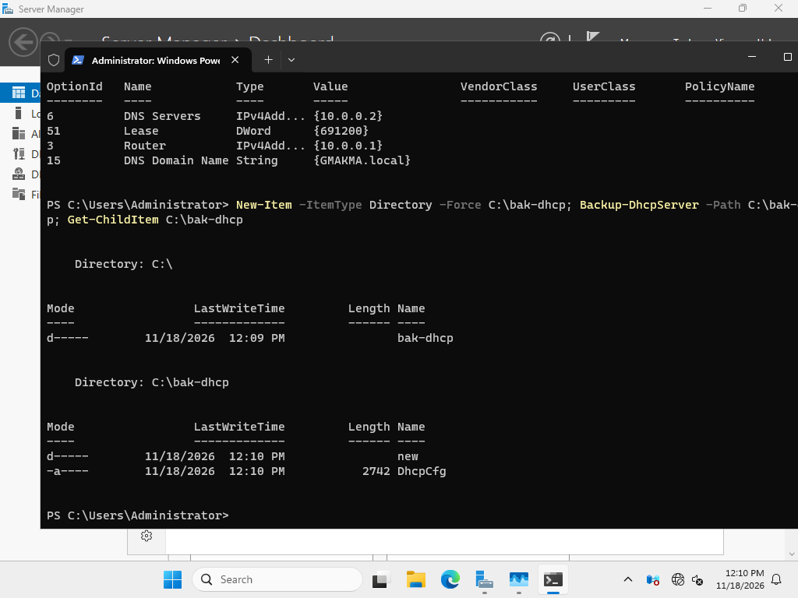

Рисунок 1: Копия DHCP до изменения области

Действующую область расширили до 10.0.0.100-10.0.0.200, срок аренды изменили на один час. Исключены 10.0.0.195-10.0.0.200, для 00-01-02-03-04-05 зарезервирован адрес 10.0.0.199

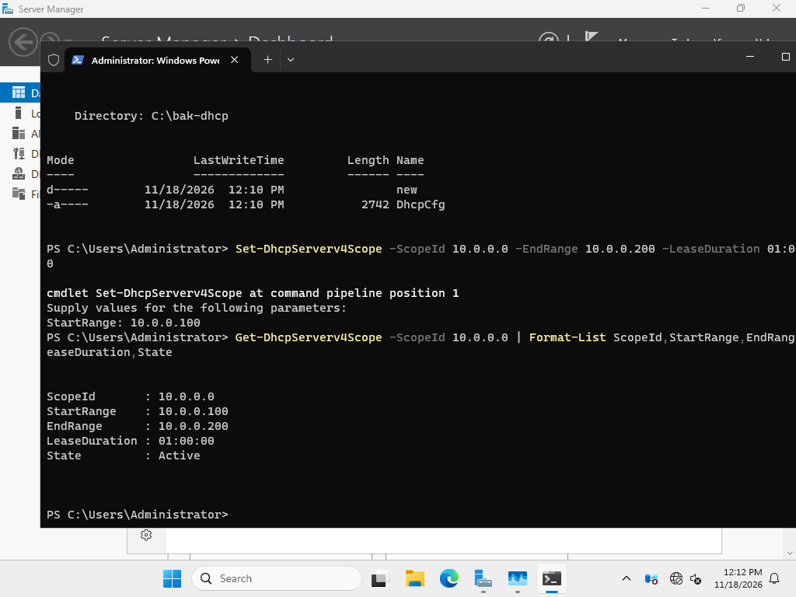

Рисунок 2: Параметры области после изменения

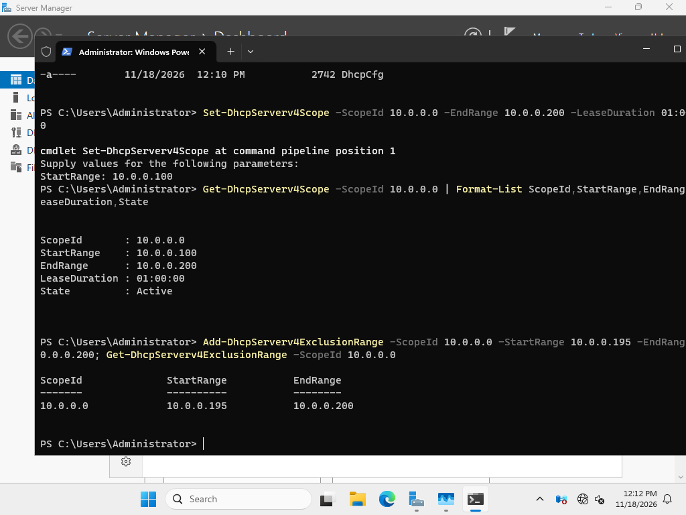

Рисунок 3: Исключённый диапазон

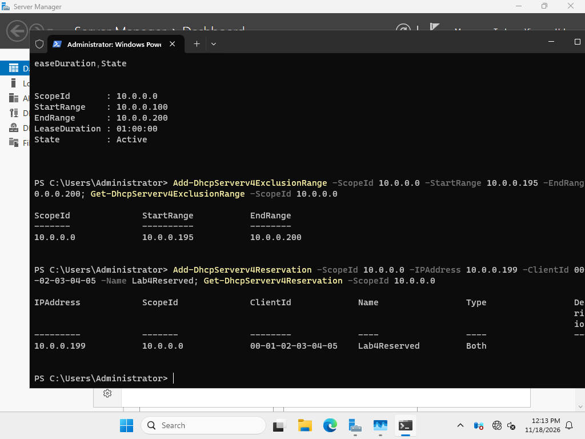

Рисунок 4: Созданное резервирование

В условии есть расхождение: сто адресов от 10.0.0.100 включительно заканчиваются на 10.0.0.199, а заданное исключение доходит до 10.0.0.200. Диапазон до .200 содержит 101 адрес до исключения. После исключения динамически доступны .100-.194. Резерв .199 находится внутри исключения, его фактическую выдачу проверили на клиенте

В области заданы маршрутизатор 10.0.0.1, DNS 10.0.0.2 и суффикс GMAKMA.local. Шлюз .1 передаётся как значение DHCP, но его работа как маршрутизатора не подтверждена

Создана включённая политика Lab4Mac с условием MAC EQ aa-01-02-* и опцией маршрутизатора 10.10.10.10

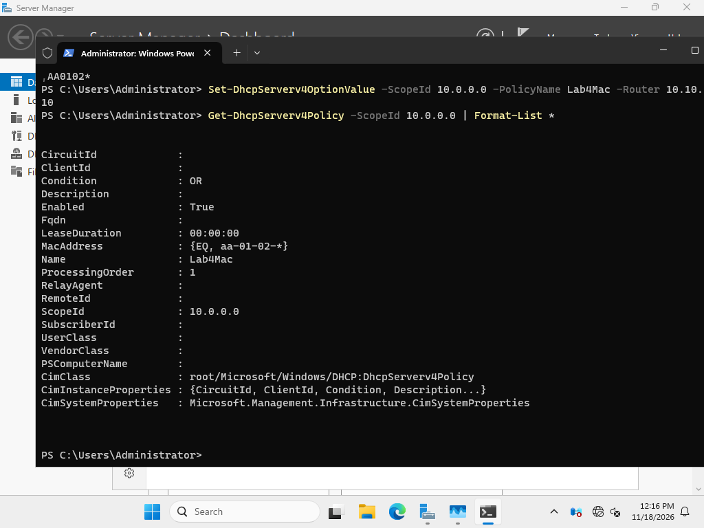

Рисунок 5: Условие политики DHCP

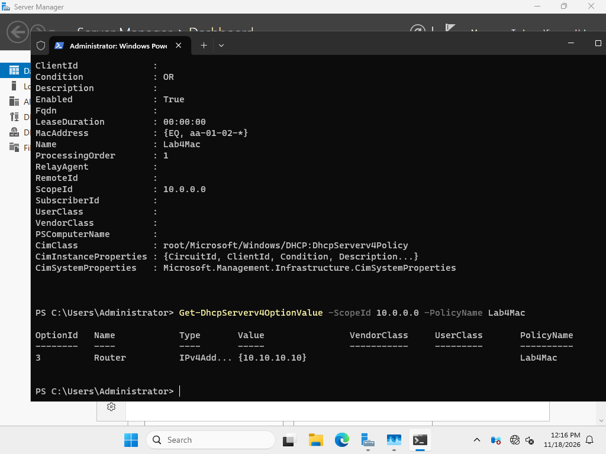

Рисунок 6: Опция маршрутизатора политики

Дамп netsh сохранён на сервере в C:\bak-dhcp\lab4-dump.txt. На рисунке видна секция добавления области. Файл извлечён и сверён по SHA-256 с источником. Ниже приведён вручную отобранный фрагмент без секрета, а не полный дамп. Он создан до настройки Failover и не содержит команд создания Failover и политики, поэтому не подтверждает окончательную конфигурацию

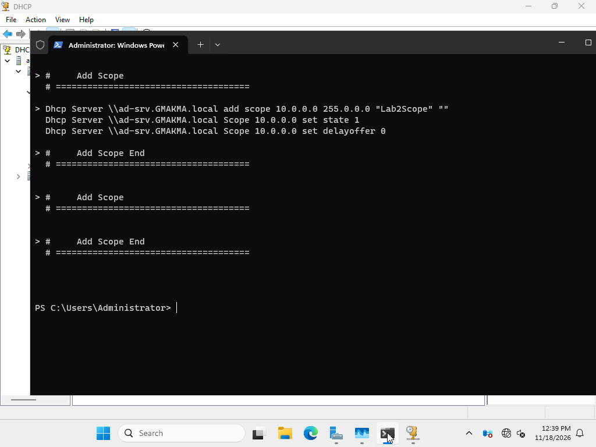

Рисунок 7: Секция области в дампе netsh

Ниже приведены только команды создания и включения области, диапазона, исключения и резервирования. Команды показаны как данные, не выполнялись при подготовке отчёта

```text
Dhcp Server \\ad-srv.GMAKMA.local add scope 10.0.0.0 255.0.0.0 "Lab2Scope" ""
Dhcp Server \\ad-srv.GMAKMA.local Scope 10.0.0.0 set state 1
Dhcp Server \\ad-srv.GMAKMA.local Scope 10.0.0.0 set delayoffer 0
Dhcp Server \\ad-srv.GMAKMA.local Scope 10.0.0.0 Add iprange 10.0.0.100 10.0.0.200
Dhcp Server \\ad-srv.GMAKMA.local Scope 10.0.0.0 add excluderange 10.0.0.195 10.0.0.200
Dhcp Server \\ad-srv.GMAKMA.local Scope 10.0.0.0 Add reservedip 10.0.0.199 000102030405 "Lab4Reserved" "" ""
```

После настройки создана отдельная копия DHCP в C:\bak-dhcp-lab4-final. На сервере видны new и DhcpCfg, исходная копия не перезаписана. Восстановление обеих копий не проверялось

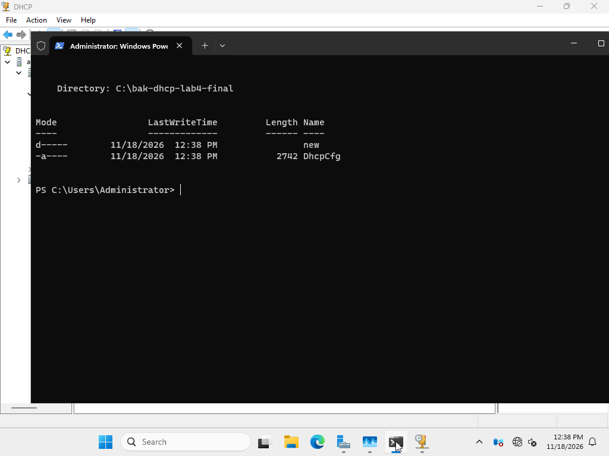

Рисунок 8: Финальная копия DHCP

## 3. Работа клиента DHCP

В сохранённом выводе ipconfig после смены MAC и запроса адреса видны следующие значения. Время указано по часам гостевой ОС

```text
Physical Address. . . . . . . . . : 00-01-02-03-04-05
IPv4 Address. . . . . . . . . . . : 10.0.0.199(Preferred)
Lease Obtained. . . . . . . . . . : 18 November 2026 20:18:53
Lease Expires . . . . . . . . . . : 18 November 2026 21:19:06
Default Gateway . . . . . . . . . : 10.0.0.1
DHCP Server . . . . . . . . . . . : 10.0.0.1
DNS Servers . . . . . . . . . . . : 10.0.0.2
```

```text
Physical Address. . . . . . . . . : AA-01-02-03-04-05
IPv4 Address. . . . . . . . . . . : 10.0.0.100(Preferred)
Lease Obtained. . . . . . . . . . : 18 November 2026 20:19:13
Lease Expires . . . . . . . . . . : 18 November 2026 21:19:27
Default Gateway . . . . . . . . . : 10.10.10.10
DHCP Server . . . . . . . . . . . : 10.0.0.1
DNS Servers . . . . . . . . . . . : 10.0.0.2
```

Первый адрес соответствует резервированию, второй получен из динамического диапазона и сопровождается шлюзом политики. Сценарий проверки завершился с ошибкой сброса свойства MAC, после чего исходный MAC BC-24-11-53-4F-29 восстановлен отдельным действием. Повторная проверка показала адрес 10.0.0.100, DHCP, шлюз 10.0.0.1, DNS 10.0.0.2 и работоспособный доверительный канал

В консоли сохранены статистика IPv4 и список аренд. В списке также есть .101 с другим именем клиента, но это не доказывает его текущее подключение. Резерв .199 на снимке показан как неактивный, ранее его выдача подтверждена клиентским выводом

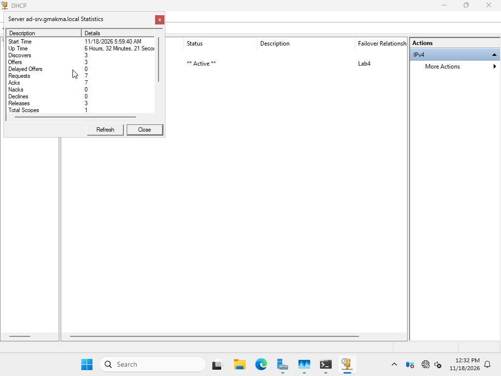

Рисунок 9: Статистика IPv4

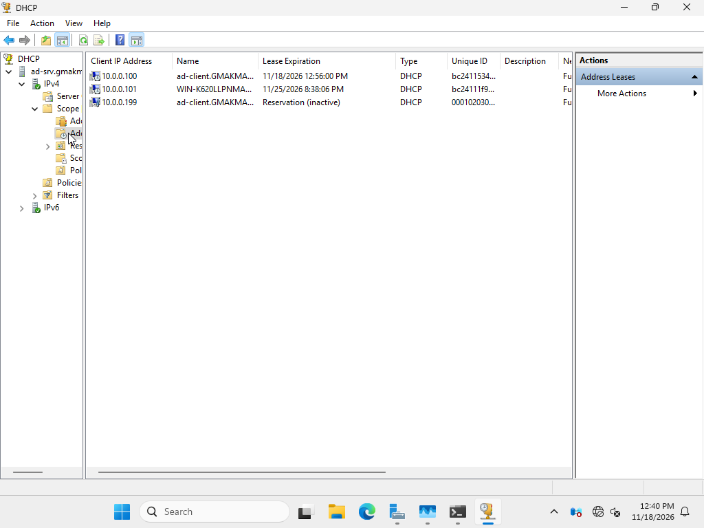

Рисунок 10: Список аренд

Текущий read-only ipconfig подтвердил исходный MAC, отсутствие override, адрес 10.0.0.100, DHCP-сервер 10.0.0.1 и DNS 10.0.0.2. Значение шлюза не подтверждает работающую маршрутизацию. Исходный вывод ipconfig до проверки двух MAC отдельно в отчёт не включён

## 4. Отказоустойчивый DHCP

На s2 установлены DHCP и средства управления, сервер авторизован в AD. Отношение Lab4 настроено в режиме Hot Standby, s2 назначен Standby. После репликации на s2 перечитаны область, исключение, резервирование и опции

```text
Mode                : HotStandby
ServerRole          : Standby
ReservePercent      : 35
MaxClientLeadTime   : 00:30:00
AutoStateTransition : True
StateSwitchInterval : 00:01:00
State               : Normal
```

При отключённом сетевом интерфейсе s1 на s2 наблюдалось состояние CommunicationInterrupted. Клиент повторно получил адрес от s2, выдержка из ipconfig:

```text
Physical Address. . . . . . . . . : BC-24-11-53-4F-29
IPv4 Address. . . . . . . . . . . : 10.0.0.100(Preferred)
Lease Obtained. . . . . . . . . . : 18 November 2026 20:26:01
Lease Expires . . . . . . . . . . : 18 November 2026 20:56:01
Default Gateway . . . . . . . . . : 10.0.0.1
DHCP Server . . . . . . . . . . . : 10.0.0.2
DNS Servers . . . . . . . . . . . : 10.0.0.2
```

Таким образом, резервный сервер действительно выдал адрес с арендой 30 минут. Переход в PartnerDown не наблюдался, поэтому его нельзя считать проверенным. Переданный клиенту шлюз 10.0.0.1 при отключённом s1 был недоступен

Сетевой интерфейс s1 восстановлен и перечитан, отношения вернулись в Normal. После восстановления проверены службы DNS, NTDS, DHCP, DNS SRV, доверительный канал клиента и TCP 445 к s1. На s1 получен снимок отношения после восстановления. GUI s2 был заблокирован экраном входа, поэтому снимок на s2 во время разрыва и визуальная проверка репликации отсутствуют

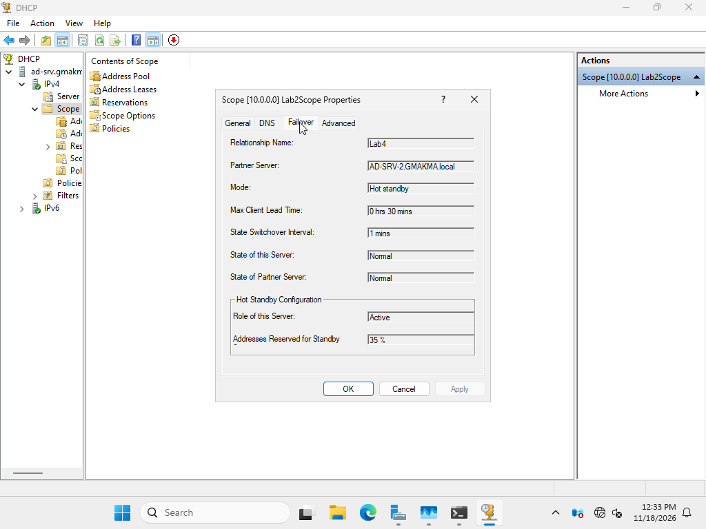

Рисунок 11: Отношение Failover на s1 после восстановления

Дополнительно с s1 выполнены запросы PowerShell к s2 после восстановления связи. На первом снимке видны Normal, Standby, резерв 35%, MCLT 30 минут и интервал переключения одна минута. На втором видны реплицированные область, исключение и резервирование. Это не GUI s2 и не снимки во время разрыва

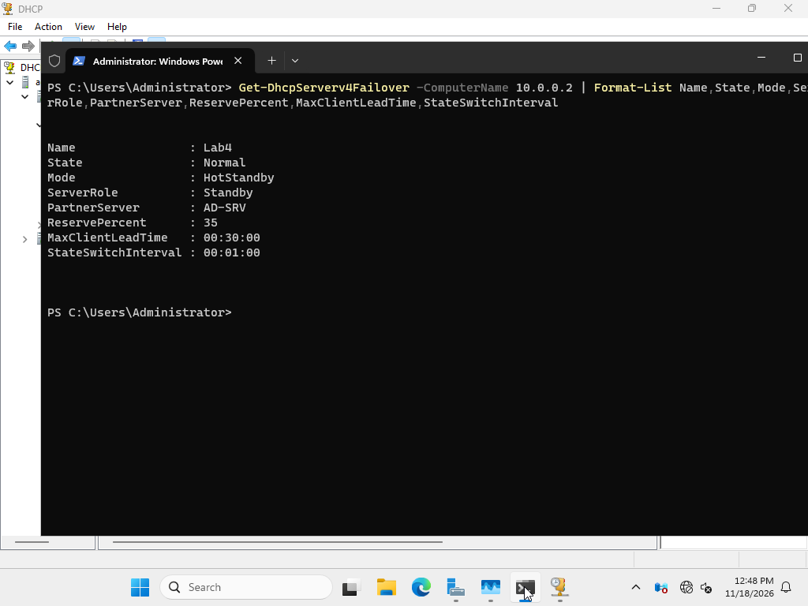

Рисунок 12: Удалённый запрос состояния Failover на s2

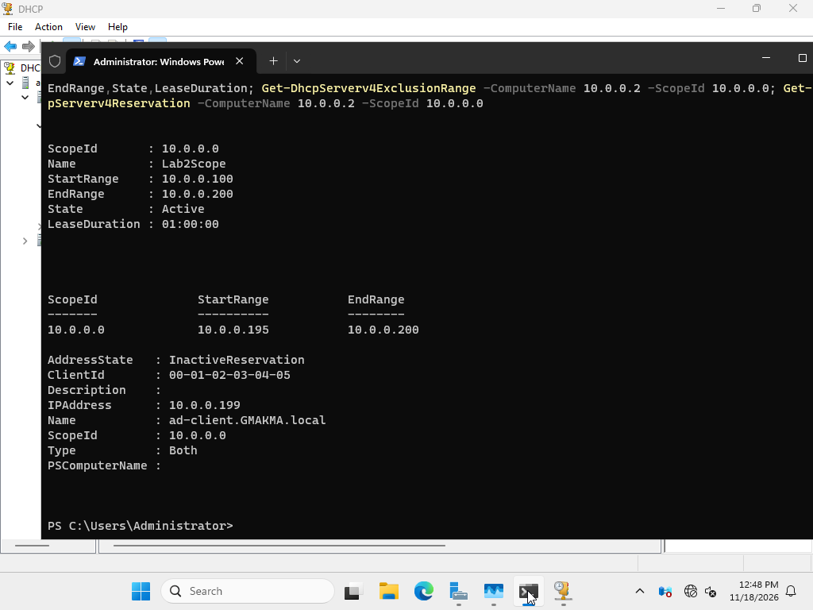

Рисунок 13: Удалённый запрос реплицированной области на s2

## 5. Автоматизация управления DHCP

Созданы сценарий lab4-configure.ps1 и отдельный файл параметров lab4-parameters.json. По умолчанию сценарий проверяет часть параметров и выводит план без сетевых операций. При -Apply он проверяет имя основного сервера, права, адрес и отсутствие областей на обоих серверах, затем запрашивает общий секрет интерактивно. В файле параметров секрета нет

На VM109 проверены синтаксический разбор, сухой запуск и отказ -Apply на неверном primary. Результат сохранён без усечения, код завершения 0

```text
Parser errors: 0
=== dry run ===
PLAN primary=AD-SRV.GMAKMA.local partner=AD-SRV-2.GMAKMA.local scope=10.0.0.0 range=10.0.0.100-10.0.0.200
PLAN install DHCP and tools on both; authorize both; create scope, options, exclusion, reservation, policy; create hot standby relationship.
DRY RUN ONLY: no changes made, no remote operations, no full provisioning tested.
=== apply guard ===
PASS: wrong-primary guard stopped before changes
```

В выводе выше опущены две повторные строки PLAN перед PASS. Реальная установка и настройка этим сценарием не выполнялись, работоспособность полного развёртывания на чистом стенде не доказана. Транзакционного отката нет, ошибка может оставить частичную конфигурацию. Не запускать -Apply на текущем стенде. Для полного теста нужен отдельно согласованный чистый стенд с проверенной изоляцией

Сценарий следует запускать от имени администратора домена на основном сервере только в проверенном изолированном стенде. При наличии областей DHCP изменение конфигурации не допускается без отдельной проверки

Листинг сценария приведён последовательно по частям без служебных комментариев

Часть 1

```powershell
[CmdletBinding()]
param(
  [Parameter(Mandatory=$true)][string]$ConfigPath,
  [switch]$Apply
)
Set-StrictMode -Version Latest
$ErrorActionPreference = 'Stop'
$c = Get-Content -LiteralPath $ConfigPath -Raw | ConvertFrom-Json
$required = 'Primary','Partner','PrimaryIP','PartnerIP','ScopeName',
  'ScopeId','StartRange','EndRange','SubnetMask','ExclusionStart',
  'ExclusionEnd','ReservationIP','ReservationMac','LeaseHours','Router',
  'DnsServer','DnsDomain','PolicyName','PolicyMacPattern','PolicyRouter',
  'Relationship','ReservePercent','McltMinutes','SwitchMinutes'
foreach ($name in $required) {
```

Часть 2

```powershell
  if (-not $c.PSObject.Properties[$name] -or [string]::IsNullOrWhiteSpace([string]$c.$name)) { throw "Missing parameter: $name" }
}
foreach ($name in 'PrimaryIP','PartnerIP','ScopeId','StartRange',
  'EndRange','SubnetMask','ExclusionStart','ExclusionEnd',
  'ReservationIP','Router','DnsServer','PolicyRouter') {
  $ip = $null
  if (-not [System.Net.IPAddress]::TryParse([string]$c.$name,[ref]$ip) -or $ip.AddressFamily -ne [System.Net.Sockets.AddressFamily]::InterNetwork) { throw "Invalid IPv4: $name" }
}
if ($c.ReservePercent -lt 1 -or $c.ReservePercent -gt 99 -or $c.LeaseHours -le 0 -or $c.McltMinutes -le 0 -or $c.SwitchMinutes -le 0) { throw 'Invalid time or standby percentage' }
if ($c.ReservationMac -notmatch '^([0-9A-Fa-f]{2}-){5}[0-9A-Fa-f]{2}$') { throw 'Invalid reservation MAC' }
Write-Output "PLAN primary=$($c.Primary) partner=$($c.Partner) scope=$($c.ScopeId) range=$($c.StartRange)-$($c.EndRange)"
Write-Output 'PLAN install DHCP and tools on both; authorize both; create scope, options, exclusion, reservation, policy; create hot standby relationship.'
if (-not $Apply) {
  Write-Output 'DRY RUN ONLY: no changes made, no remote operations, no full provisioning tested.';
  return
}
if ($env:COMPUTERNAME -ine ($c.Primary -split '\.')[0]) { throw 'Apply must run locally on the named primary.' }
```

<p style="break-after: avoid; page-break-after: avoid">Часть 3</p>

```powershell
$principal = New-Object Security.Principal.WindowsPrincipal([Security.Principal.WindowsIdentity]::GetCurrent())
if (-not $principal.IsInRole([Security.Principal.WindowsBuiltInRole]::Administrator)) { throw 'An elevated administrator session is required.' }
if (-not (Get-NetIPAddress -AddressFamily IPv4 | Where-Object IPAddress -eq $c.PrimaryIP)) { throw 'Primary IPv4 does not match configuration.' }
foreach ($server in @($c.Primary,$c.Partner)) {
  $state = Invoke-Command -ComputerName $server -ScriptBlock {
    $feature = Get-WindowsFeature DHCP
    if ($feature.Installed) { @(Get-DhcpServerv4Scope -ErrorAction Stop).Count } else { 0 }
  }
  if ([int]$state -ne 0) {
    throw "Existing DHCP scope on $server; refusing to modify it."
  }
}
```

Часть 4

```powershell
$secureSecret = Read-Host 'Enter lab failover shared secret' -AsSecureString
if ($secureSecret.Length -eq 0) { throw 'Empty failover secret is not allowed.' }
foreach ($server in @($c.Primary,$c.Partner)) {
  Invoke-Command -ComputerName $server -ScriptBlock { Install-WindowsFeature DHCP -IncludeManagementTools | Out-Null }
}
Import-Module DhcpServer
foreach ($pair in @(@($c.Primary,$c.PrimaryIP),@($c.Partner,$c.PartnerIP))) {
  $existing = @(Get-DhcpServerInDC | Where-Object { $_.DnsName -ieq $pair[0] -or $_.IPAddress.IPAddressToString -eq $pair[1] })
  if (-not $existing) { Add-DhcpServerInDC -DnsName $pair[0] -IPAddress $pair[1] }
}
Add-DhcpServerv4Scope -Name $c.ScopeName -StartRange $c.StartRange -EndRange $c.EndRange -SubnetMask $c.SubnetMask -LeaseDuration ([timespan]::FromHours($c.LeaseHours)) -State Active
Add-DhcpServerv4ExclusionRange -ScopeId $c.ScopeId -StartRange $c.ExclusionStart -EndRange $c.ExclusionEnd
```

Часть 5

```powershell
Add-DhcpServerv4Reservation -ScopeId $c.ScopeId -IPAddress $c.ReservationIP -ClientId $c.ReservationMac -Name 'Lab4Reservation'
Set-DhcpServerv4OptionValue -ScopeId $c.ScopeId -Router $c.Router -DnsServer $c.DnsServer -DnsDomain $c.DnsDomain
Add-DhcpServerv4Policy -Name $c.PolicyName -ScopeId $c.ScopeId -Condition OR -MacAddress "EQ,$($c.PolicyMacPattern)"
Set-DhcpServerv4OptionValue -ScopeId $c.ScopeId -PolicyName $c.PolicyName -Router $c.PolicyRouter
$ptr = [IntPtr]::Zero
try {
  $ptr = [Runtime.InteropServices.Marshal]::SecureStringToBSTR($secureSecret)
  $plainSecret = [Runtime.InteropServices.Marshal]::PtrToStringBSTR($ptr)
  Add-DhcpServerv4Failover -Name $c.Relationship -ScopeId $c.ScopeId -PartnerServer $c.Partner -ServerRole Active -ReservePercent $c.ReservePercent -MaxClientLeadTime ([timespan]::FromMinutes($c.McltMinutes)) -AutoStateTransition $true -StateSwitchInterval ([timespan]::FromMinutes($c.SwitchMinutes)) -SharedSecret $plainSecret -Force
} finally {
  $plainSecret = $null
  if ($ptr -ne [IntPtr]::Zero) { [Runtime.InteropServices.Marshal]::ZeroFreeBSTR($ptr) }
```

Часть 6

```powershell
  $secureSecret.Dispose()
}
Write-Output 'Provisioning commands completed; independently verify replication, leases and service health.'
```

Листинг файла параметров

```json
{
  "Primary": "AD-SRV.GMAKMA.local",
  "Partner": "AD-SRV-2.GMAKMA.local",
  "PrimaryIP": "10.0.0.1",
  "PartnerIP": "10.0.0.2",
  "ScopeName": "Lab2Scope",
  "ScopeId": "10.0.0.0",
  "StartRange": "10.0.0.100",
  "EndRange": "10.0.0.200",
  "SubnetMask": "255.0.0.0",
  "ExclusionStart": "10.0.0.195",
  "ExclusionEnd": "10.0.0.200",
  "ReservationIP": "10.0.0.199",
  "ReservationMac": "00-01-02-03-04-05",
  "LeaseHours": 1,
  "Router": "10.0.0.1",
  "DnsServer": "10.0.0.2",
  "DnsDomain": "GMAKMA.local",
  "PolicyName": "Lab4Mac",
  "PolicyMacPattern": "AA-01-02-*",
  "PolicyRouter": "10.10.10.10",
  "Relationship": "Lab4",
  "ReservePercent": 35,
  "McltMinutes": 30,
  "SwitchMinutes": 1
}
```

Команда экспорта конфигурации в файл, приведённая как пример, а не результат исполнения:

```powershell
Export-DhcpServer -ComputerName AD-SRV -File C:\bak-dhcp\dhcp-export.xml -Leases -Force
```

Экспорт этой командой и последующий импорт не проверялись

## 6. Ответы на вопросы

### 1. Область, опция, аренда и политика

Область задаёт диапазон адресов подсети и настройки выдачи. Опция передаёт дополнительный параметр, например адрес DNS. Аренда ограничивает время использования адреса клиентом. Политика позволяет выбирать параметры по условиям, например по префиксу MAC, как Lab4Mac в этой работе

### 2. Компоненты роли DHCP

Роль включает службу DHCP Server, а предлагаемые средства управления включают консоль DHCP и модуль DHCP Server для Windows PowerShell. Конкретный состав, предложенный мастером на данном сервере, отдельным снимком не подтверждён. На s2 установка роли и средств управления подтверждена результатом установки

### 3. Опции DHCP в части 2

Использованы опция 003 Router со значением 10.0.0.1, 006 DNS Servers со значением 10.0.0.2, 015 DNS Domain Name со значением GMAKMA.local и 051 IP Address Lease Time со значением 3600 секунд. Для клиентов политики опция 003 заменена на 10.10.10.10

### 4. Режимы отказоустойчивости

В Load Balance оба сервера обычно обслуживают клиентов, распределяя запросы между собой. В Hot Standby основной сервер обслуживает клиентов, а резервный хранит выделенную ему долю адресов и помогает при недоступности партнёра. Здесь использован Hot Standby с резервом 35%

### 5. MCLT и интервал переключения

MCLT ограничивает время, на которое один партнёр может продлить аренду сверх срока, известного другому. State Switchover Interval задаёт задержку автоматического перехода из CommunicationInterrupted в PartnerDown. Если автоматический переход не настроен, сервер остаётся в CommunicationInterrupted до восстановления связи или ручного перевода в PartnerDown. В этой работе настроена минута, но сам PartnerDown не наблюдался

### 6. Архивная копия DHCP

Архив DHCP содержит базу службы и связанные настройки, необходимые для восстановления. Копия, сделанная Backup-DhcpServer, отличается от текстового дампа netsh и от XML-экспорта Export-DhcpServer. Наличие каталога копии подтверждено, пригодность для восстановления в работе не проверена

### 7. Переименование узла PowerShell

Для переименования локального узла можно использовать команду ниже с правами администратора. Новое имя вступает в силу после перезагрузки. Это пример, в рамках ЛР4 команда не выполнялась

```powershell
Rename-Computer -NewName "NEW-NAME" -Restart
```

## 7. Границы проверки

На vmbr1_lab не настроены физические bridge_ports, к мосту подключены три машины стенда. Это не доказывает отсутствие других виртуальных клиентов или маршрутизации. Дополнительная аренда .101 не позволяет считать состав сети исключительным. VM106 не исследовалась и не изменялась

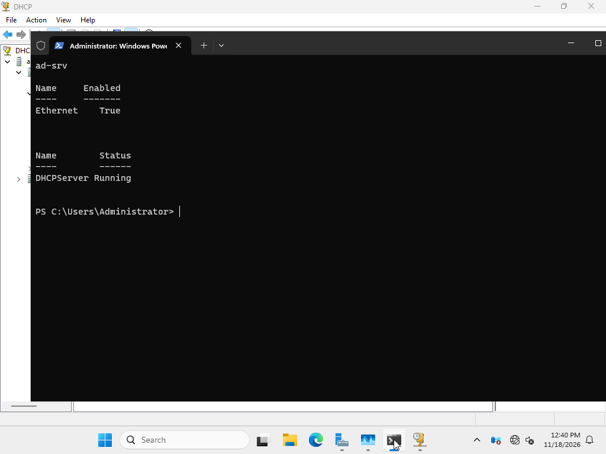

Рисунок 14: IPv6 binding на s1

Гостевой агент s1 при повторном чтении файла вернул timeout, хотя GUI оставался доступен. Данные по IPv6 на s1 получены через GUI, на s2 и клиенте - из сохранённой инвентаризации

## Вывод

Настроены область DHCP, исключение, резервирование и политика по MAC. Клиент получил зарезервированный адрес и отдельный шлюз политики. Настроен Hot Standby, при разрыве связи клиент получил адрес от резервного сервера, затем связь восстановлена. Полное выполнение задания не подтверждено: PartnerDown не наблюдался, GUI s2 при отказе не зафиксирован, полная проверка сценария и восстановление копий не проводились. Полный дамп хранится отдельно и не включён в отчёт, изоляция не доказана, IPv6 остался включён
