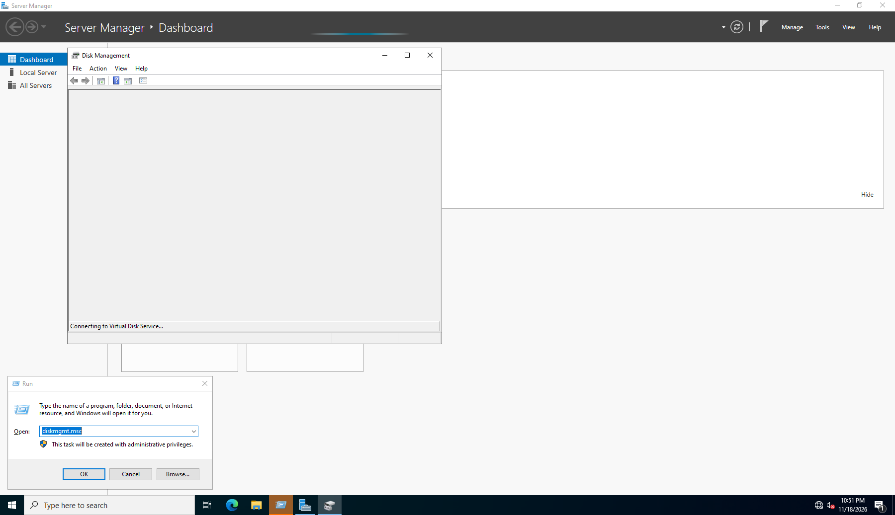
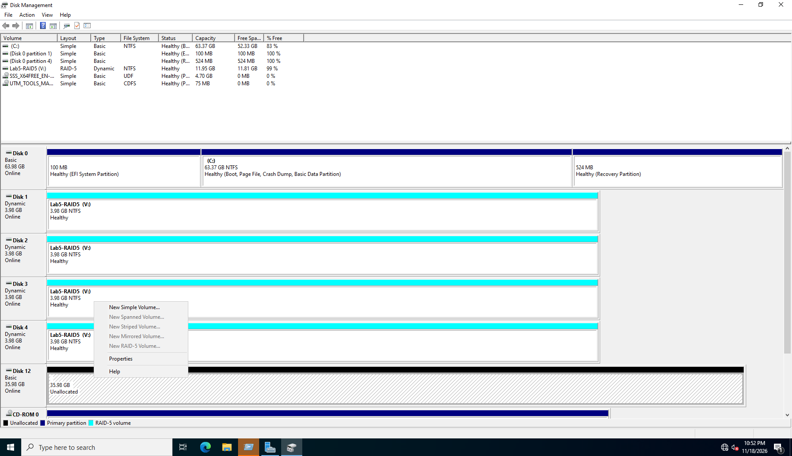
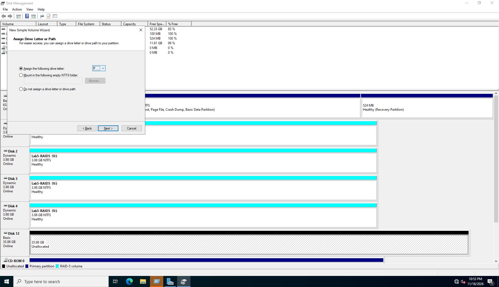
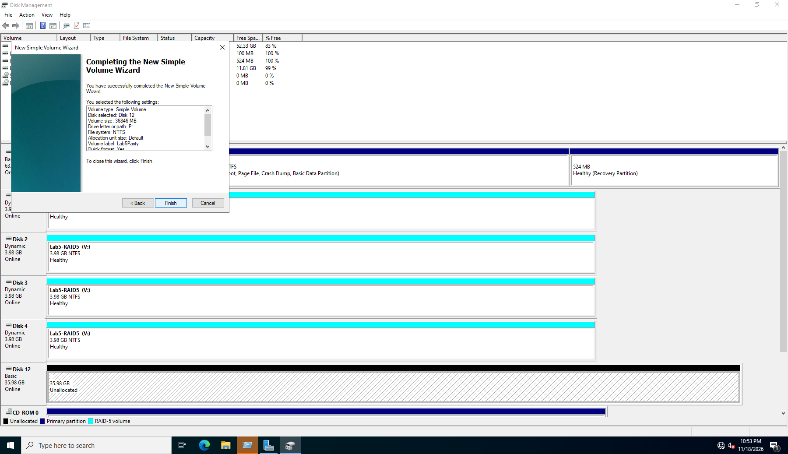
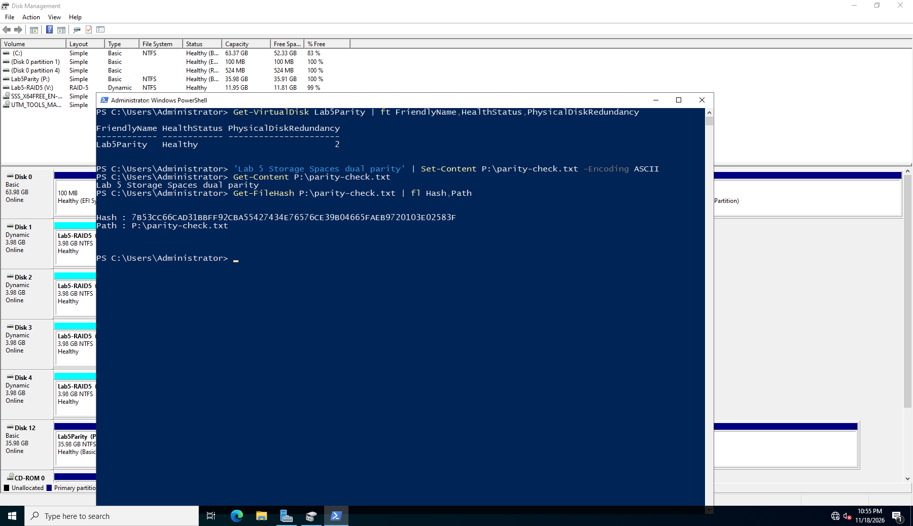
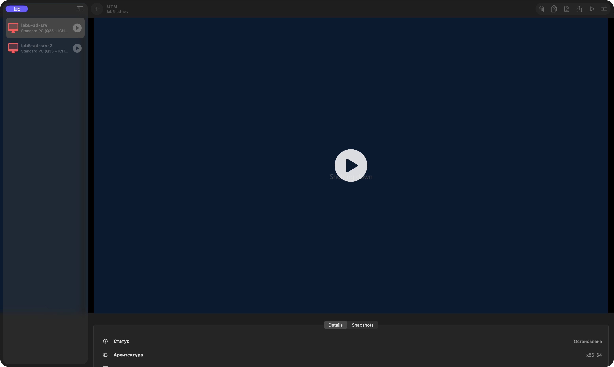
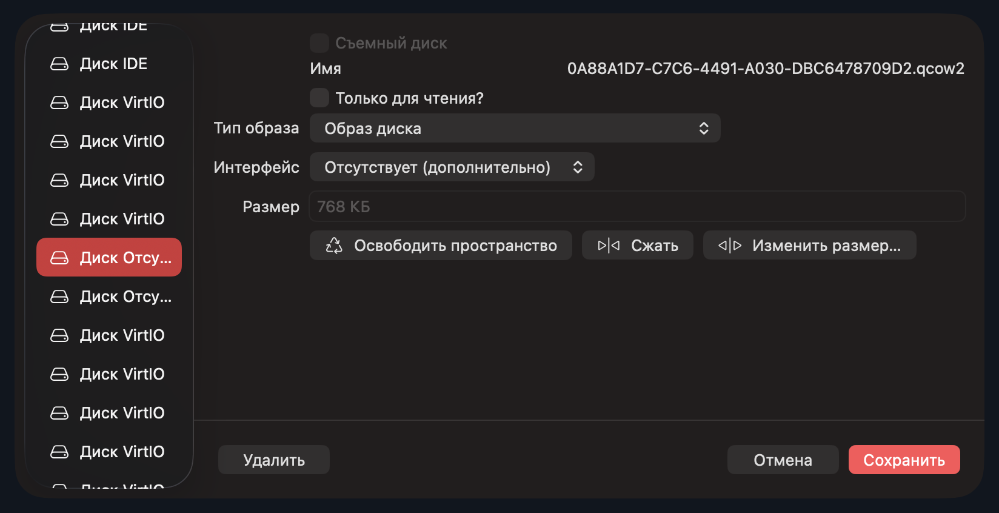
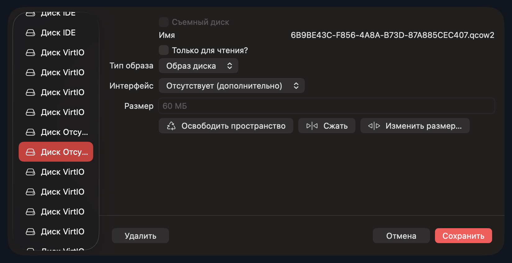
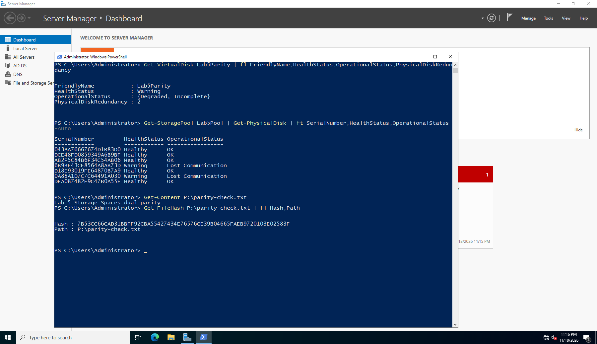
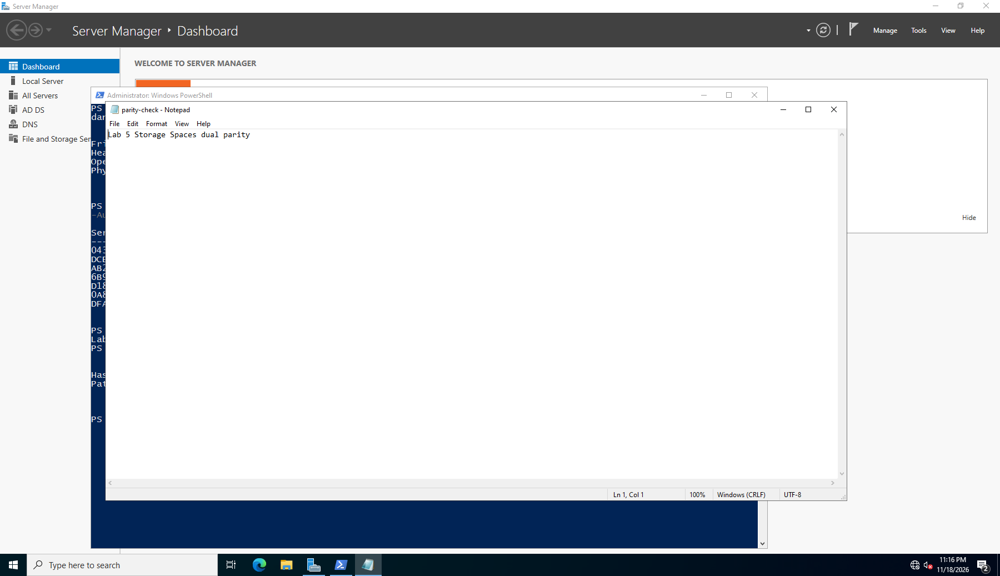

# ЛР5. Проверяем Storage Spaces после отключения двух дисков

В опыте участвует `Lab5Parity` на `ad-srv`. Он создан в пуле `Lab5Pool` из семи дисков по 10 ГиБ с `PhysicalDiskRedundancy = 2`. Проверяем, что после отключения двух дисков за один запуск файл на томе `P:` читается с прежним содержимым и SHA-256

## 1. Находим виртуальный диск

На `ad-srv` открываем Windows PowerShell от имени администратора и смотрим, какой номер Windows назначила виртуальному диску `Lab5Parity`

```powershell
$parity = Get-VirtualDisk -FriendlyName Lab5Parity
$parity | Format-List FriendlyName,HealthStatus,PhysicalDiskRedundancy,Size
$parity | Get-Disk | Format-Table Number,PartitionStyle,IsOffline,Size
```

В нашем запуске это **Disk 12**, 36 ГиБ, `RAW` и `Offline`. Номер проверяем перед каждым опытом. Если уже есть том `Lab5Parity (P:)` с NTFS, переходим к шагу 4

Нажимаем **Win+R**, вводим `diskmgmt.msc` и нажимаем **OK**



## 2. Включаем и инициализируем диск

1. Правой кнопкой по серой карточке **Disk 12** в нижней панели -> **Online**
2. Правой кнопкой по той же карточке -> **Initialize Disk**
3. Проверяем, что отмечен только нужный диск, выбираем **GPT (GUID Partition Table)** -> **OK**


## 3. Создаём том P:

Правой кнопкой по области с чёрной полосой **Unallocated** у Disk 12 -> **New Simple Volume**



В мастере нажимаем **Next**, оставляем максимальный размер, выбираем свободную букву **P**, затем **NTFS**, метку **Lab5Parity** и **Perform a quick format**. Проверяем сводку и нажимаем **Finish**







## 4. Записываем файл и запоминаем SHA-256

В PowerShell создаём файл, читаем его и записываем контрольную сумму для сравнения после перезапуска

```powershell
'Lab 5 Storage Spaces dual parity' | Set-Content P:\parity-check.txt -Encoding ASCII
Get-Content P:\parity-check.txt
Get-FileHash P:\parity-check.txt | Format-List Hash,Path
```



## 5. Сверяем диски пула и выключаем ВМ

В PowerShell выводим состав пула. У каждого из его семи дисков свой `SerialNumber`. По нему находим соответствующий образ в UTM

```powershell
Get-StoragePool Lab5Pool | Get-PhysicalDisk |
    Format-Table SerialNumber,Size,HealthStatus,OperationalStatus
```

В этом опыте выбрали эти два диска:

| Серийный номер в Windows | Имя образа в UTM |
|---|---|
| `0A88A1D7C7C64491A030` | `0A88A1D7-C7C6-4491-A030-DBC6478709D2.qcow2` |
| `6B9BE43CF8564A8AB73D` | `6B9BE43C-F856-4A8A-B73D-87A885CEC407.qcow2` |

Штатно выключаем сначала `ad-srv-2`, затем `ad-srv`. В Windows можно выбрать **Пуск -> Питание -> Завершение работы** или выполнить `Stop-Computer` в PowerShell. Ждём, пока UTM покажет **Остановлена**

Для повторения на своём стенде после выключения сохрани копию пакета `lab5-ad-srv.utm` в Finder. В нашем запуске тестировали на APFS-копиях образов, а исходные образы и конфигурацию сохранили для возврата стенда

## 6. Отключаем оба диска в UTM

1. В главном окне UTM выбираем `lab5-ad-srv` -> **Изменить** (значок ползунков справа сверху). Если открыта консоль, библиотека доступна в меню **Окно -> UTM Library**
2. В левой панели **Диски** открываем нужный **Диск VirtIO**. Сверяем поле **Имя** с таблицей
3. Открываем **Интерфейс** -> **Отсутствует (дополнительно)**. Образ остаётся в пакете ВМ
4. Выбираем второй диск, сверяем имя и ставим тот же интерфейс. Нажимаем **Сохранить** после обоих изменений
5. Запускаем `lab5-ad-srv` кнопкой с треугольником и входим в Windows

В этом стенде выбранные диски были пятым и шестым VirtIO в списке. Поле **Размер** в UTM может показывать текущий размер файла образа на Mac. Для выбора дисков используй поле **Имя**







## 7. Проверяем, что файл читается

Когда Windows загрузится, открываем PowerShell от имени администратора. Смотрим состояние виртуального диска, двух выбранных участников пула и файла

```powershell
Get-VirtualDisk Lab5Parity |
    Format-List FriendlyName,HealthStatus,OperationalStatus,PhysicalDiskRedundancy

Get-StoragePool Lab5Pool | Get-PhysicalDisk |
    Format-Table SerialNumber,HealthStatus,OperationalStatus -AutoSize

Get-Content P:\parity-check.txt
Get-FileHash P:\parity-check.txt | Format-List Hash,Path
```

У двух выбранных дисков ожидаем `Lost Communication`. У нас `Lab5Parity` показал `Warning` и `Degraded, Incomplete`. Буква `P:` сохранилась и SHA-256 файла совпала с исходной. Для наглядной проверки нажимаем **Win+R**, вводим `notepad P:\parity-check.txt` и нажимаем **OK**





## 8. Возвращаем стенд

Штатно выключаем `ad-srv`. При ручном повторе можно вернуть обоим образам **Интерфейс -> VirtIO** и сохранить. После запуска проверяем, что связь с обоими дисками восстановилась, том читается, а `Lab5Parity` вернулся в `Healthy`. Если Windows начала восстановление, ждём его завершения и повторяем проверку

В выполненном опыте мы после выключения вернули сохранённые образы и конфигурацию целиком. После запуска проверили, что все семь дисков пула снова в `OK`, `Lab5Parity` в `Healthy`, а `P:\parity-check.txt` читается с той же SHA-256. Затем запустили `ad-srv-2` и проверили iSCSI и чтение с `R:`

## Запись в OBS

Для повтора открой сцену **ЛР5 • Проверка**. Источник **UTM — ЛР5** захватывает только приложение UTM, включая библиотеку, настройки и консоль Windows. Микрофон и звук источника заглушены. Запись запускается кнопкой **Начать запись** и сохраняется в папке **Фильмы** на Mac

[Короткая запись проверки в OBS](storage-spaces-check.mp4) длится 2 минуты 8 секунд. В ней есть мастер тома, исходный файл, отключение дисков и повторное чтение. Паузы и ожидание загрузки сокращены
