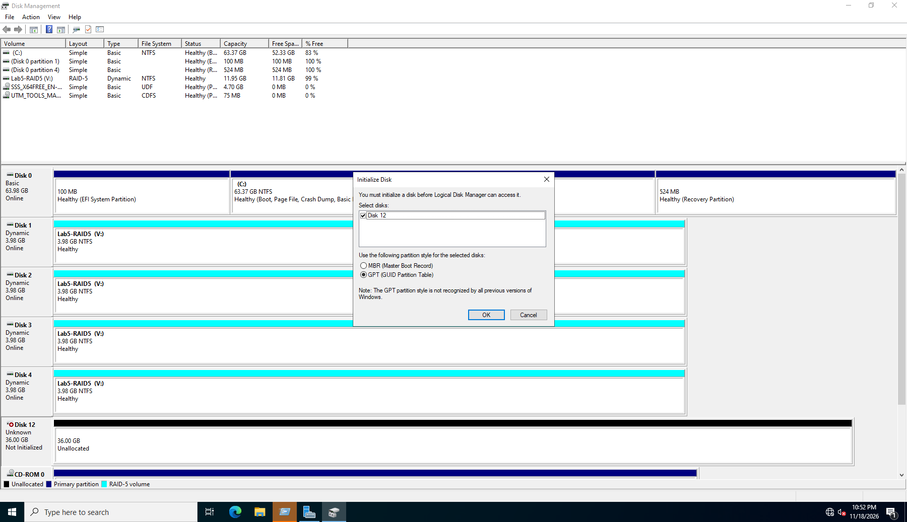
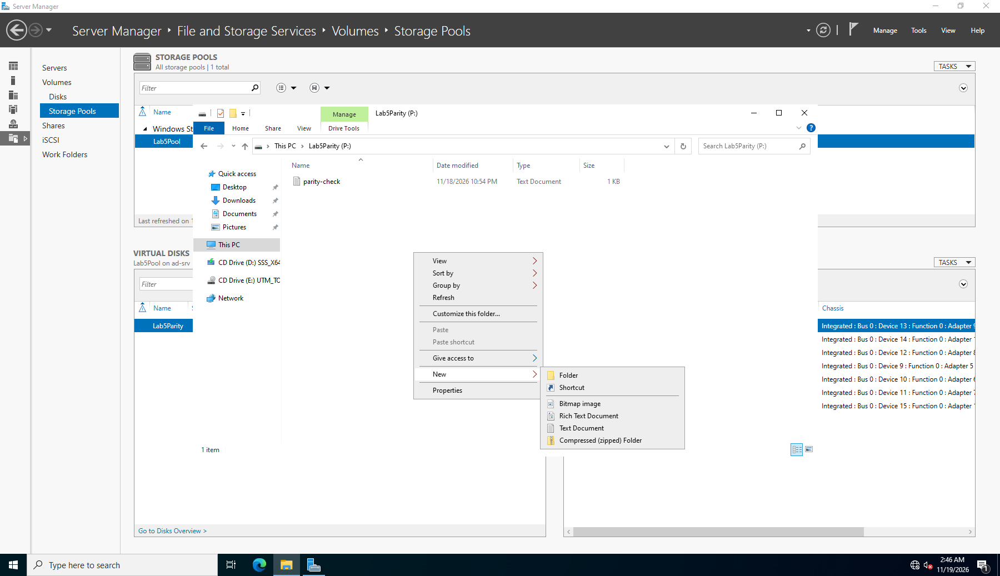
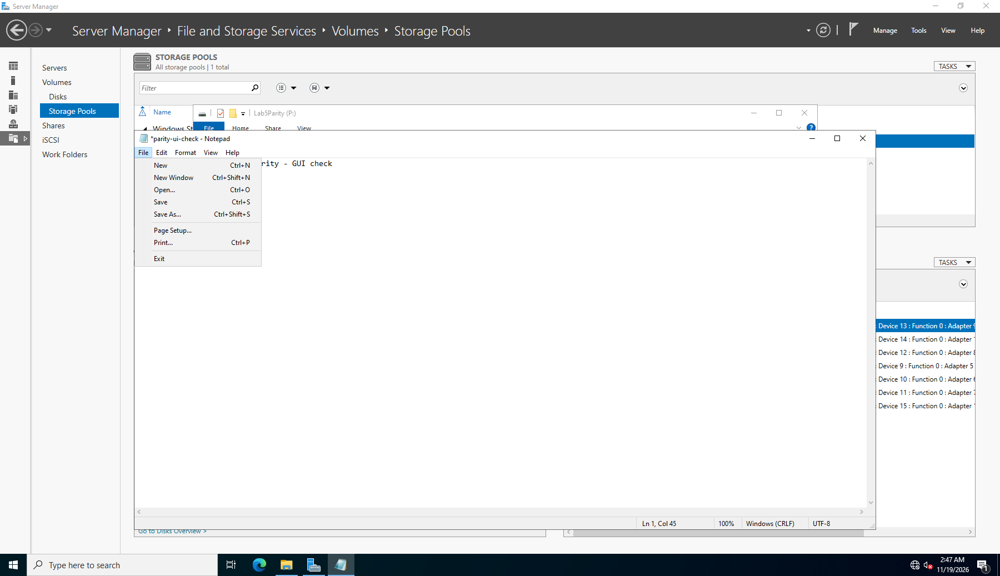
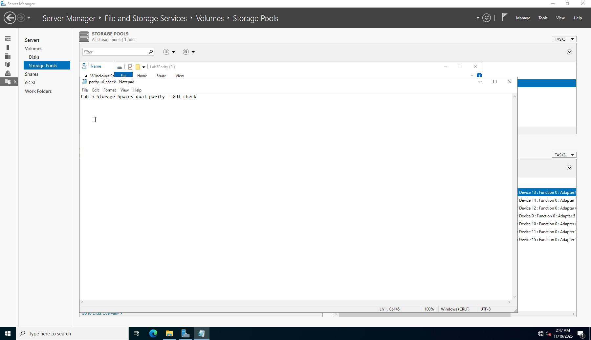
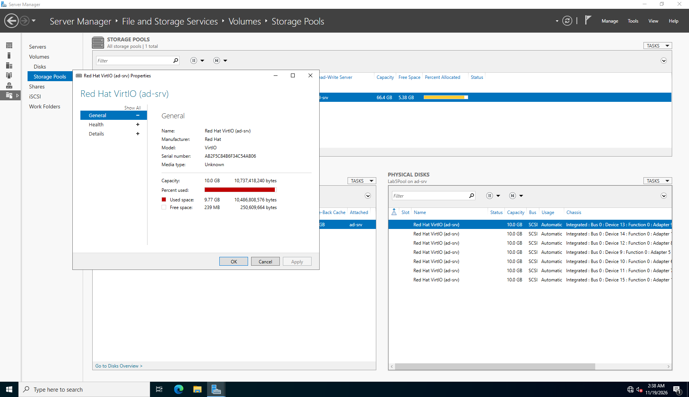
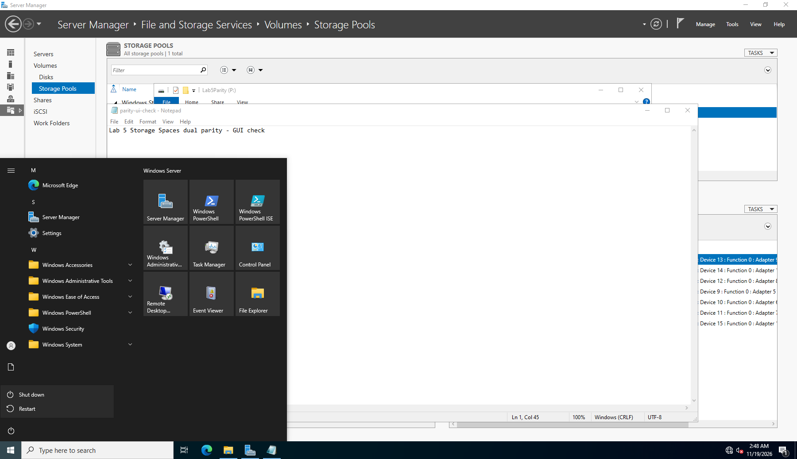
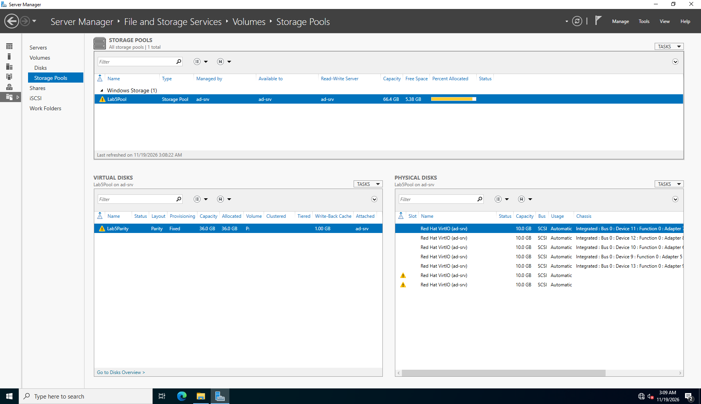
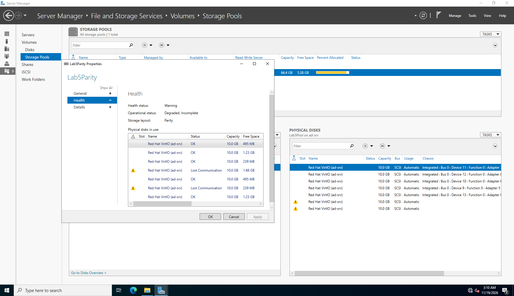

# ЛР5. Проверяем Storage Spaces после отключения двух дисков

В опыте участвует `Lab5Parity` на `ad-srv`. Он создан в пуле `Lab5Pool` из семи дисков по 10 ГиБ с `PhysicalDiskRedundancy = 2`. Проверяем, что после отключения двух дисков за один запуск файл на томе `P:` снова открывается и показывает ту же строку

## 1. Находим Lab5Parity в Server Manager

1. На `ad-srv` открываем **Server Manager -> File and Storage Services -> Storage Pools**
2. В верхней таблице выбираем **Lab5Pool**. Внизу слева, в **Virtual Disks**, виден **Lab5Parity** с **Layout** = **Parity**, **Capacity** = **36.0 GB** и **Volume** = **P:**. Справа, в **Physical Disks**, видны семь участников пула
3. Правой кнопкой по **Lab5Parity -> Properties -> Details**. В списке **Property** выбираем **PhysicalDiskRedundancy** и проверяем, что в **Value** стоит **2**
4. Чтобы показать том Windows, нажимаем правой кнопкой по **Пуск -> Disk Management**. В нижней панели находим диск, на котором показан **Lab5Parity (P:)**

На нашем стенде `P:` уже создан вместе и готов к проверке. Для показа на защите сразу переходим к шагу 4. Если повторяем с исходного неразмеченного диска, в Disk Management сверяем отдельный виртуальный диск **36.00 GB**. В нашем опыте это был **Disk 12**, отмеченный **Unknown**, **Offline**, **Unallocated**. Сверяем размер и состояние перед инициализацией, так как номер диска может измениться

## 2. Включаем и инициализируем диск

1. Правой кнопкой по серой карточке **Disk 12** в нижней панели -> **Online**
2. Правой кнопкой по той же карточке -> **Initialize Disk**
3. Проверяем, что отмечен только нужный диск, выбираем **GPT (GUID Partition Table)** -> **OK**

## 3. Создаём том P:

Правой кнопкой по области с чёрной полосой **Unallocated** у Disk 12 -> **New Simple Volume**

В мастере нажимаем **Next**, оставляем максимальный размер, выбираем свободную букву **P**, затем **NTFS**, метку **Lab5Parity** и **Perform a quick format**. Проверяем сводку и нажимаем **Finish**

## 4. Создаём файл в Проводнике и сохраняем его в Блокноте

1. Открываем **File Explorer -> This PC -> Lab5Parity (P:)**
2. Правой кнопкой по пустому месту -> **New -> Text Document**. Называем файл `parity-ui-check.txt`. Если Проводник скрывает расширения, вводим `parity-ui-check` и Windows добавит `.txt`
3. Открываем файл двойным щелчком, пишем `Lab 5 Storage Spaces dual parity - GUI check` и выбираем **File -> Save** в Блокноте

## 5. Сверяем диски пула и выключаем ВМ

В **Server Manager -> File and Storage Services -> Storage Pools** выбираем **Lab5Pool**. В нижней правой таблице **Physical Disks** нажимаем правой кнопкой по строке диска -> **Properties -> General** и смотрим **Serial number**. Для отключения на нашем стенде сверяем имена образов с таблицей ниже

В этом опыте выбрали эти два диска:

| Серийный номер в Windows | Имя образа в UTM |
|---|---|
| `0A88A1D7C7C64491A030` | `0A88A1D7-C7C6-4491-A030-DBC6478709D2.qcow2` |
| `6B9BE43CF8564A8AB73D` | `6B9BE43C-F856-4A8A-B73D-87A885CEC407.qcow2` |

Штатно выключаем сначала `ad-srv-2`, затем `ad-srv`. В Windows выбираем **Пуск -> Питание -> Завершение работы**. При запросе указываем причину и нажимаем **Continue**. Ждём, пока UTM покажет **Остановлена**

Для повторения на своём стенде после выключения сохрани копию пакета `lab5-ad-srv.utm` в Finder. В нашем запуске тестировали на APFS-копиях образов, а исходные образы и конфигурацию сохранили для возврата стенда

## 6. Отключаем оба диска в UTM

1. В главном окне UTM выбираем `lab5-ad-srv` -> **Изменить** (значок ползунков справа сверху). Если открыта консоль, библиотека доступна в меню **Окно -> UTM Library**
2. В левой панели **Диски** открываем нужный **Диск VirtIO**. Сверяем поле **Имя** с таблицей
3. Открываем **Интерфейс** -> **Отсутствует (дополнительно)**. Образ остаётся в пакете ВМ
4. Выбираем второй диск, сверяем имя и ставим тот же интерфейс. Нажимаем **Сохранить** после обоих изменений
5. Запускаем `lab5-ad-srv` кнопкой с треугольником и входим в Windows

В этом стенде выбранные диски были пятым и шестым VirtIO в списке. Поле **Размер** в UTM может показывать текущий размер файла образа на Mac. Для выбора дисков используй поле **Имя**

## 7. Показываем отказ и заново открываем файл

1. После входа в Windows снова открываем **Server Manager -> File and Storage Services -> Storage Pools -> Lab5Pool**. Обновляем список круглой стрелкой вверху
2. Правой кнопкой по **Lab5Parity -> Properties -> Health**. Смотрим **Health status**, **Operational status** и **Status** участников
3. В **File Explorer -> This PC -> Lab5Parity (P:)** заново открываем **parity-ui-check.txt**. В Блокноте видна та же строка, которую сохранили до выключения

В этом запуске **Health status** показал `Warning`, **Operational status** - `Degraded, Incomplete`, а у двух физических дисков появился `Lost Communication`

## 8. Возвращаем стенд

Штатно выключаем `ad-srv`. При ручном повторе можно вернуть обоим образам **Интерфейс -> VirtIO** и сохранить. После запуска проверяем, что связь с обоими дисками восстановилась, том читается, а `Lab5Parity` вернулся в `Healthy`. Если Windows начала восстановление, ждём его завершения и повторяем проверку

В выполненном опыте мы после выключения вернули сохранённые образы и конфигурацию целиком. После запуска проверили, что все семь дисков пула снова в `OK`, `Lab5Parity` в `Healthy`, а `P:\parity-ui-check.txt` снова открывается. Затем запустили `ad-srv-2` и проверили iSCSI и чтение с `R:`

## Запись в OBS

Для повтора открой сцену **ЛР5 • Проверка**. Источник **UTM — ЛР5** захватывает только приложение UTM, включая библиотеку, настройки и консоль Windows. Микрофон и звук источника заглушены. Запись запускается кнопкой **Начать запись** и сохраняется в папке **Фильмы** на Mac

[Видео проверки](storage-spaces-check.mp4) длится 1 минуту 7 секунд. Оно собрано из записи OBS и кадров, снятых в ходе проверки. В ней показаны свойства Lab5Parity, создание и сохранение файла, отключение двух образов в UTM и повторное открытие файла. Паузы и ожидание загрузки сокращены
