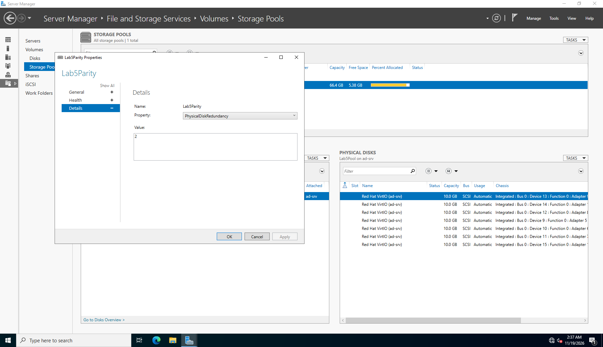
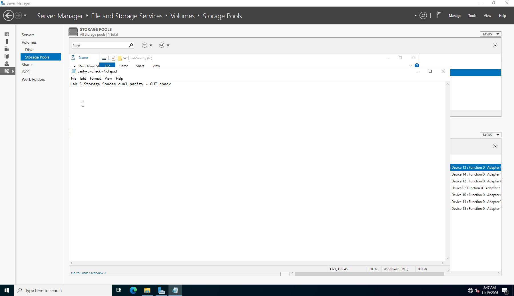
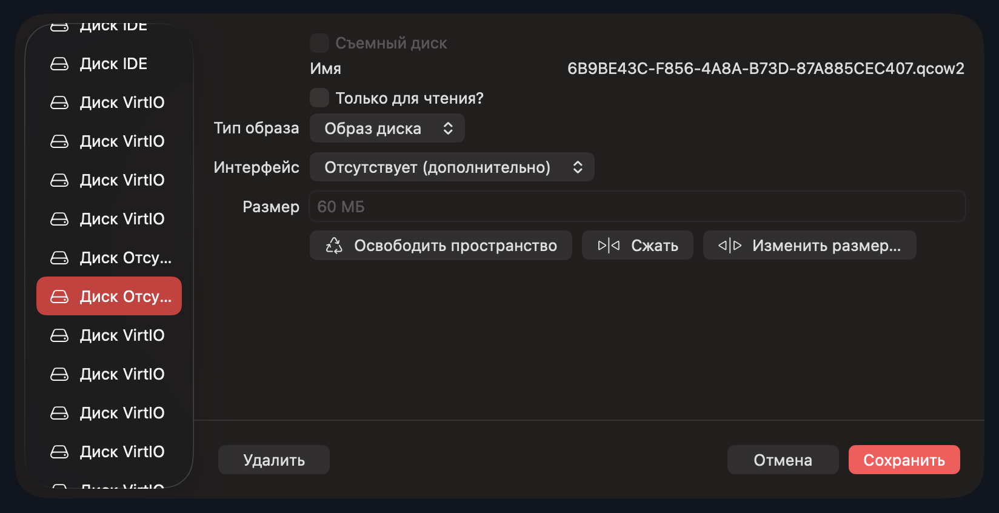
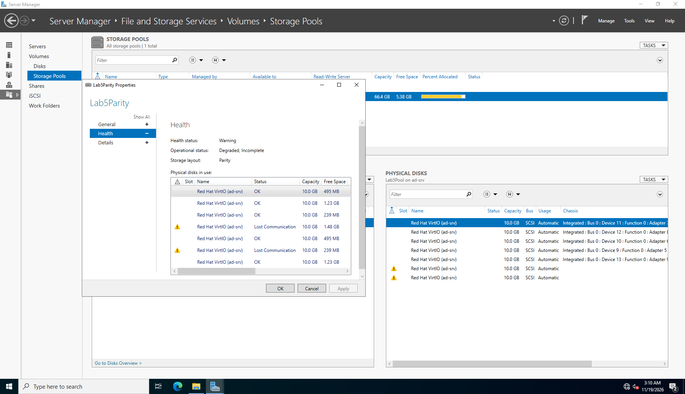
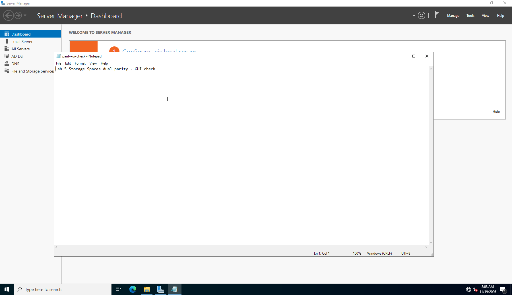

# Проверка Storage Spaces при отключении двух дисков

На сервере `ad-srv` проверили `Lab5Parity` объёмом 36 ГиБ из пула `Lab5Pool`. В пуле семь дисков по 10 ГиБ. В Server Manager открыли свойства `Lab5Parity` и на вкладке **Details** увидели значение `PhysicalDiskRedundancy = 2`

## Подготовка файла

На готовом томе `Lab5Parity (P:)` через **New -> Text Document** в Проводнике создали `parity-ui-check.txt`. Открыли его в Блокноте, ввели строку `Lab 5 Storage Spaces dual parity - GUI check` и сохранили через **File -> Save**

## Отключение двух дисков

Сверили серийные номера участников пула с именами образов в UTM. Завершили работу Windows через меню **Пуск -> Питание -> Завершение работы**. В настройках выключенного `ad-srv` выставили **Интерфейс -> Отсутствует** для образов дисков `0A88A1D7C7C64491A030` и `6B9BE43CF8564A8AB73D`. Сохранили оба изменения и запустили ВМ

## Проверка после запуска

Через Проводник заново открыли `P:\parity-ui-check.txt` в Блокноте. В файле была та же строка. В **Lab5Parity -> Properties -> Health** Server Manager показал `Warning` и `Degraded, Incomplete` у виртуального диска. У двух участников был статус `Lost Communication`, у остальных пяти - `OK`

## Возврат стенда

После завершения опыта выключили ВМ. Вернули сохранённые образы и исходную конфигурацию с семью подключёнными дисками. После запуска `Lab5Parity` вернулся в состояние `Healthy`, все семь участников показали `OK`, а файл на `P:` снова прочитался

## Термины

- **Пул** объединяет диски, на которых Storage Spaces размещает виртуальный диск
- **Двойная чётность** позволяет читать данные при потере двух участников пула
