# ЛР6. Что показать на защите

В UTM открываем `lab6-monitor-srv`. Первый сервер ЛР5 и клон используют один IP и MAC, поэтому запускаем стенды по очереди

На записи защиты преподаватель просит показать заполнение и очистку диска вживую (00:07:24, 00:09:23, 00:57:11), а затем объяснить, что сравнивали и как получили графики (01:06:29, 01:09:50, 01:11:05)

[Видео показа с подписями, 2:26](defense.mp4)

| Время в видео | Что показываем |
|---|---|
| 00:00 | Порог, действие и запуск оповещения |
| 00:31 | Заполнение `T:`, остаток до и после автоматической очистки |
| 01:15 | События 2031 и 6100, результат задачи |
| 01:38 | Два замера, CSV, скрипт построения и графики |

## 1. Включаем оповещение

1. Открываем **Performance Monitor -> Data Collector Sets -> User Defined -> Lab6-DiskAlert**
2. Правой кнопкой по **LowSpace -> Properties**. На вкладке **Alerts** показываем `LogicalDisk(T:)\% Free Space`, **Below 20** и интервал **5 Seconds**
3. На вкладке **Alert Action** показываем запись события, а на **Alert Task** - задачу `Lab6-ClearTestDisk`
4. Закрываем свойства, правой кнопкой по самому набору **Lab6-DiskAlert -> Start**. В строке набора ждём статус **Running**. Если **Start** серый при статусе **Stopped**, переоткрываем Performance Monitor

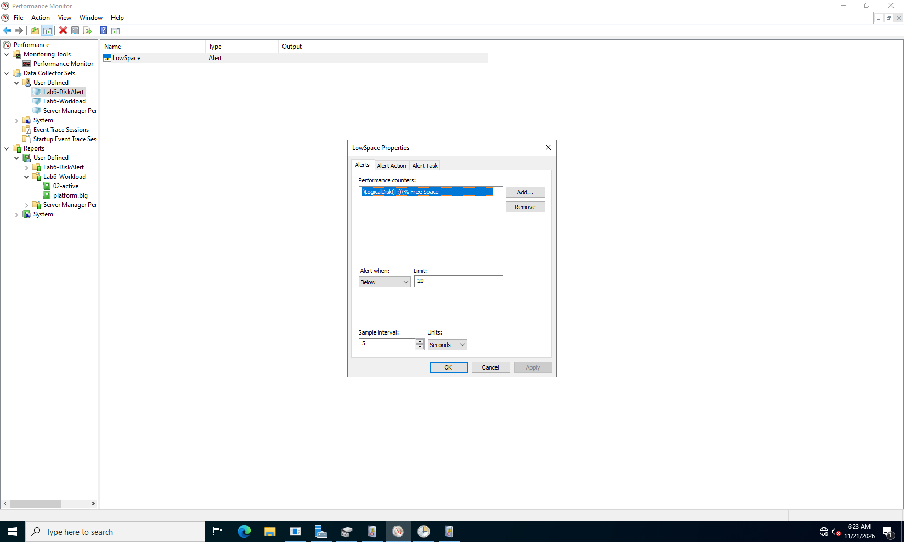

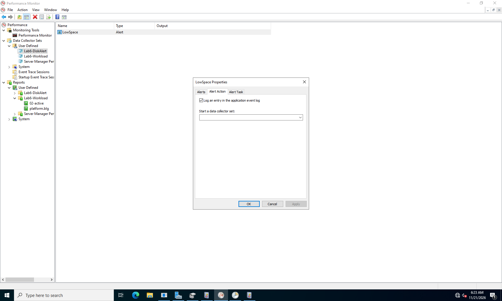

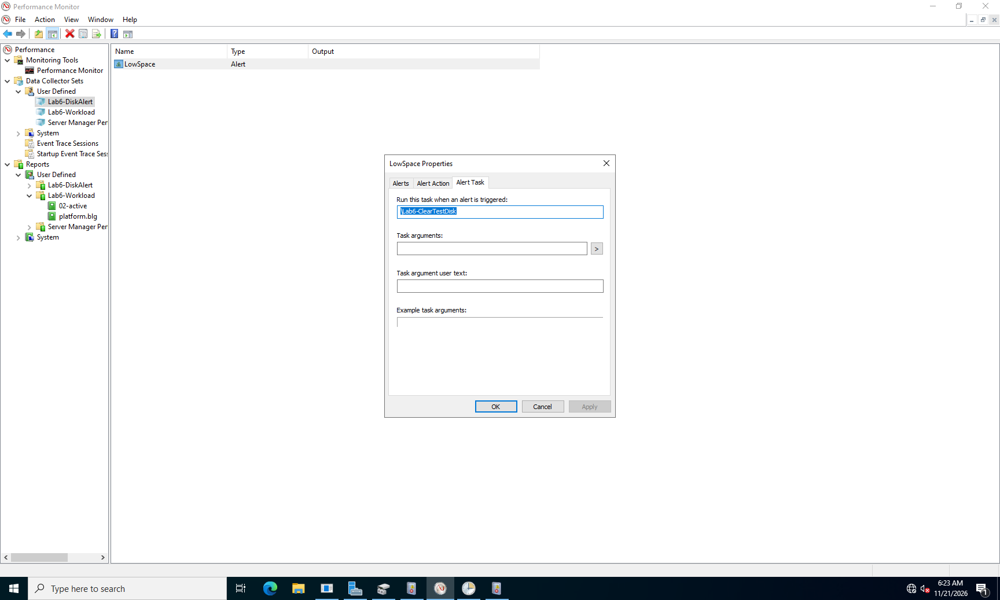

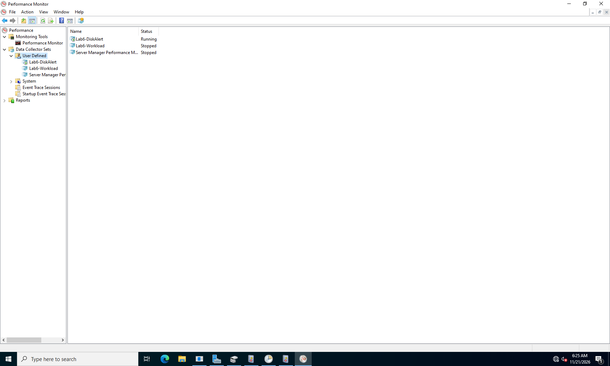

## 2. Заполняем T: и дожидаемся очистки

1. Открываем **Проводник -> Этот компьютер**. На `Lab6-Alert (T:)` до теста около 167 МиБ свободно
2. На рабочем столе дважды нажимаем ярлык **Lab6 - Fill T**. Он запускает `C:\Lab6\Fill-TestDisk.ps1`
3. Возвращаемся в **Этот компьютер**. У `Lab6-Alert (T:)` открываем **Properties** и смотрим **Free space**. Если плитка показывает старое число, обновляем список и переоткрываем свойства. В папке `T:\Lab6Fill` можно показать файлы по 768 КиБ
4. Ждём, пока задача запустится сама. После очистки папка `Lab6Fill` исчезает и свободное место восстанавливается. Свойства тома открываем заново, чтобы увидеть свежий остаток

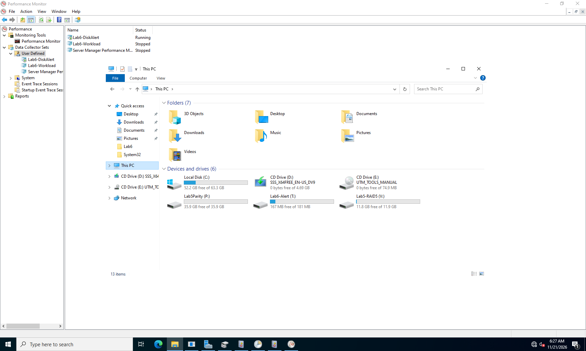

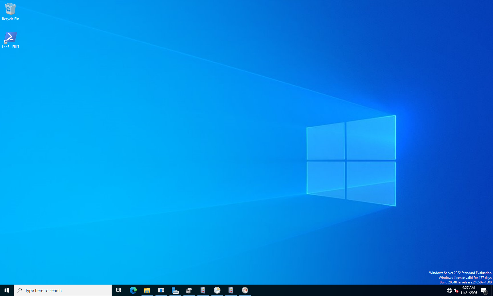

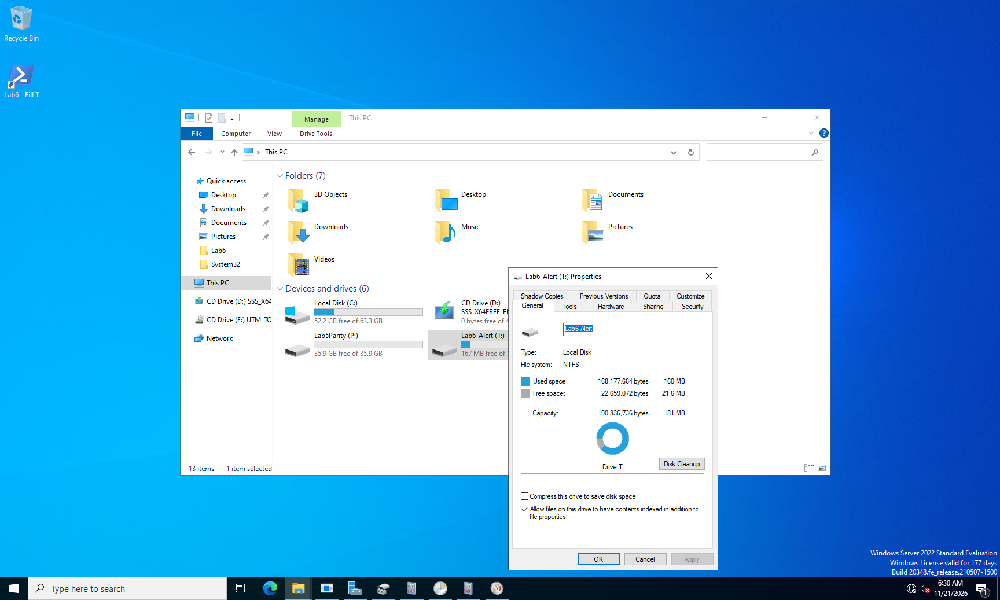

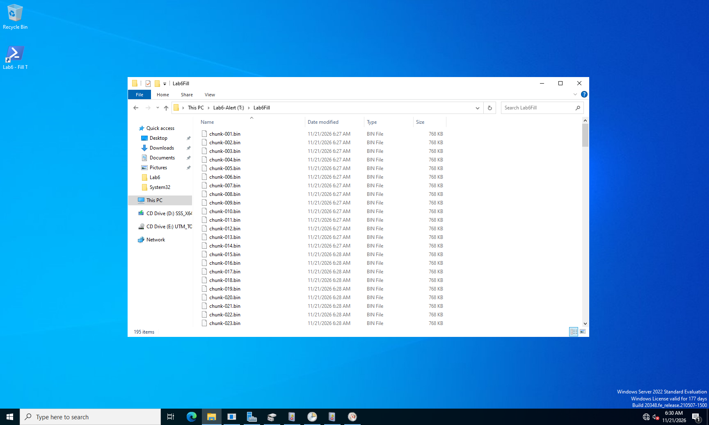

Если преподаватель спросит, почему результат появился с задержкой, интервал опроса пять секунд относится к чтению счётчика. Само значение `LogicalDisk` может некоторое время отставать от фактического остатка. В основном опыте оба счётчика тома, `% Free Space` и `Free Megabytes`, сначала показали старые значения. Экземпляр `_Total` учитывает свободное место на других томах

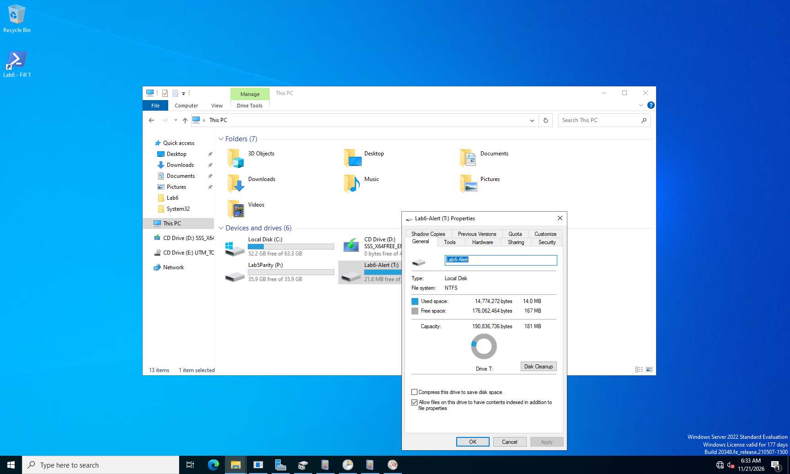

## 3. Подтверждаем автоматический запуск

1. В **Event Viewer -> Applications and Services Logs -> Microsoft -> Windows -> Diagnosis-PLA -> Operational** находим свежее событие **2031**. В сообщении видны измеренное значение и порог **20%**
2. В **Windows Logs -> Application** смотрим **6100** от `Lab6DiskCleanup`. Запись **Warning** показывает число свободных байт до и после очистки
3. В **Task Scheduler -> Task Scheduler Library** находим `Lab6-ClearTestDisk`. Смотрим **Last Run Time** и **Last Run Result**. Последний запуск может быть позже первого события: счётчик некоторое время сохраняет старое значение и оповещение повторяется. Код **0x0** означает успешное завершение

В этом прогоне событие 2031 записано в 06:30:49, Warning 6100 - в 06:31:13 по часам гостевой ОС. Первое содержит 11,60% при пороге 20%. Второе подтверждает, что очистка подняла остаток с 22 659 072 до 176 062 464 байт, то есть с 11,87% до 92,26%

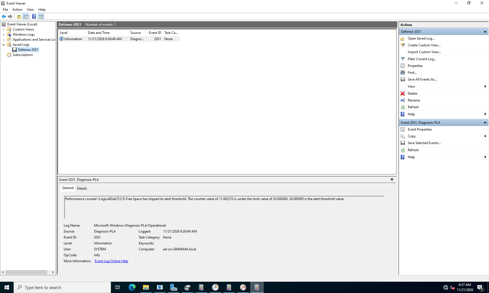

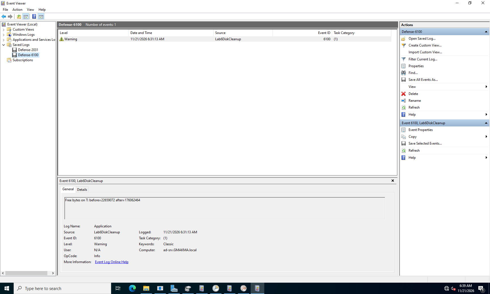

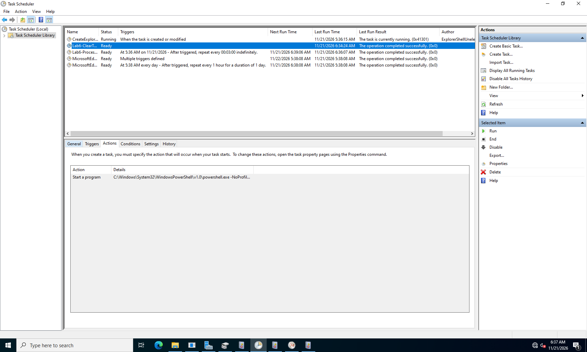

Для быстрого показа эти две записи сохранены в **Event Viewer -> Saved Logs** как **Defense-2031** и **Defense-6100**

После проверки в Performance Monitor останавливаем **Lab6-DiskAlert**, чтобы он был готов к следующему показу

## 4. Показываем, откуда взялись графики

В **Performance Monitor -> Reports -> User Defined -> Lab6-Workload** открываем `platform.blg` и `02-active`. Первый замер - обычная фоновая работа. Второй - повторное копирование файла 32 МиБ и вычисление SHA-256 копии в течение 65 секунд. Получили по 16 отметок за 75 секунд с шагом пять секунд. Для скорости и CPU первый отсчёт пуст, средние по ним рассчитаны по 15 значениям

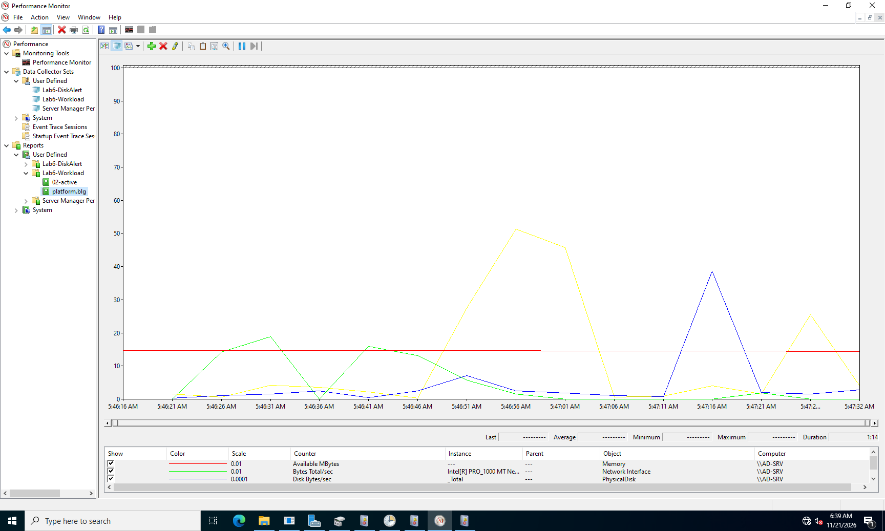

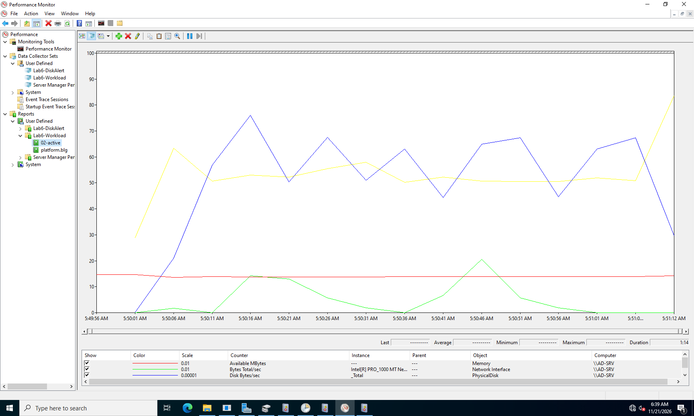

Как получился график для отчёта

1. Performance Monitor записал счётчики в **BLG**
2. `relog.exe` экспортировал из BLG замеры в **CSV**. На стенде их можно открыть в `C:\Lab6\idle.csv` и `C:\Lab6\active.csv`
3. Скрипт `plot-workload.py` прочитал два CSV и построил четыре графика с **Matplotlib**. У каждого замера отсчёт времени начинается с нуля. Готовый график на стенде лежит в `C:\Lab6\workload-comparison.png`

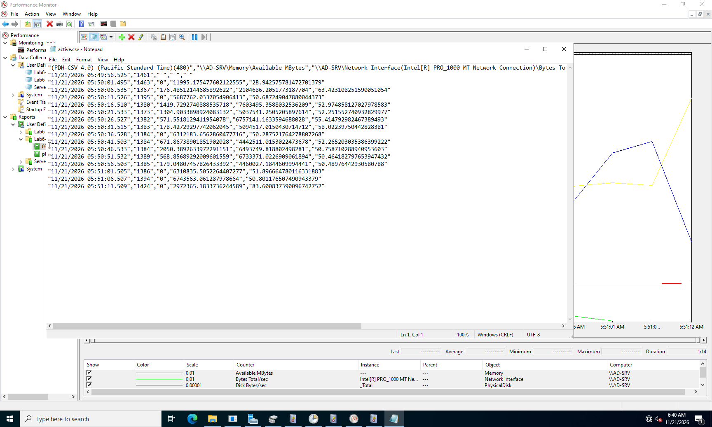

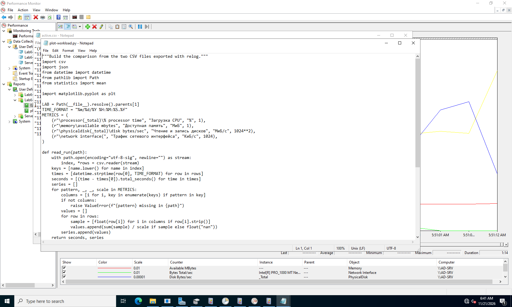

| Показатель | Фон | Копирование и SHA-256 |
|---|---:|---:|
| CPU | 11,58% | 53,49% |
| Доступная память | 1460,63 МиБ | 1395,88 МиБ |
| Дисковый обмен | 0,04 МиБ/с | 4,88 МиБ/с |
| Сетевой обмен | 0,46 КиБ/с | 0,46 КиБ/с |

Сильнее всего изменились CPU и дисковый обмен. Сетевой фон почти одинаковый, поскольку файлы копировались локально. Для вывода о насыщении диска понадобились бы ещё задержка и очередь операций

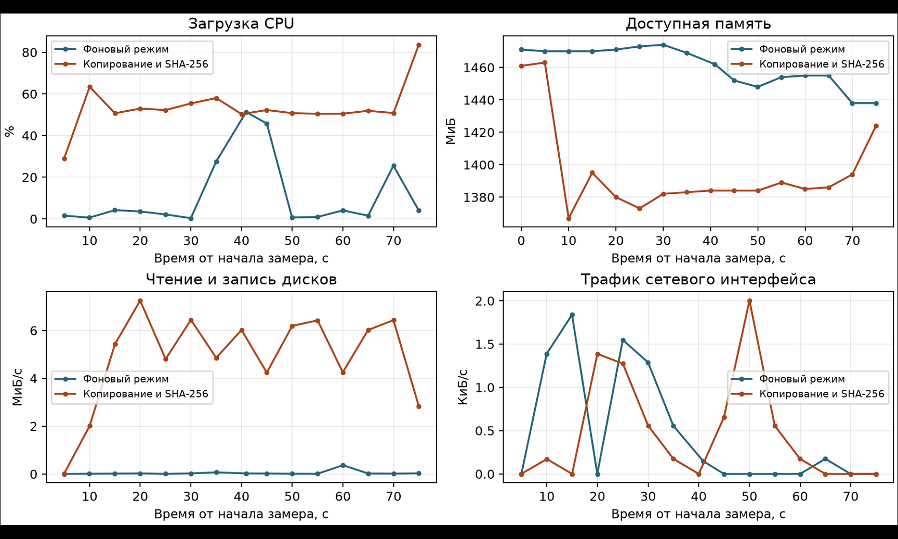

## Если попросят показать первые части

- **Task Scheduler -> Task Scheduler Library -> Lab6-ProcessMonitoring -> Triggers**. Повтор каждые три минуты. На **Conditions** проверяем условия питания
- **Event Viewer -> Applications and Services Logs -> ProcessMonitoringLog**. Событие 1000 записывает успешный экспорт CSV, 1001 - ошибку сохранения. Сами снимки лежат в `C:\Lab6\samples`
- **Event Viewer -> Custom Views -> Lab6 Administrator - failed logons**. Контрольный неудачный вход виден как событие 4625. Текстовая сводка остальных событий лежит в `C:\Lab6\system-history.txt`
