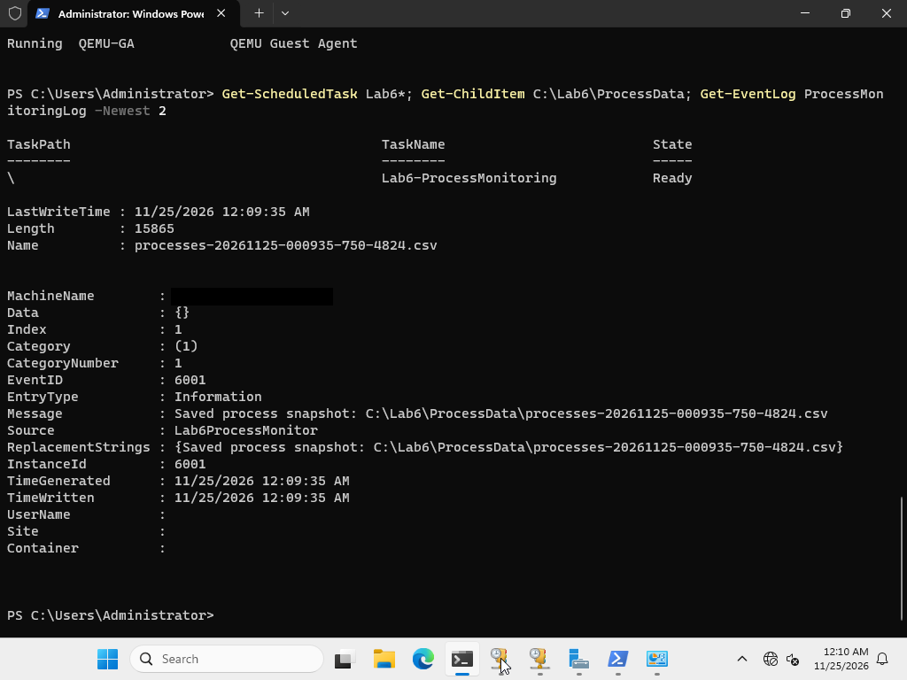
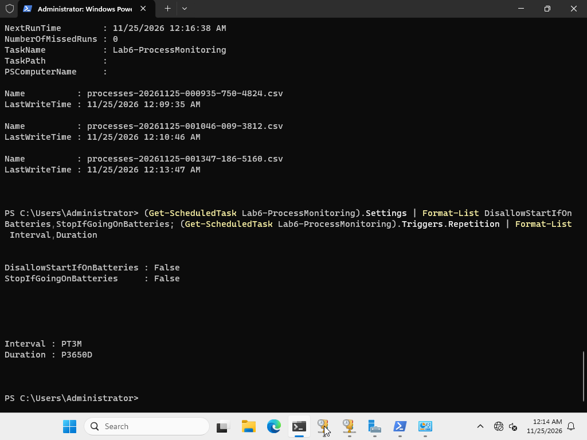
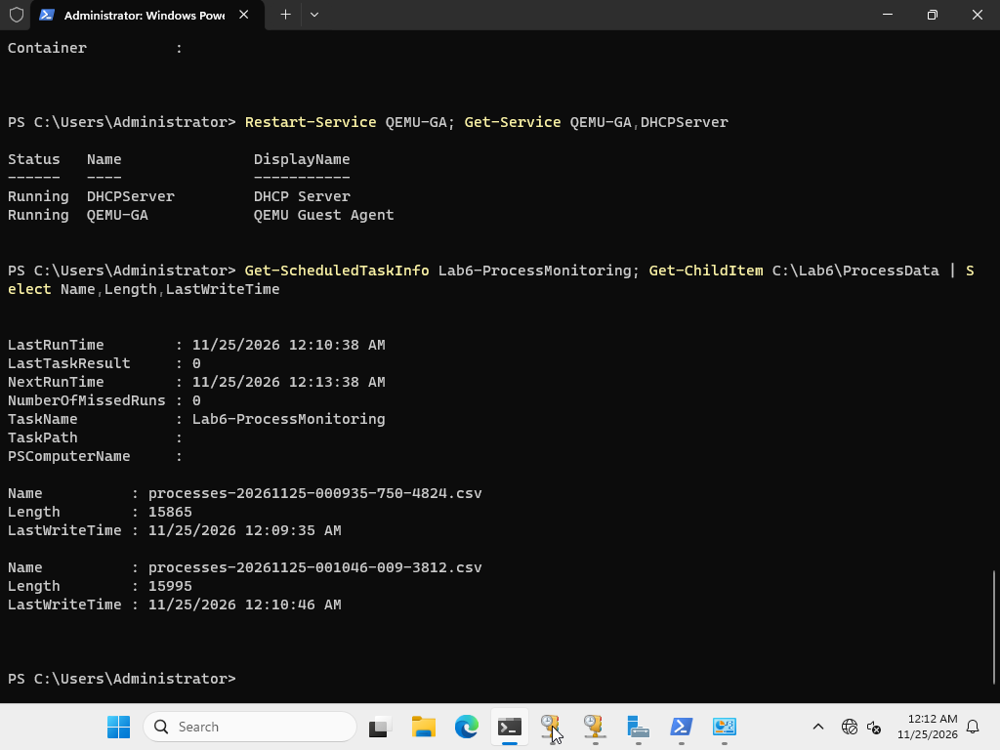
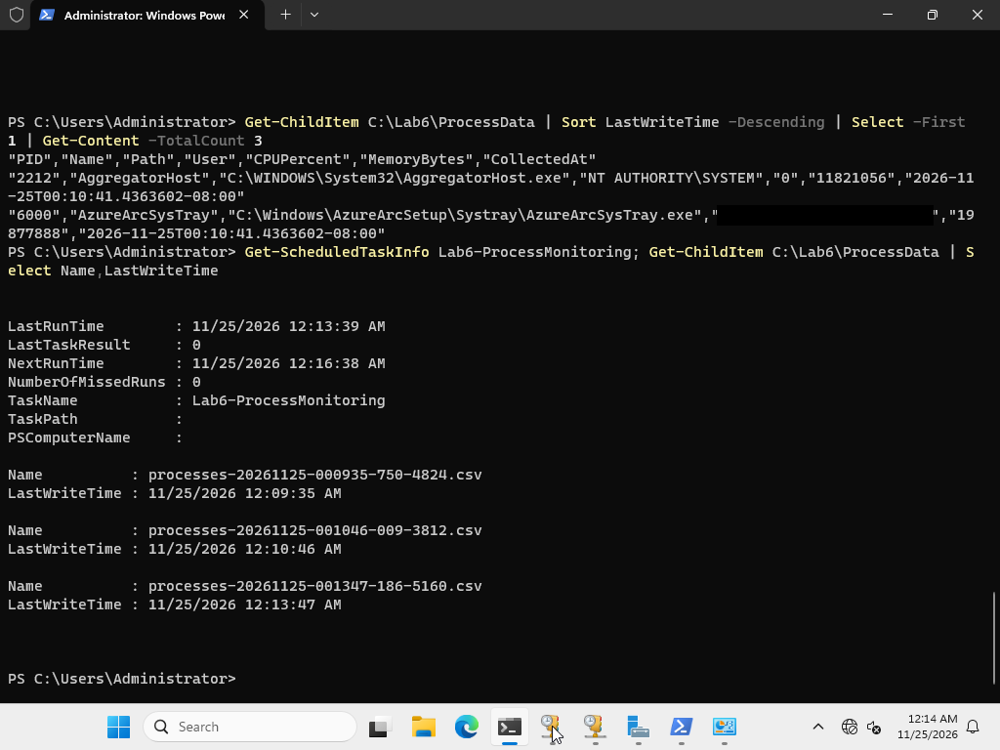

# Отчёт по практической работе №6

**Черновик:** на VM 104 подтверждены отдельные результаты частей 1 и 2; части 3–5 не выполнены. Практическая работа не завершена, отчёт не готов к сдаче.

<style>
tr { break-inside: avoid; page-break-inside: avoid; }
p code, li code, td code { font: inherit; background: none; padding: 0; border: 0; }
</style>

## Работа со средствами мониторинга и диагностики в Windows

### Цель работы

Ознакомиться со средствами мониторинга Windows и Performance Monitor, научиться собирать и анализировать данные о производительности, работать с процессами, журналами событий и планировщиком заданий

### Среда выполнения

25.11.2026: VM104 в Proxmox, Windows Server 2025 Evaluation, AD-SRV. Это отличается от предусмотренной заданием среды Windows Server 2012/2016. Остальные параметры стенда в отчёте не подтверждены.

### Используемые термины

| Термин | Значение |
|---|---|
| Счётчик производительности | Показатель состояния или активности компонента системы |
| Группа сборщиков данных | Набор сборщиков, которыми можно управлять совместно |
| ETW | Механизм трассировки событий Windows, в том числе событий ядра |
| Оповещение счётчика | Реакция на пересечение заданного порога значения счётчика |
| Настраиваемое представление | Сохранённый фильтр событий одного или нескольких журналов |

## 1. Работа с процессами

Первые три сценария переданы в `C:\Lab6\Scripts`; зафиксировано отсутствие синтаксических ошибок. Запрос статуса основного процесса завершился по тайм-ауту, поэтому результат проверен независимо в гостевой консоли.

Создание журнала `ProcessMonitoringLog` подтверждено чтением записи: событие **6001**, тип Information, источник `Lab6ProcessMonitor`, сообщение о сохранении снимка процессов в CSV. На снимке также виден CSV в `C:\Lab6\ProcessData` и задание в состоянии Ready. Имя внутреннего домена на изображении закрыто.



Фактический CSV содержит столбцы `PID`, `Name`, `Path`, `User`, `CPUPercent`, `MemoryBytes`, `CollectedAt`; примеры строк видны на снимке второго автоматического запуска ниже. Метод измерения CPU и поведение при недоступных путях или владельцах по представленным свидетельствам не установлены. Полный листинг и проверка обработки ошибок в отчёте отсутствуют.

## 2. Планирование периодического выполнения

Созданное и оставленное включённым задание `Lab6-ProcessMonitoring` имеет интервал повторения `PT3M` и продолжительность `P3650D`. Параметры `DisallowStartIfOnBatteries` и `StopIfGoingOnBatteries` равны `False`.



25.11.2026 по часам гостевой ОС зафиксированы два автоматических запуска:

| Запуск | Время запуска | Последний код | Время CSV |
|---|---|---|---|
| Первый | 00:10:38 | 0 | 00:10:46 |
| Второй | 00:13:39 | 0 | 00:13:47 |





На втором изображении закрыто имя доменной учётной записи. Учётная запись и права задания, полная команда запуска и листинг его создания здесь не подтверждены. CSV продолжают накапливаться каждые три минуты; ограничение хранения не настроено.

## 3. Работа с журналом событий

### Неудачные попытки входа администратора

Для представления предусмотрен журнал Security и событие 4625. Фильтровать нужно целевую учётную запись, а не только имя инициатора события. Если встроенная учётная запись переименована или есть одноимённые пользователи разных доменов, следует уточнить её SID или домен и проверить поля события. Наличие событий зависит от настроек аудита и срока хранения журнала

[Не заполнено: фактическое имя или SID учётной записи, параметры представления и XML-фильтр при его использовании, снимок представления и результат проверки]

### Сводка событий

[Не заполнено: листинг PowerShell, создающий текстовый файл с последними 10 включениями, последними 5 установками обновлений с названиями и количеством ошибок и предупреждений за 24 часа]

[Не заполнено: использованные журналы, источники и идентификаторы событий, границы периода и часовой пояс, путь и фактическое содержимое файла. Если записей меньше запрошенного количества, указать это явно]

Событие запуска службы журнала может использоваться как признак запуска системы, но само по себе не доказывает физическое включение. Историю обновлений нужно сопоставлять с событиями установки и указывать, какие записи охватывает выбранный источник

## 4. Сбор и анализ данных

### Группа сборщиков данных

Для сравнения предлагается собрать следующие счётчики с интервалом пять секунд. Имена приведены для английской локализации, доступность экземпляров и названия на стенде нужно проверить

| Подсистема | Предлагаемый счётчик | Назначение |
|---|---|---|
| Процессор | `Processor(_Total)\% Processor Time` | Общая загрузка процессоров |
| Память | `Memory\Available MBytes` | Объём доступной физической памяти |
| Диск | `PhysicalDisk(_Total)\Disk Bytes/sec` | Скорость чтения и записи дисковой подсистемы |
| Диск | `PhysicalDisk(_Total)\Avg. Disk sec/Transfer` | Средняя длительность дисковой операции |
| Сеть | `Network Interface(<интерфейс>)\Bytes Total/sec` | Общая скорость приёма и передачи выбранного интерфейса |

[Не заполнено: имя группы, фактически выбранные счётчики и экземпляры, путь и формат журналов, параметры сборщика событий ядра и подтверждение интервала]

### Сравнение двух ситуаций

Нагрузки следует сравнивать при одинаковом интервале и сопоставимой длительности сбора. Для обоих случаев нужно описать приложения, действия пользователя и фоновые условия

| Условие | Приложение и действия | Длительность | Результат |
|---|---|---|---|
| Ситуация 1 | [Не заполнено] | [Не заполнено] | [Не заполнено] |
| Ситуация 2 | [Не заполнено] | [Не заполнено] | [Не заполнено] |

[Не заполнено: отчёты Performance Monitor, средние и пиковые значения с единицами измерения, сравнение и первичный анализ возможных узких мест]

[Не заполнено: графики по CPU, памяти, диску и сети с подписями осей, единицами и легендой, указание исходных журналов и способа обработки]

## 5. Реакция на заполнение диска

Для проверки требуется отдельный виртуальный диск объёмом 200 МБ и раздел на нём. Очистка должна быть ограничена специально созданными тестовыми файлами на проверенном тестовом разделе, а не всеми файлами произвольного диска

[Не заполнено: параметры нового диска и раздела, буква тома, подтверждение его назначения и снимок конфигурации]

[Не заполнено: листинг сценария постепенного создания файлов размером не более 1 МБ]

[Не заполнено: листинг сценария очистки тестовых файлов и меры защиты от выбора другого тома]

[Не заполнено: имя задания очистки, его команда и учётная запись, параметры группы сборщиков, экземпляр тома, счётчик, условие менее 20%, запись предупреждения и привязка задания]

[Не заполнено: значения свободного места до и после заполнения, событие оповещения, результат запуска задания, остаток файлов и результаты повторной проверки с другими счётчиками]

## 6. Ответы на вопросы

### 1. Разделы журнала событий

В разделе Windows Logs журнал Application содержит события приложений, Security - события аудита безопасности, Setup - события установки и настройки компонентов, System - события системных компонентов и служб, Forwarded Events - события, полученные с других компьютеров. В Applications and Services Logs находятся отдельные журналы приложений и компонентов Windows, в том числе административные, оперативные, аналитические и отладочные журналы. Custom Views хранит представления с фильтрами, а не отдельные копии событий. Subscriptions содержит настройки подписок на пересылаемые события

### 2. Перенаправленные события

Forwarded Events позволяет собирать события нескольких компьютеров на одном коллекторе Windows Event Forwarding. Это упрощает централизованный просмотр, но полнота данных зависит от подписки, доступности источников и настроек аудита

### 3. Файлы журналов

По умолчанию файлы современных журналов Windows с расширением `.evtx` находятся в `%SystemRoot%\System32\winevt\Logs`. Путь конкретного журнала может быть изменён и проверяется в его свойствах

### 4. Поиск подключения устройства по VID

В Event Viewer следует открыть журналы Applications and Services Logs -> Microsoft -> Windows и проверить журналы, связанные с установкой устройств, например DeviceSetupManager и Kernel-PnP. В доступном журнале можно воспользоваться поиском по строке `VID_XXXX`, затем открыть найденные события и сопоставить время, идентификатор устройства и описание установки. VID обозначает производителя, а не конкретное устройство, поэтому для различения устройств нужны также PID и при наличии идентификатор экземпляра. Набор событий зависит от версии Windows, включённых журналов и срока их хранения. Отсутствие найденного события не доказывает, что устройство не подключалось

### 5. Выбор счётчиков

Предложенный `% Processor Time` показывает общую занятость CPU, `Available MBytes` - запас доступной памяти, а скорость и длительность дисковых операций вместе дают контекст для оценки нагрузки и задержки диска. `Bytes Total/sec` отражает обмен по выбранному сетевому интерфейсу. Один показатель не доказывает наличие узкого места: нужны сопоставление графиков и учёт выполняемой нагрузки. Это обоснование предложенного набора, фактически использованные счётчики пока не подтверждены

### 6. Подробные параметры задания через schtasks.exe

Пример запроса к заданию очистки с условным именем. Если задание находится в папке планировщика, вместо имени нужно указать полный путь к нему

```cmd
schtasks.exe /Query /TN "Lab6-Cleanup" /V /FO LIST
```

Ключ `/V` запрашивает подробные сведения, `/FO LIST` задаёт формат списка. Имя здесь только пример, фактическое задание и вывод команды не проверены

[Не заполнено: фактическое имя задания из части 5, команда и её вывод]

### 7. Выводы по проверке оповещения

Пока проверка не выполнена, причину возможного неожиданного поведения устанавливать нельзя. При сравнении следует записать точное имя и экземпляр каждого счётчика, направление и порог срабатывания, интервалы замера, время события и запуска задания. В частности, счётчик свободного места и счётчик занятого места требуют разных направлений сравнения, а неверный экземпляр может относиться к другому тому. Это возможные причины для проверки, а не результат опыта

[Не заполнено: наблюдаемое поведение, результаты замены счётчиков, подтверждённая причина или указание, что её установить не удалось]

## 7. Границы проверки

Подтверждены отдельные результаты частей 1 и 2, описанные выше; полная проверка сценариев не проведена. Части 3–5 не выполнены: представление и отчёт событий, сравнение нагрузок и опыт с заполнением диска отсутствуют. Новый диск не добавлялся, заполнение и очистка не выполнялись. Проблема QEMU guest agent не устранена: последняя проверка Proxmox сообщала, что агент не работает. Скрипт очистки до опыта требует проверки и исправления предполагаемой ошибки регулярного выражения.

## Вывод

На VM104 подтверждены создание журнала, сохранение CSV и два автоматических запуска задания. Сравнение нагрузок и проверка оповещения не выполнялись; работа остаётся незавершённой.
