# Работа со средствами мониторинга и диагностики в Windows

Стенд - Windows Server 2022 x64 в UTM

## Часть 1. Работа с процессами. Разработка скриптов.

Создаём журнал `ProcessMonitoringLog` и источник `Lab6ProcessMonitoring`. При повторном запуске скрипт сообщает, что журнал уже существует

Следующий скрипт выводит PID, имя, доступные путь и владельца, использование CPU, рабочий набор памяти в МиБ и время замера. Процент CPU рассчитываем по приращению процессорного времени за интервал наблюдения и делим на число логических процессоров. В проверенном CSV владельцы определены для 75 из 76 строк. Пустое поле осталось у системной записи Idle с PID 0. Для защищённых или исчезнувших процессов Windows может не вернуть отдельные поля

При сохранении CSV журнал получает событие 1000. При исключении пишем событие 1001 с путём и ошибкой. Проверили это на пути, у которого в качестве родительского каталога указан существующий файл

## Часть 2. Планирование периодического выполнения.

Регистрируем `Lab6-ProcessMonitoring` через PowerShell от имени `SYSTEM`. Однократный триггер имеет повтор `PT3M` без срока окончания. Условия задания разрешают запуск от батареи и работу при переходе на неё

Планировщик создал несколько файлов `processes-*.csv` в `C:\Lab6\samples`. В журнале видны последовательные записи 1000, например в 05:51:19, 05:54:18 и 05:57:17. Последний завершённый запуск вернул код 0

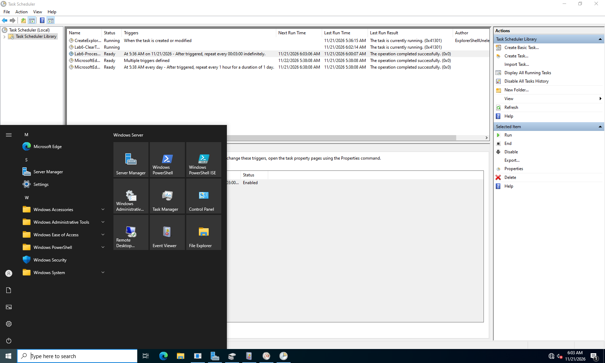

Рисунок 1: Триггер повторяет сбор процессов каждые три минуты

## Часть 3. Работа с журналом событий.

В **Event Viewer** обозреваем **Windows Logs** и **Applications and Services Logs**. Через **Import Custom View** добавляем представление **Lab6 Administrator - failed logons**. Фильтруем журнал `Security` по Event ID 4625 и по полю `TargetUserName`. Событие после контрольного неудачного входа появилось в представлении

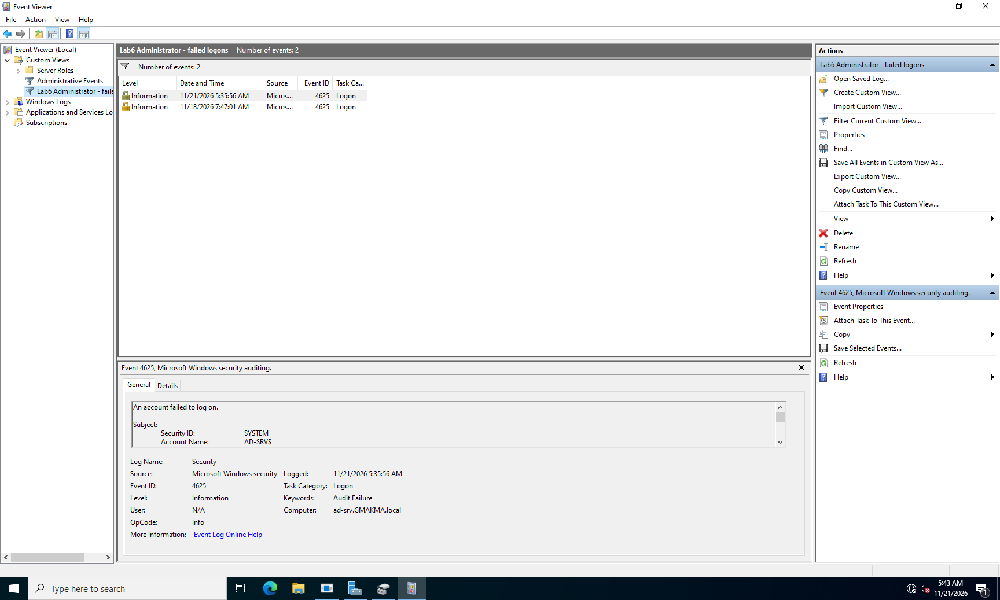

Рисунок 2: Контрольная запись 4625 в представлении для Administrator

Параметры запроса

~~~xml
<QueryList>
  <Query Id="0" Path="Security">
    <Select Path="Security">*[System[EventID=4625] and
        EventData[Data[@Name='TargetUserName']='Administrator']]</Select>
  </Query>
</QueryList>
~~~

Скрипт сохраняет историю в `C:\Lab6\system-history.txt`. Событие 12 от `Kernel-General` отмечает запуск ОС. Верхняя граница запроса - момент снятия сводки. Она исключает записи с отметкой позже момента снятия сводки

Десять последних учтённых записей о включении по часам гостевой ОС

~~~text
2026-11-19 14:12:00 -08:00
2026-11-19 10:17:33 -08:00
2026-11-19 09:30:35 -08:00
2026-11-19 01:34:39 -08:00
2026-11-19 00:54:19 -08:00
2026-11-19 00:44:06 -08:00
2026-11-19 00:29:43 -08:00
2026-11-18 22:48:18 -08:00
2026-11-18 22:40:51 -08:00
2026-11-18 09:00:36 -08:00
~~~

В `System` и `WindowsUpdateClient/Operational` событий 19 нет, история агента Windows Update пуста. DISM вернул три установленных пакета обновлений с отметками времени. Других установленных пакетов обновлений DISM не показал

| Пакет DISM | Время установки в гостевой ОС |
|---|---|
| RollupFix, 20348.587.1.7 | 03.03.2022 15:58 |
| DotNetRollup, 10.0.4465.4 | 03.03.2022 15:49 |
| ServicingStack_557, 20348.557.1.3 | 03.03.2022 15:48 |

С 06:10 20 ноября до 06:10 21 ноября 2026 года по часам гостевой ОС в журналах Application, System и Setup было 0 ошибок и 6 предупреждений

## Часть 4. Сбор и анализ данных

Регистрируем XML-набор `Lab6-Workload` штатной утилитой `logman import` и открываем его в **Performance Monitor -> Data Collector Sets -> User Defined**. В набор входят счётчик `Platform` с интервалом 5 секунд и трассировка `KernelProcess` с провайдером `Microsoft-Windows-Kernel-Process`

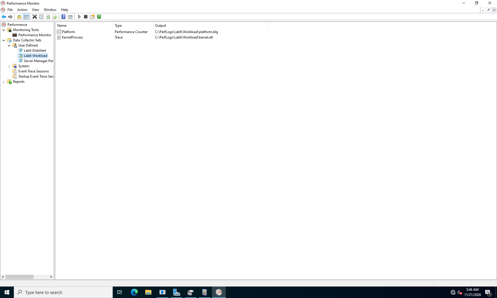

Рисунок 3: Сборщик показателей платформы и трассировка ядра в одном наборе

| Что наблюдаем | Счётчик |
|---|---|
| CPU | `Processor(_Total)\% Processor Time` |
| Память | `Memory\Available MBytes` |
| Диск | `PhysicalDisk(_Total)\Disk Bytes/sec` |
| Сеть | `Network Interface(*)\Bytes Total/sec` |

Сравниваем фоновую работу сервера с копированием файла на 32 МиБ и вычислением SHA-256 копии в течение 65 секунд. Оба замера запустили и остановили в Performance Monitor. В каждом получено по 16 отметок за 75 секунд. Для скорости и CPU первая запись пустая, поэтому средние рассчитаны по 15 значениям. В обоих ETL есть события запуска и завершения процессов от выбранного провайдера

| Показатель | Фоновый режим, среднее | Копирование и SHA-256, среднее |
|---|---:|---:|
| Процессор, % | 11,58 | 53,49 |
| Доступная память, МиБ | 1460,63 | 1395,88 |
| Чтение и запись, МиБ/с | 0,04 | 4,88 |
| Сеть, КиБ/с | 0,46 | 0,46 |

В **Reports -> User Defined -> Lab6-Workload** открываем `platform.blg` и `02-active`. На первом графике видны отдельные пики, на втором CPU и дисковый счётчик дольше остаются выше фона. Шкала Performance Monitor применяет разные коэффициенты к линиям, поэтому для сравнения абсолютных значений использовали CSV

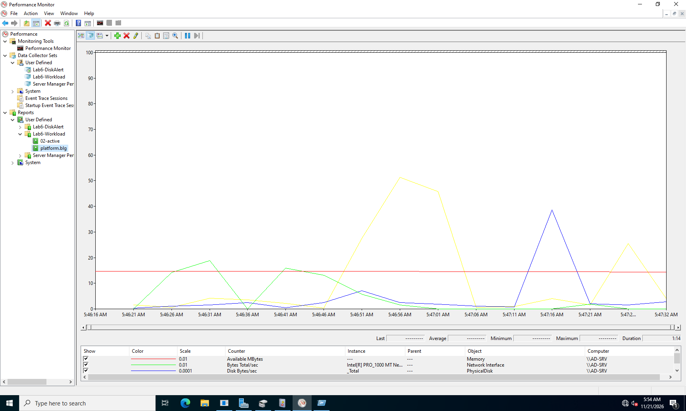

Рисунок 4: Фоновый замер в Reports

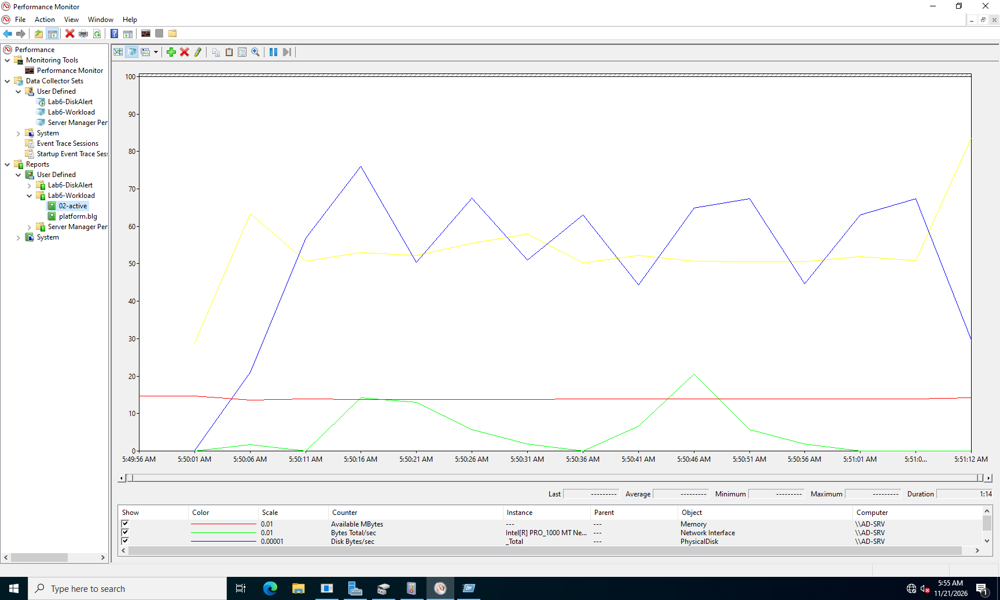

Рисунок 5: Замер с копированием и хешированием в Reports

Под нагрузкой пиковое использование CPU выросло с 51,32 до 83,60%. Сильнее всего изменились CPU и дисковый обмен. Доступной памяти стало примерно на 65 МиБ меньше, сетевой фон остался близким. Пропускная способность показывает объём операций, а для вывода о насыщении диска понадобились бы ещё задержка и длина очереди

Для сопоставления по времени конвертируем BLG в CSV утилитой `relog.exe`. На графике обе серии начинаются с нулевой отметки соответствующего замера

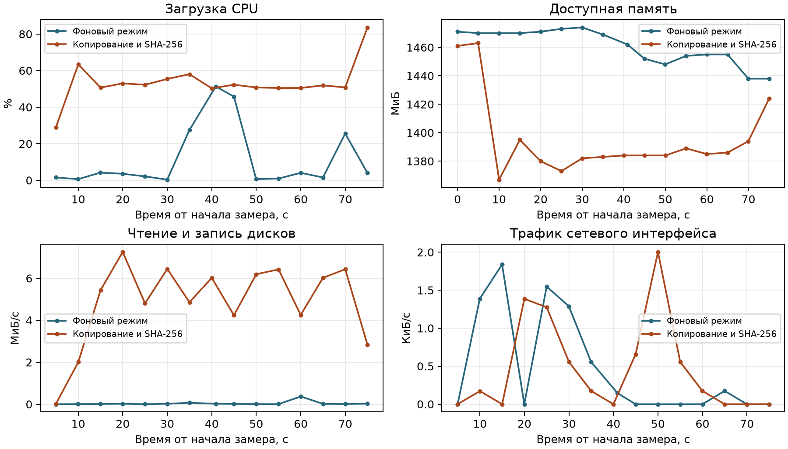

Рисунок 6: Замеры CPU, памяти, диска и сети в двух режимах

## Часть 5. Автоматизация реакции системы на ее состояние

В UTM добавляем виртуальный диск 200 МиБ. В **Disk Management** сверяем диск по размеру, переводим его в Online, инициализируем в GPT и создаём простой том NTFS `T:` с меткой `Lab6-Alert`. Windows показывает 182 МиБ на готовом томе

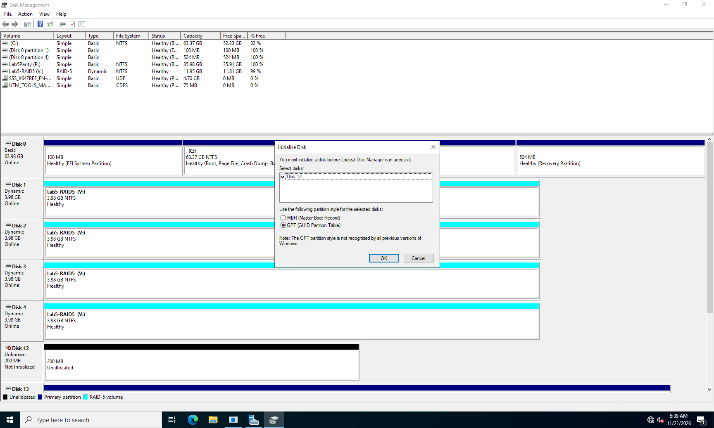

Рисунок 7: Инициализация нового диска 200 МиБ

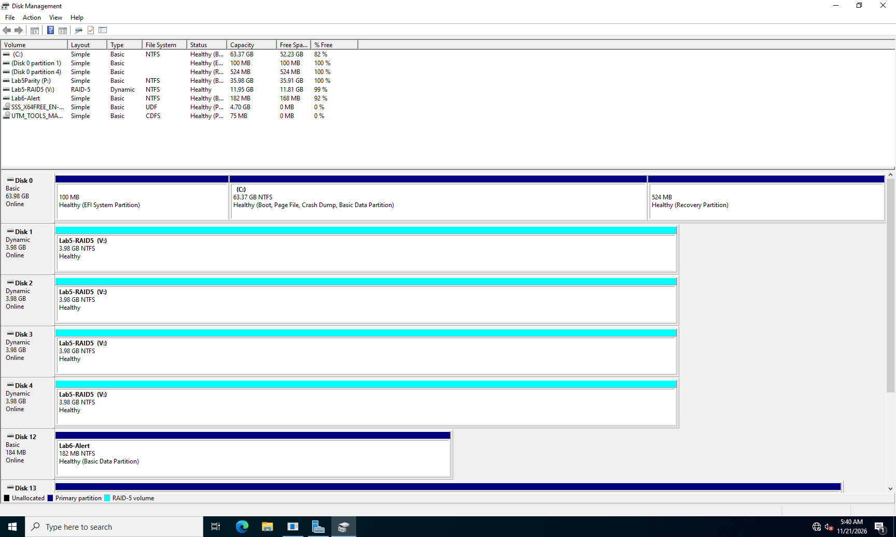

Рисунок 8: Том Lab6-Alert (T:) после выделения места под GPT и NTFS

Скрипт заполнения пишет на `T:` файлы по 768 КиБ с паузой 250 мс. Скрипт очистки проверяет букву и метку тома и удаляет файлы своего формата. В Task Scheduler регистрируем `Lab6-ClearTestDisk`, которая запускает очистку от `SYSTEM`

Импортируем XML-набор `Lab6-DiskAlert` и в Performance Monitor открываем свойства оповещения `LowSpace`. Счётчик `LogicalDisk(T:)\% Free Space` проверяется раз в пять секунд. Условие - строго меньше 20%. Включаем запись о срабатывании в журнал и связываем оповещение с задачей `Lab6-ClearTestDisk`

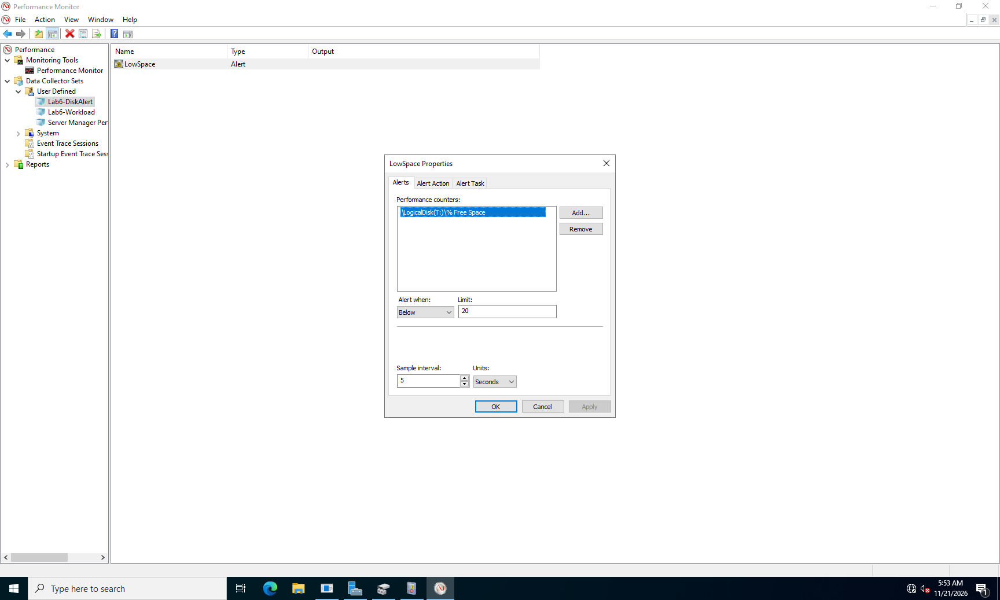

Рисунок 9: Условие Below 20 и интервал пять секунд

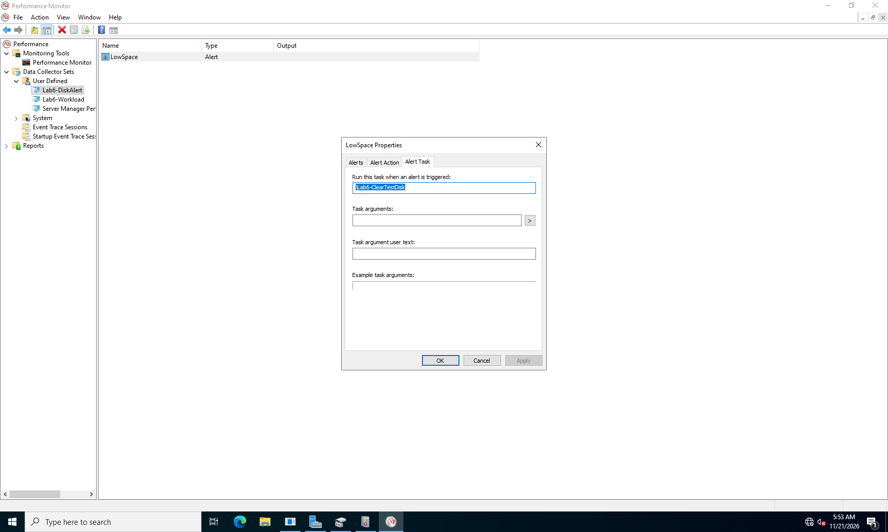

Рисунок 10: Вкладка Alert Task с задачей Lab6-ClearTestDisk

В контрольном прогоне фактическое свободное место упало до 22 659 072 байт, около 11,87%. Сразу после заполнения оба счётчика `LogicalDisk(T:)` ещё показывали прежние 92,27% и 167 МиБ. В рабочем прогоне после обновления показаний те же счётчики показали 11,60% и 21 МиБ. Показатель `LogicalDisk(_Total)\% Free Space` остался около 89,30%, поскольку учитывает остальные тома

| Запись рабочего прогона | Время гостевой ОС | Наблюдение |
|---|---|---|
| Diagnosis-PLA/Operational, 2031 | 05:59:24 | 11,602210% ниже порога 20% |
| Application, 6100, Warning | 05:59:35 | Задача очистки освободила место с 22 659 072 до 176 062 464 байт |

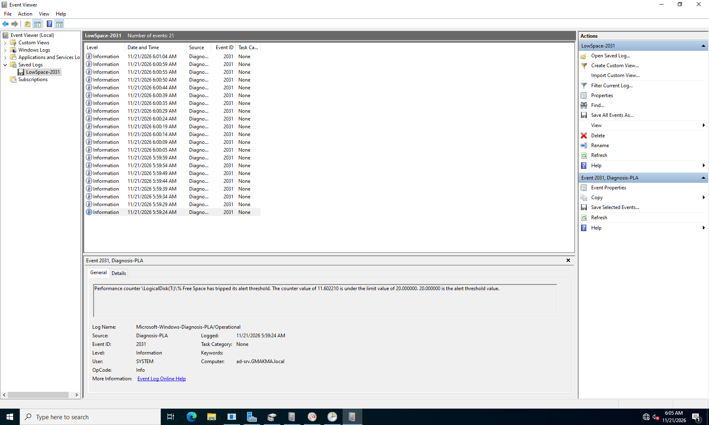

Рисунок 11: В Event Viewer видно, что показание стало ниже 20%

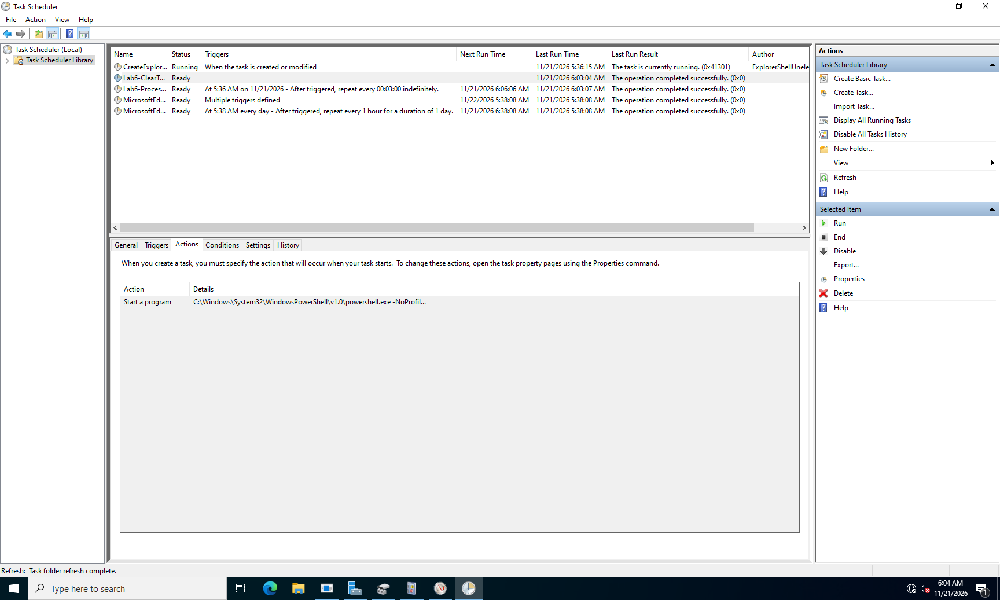

Рисунок 12: Задача очистки завершилась с результатом 0x0

После запуска задачи на `T:` снова свободно 92,26%. Запись 2031 имеет уровень Information и содержит само условие оповещения. Скрипт очистки дополнительно пишет Warning с числом байт до и после. После опыта остановили сборщик оповещений, чтобы стенд был готов к повторному запуску

## Вопросы

### 1. В чем назначение каждого из разделов журнала событий?

| Раздел Windows Logs | Какие события содержит |
|---|---|
| Application | События приложений и прикладных служб |
| Security | Результаты аудита входа, доступа и других операций согласно политике аудита |
| Setup | Установка и обслуживание компонентов Windows |
| System | Запуск и остановка ОС, события драйверов и системных служб |
| Forwarded Events | События, собранные с других компьютеров |

В разделе **Applications and Services Logs** провайдеры ведут отдельные журналы компонентов. **Custom Views** показывают результаты заданных фильтров по одним или нескольким журналам

### 2. Зачем нужен раздел Перенаправленные события?

Компьютер с Windows Event Collector может получать события других машин через подписки. В **Forwarded Events** удобно проверять журнал нескольких серверов с одного узла. Способ доставки и список событий задаются подпиской

### 3. Где находится журналы событий Windows в виде файлов?

По умолчанию файлы `.evtx` находятся в `%SystemRoot%\System32\winevt\Logs`. Фактический путь для выбранного канала виден в его свойствах в Event Viewer

### 4. Как с помощью графической оснастки журнала событий установить по известному VID коду, когда было подключено и настроено устройство?

Открываем **Applications and Services Logs -> Microsoft -> Windows -> Kernel-PnP -> Configuration**. Через **Find** ищем `VID_XXXX` и находим совпадение в **Details -> XML View** по полю `DeviceInstanceId`. Если устройств производителя несколько, уточняем по PID и полному ID экземпляра. У события 400 смотрим время настройки, у 410 - время запуска устройства. Эти отметки относятся к настройке и запуску драйвера. Точное время физического подключения можно подтвердить по записи о подключении того же экземпляра, если такая запись сохранилась

### 5. Почему были выбраны конкретные счетчики в Части 4 п.1? Обоснуйте выбор.

`% Processor Time` измеряет занятость процессора. `Available MBytes` показывает память, доступную для выделения. `Disk Bytes/sec` показывает пропускную нагрузку чтения и записи, поэтому подходит для сравнения файла и фона. `Bytes Total/sec` показывает приём и передачу по каждому интерфейсу. Он помогает отделить локальную дисковую работу от сетевого обмена

### 6. Как получить на консоль подробные параметры запланированного задания с помощью утилиты schtasks.exe? Проиллюстрируйте ответ на примере задания из части 5.

~~~powershell
schtasks.exe /Query /TN "\Lab6-ClearTestDisk" /FO LIST /V
~~~

`/TN` ограничивает запрос одним заданием, `/FO LIST` выводит поля списком, `/V` добавляет подробности. В выводе видны путь к `Clear-TestDisk.ps1`, учётная запись `SYSTEM`, тип `On demand only` и результат последнего запуска. После завершения очистки и остановки коллектора результат задачи равен 0

Пример полей фактического вывода

~~~text
TaskName:             \Lab6-ClearTestDisk
Last Result:          0
Run As User:          SYSTEM
Schedule Type:        On demand only
~~~

### 7. Опишите ваши выводы по пункту 5. Части 5.

Интервал сборщика в пять секунд определяет, как часто он читает счётчик. Обновление самого значения свободного места может запаздывать. При параллельной проверке `Free Megabytes` также показал старое значение. После очистки устаревшие низкие показания ещё несколько раз запускали оповещение, поэтому повторное выполнение очистки должно безопасно работать на пустом томе. Для порога по одному разделу выбираем экземпляр `T:`, так как `_Total` в нашем опыте скрывал заполнение небольшого тома

## Термины

- **Рабочий набор** - физическая память, занятая страницами процесса в момент замера
- **ETW** - механизм трассировки Windows. Файл ETL содержит записанные события провайдера
- **PLA** - служба Windows, которая управляет наборами сборщиков и оповещениями Performance Monitor

## Скрипты

### Часть 1. Создание журнала

`New-ProcessLog.ps1`

~~~powershell
$ErrorActionPreference = 'Stop'
$log = 'ProcessMonitoringLog'
if ([System.Diagnostics.EventLog]::Exists($log)) {
    Write-Output "Event log $log already exists."
    return
}

New-EventLog -LogName $log -Source 'Lab6ProcessMonitoring'
Write-Output "Created event log $log."
~~~

### Часть 1. Снимок процессов и CSV

`Save-ProcessSample.ps1`

~~~powershell
param(
    [string]$CsvPath = (Join-Path $PSScriptRoot ('samples\processes-{0:yyyyMMdd-HHmmssfff}.csv' -f (Get-Date)))
)
$ErrorActionPreference = 'Stop'
$log = 'ProcessMonitoringLog'
$source = 'Lab6ProcessMonitoring'

try {
    $owners = @{}
    foreach ($process in Get-CimInstance Win32_Process) {
        $owner = Invoke-CimMethod -InputObject $process -MethodName GetOwner -ErrorAction SilentlyContinue
        if ($owner.ReturnValue -eq 0) {
            $owners[[int]$process.ProcessId] = "$($owner.Domain)\$($owner.User)"
        }
    }

    $before = @{}
    $timer = [Diagnostics.Stopwatch]::StartNew()
    foreach ($process in Get-Process) {
        if ($null -ne $process.CPU) {
            try { $before[$process.Id] = @($process.CPU, $process.StartTime) } catch { }
        }
    }
    Start-Sleep -Seconds 1
    $processes = Get-Process
    $interval = $timer.Elapsed.TotalSeconds
    $sampleTime = Get-Date -Format o
    $cores = [Environment]::ProcessorCount
    $rows = foreach ($process in $processes) {
        $cpu = $null
        if ($before.ContainsKey($process.Id) -and $null -ne $process.CPU) {
            try {
                if ($process.StartTime -eq $before[$process.Id][1]) {
                    $cpu = [math]::Round(100 * ($process.CPU - $before[$process.Id][0]) / ($cores * $interval), 2)
                }
            } catch { }
        }
        try { $path = $process.Path } catch { $path = $null }
        [pscustomobject]@{
            PID = $process.Id
            Name = $process.ProcessName
            Path = $path
            User = $owners[$process.Id]
            CPUPercent = $cpu
            WorkingSetMiB = [math]::Round($process.WorkingSet64 / 1MB, 2)
            SampleTime = $sampleTime
        }
    }

    $rows | Write-Output
    New-Item -ItemType Directory -Force -Path (Split-Path -Parent $CsvPath) | Out-Null
    $rows | Export-Csv -LiteralPath $CsvPath -NoTypeInformation -Encoding UTF8
    Write-EventLog -LogName $log -Source $source -EntryType Information -EventId 1000 -Message "Saved $($rows.Count) processes to $CsvPath."
} catch {
    Write-EventLog -LogName $log -Source $source -EntryType Error -EventId 1001 -Message "Sample failed for ${CsvPath}: $($_.Exception.Message)"
    throw
}
~~~

### Часть 2. Задание с повтором в три минуты

`Register-ProcessTask.ps1`

~~~powershell
$ErrorActionPreference = 'Stop'
$ps = "$PSHOME\powershell.exe"
$script = Join-Path $PSScriptRoot 'Save-ProcessSample.ps1'
$action = New-ScheduledTaskAction -Execute $ps -Argument ('-NoProfile -File "{0}"' -f $script)
$trigger = New-ScheduledTaskTrigger -Once -At (Get-Date).AddMinutes(1) -RepetitionInterval (New-TimeSpan -Minutes 3)
$settings = New-ScheduledTaskSettingsSet -AllowStartIfOnBatteries -DontStopIfGoingOnBatteries -MultipleInstances IgnoreNew
Register-ScheduledTask -TaskName 'Lab6-ProcessMonitoring' -Action $action -Trigger $trigger -Settings $settings -User SYSTEM -RunLevel Highest -Force
~~~

### Часть 3. Сводка системных событий

`Get-SystemHistory.ps1`

~~~powershell
param([string]$OutputPath = (Join-Path $PSScriptRoot 'system-history.txt'))
$ErrorActionPreference = 'Stop'
function Find-Events($Filter, $Limit) {
    try {
        if ($Limit) { Get-WinEvent -FilterHashtable $Filter -MaxEvents $Limit }
        else { Get-WinEvent -FilterHashtable $Filter }
    } catch {
        if ($_.FullyQualifiedErrorId -notlike 'NoMatchingEventsFound*') { throw }
    }
}

$now = Get-Date
$boots = @(Find-Events @{
    LogName='System'; ProviderName='Microsoft-Windows-Kernel-General'; Id=12; EndTime=$now
} 10)
$history = Find-Events @{
    LogName=@('System','Microsoft-Windows-WindowsUpdateClient/Operational')
    ProviderName='Microsoft-Windows-WindowsUpdateClient'; Id=19; EndTime=$now
} 5
$updates = @($history | ForEach-Object {
    [pscustomobject]@{ Date = $_.TimeCreated; Title = $_.Properties[0].Value }
})
if ($updates.Count -eq 0) {
    $updates = @(Get-WindowsPackage -Online | Where-Object {
        $_.PackageState -eq 'Installed' -and $_.ReleaseType -match 'Update|Hotfix' -and
            $_.InstallTime -and $_.InstallTime -le $now
    } | Sort-Object InstallTime -Descending | Select-Object -First 5 | ForEach-Object {
        [pscustomobject]@{ Date = $_.InstallTime; Title = $_.PackageName }
    })
}
$since = $now.AddHours(-24)
$events = @(Find-Events @{
    LogName=@('Application','System','Setup'); Level=@(2,3); StartTime=$since; EndTime=$now
})
@(
    "Boots found: $($boots.Count) (maximum 10)"
    $boots | ForEach-Object { $_.TimeCreated.ToString('yyyy-MM-dd HH:mm:ss zzz') }
    ''
    "Successful updates found: $($updates.Count) (maximum 5)"
    $updates | ForEach-Object { '{0:yyyy-MM-dd HH:mm:ss}  {1}' -f $_.Date, $_.Title }
    ''
    "Application, System, Setup from $($since.ToString('o')) to $($now.ToString('o'))"
    "Errors: $(@($events | Where-Object Level -eq 2).Count)"
    "Warnings: $(@($events | Where-Object Level -eq 3).Count)"
) | Set-Content -LiteralPath $OutputPath -Encoding UTF8
~~~

### Часть 5. Заполнение тома

`Fill-TestDisk.ps1`

~~~powershell
$ErrorActionPreference = 'Stop'
$volume = Get-Volume -DriveLetter T
if ($volume.FileSystemLabel -ne 'Lab6-Alert' -or $volume.Size -gt 200MB) {
    throw 'T: must be the Lab6-Alert volume.'
}

$directory = 'T:\Lab6Fill'
if (Test-Path -LiteralPath $directory) { throw 'Clear the previous run first.' }
$null = New-Item -ItemType Directory -Path $directory
$payload = New-Object byte[] (768KB)
[Random]::new(6).NextBytes($payload)
$drive = [IO.DriveInfo]::new('T')

for ($i = 1; $i -le 260; $i++) {
    if (-not (Test-Path -LiteralPath $directory)) { break }
    if ($drive.AvailableFreeSpace / $volume.Size -lt 0.12) { break }
    try {
        $file = Join-Path $directory ('chunk-{0:D3}.bin' -f $i)
        [IO.File]::WriteAllBytes($file, $payload)
    } catch [IO.DirectoryNotFoundException] {
        break
    }
    Start-Sleep -Milliseconds 250
}

Get-Volume -DriveLetter T | Select-Object DriveLetter,Size,SizeRemaining
~~~

### Часть 5. Очистка тома

`Clear-TestDisk.ps1`

~~~powershell
$ErrorActionPreference = 'Stop'
$volume = Get-Volume -DriveLetter T
if ($volume.FileSystemLabel -ne 'Lab6-Alert' -or $volume.Size -gt 200MB) {
    throw 'T: must be the Lab6-Alert volume.'
}

$before = $volume.SizeRemaining
$directory = 'T:\Lab6Fill'
if (Test-Path -LiteralPath $directory) {
    if ((Get-Item -LiteralPath $directory).Attributes -band [IO.FileAttributes]::ReparsePoint) {
        throw 'Refusing to clean a reparse point.'
    }
    $cleanup = 'T:\Lab6Fill-Cleanup'
    if (Test-Path -LiteralPath $cleanup) { throw 'Previous cleanup is unfinished.' }
    Rename-Item -LiteralPath $directory -NewName 'Lab6Fill-Cleanup'

    $items = @(Get-ChildItem -LiteralPath $cleanup -Force)
    if ($items | Where-Object { $_.PSIsContainer -or $_.Name -notmatch '^chunk-\d{3}\.bin$' -or
            ($_.Attributes -band [IO.FileAttributes]::ReparsePoint) }) {
        throw 'Unexpected entries in the cleanup directory.'
    }
    $items | Remove-Item -Force
    Remove-Item -LiteralPath $cleanup
}

$after = (Get-Volume -DriveLetter T).SizeRemaining
$type = if ($before / $volume.Size -lt 0.20) { 'Warning' } else { 'Information' }
Write-EventLog -LogName Application -Source 'Lab6DiskCleanup' -EntryType $type -EventId 6100 `
    -Message "Free bytes on T: before=$before after=$after"
~~~

### Часть 5. Регистрация задачи очистки

`Register-CleanupTask.ps1`

~~~powershell
$ErrorActionPreference = 'Stop'
if (-not [Diagnostics.EventLog]::SourceExists('Lab6DiskCleanup')) {
    New-EventLog -LogName Application -Source 'Lab6DiskCleanup'
}
$script = Join-Path $PSScriptRoot 'Clear-TestDisk.ps1'
$action = New-ScheduledTaskAction -Execute "$PSHOME\powershell.exe" -Argument ('-NoProfile -File "{0}"' -f $script)
$settings = New-ScheduledTaskSettingsSet -AllowStartIfOnBatteries -DontStopIfGoingOnBatteries -MultipleInstances IgnoreNew
Register-ScheduledTask -TaskName 'Lab6-ClearTestDisk' -Action $action -Settings $settings -User SYSTEM -RunLevel Highest -Force
~~~
